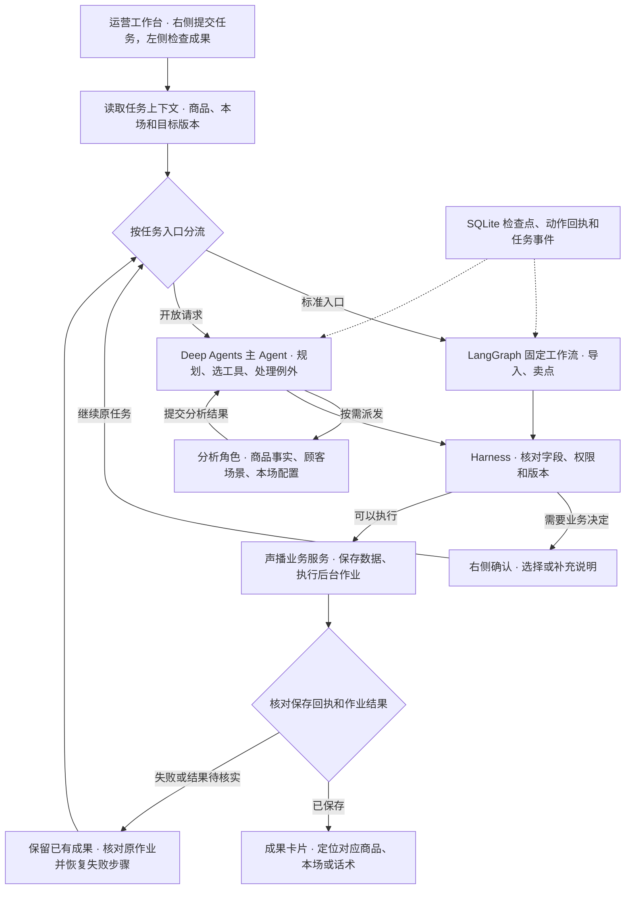

# 声播 · 数字人直播运营工作台

**把商品资料整理成可核对、可编辑、可试播的直播准备成果。**

声播面向电商直播运营和主播。开播前，他们要从规格表、商品文档和活动说明中确认每款商品的卖点、价格与优惠，再写话术、排播并准备语音。资料往往分散在几份文档里，一次改价或换款就可能牵动多个环节。声播把这些工作放进一个本地工作台，让运营在右侧交代任务，在左侧核对并编辑实际保存的商品、本场配置和话术。

## 我如何定义这个产品

我把播前准备拆成三个可以分别管理的业务对象。

| 业务对象 | 用户要解决的问题 | 产品怎么处理 |
| --- | --- | --- |
| **商品知识库** | 多款商品规格容易串，下一场还得重新整理资料 | 按 SKU 保存日常售价、规格、使用限制、常见问答和卖点，供不同场次引用 |
| **直播间与本场配置** | 同一商品在不同场次可能有不同活动价、优惠门槛和截止时间 | 直播间绑定商品，活动价、优惠券、适用款式与时段随本场保存。生成话术时一起读取商品事实和本场规则 |
| **话术与播出准备** | 一版稿要能反复检查、局部修改和调换顺序 | 从顾客场景和核心卖点生成版本化话术，按开场、介绍、卖点、活动和促单等模块保存。运营审阅、排序、准备语音并决定采用与开播 |

一条典型旅程是**上传多款商品资料 → 确认入库并绑定直播间 → 核对本场活动 → 补核心卖点 → 生成话术 → 审阅并准备语音**。已有直播间也可以上传本场资料。用户可以点击 Agent 的成果入口，直接打开对应商品或话术版本。

## 三个设计取舍

1. **把高频任务做成明确入口。** 上传商品、生成卖点等动作可以由按钮携带目标和范围。开放请求仍可用对话表达，交给主 Agent 决定需要哪些步骤。这样用户既能快速办常规任务，也能描述具体的修改要求。
2. **把判断和写入分开。** 模型擅长理解资料、整理顾客场景和写话术。程序负责核对商品身份、业务字段、版本和写入范围。涉及入库选择、草稿冲突或采用播出内容时，用户在相应界面作决定。
3. **把完成定义在业务结果上。** 用户要看的是哪款商品入库了、哪个场次存了优惠、哪版稿可以打开。工作台区分已提交、生成中、部分完成和已保存。后台以保存回执及实际读回为依据，补救时沿用已确认的成果。

## Agent 与 Harness 如何协作

**Deep Agents** 承载主 Agent 和按需分析的角色。**Skill** 提供各角色的业务规则与操作方法。**LangGraph 工作流**把已明确的步骤、条件和恢复位置写进程序。长资料、报告和稿件按需读取，任务检查点与动作回执支持暂停后继续，也帮助判断一次写入是否已经发生。 [Deep Agents 官方文档](https://docs.langchain.com/oss/python/deepagents/overview)

## 怎么验收

验收同时看三件事。内容上核对款式、价格和优惠条件，操作上确认成果真正保存且能在页面重新打开，效率上分别统计模型请求、后台作业和人工等待。

| 正式网页样例 | 观察结果 |
| --- | --- |
| 上传双款商品资料 | **1 次模型请求，48.33 秒**，含入库确认。两款实际入库、建房并绑定，日常价与本场活动价分别保存 |
| 在同一直播间重传同一份资料 | **0 次模型请求，5.73 秒**，复用已有商品和直播间 |
| 从原任务续跑一版话术 | 实际保存 **2,239 个有效口播字**，按每分钟 240 字估算约 9.3 分钟。整稿调用 1 次，保存后主 Agent 调用 0 次 |

以上是本地正式工作台的单次验收样例。话术样例包含问题修复后的续跑。有效口播字数用于估算，实际播出时长以音频为准。

## 从哪里看实现

- **交互与业务服务** · [工作台入口](voice/web/agent-workbench.js) · [业务保存与作业](voice/app/prelive/service.py) · [本地使用说明](voice/README.md)
- **Agent 与 Harness** · [运行器](agent/src/shengbo_prelive/runtime.py) · [商品导入](agent/src/shengbo_prelive/catalog_intake.py) · [播前工作流](agent/src/shengbo_prelive/workflows.py) · [工具与数据契约](agent/src/shengbo_contracts/) · [角色 Skills](agent/skills/)
- **产品与工程设计** · [设计文档索引](design/README_当前设计入口.md)

这是以播前准备为重点的本地作品集项目。语音准备、人工采用和播出控制台承接已审阅内容，开播由运营人员发起。
