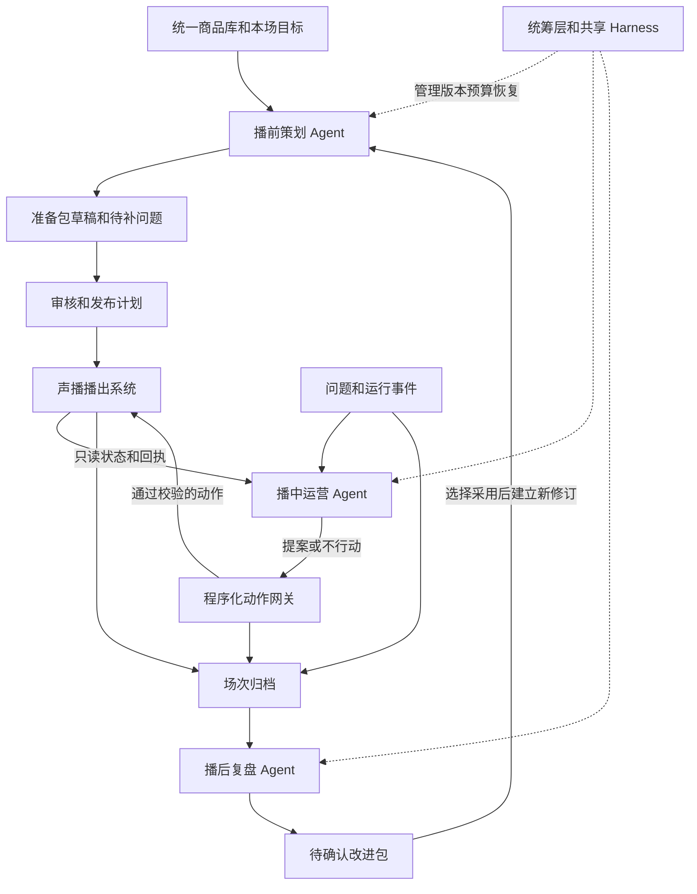

# 声播电商直播运营 Agent 整体设计

2026年10月15日首期流程最新入口：[10 播前Agent首期流程基线](10_播前Agent首期流程基线.md)。2A/2B/3并行，4A补齐全部商品配置，4B保留完整上下文并制定模块执行计划。下一步工具及Harness设计先读该基线；早期串行描述不覆盖本次确认。

2026年10月15日职责对照补充：[08 第十三章：原建议、用户范围、Agent产出与声播配合](08_业务闭环与动态数据详细设计.md#十三-播前agent与声播的横向对照及融合流程)。第十二章的用户取舍保留；第十三章增加横向比较和融合流程，手动跳播口径明确标为尚未确认的建议，不恢复已排除功能。

版本 2.0　设计日期 2026年10月7日　状态 设计交接稿

2026年10月15日首期范围已逐项收敛，开发前先读[08 第十二章需求总表](08_业务闭环与动态数据详细设计.md#十二-播前需求取舍与总表)。商品与顺序由用户决定；顾客需求前置到卖点提炼；首期只配置用户优惠并输出素材建议，视频/Hook/播后闭环放二期。旧的智能排品、时长优化、实验归因等设想不因保留在背景中而成为首期必做；第16项自动问答彩排待定。共享合同与代码尚未随本次需求整理实现。

业务修订：实施前先读 [08 业务闭环与动态数据详细设计](08_业务闭环与动态数据详细设计.md)。该稿补齐原始商品资料整理入库、缺资料补问与替代路径、本场活动、监控指标、分析到动作、复盘面板及动态数据口径；本文继续提供总体架构。

建议建设三个职责独立的运营 Agent，由一个程序化统筹层管理场次、产物、权限和执行。播前负责把商品资料变成可审核的讲解方案；播中根据事件和实际播放状态选择运营动作；播后根据已发生的事实提出下一场改进。三个 Agent 不直接互相发送长篇聊天，也不共同修改直播队列。

本次只交付设计、接口约定、数据样例和研发任务包，没有新增业务 Agent 代码，也没有修改正在使用的声播。下面的新增接口、状态和性能门槛均属于待实现或待验证设计。

## 一 项目目标和边界

首个目标是在不连接抖音、不需要真人主播的情况下，用声播作为被控制的声音直播间，完成可反复回放的运营闭环：准备两件演示商品，注入问题，查证并提议调整，确认后实际发声，归档，再产出有依据的改进方案。最终可通过 OBS 播出链接测试；平台接入放在本地闭环之后。

首版语言是简体中文、普通话，继续支持本机音色和 MiniMax。商品库是唯一可编辑的商品来源，直播间只保存商品引用；计划和归档保存只读快照以便追溯。保留同时仅一个直播间开播的限制。DeepSeek 用于需要判断的节点，音频生成和播放不交给模型调度。

没有观众、订单、点击和停留数据时，验证流程正确性、回答质量、动作可靠性和人工操作量；不宣称带来销量提升。不自动修改商品价格、库存、平台购物车或广告投放。

## 二 已有能力和需要补齐的部分

依据 `D:/Codex project/ecommerce-voice-agent/app/server.py`、播放器代码和此前方案进行静态核查。本轮没有启动直播或调用真实模型接口。

| 部分 | 代码中已经存在 | 新设计需要补齐 |
| --- | --- | --- |
| 商品和房间 | 统一商品库，房间引用商品，已确认话术，开播资料一致性检查 | 可追溯商品资料版本、准备包无损导入、计划发布绑定 |
| 实时动作 | 插播、切后续商品、重排未播列表、替换同商品版本、暂停等 | 能力清单、统一动作校验、队列和人工控制版本 |
| 播放确认 | owner 播放器回报 playing、progress、ended，句级 attempt_id | action_id 到插播 attempt 的关联、完整开始和结束记录 |
| 去重恢复 | 内存 action_id 缓存最多500项，asyncio 锁 | 持久账本、参数摘要、未知结果处理；重启不自动恢复旧声音 |
| 日志归档 | events.jsonl 追加；快照 logs 最近120条、played 最近1000条 | 带 room/session/action 的完整事件、不可变场次归档 |
| 经营输入 | 当前无平台业务数据 | 模拟、人工导入、后续授权平台适配分开标来源 |

`/api/export` 是当前快照，不能视为完整历史数据库。已有批准按钮主要是人工确认和有限规则检查；引用 ID 存在不代表句意得到事实支持。

## 三 主体框架

声播负责可靠地播；三个 Agent 负责取证、选择和提出方案；网关负责决定能否执行及记录真实结果；统筹层负责顺序与生命周期。四种职责可以运行在同一个 Python 后端，不要求四套服务。

### 三个 Agent 的具体设计

| Agent | 关键判断 | 可用工具 | 完成产物 |
| --- | --- | --- | --- |
| 播前策划 | 缺什么资料，讲什么、按什么顺序，多版本如何差异化，哪些问题需确认 | 读商品和旧稿，读已采纳改进，创建草稿，检查事实及计划 | PreparationBundle，含脚本、FAQ、讲解顺序、必讲点和阻断项 |
| 播中运营 | 当前问题是否应答，是否已答，回答依据是什么，是否需调整后续讲解 | 读当前状态、商品事实、已回答记录和允许动作；提交提案 | Proposal 或 no_action，执行由网关负责 |
| 播后复盘 | 哪些问题重要，证据是否充分，哪里可以改，怎样验证原因假设 | 读归档、查询时间段和证据、读取程序计算结果 | ReviewBundle，含事实、假设、改进提案和实验 |

每个 Agent 是有界的观察、取证、判断、检查循环。每个流程节点不再额外建一个 Agent。首版不加自由指挥的总 Agent，也不默认加第四个审稿 Agent；确定性检查与针对性模型复核放在各自工作流里。

### 为什么采用这个组合

只有固定脚本不足以处理新的问题和证据冲突；一个总 Agent 可以作为对照基线，但容易把跨场复盘、即时控制和准备资料混在同一上下文。三个角色具有不同的上下文、工具权限和时效要求，因此按三个边界实现更便于独立开发和测试。是否带来效果提升仍须在相同数据、模型与预算下和单 Agent 比较，不能靠数量证明。

外层阶段顺序固定，适合程序工作流；局部如何取证、解释和选择由 Agent 完成。LangGraph 支持这两类控制方式组合，本项目将它用作阶段子图与恢复工具，而非业务事实存储。[官方工作流与 Agent 说明](https://docs.langchain.com/oss/python/langgraph/workflows-agents)

## 四 三个板块如何协作

同一场次：草稿准备 → 审核发布 → 开播绑定实际 session_id → 播中运行 → 结束封存 → 播后复盘 → 改进待采纳。商品、计划、脚本和归档都带版本；传递的是结构化产物引用，不传全部聊天。

跨场次可以并行：直播 A 正在播时，播前准备 B，播后分析已结束的 C；B 的新稿不得改写 A 的队列。播后可以在开发时直接使用样例归档，不必等待播前和播中实现。正在直播的阶段统计只能叫临时诊断，首版不生成正式播后结论。

复盘不自动覆盖商品事实或已批准稿。采纳后生成下一场准备任务或新修订，并记录来源 review_id；事实变更仍经商品库入口确认。经验记忆只收已采纳的规则和有证据的反例，未知原因不升级成长期事实。

## 五 Harness 的落实方式

| 机制 | 本项目怎么用 | 验证方式 |
| --- | --- | --- |
| 工具边界 | 播前写草稿；播后只写报告；播中只能提案；网关唯一提交 | 越界调用被拒，记录拒绝原因 |
| 上下文 | 各角色按商品、场次或归档装配；大记录用查询工具 | 同名不同商品、不同场次反例不混答 |
| 状态与检查点 | 按 plan/session/review 分线程，持久化任务、预算和产物引用 | 进程重启只继续未完成计算 |
| 业务动作账本 | 稳定 action_id、参数摘要、实际效果确认 | 回包丢失不重复播，已接受不冒充已播完 |
| 时效与控制权 | 人工优先、取消令牌、版本条件、过期提案拒绝 | 人工切商品后旧回答不能进入播出 |
| 观测 | event→proposal→action→attempt→review 可追溯 | 随机抽一条回答能查到来源和播放结果 |
| 预算 | 角色局部上限和全局并发优先级，LLM 慢时原队列继续 | 超时不阻塞声音，费用缺失标未知 |

检查点不能保证外部动作只发生一次。LangGraph 恢复 interrupt 时会重新进入所在节点，所以提交动作必须在独立边界，使用账本对账，不在确认点之前执行。[持久化](https://docs.langchain.com/oss/python/langgraph/persistence) · [interrupt 恢复语义](https://docs.langchain.com/oss/python/langgraph/interrupts)

## 六 多窗口并行开发安排

建议四个开发窗口。共享契约和样例已经随本设计提供，四组可立即开始各自离线部分；真实联调按就绪门槛推进。

| 窗口 | 完整任务文档 | 独立开发内容 | 联调依赖 |
| --- | --- | --- | --- |
| A 统筹集成 | [02 统筹与接入任务](02_统筹与接入任务.md) | 公共契约实现、Harness、网关、归档、假播放器、集成测试 | 最后接 B/C/D 的输出；唯一维护声播接入代码 |
| B 播前 | [03 播前策划任务](03_播前策划Agent任务.md) | 资料诊断、讲解方案、草稿和 FAQ；用文件输入输出 | 发布导入依赖 A；不等待播中和播后 |
| C 播中 | [04 播中运营任务](04_播中运营Agent任务.md) | 模拟事件、查证、去重、动作提案和回放 | 真实控制等 A 网关及回执可靠后开启 |
| D 播后 | [05 播后复盘任务](05_播后复盘Agent任务.md) | 归档解析、指标、取证复盘、改进和实验 | 真实场次归档依赖 A；先用样例和旧快照 |

统一实现目录拟为 `D:/Codex project/shengbo-ops-agent`，按任务包划分文件所有权。当前目录 `shengbo-ops-agent-plan` 只有设计和样例。先冻结 `shengbo.ops.v2`，新增字段不能由各窗口随意发明；破坏性变更由 A 协调并升级版本。

开发顺序：G0 读懂契约并跑样例 → G1 四组模块离线通过 → G2 假播放器端到端 → G3 真实本机声音闭环 → G4 OBS 本地录制 → G5 受限自动答疑 → G6 后续授权平台测试。G3前不让 Agent 自动操作现用直播。

## 七 验收与价值验证

总体必须证明三件事：准备包能在正确版本上发布；运营提案能可靠地变成真实播出或明确拒绝；复盘能回到实际发生的证据，并形成下一次可验证的修改。

发布硬门槛：测试集中错误场次动作、未批准话术播出、未知写入盲目重放、模拟数据冒充真实经营结果、无证据成功声明均为零。开放文本质量和时延采用候选目标，先校准再冻结留出集，不能当作已达成绩。

详细数据口径、模块案例、故障注入、对照实验与分级验收见 [06 验收和回放计划](06_验收与回放测试计划.md)。本轮完成的是设计可交接性检查；真实运行测试由实施阶段执行。

## 八 资料复用和相对旧方案的修订

复用 Agent Harness Skill 的有界循环、工具契约、上下文隔离和恢复方法；Learn Claude Code 用来解释和拆解机制，不整体搬进业务产品。[方法来源索引](<D:/Codex project/agent-harness-design-research/skill/agent-harness-design/references/09-source-map.md>)

开源参考继续沿用原研究锁定版本：Sparklive 的有限事件窗口与输入 ID 校验；ai-livestream-review 的取证后结构化提交；LiveStream-Agent-Studio 的时间线组织。只迁移需要的机制，不继承未经验证的经营评分；复制代码前由负责窗口核查许可证、当前版本与小测试。定位见现有 `docs/运营Agent构建报告_v1.0.md`。

本版增加明确的 A 组和播中任务包、人工控制版本、持久动作关联、文件所有权和端到端门槛；区分队列结构版本与播放位置，避免每句推进导致所有计划失效。此前 v1.x 文档保留为历史，本版接口和任务包作为新开发依据。
