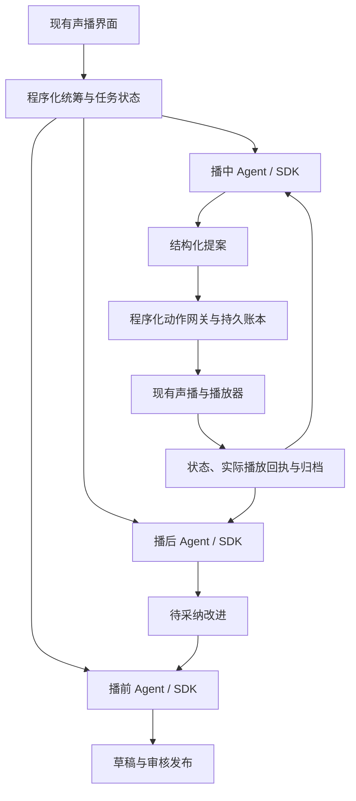

# 声播运营方案与 OpenAI Agents SDK 可行性评估

日期：2026-10-11。性质：需求适配与源码静态评估，不是业务实现、模型兼容测试或上线验收。本文件不改变原方案的模型、授权、版本和动作白名单。

## 结论

可以由 Codex 使用 OpenAI Agents SDK 实现播前、播中、播后三个运营 Agent。推荐保留现有 Python/FastAPI 声播、商品库、声音生成和播放器；将 SDK 用在取证、判断、生成和结构化提案层。场次生命周期、统计、资料版本、动作网关、实际播放确认及持久账本由应用程序负责。

三个角色用程序按阶段调用，各自有独立上下文和工具权限。不要求额外添加一个自由指挥的总 Agent，也不要求把三个阶段实现成三套服务。

最先验证播中最小切片：模拟尺码问题聚集 → 读取当前商品与 FAQ → 提案 → 网关校验 → 已批准 FAQ 句尾插播 → started/ended → 归档。随后补齐播前和播后，并验证复盘建议被采纳后进入下一场。

## 已读取的证据与当前状态

- 00—06：整体方案、工具契约、统筹和三个角色任务、验收计划。
- 08：2.1 业务修订，有冲突时采用其新业务要求。原始资料入库、本场活动、经营指标等不能只靠旧 v2 fixtures 覆盖。
- 设计校验记录、scenario-manifest、golden-expectations：已有检查属于文档和构造数据一致性，不是 Agent 功能测试。
- 现有声播 README、requirements、app/server.py、app/reply_lab.py、评论测试台与本地持久化 v1.5 文档：Python/FastAPI，已有 DeepSeek 话术及回复、商品检索、聊天和部分事件持久化、房间动作入口和播放器回执。
- 拟定实现目录 `D:/Codex project/shengbo-ops-agent` 本轮检查不存在。当前方案包是设计、样例和校验工具。

10 月 11 日的声播实现已增加评论测试台及持久化，因此不能照搬 10 月 7 日方案中所有旧能力缺口。已有评论回复仍是程序检索后调用一次模型，并校验答案；源码未提供播放写工具，不等于播中运营 Agent 已完成。

本轮没有启动服务、读取密钥、调用模型、提交动作或实测声音。既有文档中的测试成绩是历史记录，本轮未重跑。

## SDK 使用方式与职责

开发过程由 Codex 完成：建立隔离 Python 环境、安装并锁定 `openai-agents`、定义 Agent、包装工具、配置结构化输出、使用 Runner 执行、连接页面与后台任务、补齐测试与启动方式。

用户主要提供业务目标、代表资料、结果反馈和所选模型的合法调用条件。使用默认 OpenAI 模型路径时，需要运行环境中的 API 凭据和额度；本次 Codex 对话本身不能当作该应用的 API 凭据。

| 需求 | SDK 对应能力 | 自己需要实现 |
| --- | --- | --- |
| 三个角色 | 三个 Agent 定义、instructions、独立工具集合 | 程序化阶段调度与场次隔离 |
| 按需要取证 | function tools；跨服务时可用 MCP | 商品、FAQ、状态和归档的真实读取入口 |
| PreparationBundle / Proposal / ReviewBundle | 结构化输出，Python 可用 Pydantic 类型 | 2.1 扩展合同、字段约束和语义校验 |
| 任务上下文与暂停 | 会话和运行结果/恢复状态接口 | 持久任务记录、业务版本、取消、恢复策略 |
| 工具拦截和审批 | Guardrails、Hooks、审批相关机制 | 执行侧原子校验；审批绑定内容与版本 |
| 调试和费用 | Tracing 与用量信息 | event→proposal→action→attempt 的业务关联 |
| 声音播放 | 通过业务工具连接现有服务 | TTS、句尾调度、播放器回执、OBS 收音验证 |
| 真实经营策略 | 对工具返回数据进行分析 | 授权数据源、口径、时间窗口、样本与归因 |

SDK 的结构化输出只保证形式上的约束；引用 ID 存在不保证语义正确。SDK 的会话或恢复能力不自动保证音频动作只执行一次。

## 三个角色的落地映射

| 角色 | 输入和工具 | 输出及停止条件 | 验收 |
| --- | --- | --- | --- |
| 播前 | 原始资料/商品版本、目标、活动、已采纳建议；读商品、旧稿、经验，创建草稿和验证准备包 | 字段候选、缺口问题、草稿、FAQ、顺序、PreparationBundle；达到覆盖要求或清楚交付待补项/部分结果 | 价格币种正确、过期承诺阻断、不虚构库存、未审核内容不发布 |
| 播中 | 有限事件窗口、场次与当前商品、FAQ、待播/已答历史；读状态/事实/事件，登记提案 | Proposal 或 no_action/ask_operator；有界调用，超时/取消/过期退出 | 不串商品、不重复插播、人工切换后旧提案失效；answered 依据真实完成回执 |
| 播后 | 固定归档修订、程序指标、时间线；查询证据、读取准备快照、保存复盘候选 | ReviewBundle、观察/假设、具体修改与实验；证据充分或明确缩小结论范围 | 关键观察可追溯、未知不填零、未采纳建议不进入下一场 |

## 推荐连接方式

同进程优先通过函数工具复用服务，不为了接 SDK 强制把所有接口改成 MCP。读取必须限定 room/session/product/archive revision；播中模型只拥有 propose_action，submit_action 由网关调用。

## 需要调整的设计

1. **冻结扩展契约。** 01 和旧 fixtures 未覆盖 08 新增全部对象。为字段候选、补问、活动、指标、决策和改进补丁提供版本化类型与新案例，不静默塞入旧版本。
2. **同步当前实现。** 复用 reply_lab 的商品隔离、检索、引用和聊天持久化；它的文档/片段版本需要映射到正式商品事实合同，不能直接假定等价。
3. **补执行网关。** 当前 Room.action 有内存 action_id 缓存和 session/epoch 条件，但仍需持久动作记录、完整参数摘要、control/queue 等业务版本及 action→attempt 关联。同 ID 不同参数拒绝；未知结果先对账。
4. **补完整归档。** 数据库中有日志/评论，不自动等于冻结的 SessionArchive；计划、商品与脚本历史版本、提案、动作、播放、缺口需可靠关联。
5. **保护播放快路径。** 播放逐句推进、到期保护、暂停和人工接管由程序处理。UI 每秒刷新不等于每秒调用模型；LLM 慢时既有播放继续。
6. **验证 SDK 与模型。** 锁定版本，测工具调用、结构化输出、流式、超时、取消、恢复和用量。文档比对不能代替探针。

## DeepSeek 与 LangGraph 的处理

原方案指定 DeepSeek，本次不默认替换。OpenAI Agents SDK 提供其他模型的适配入口，但 DeepSeek 所需能力仍待真实探针。可保留现有生成/回复路径，为新增 Agent 注入可切换的模型适配器；使用 OpenAI 模型做验证时单独记录，不将其表现当作 DeepSeek 已验证。

原方案使用 LangGraph 承载阶段子图与恢复。它与 SDK 不必二选一：外层图可以管理任务状态，节点内部调用 SDK。播中最小切片可先用程序控制器；完整跨阶段长任务是否保留图运行时，按暂停恢复需求和实现复杂度决定。SDK 不负责替代业务数据库和动作账本。

## 实施顺序及验证关口

| 环节 | 具体产物 | 验证机制和评价指标 |
| --- | --- | --- |
| A 合同与 SDK 探针 | 扩展类型、FakeTools、模型适配器、一个只读 Agent | 正常/坏输入、工具往返、结构化输出、超时/取消；没有凭据只报告模拟结果 |
| B 播中小闭环 | 尺码 FAQ 聚合、Proposal、FakePlayer、账本与事件关联 | 同 ID 重复、同 ID 参数变化、切商品、accepted 未 started、unknown 不重放等回放案例 |
| C 真实声播接入 | 网关、审批、句尾插播、播放器证据、监控状态 | 实际发声与恢复；action→attempt→ended 可追溯；另做 OBS 本地录制 |
| D 播前完整流程 | 原始资料→补问/替代→候选入库→本场准备与音频 | TWD/过期活动/未知库存/同款匹配/更新失效；衡量人工修改与准备耗时 |
| E 播后及下一场 | 归档、指标、证据复盘、改进采纳 | 完整/缺失/迟到归档；采纳生成新修订，未采纳不生效 |
| F 经营数据 | 可用真实数据适配与策略试验 | 来源、PV/UV、成熟窗口、样本和延迟验证；无数据不声明 GMV 或转化收益 |

沿用 06 的 T01—T30 与 08 的 V01—V16，逐项记录 pass/fail/not_run。关键价格币种错误、错场动作、未审核自动播出、未知动作盲目重放和伪造经营/完成结果为阻断问题。事实支持率≥95%、复盘证据支持100%、批结束到提案 P95≤5秒等是原方案候选目标，需实测标定，不是本轮成绩。

第一条验收场景：尺码问题有已批准 FAQ，最终一次句尾插播完成；未知库存问题保留待处理；中途人工切商品则旧尺码提案被拒。既验证能力，也验证合理的不行动和失败出口。

## Codex 可交付内容

我可以实现项目结构、SDK Agent、工具适配器、类型、存储、调度、动作网关、现有界面接入、测试与启动说明，并根据错误修复迭代。真实模型、音频、OBS 和平台效果按层级保存证据；没有对应接入不宣称完成。

若进入开发，沿用原方案拟定的 `D:/Codex project/shengbo-ops-agent`。运营模块与现有声播通过明确的服务边界连接，现有商品库仍是唯一事实来源。本轮仅完成适配评估。

## 核查的 OpenAI 官方资料

- [Agents SDK 概览](https://developers.openai.com/api/docs/guides/agents/sdk)：应用负责工具、存储、部署和审批，SDK 运行循环。
- [Quickstart](https://developers.openai.com/api/docs/guides/agents/quickstart)：安装、Agent、Runner、工具和运行记录。
- [Agent definitions](https://developers.openai.com/api/docs/guides/agents/define-agents)：指令、工具、结构化输出。
- [Models and providers](https://developers.openai.com/api/docs/guides/agents/models)：其他供应商适配入口及功能差异。
- [Orchestration and handoffs](https://developers.openai.com/api/docs/guides/agents/orchestration)：角色边界和协作形式，不要求所有阶段互相 handoff。
- [Integrations and observability](https://developers.openai.com/api/docs/guides/agents/integrations-observability)：MCP 接入与 Tracing。
