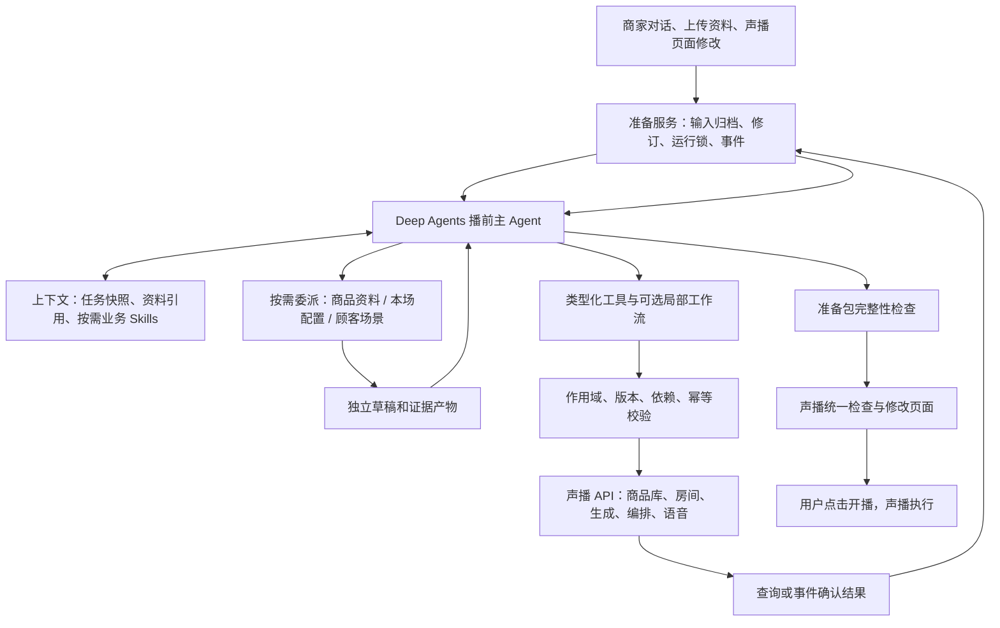

# 声播播前 Agent Harness 总体设计

> 历史稿，已被[后端工程设计 v2](engineering-v2/00_后端工程设计.md)替代。请勿据本稿直接实施；原生task/备用worker、发布与采用、数据权威及恢复接线按v2执行。本稿保留用于追溯。

设计版本：PRELIVE-HARNESS-1.0，2026-10-15。状态：详细设计，未实现业务 Agent，未完成真实模型、声播接入或故障恢复测试。

## 0. 阅读顺序与本轮结论

| 阅读目的 | 文件 |
| --- | --- |
| 先理解整个 Harness 怎样运行 | 本文件，先看第 1—6 节 |
| 逐步核对行动、上下文、工具和输出 | [14 逐步执行与工具数据契约](14_逐步执行与工具数据契约.md) |
| 对照 Learn Claude Code 验收，交给其他窗口实施 | [15 教程对照、验收与实施任务包](15_LearnClaudeCode对照与验收实施计划.md) |
| 查询已确认的业务取舍 | [10 首期流程基线](10_播前Agent首期流程基线.md)，仍是业务范围依据 |
| 查看本轮实际代码与 SDK 证据 | [声播核验](tooling/13_声播后端能力核验.md)、[SDK/教程核验](tooling/13_DeepAgents与LearnClaudeCode机制核验.md)、[业务审查](tooling/13_业务边界与动态调度审查.md) |

**推荐结构：一个 Deep Agents 主 Agent，三类按需调用的短生命周期子 Agent，一组可选工作流，一套声播业务工具，以及围绕它们的状态、上下文、版本、恢复和验收机制。**

三类子 Agent 是商品资料、本场配置、顾客场景研究。它们不是每次必须启动的三个岗位，也不需要一直在线。主 Agent 根据目标、当前资料和已有产物决定使用哪些能力；有明确依赖的写入与就绪条件由程序检查。

本方案以自制 `agent-harness-design` 组织设计，以 `deep-agents-core` 约束实现。Learn Claude Code 提供可对照的机制思路；Deep Agents 负责实际模型/工具循环。不会另外照搬教程的 `while` 循环，运行第二套总控。

## 1. 首期目标、范围与事实边界

### 1.1 要帮助谁完成什么

商家上传资料，或选择已有商品并说明本场要求。Agent 帮助整理完整商品库、研究顾客场景、制定和执行模块话术计划、准备用户选定顺序需要的语音，最终交付**声播中可检查、可修改、与当前修订一致的准备包**。用户在声播页面启动直播。

| 项目 | 首期决定 |
| --- | --- |
| 框架 | Python Deep Agents；已准备版本 `deepagents==0.7.25`，不改成 Claude Agent SDK 或纯 LangGraph 总流程 |
| 模型 | 沿用 DeepSeek 方向。主 Agent 的工具调用能力需实测；声播话术生成继续使用统一生成服务，不能把“能生成文本”当成“已验证 Agent 工具调用” |
| 语音 | 简体中文、普通话；本机免费音色和 MiniMax 可选；币种仍来自商品资料 |
| 正式数据 | 商品库与房间业务数据归声播；房间引用商品，不能每个房间复制一套商品 |
| 用户决定 | 商品集合、版本、顺序、优惠力度、主体久用后是否换稿 |
| Agent 决定 | 如何理解材料、怎样取证、如何组织卖点、哪些话术模块需要修改、如何调用可用能力完成目标 |
| 程序决定 | 字段合法性、对象归属、优惠计算、依赖检查、版本冲突、开场位置、缓存键、重复提交和就绪状态 |
| 本轮交付 | 设计文档、工具合同、验收规格和实施分工；不创建业务运行代码 |

### 1.2 首期不恢复的内容

不做自主选品、讲解时间分配、利润最优优惠设计、按目标分钟数反复删稿、独立逐句语义裁判、视频生成、画面播放 Hook、播中运营决策、播后自动优化闭环和自动对外开播。素材分析只给建议，不阻塞纯声音准备。自动问答彩排仍待单独决定。

基础事实冲突、价格/币种/优惠条件检查继续保留；它们属于数据和业务正确性，不等同于新增一位逐句审核 Agent。

### 1.3 本方案中“现有、拟建、待验证”的含义

| 标记 | 含义 |
| --- | --- |
| 现有 | 本轮读取代码可定位到实现；不代表已经完成真实业务测试 |
| 拟建 | 为本方案提出的接口、记录或中间件，需要后续开发 |
| 待验证 | 能力需要最小探针或集成测试；文档不提前宣布可用 |

早期 `01_统一数据与工具契约.md` 不会因本轮文档自动升级。后续播前开发以 13—15 的设计合同为入口，跨播中/播后共享协议再由集成者正式迁移。

## 2. 主体架构：模型选行动，Harness 保证行动可执行



### 2.1 各层只负责一件事

| 层 | 职责 | 不承担的职责 |
| --- | --- | --- |
| Deep Agents 主循环 | 看目标、观察反馈、决定下一项能力和是否委派 | 不重写声播 TTS、优惠计算或数据库 |
| 业务 Skills | 告诉模型什么时候使用某种做法、需要什么证据、如何交付 | 不自行赋予权限，不把价格固化到教程里 |
| 子 Agent | 在单独判断上下文里完成边界清楚的分析任务 | 不直接提交正式商品、激活播放计划或开播 |
| 局部工作流 | 执行已确定计划的生成、校验、保存、回读等稳定步骤 | 不成为每次必跑的全局固定流程 |
| 准备服务 | 持久任务、用户决定、版本、动作账本、上下文产物、事件 | 不凭规则树代替全部顾客分析和话术策划 |
| 声播后端 | 业务事实、生成与语音服务、播放器、人工页面 | 不依赖解析模型聊天文本判断是否准备好 |

## 3. 怎样避免“把整个 Agent 写死成工作流”

业务步骤描述的是能力与正确性依赖，不是每次都从第 1 步跑到第 8 步。主 Agent 看到当前目标和资源状态后，自主选择行动。`eligible_actions` 是程序给出的**合法动作范围**，不替模型指定唯一下一步。

| 商家这次要什么 | 主 Agent 的合理选择 | 应跳过什么 |
| --- | --- | --- |
| 新商品资料，准备新一场 | 归档后，按需并行资料、本场配置、顾客研究，再汇合 | 无需启动播中/播后能力 |
| 只把本场折扣改成用户指定规则 | 检查本场条件，制定受影响模块计划，生成并补语音 | 不重新整理未变商品、不强制全网调研 |
| 只换音色 | 读取当前文案和编排，准备对应音频，更新准备包 | 不重写话术，不重做卖点 |
| 用户换商品版本顺序 | 重算开场和音频需求；缺文本时局部补写 | 不默认重新生成主体 |
| 只想先看看顾客画像 | 调研究能力，输出带证据/假设的结果 | 不擅自建房间、生成全场稿或付费 TTS |
| 继续上次中断的准备 | 读取持久状态、用户新回答和未完成动作，从受影响处继续 | 不从上传资料开始全重跑 |

### 3.1 首期提供的可调用工作流

以下名称都是拟建的业务能力，不是声称 SDK 已有同名方法。

| 工作流 | 什么时候调用 | 内部固定部分 | 留给模型的判断 |
| --- | --- | --- | --- |
| `material_ingestion` | 新资料、资料更新 | 文件检查、抽取、OCR、来源索引、保存 | 资料含义、商品对应关系和矛盾分析交给分析者 |
| `script_plan_execution` | 已有有效模块计划 | 取回版本化输入、按模块生成、基础检查、保存修订、回读 | 哪些模块要改、表达角度由主 Agent 和计划决定 |
| `playback_compilation` | 用户给定顺序或循环方式 | 位置计数、长短开场映射、音频需求求并集 | 不判断哪个商品更值得卖 |
| `audio_preparation` | 已有确定文本与音频需求 | 缓存检查、缺失提交、任务观察、绑定 | 不让模型反复猜任务是否结束 |
| `review_packet_assembly` | 需要交付或刷新检查页面 | 核对引用、版本、缺口、音频与页面快照 | 主 Agent 解释变化和待决定事项 |

模型可以不调用、局部调用或再次调用这些工作流，但不能绕过它们维护的确定性约束。首期不开放模型临时生成任意 Python 工作流并执行。

## 4. Agent 与子 Agent 的具体分工

### 4.1 推荐角色

| 角色 | 承担什么判断 | 输入 | 输出 | 正式写入权 |
| --- | --- | --- | --- | --- |
| `prelive-coordinator` 主 Agent | 目标理解、选择能力、合并冲突、4A 完整商品配置、4B 话术计划、局部回流、交付解释 | 本次目标、任务快照、必要业务记录、子产物与工具结果 | 动作调用、模块计划、问题清单、准备结果说明 | 经工具服务校验后可提交商品和本场草案；无开播工具 |
| `catalog-analyst` | 从资料提取事实，匹配相似商品，解释差异/缺口 | 原材料引用、最小商品身份、已有候选、实际字段 schema | 商品候选、知识候选、来源、冲突、需确认身份 | 仅写本子任务草稿；不修改正式商品 |
| `session-analyst` | 本场主题、活动、沿用条件、范围和期限的结构化理解 | 本场材料、用户说明、旧场配置引用、商品临时映射 | 本场配置候选、沿用/失效项、缺失条件 | 仅写本子任务草稿 |
| `audience-researcher` | 顾客/场景假设、搜索取证、需求与顾虑分析 | 原资料与最小已知事实、渠道/地区、商家已有材料 | 顾客场景记录、需求依据、未知、素材建议输入 | 仅写研究产物；不把推测写成商品事实 |

首次复杂准备时可以三路同时分析。简单配置由主 Agent 直接处理，省去一次委派。4A 和 4B 由主 Agent 统筹，首期不再单列“卖点 Agent、策划 Agent、评审 Agent、TTS Agent”。生成模型调用和普通程序任务本身不算新增 Agent。

### 4.2 真正并行的实现条件

1. 第 1 步先提供原材料索引和最小商品身份。三路均可读取原资料，不让研究等待整个商品库完成。
2. 主 Agent 可以在同一模型消息中发起多个独立 `task` 调用；实际并发由安装版本的工具执行与模型能力探针确认。
3. 主 Agent 等待这批 `task` 返回时，不会同时继续推理本场配置。需要三路推理重叠时，2B 也委派给 `session-analyst`。
4. 原生批次若要等全部返回，首期接受“批次汇合后消费”；不能声称已具备跨批次流式消费部分子结果。界面进度可由草稿事件提前更新。
5. 若 DeepSeek 不能稳定在同一轮发出多项工具调用，使用**一个应用层批量委派适配器**，复用相同三个 Deep Agents worker 定义，以受限并发运行；主 Agent 仍决定分支集合。它是局部调用能力，不是第二个总体控制器。两种派发路径在配置中择一，不能同批双发。
6. 同一任务指纹只能有一个执行者；三个 worker 写各自命名空间，主 Agent 检查输入版本后合并。

两种派发方式共用审核过的 worker 规格、工具、Skills、报告 schema、预算与取消守卫。批量路径用公开 API 构建可运行 worker，不读取 SDK 私有编译缓存；其默认通用子 Agent 同样受限。原生批次超时不能直接再发 fallback，须先按同一 `dispatch_key` 查询每项状态、确认旧执行者已退出或结果失效，避免两套路径同时工作。批量收集逐项返回错误，不因一项异常丢掉其他结果。

### 4.3 每次委派的任务包

| 必须传入 | 具体内容 |
| --- | --- |
| 身份 | `preparation_id / branch_task_id / parent_run_id / role / attempt` |
| 目标 | 本次要回答的问题、处理哪些商品/本场字段、明确不处理什么 |
| 版本 | `goal_revision / input_snapshot_id / product_refs / session_draft_revision` |
| 上下文 | 必须读取的材料与字段、必要来源、用户已确认事实、相关未知项 |
| 权限 | 只读业务对象；只可向自己的草稿命名空间写结果；禁止委派下一层 |
| 交付 | `status / findings_ref / evidence_refs / conflicts / missing / assumptions / usage` |
| 终止 | 完成、证据不足、预算耗尽、取消、资料陈旧；缺信息返回给主 Agent 集中问 |

首期采用隔离上下文的子 Agent，不使用实验性的父会话 fork；不启用长期队友收件箱。隔离消息不等于隔离共享状态，具体控制见第 7 节。

## 5. 主 Agent 每次运行怎样推进

| 次序 | Harness 提供什么 | 模型做什么 | 程序如何验证 |
| --- | --- | --- | --- |
| 1 接收 | 归档用户输入，创建/更新准备记录，分配运行 ID | 理解这次目标和变更范围 | 同一准备记录只有一个有效模型运行；新输入修订可追踪 |
| 2 观察 | 当前资源版本、已完成产物、待问问题、后台任务、预算 | 判断当前缺什么、可复用什么 | 过期输出标 stale；不从聊天反推权威状态 |
| 3 取上下文 | 精简任务快照、业务 Skill 目录、按需读取工具 | 读取相关 Skill 与完整证据 | 必读输入有版本和读取记录；不能只凭摘要写入 |
| 4 选择 | 合法工具、可独立委派项、前置条件 | 选择直接做、委派、调用工作流、补问或结束 | 作用域、版本和业务条件在工具前再次校验 |
| 5 执行 | 类型化工具和动作登记 | 给出具体参数与简短依据 | 实际执行由服务完成，记录 accepted/completed/unknown |
| 6 反馈 | 工具结果、回读差异、任务进度 | 更新判断；失败时换路径或局部修正 | 不把 accepted 当 completed；保留已成功产物 |
| 7 等待 | 已保存问题或 job 引用 | 无可推进项时说明等待什么 | 退出本轮模型计算；后台观察由普通任务执行器处理 |
| 8 候选交付 | `evaluate_preparation` 的结构化结果 | 解释完成范围、缺口与变化 | 完成守卫核对事实；不能用一句“已准备好”替代检查 |
| 9 结束/续跑 | 检查点、任务快照、动作记录、事件游标 | 下一次根据新反馈继续 | 版本与停止条件仍成立；取消后迟到结果不重启旧计划 |

上述是围绕 SDK 循环的职责说明，不要求在外部再写一个不断调用 `create_deep_agent().invoke()` 的模型总循环。

### 5.1 等待、追问、完成分别意味着什么

| 情况 | 首期行为 |
| --- | --- |
| 某商品缺必填价格，其他商品可继续 | 标记该商品阻塞；继续无关任务；集中给出待答清单 |
| 子 Agent 缺信息 | 返回 `needs_input` 报告，自己不直接中断整个父图 |
| 主 Agent 确实需要用户决定 | 问题工具在持久记录后触发 LangGraph `interrupt()`；界面或下一条对话用同一线程恢复 |
| 文本/TTS 已提交 | 记录 job ID，普通观察器查状态，必要时结束当前运行为 `waiting_job` |
| 用户只要求分析报告 | 按报告目标结束，不强制要求达到“全场可开播” |
| 用户要求整场准备 | 必要数据、话术、编排、音频和修订一致，才可标 `ready_for_review` |

问题工具中的写入必须可重放：QuestionBatch/问题 ID 按准备、目标修订、对象及缺口稳定分配，重复执行只取回原记录。恢复使用同一 `thread_id` 的 `Command(resume=...)`，回答绑定 question ID 与对象/目标版本。业务错误包装不能吞掉 `GraphInterrupt`、取消等运行控制信号。

进入 `waiting_input` 后本次活跃 invoke 结束并释放执行租约，保留检查点与待答。恢复重新取租约；同一个 thread 不允许两个并发 invoke/resume。新输入到来先登记新修订、停止旧运行并等待其图调用退出，再进入同一线程；不能仅让租约过期后在旧图仍执行时并发恢复。旧问题被取消/替代时显式恢复为已过期结果，不能将旧答案强套到当前商品。

`waiting_job` 是本轮正常退出，不滥用人工 interrupt。普通观察器持久记录 job，遇到完成/失败等有意义变化时，为仍有效目标去重排入一次续跑；进度轮询不会每次唤起模型。

人工确认不是所有保存动作都弹窗。身份不确定、事实冲突、必要信息和久用主体是否更换需要用户决定；已明确本场活动的相关模块可直接更新。最终页面是整包检查，不恢复强制逐稿批准。

## 6. 步骤依赖：限制错误提交，不限定模型每次走同一路

| 能力 | 可开始的最低条件 | 可以复用/跳过的条件 | 提交前门槛 |
| --- | --- | --- | --- |
| 2A 商品分析 | 有资料或已有商品引用 | 原资料和字段规则未变且已有有效候选 | 来源、匹配和冲突可解释 |
| 2B 本场分析 | 有本场要求或可读取旧草案 | 本场配置已明确且未变 | 主题/规则/期限/范围无阻塞矛盾 |
| 3 顾客研究 | 商品基本身份及原材料可读 | 关键事实、渠道和需求未变 | 结论区分事实与假设，来源可追溯 |
| 4A 商品完成 | 2A 候选及相关 3 结果可用 | 正式商品全字段已处理且版本有效 | 必填齐全；身份明确；研究不虚构商品功能；写入回读 |
| 4B 模块计划 | 完整商品＋研究＋本场配置，另有旧稿/用户决定 | 现行计划输入指纹未变且目标相同 | 每个变更有依据，所有完整输入可回取 |
| 5 生成 | 有未执行的合法模块动作，本场草案已发布到对应空闲 room 并取得一致回执 | 所需稿件已存在且有效 | 只改授权模块；保存新修订，不静默覆盖旧主体 |
| 6 编排 | 用户给定商品/版本/顺序和播放方式 | 当前编排指纹未变 | 每个播出项独立 ID；缺文本回到 5 |
| 7 语音 | 当前编排对应的确定文本和声音参数 | 音频缓存键完全一致 | 所有所需音频可读；旧任务不得覆盖新计划 |
| 8 检查包 | 产物和当前引用可读取 | 当前包指纹未变 | 无阻塞项、配置有效、音频匹配；人工修改会使旧检查包失效 |

依赖按商品与模块粒度记录，不用一个全局“全部完成”布尔值阻塞所有工作。某项允许“未知并带提示”的字段，不应被误判为必填缺失；字段规则来自实际 schema。

## 7. 状态、数据归属与并发

### 7.1 正式数据只有一个来源

| 数据 | 权威保存位置 | Agent 如何用 |
| --- | --- | --- |
| 商品资料、规格、知识及可复用卖点 | 声播商品库 | 引用商品 ID 与修订，正式修改走声播服务 |
| 房间基础配置和产品引用 | 声播房间服务 | 读取/修改引用，不复制商品正文 |
| 本场准备草案、模块计划、字段来源、研究 | 拟建准备存储 | 保存草稿、证据、用户决定；正式提交后回填声播对象引用 |
| 原资料、抽取结果、完整研究和计划输入 | 拟建产物存储 | 按对象、字段、来源位置读取，保存内容哈希 |
| 模型消息、临时文件和执行位置 | Deep Agents + 持久 checkpointer | 用于恢复计算，不是商品真相 |
| 外部动作/生成/TTS 受理与终态 | 动作账本＋声播 job 状态 | 恢复先查实际结果，不能只看 checkpoint |
| 长期偏好 | 首期已有配置/明确用户决定 | 暂不建设自动长期记忆写入和经验自学习 |

### 7.2 不同 ID 与状态分开

| 对象 | ID 与状态 |
| --- | --- |
| 开播前准备 | `preparation_id`；`draft / working / waiting_input / waiting_job / ready_for_review / reviewed / failed / cancelled` |
| 一次模型运行 | `run_id`、SDK `thread_id`；一次准备可有多次运行 |
| 子任务 | `task_id`；`pending / running / needs_input / succeeded / failed / stale / cancelled` |
| 外部动作 | `action_id / operation_key`；`proposed / dispatching / accepted / confirmed / unknown / failed` |
| 异步任务 | `job_id`；映射实际服务状态，另保留来源服务 |
| 实际开播 | 声播真正启动后才有直播 session；不能拿 preparation ID 伪装开播 session |

### 7.3 首期并发策略

- 同一个 preparation 的主运行采用租约和修订检查，任意时刻只有一个有效提交者；不同商品分析可并发。
- 子任务唯一键包含角色、对象、输入快照和目标修订；重复委派返回已有任务或结果。
- SDK 默认的 `general-purpose` 不保留父写工具：在 `subagents` 中显式提供同名定义，`tools=[]` 或受限只读工具，文件写权限拒绝，使用 isolated；`task` 派发守卫只允许三类业务角色。不能向工厂传入不存在的同名禁用参数。
- 正式商品、房间配置、模块计划和准备包由主 Agent 通过受控工具提交；worker 只写自己的草稿。
- SDK 的隔离子 Agent 仍可能继承/回并非私有状态和 `files`。首期尽量不扩展共享状态保存业务对象；必须扩展的主运行字段使用 `PrivateStateAttr` 明确标记，具体以锁定源码为准。
- `/skills/`、`/policies/` 只读；worker 不通过通用文件工具改这些目录。草稿路径按 `preparation_id/task_id` 隔离。
- worker 的通用文件写权限首期拒绝 `/**`；分析产物统一走 `save_branch_artifact`。该工具从可信运行上下文绑定 preparation/task/attempt 和命名空间，忽略模型自称的角色/路径，不能写别的分支。直接 backend 调用和自定义工具也须做同等检查，不能依赖仅针对内置工具的 SDK 文件权限。
- 不把 `files` 整体标为私有来实现隔离；它是 SDK 的共享文件通道。正式 Product/Session/Plan、预算、租约均在服务保存。子报告先做 typed 校验与输入版本检查，再由唯一主写入者合并。
- 声播界面修改和 Agent 写入必须经过同一修订/CAS 规则。只给 Agent 入口加锁，不能防止页面覆盖。
- 新目标、顺序、文案或音色形成新目标/计划修订。迟到结果可以贡献可验证缓存，但不能激活旧计划。
- 准备期间如房间已在直播，首期默认保存为下一场草案，不修改正在播放的内容。用户要求播中修改时明确移交对应能力，不扩大本期。

## 8. 上下文、Skills、完整输入与压缩

### 8.1 提供给模型的四层内容

| 层次 | 内容 | 装配策略 |
| --- | --- | --- |
| 稳定规则 | 本期边界、正式数据归属、用户决策权、工具原则 | 短系统指令与已审核的业务政策文件；不含商品价格或密钥 |
| 当前目标 | 用户最新要求、目标修订、已答问题、有效授权范围 | 每轮关键决策可见，不靠旧摘要猜 |
| 任务观察 | 已完成/过期项、阻塞、任务 ID、合法动作范围、预算 | 从准备服务重读精简快照 |
| 具体证据 | 原资料、完整商品、研究、本场配置、旧稿、变更计划 | 按需取回完整相关内容，保留来源与修订 |

### 8.2 “4B 完整上下文”怎样保证

准备一个 `ContextBundle`，引用**完整商品字段、完整研究记录、完整本场配置、旧稿全文、用户决定**，附每份内容的版本/哈希、读取入口和必须精确保留的条件。它不是只有几句话的讲解摘要。

主 Agent 制定模块计划前加载必需内容；生成服务执行每个模块时，根据计划读取相关完整输入。大材料可以分页/分段读取，但不能静默截断后声称完整。读取清单只能证明输入已送达，不能证明模型理解无误，理解质量仍靠案例验收。

上下文超过模型窗口时：先拆到单商品/模块，保留全部引用，再分段抽取并核对精确字段。无法装入必要内容时返回 `CONTEXT_LIMIT`，不能删除关键条件。token 预算来自实际 DeepSeek 模型配置与探针；70% 水位仅是可调工程起点，不是已测性能阈值。

### 8.3 首期运行时业务 Skill 目录

| 拟建 Skill | 按需加载时机 | 核心约束 |
| --- | --- | --- |
| `prepare-catalog` | 分析/完成商品资料 | 全字段处理，保留来源，相似不误覆盖 |
| `prepare-session` | 整理本场主题/活动/沿用 | 长期资料与本场覆盖分开，只采用用户优惠 |
| `research-audience` | 顾客场景证据不足或需更新 | 事实/假设分离，能核对来源，不承诺搜到所有渠道 |
| `plan-script-changes` | 新稿或输入变化 | 关联三路完整上下文，逐模块新建/修改/复用 |
| `prepare-playback` | 用户定序、换声音或准备音频 | 规则计算交程序，只合成所需内容 |
| `review-preparation` | 解释差异、收集问题、最终交付 | 说明阻塞项，整包检查，用户启动直播 |

这些是将要写给业务 Agent 的 Skill，不是把 Codex 的 `deep-agents-core` 等开发教程复制给业务 Agent。首期固定审核版本；Agent 不自动修改 Skill 并立即上线。

### 8.4 SDK 中如何保存与加载

首期采用 `StateBackend` 保存线程工作文件，首次调用时通过受支持的 `files` 初始状态和 `create_file_data` 放入已审核的政策/Skill 文本，再由 `skills=`、必要的 `memory=` 指向虚拟路径。目录只读规则由程序设定。

原始资料和大型分析保存在准备产物存储，工具按引用返回，不把整个主机目录暴露给 Web 服务。配持久 checkpointer 后，线程文件与进度可跨进程恢复。当前环境只有内存检查点组件，持久 SQLite 组件仍需兼容安装和实测。

自定义子 Agent 显式声明自己的 Skills、政策和工具；不能依赖“应该自动继承”。不使用跨任务 Store 时，不宣称具备跨任务长期记忆。

每个准备线程固定 `skill_bundle_version/hash`。恢复既有线程不重新覆盖虚拟 Skill/政策文件；升级另建任务或显式迁移，防止 SDK 缓存的目录与新正文不一致。

压缩由 SDK 机制承担，并额外保护目标、否定约束、决定、当前版本、未决问题和产物引用。压缩结束后重读精简任务快照；必须精确的报价/条件从数据源再取，不从摘要恢复。

## 9. 声播动作入口：API、类型化客户端、CLI、MCP

### 9.1 推荐接入层次

**以声播 API 为正式业务入口，提供一个类型化 Python 客户端，将客户端操作封装成 Agent 工具。保留最小诊断 CLI；首期不要求搭建 MCP Server。**

| 方式 | 本期用途 | 决定理由 |
| --- | --- | --- |
| 声播 HTTP API | 正式读写与生成服务 | 复用现有服务，页面与 Agent 使用同一份数据和校验 |
| Python client | Agent 工具和诊断 CLI 共同调用 | 统一对象类型、错误、超时、版本、幂等和查询 |
| 类型化 Agent 工具 | 模型主要动作入口 | 参数和返回可验证，避免拼接 shell 命令 |
| CLI | 开发调试、其他窗口复现、手工检查 schema/草案/job/ready | 做薄壳，调用同一 client；业务逻辑不复制一套 |
| MCP | 将来让多个独立 Agent 客户端共用工具时再包装 | MCP 是协议接入，不会自动补足声播的版本或模块能力 |
| 鼠标/UI 自动化 | 人工验证页面或临时只读查验 | 不能替代正式准备服务的可靠动作入口 |

CLI 名称建议 `shengbo`，优先提供 `capabilities`、`preparation inspect`、`preparation diff`、`jobs get`、`preparation check` 五类诊断命令；输出统一 JSON，错误返回非零退出码。以下均是拟建命令，不代表现在可运行：

```text
shengbo capabilities --json
shengbo preparation inspect --id prep_demo --json
shengbo preparation diff --id prep_demo --json
shengbo jobs get --id job_demo --json
shengbo preparation check --id prep_demo --json
```

CLI 不携带命令行明文密钥，不提供任意 SQL/任意 Python 执行，不直接开播。将来如给 CLI 添加写操作，仍调用相同服务合同与幂等键。

### 9.2 现有基础与必要增量

| 类别 | 本轮代码核验 | 需要增量 |
| --- | --- | --- |
| 商品与房间 | 共享商品库、房间引用、商品/commerce schema 已存在 | 补完整 room/preparation schema、来源/完整字段处理记录、并发版本条件；新建房间及本场发布回执 |
| 促销 | 结构化优惠与价格试算已存在 | 复用并补足本场覆盖、有效期和资料冲突映射 |
| 话术 | 有生成、分段分句和任务能力 | 稳定模块 ID、局部 patch、基准修订、保持未改模块 |
| 编排 | 有顺序设置 | 同一稿可重复出现的独立播出项、长短开场编译与循环覆盖 |
| 语音 | 有异步任务和句级缓存 | 当前计划音频清单、修订绑定、旧任务结果 fence |
| 检查 | 有音频检查和配置陈旧提示 | 独立准备包检查、整包 review 指纹、与用户开播时的快照一致 |
| 运行恢复 | 有部分 job 机制 | 持久任务/动作账本、幂等、CAS、取消和重启对账 |

当前 `audio-status.all_ready` 只说明文件可用，不等于本场条件有效、配置未陈旧或整包已审。现有程序允许未逐稿 approve 的 draft 在音频齐全时开播；本方案不恢复逐稿审核要求。

## 10. Deep Agents 的明确落地配置

以下是配置设计，名称对应已核对的 SDK 能力；具体实例构建属于后续实现。

| 配置/组件 | 本期选择 | 需要验证 |
| --- | --- | --- |
| `create_deep_agent` | 建主 Agent；自定义子 Agent 使用同一框架 | 编译、工具绑定、模型/工具往返 |
| `model=` | 显式 DeepSeek 模型实例；模型 ID、端点与参数从服务配置读取 | 当前模型 ID 可用、tool calls、并行、结构化结果、超时/流式 |
| `system_prompt=` | 目标、边界、工具原则、完成语义、证据要求 | 新请求能覆盖旧偏好；不依赖隐藏思维链 |
| `tools=` | 受限业务动作；无直播 start、通用 shell、数据库直写 | 合法/非法对象、过期版本与重复调用 |
| `subagents=` | 三类短任务规格，按需调度 | isolated 上下文、工具限制、输出结构与并发合并 |
| `skills=` | 按角色提供已审核虚拟业务 Skill 路径 | 能列目录并按需读正文，worker 明确配置 |
| `memory=` | 小型稳定业务政策文件；不当数据库 | 不包含动态价格和未确认偏好 |
| `backend=` | `StateBackend`＋虚拟文件只读/作用域规则 | Skill 预置、持久检查点、共享 files 不串写 |
| Todo | 主 Agent 显式加 `TodoListMiddleware` | 待办是计划显示，不是业务依赖和完成事实 |
| 自定义 state | 尽量只留引用；主私有字段用 `PrivateStateAttr` | 子 Agent 不覆盖父版本、预算或准备状态 |
| 人工输入 | 主问题工具使用持久 `interrupt()` 和同线程恢复 | 问题重放、旧答案失效、同问题不反复询问 |
| `interrupt_on=` | 必要时用于具体敏感工具的执行前批准；不是所有写入默认批准 | approve/edit/reject 对应同一参数和版本 |
| checkpointer | 本地单服务首期选持久 SQLite，异步 API 选 `AsyncSqliteSaver` | 额外依赖未安装；兼容性、并发、断电恢复待测 |
| store | 首期不启用跨任务自动长期记忆 | 后续有明确用途再加持久 store |
| LangGraph | 使用 SDK 底层运行时与持久/interrupt 能力 | 不把外层另写成固定 StateGraph 总流程 |

静态 Skill 的默认行为可能滞后。例如 Todo 当前需要显式启用；实现以 0.7.25 源码及对应官方资料为准。官方配置入口见 [Customization](https://docs.langchain.com/oss/python/deepagents/customization)，Skills 预置机制见 [Skills](https://docs.langchain.com/oss/python/deepagents/skills)。

每个自定义 isolated worker 都显式配置自己的预算、取消、工具和输出校验中间件。主 Agent 的自定义 middleware 不会自动完整继承给它们；全局预算通过同一个服务记录原子扣减。同步/异步包装与各角色实测不能省略。

本机 FastAPI 的异步服务通过应用 lifespan 持有 `AsyncSqliteSaver` 连接，不能退出连接上下文后继续复用 agent。候选导入位置为 `langgraph.checkpoint.sqlite.aio`；依赖安装兼容性和连接生命周期仍属于 G0 待验证项。

## 11. Harness 扩展点与生命周期

下表的业务中间件名字是拟建应用组件；不声称 SDK 自带这些同名类。

| 组件 | 放在哪里 | 做什么 | 验证 |
| --- | --- | --- | --- |
| 输入/目标登记 | Agent 调用前的准备服务 | 上传归档、scope、goal revision、运行锁 | 重复提交与用户新修改不会产生两个有效总控 |
| 上下文装配 | `before_model` / `wrap_model_call` 及上下文读取工具 | 注入当前目标/快照和角色所需信息 | 不覆盖 SDK 自带 Skill 提示段；精确条件可回取 |
| 工具守卫 | `wrap_tool_call`＋声播服务校验 | 对象范围、版本、参数、动作登记、错误归一 | 提示词失守时仍不能越过业务校验 |
| 全局资源守卫 | 调用前及模型/工具包装层 | 父子共享预算、并发、取消和超时 | 只给父 Agent 设限制不能漏掉子调用 |
| 结果观察 | job 观察器、工具返回后 | 回读、记录终态、通知有效目标 | accepted 不误报成功；旧回调不改新包 |
| 候选完成守卫 | 支持跳转的 `after_model`＋准备状态检查 | 整场准备目标未达时返回缺口并有界继续 | 不能把 `after_agent` 当成能否决 Stop 的 Hook |
| 退出记录 | `after_agent` / 应用收尾 | 记用量、结束原因、产物和待办 | 不在这里再次执行不可控写入 |

完成守卫优先读取程序检查结果，不单独创建模型裁判。若模型过早声称完成，可有界反馈缺口、跳回模型；信息不足则进入 waiting，预算耗尽则停止并说明已完成范围。首期候选上限为两次无进展纠正，须通过探针标定，不允许无限“反思直到成功”。

候选最终答复通过守卫前，不发布为对外最终完成事件。界面的就绪标识只读取准备服务状态；流式模型文字不驱动该标识。

完成守卫只处理主 Agent 拟结束且没有待执行真实工具调用的分支；不得拦截正常工具消息或破坏 tool call/ToolMessage 配对。结构化输出终止单独识别，worker 依各自报告目标校验，不以全场 ready 强求子任务。合法 waiting、部分交付、取消或预算退出均允许结束；自动补做需避免重复使用旧 structured response。

中间件顺序、异步 Hook 签名和 `jump_to` 合法值须在最小技术切片验证，不能只因名字像 Learn Claude Code Hook 就认为等价。参考 [Custom middleware](https://docs.langchain.com/oss/python/langchain/middleware/custom)。

## 12. 可靠性、资源与可观察性

### 12.1 失败与恢复

| 失败 | 保存什么 | 恢复动作 |
| --- | --- | --- |
| OCR/解析缺页 | 原文件、失败页、已提取内容、原因 | 只重试失败部分或请商家补文字；不编造图片内容 |
| 网络研究不可用 | 已有证据、失败渠道、研究等级 | 使用商家材料并标假设；有硬证据要求的结论保留未知 |
| 商品匹配/价格冲突 | 候选差异、来源、问题 ID | 用户确认后局部重算，不自动覆盖相似商品 |
| 生成部分失败 | 每模块状态、成功修订、原计划 | 只重试失败模块；不丢已确认主体 |
| TTS 部分失败 | 文本/声音哈希、job ID、成功缓存 | 仅补缺，不能整批重复收费 |
| 写请求超时 | action 与稳定 operation key、dispatch 状态 | 先查动作或回读资源；不能换 key 盲重试 |
| 版本冲突 | 旧快照、差异、新版本 | 重新评估受影响动作；界面修改也参与 CAS |
| 取消后任务完成 | 取消修订与迟到结果 | 可写有效缓存，不激活旧计划或开启新任务 |
| 进程重启 | checkpoint、准备记录、待问问题、账本、job | 查业务事实后续跑，不只恢复 messages |

对不支持幂等且结果无法查询的旧接口，遇到不确定提交必须保留 `unknown`，不宣称已具备恰好一次语义。要么补充业务端幂等/查询，要么保持待核实。取消只阻止后续提交，无法保证撤回已经发出的厂商请求。

### 12.2 初始可调资源策略

| 参数 | 首期设计起点 | 依据与限制 |
| --- | --- | --- |
| 专家委派深度 | 1 层，worker 无再次委派权 | 首期任务边界已知，降低协调复杂度 |
| 分析并发 | 最多 3，且计入父任务总预算 | 对应三条独立分析线；模型服务限流另测 |
| 无效结构修正 | 每产物最多 2 次 | 候选工程值，测试后调整 |
| 无新信息重复 | 相同动作/输入连续 2 次无进展后换路径或退出 | 避免空转；临时网络重试由适配器独立退避 |
| 模型/工具/费用上限 | 服务配置，按实际模型计量；父子共同扣减 | 未测不写虚假的固定成本或完成时长 |
| job 查询 | 普通观察器指数退避，页面可主动刷新 | 不为每次轮询调用模型；重启后可重建观察任务 |

实现配置必须提供模型调用次数、工具超时、总时限、子任务上限，以及 token/费用或等价硬界；缺硬界时启动检查失败。预算覆盖主/子模型、摘要、模型修正、检索和外部生成作业，不能只数主会话消息。SDK 的默认大递归上限不作为项目预算。

### 12.3 事件和页面展示

准备记录维护跨运行单调 `event_seq`。事件包括 `preparation.updated`、`branch.started/finished`、`action.accepted/confirmed/unknown`、`job.updated`、`input.required`、`artifact.stale`、`review.ready/invalidated`。每条带 preparation/run/task/action 关联 ID、目标/计划修订和产物引用。

页面显示“在整理哪个商品、研究是否有来源、缺什么、生成哪些模块、音频缺几条、为何尚未就绪”，不暴露工具内部实现和私有思维链。刷新/重连先取当前快照，再按游标补事件；不凭事件文本恢复业务事实。

## 13. Learn Claude Code 如何对应

完整逐章对照和行为验收在 [15](15_LearnClaudeCode对照与验收实施计划.md)。本机教程已到 s01—s17，不能继续按旧的 12 章清单设计；本机副本没有 Git 元数据，使用文件哈希记录阅读版本。

核心采用：模型/工具循环、权限与 Hooks 的思路、待办、隔离子任务、按需 Skill、上下文压缩、持久任务、后台 job，以及“主 Agent 调用保存工作流”的结构。首期不采用 cron、长期自主队友团队、动态安装插件、通用命令行执行或独立目标评审模型。

这里的后台任务是文本/TTS 等普通 job；不把 Deep Agents 的远程 `AsyncSubAgent` 等同于本机后台任务。本地 Hooks、Stop 和队友机制的语义差异按已读取的转换 Skill 处理。[教程入口](https://github.com/shareAI-lab/learn-claude-code/blob/main/README-zh.md)。

## 14. 后续实施顺序与当前验证边界

| 顺序 | 交付什么 | 验收门槛 |
| --- | --- | --- |
| P0 合同与技术探针 | 冻结业务 Schema/错误/版本语义；证明 DeepSeek＋Deep Agents 的关键能力 | 见 15 的 G0 探针；不能只用模型替身替代 |
| P1 声播服务增量 | 模块 patch、编排、音频清单、版本/幂等、检查包 | 服务级行为测试，页面与 Agent 同样受版本保护 |
| P2 Agent 与准备存储 | 主 Agent、三类 worker、业务 Skills、上下文/问题/账本 | 新建/复用/增量/等待路径可完成，子任务无越权写入 |
| P3 运行可靠性 | 持久恢复、取消、后台观察、事件、预算 | 故障注入、迟到回调、重复请求和进程重启 |
| P4 人工页面与整体验收 | 单页检查、修改回流、用户启动和诊断 CLI | 准备包与实际开播快照一致；不强制逐稿审批 |

合同固定后，声播后端增量、Agent 分析/上下文、测试夹具可并行开发；写同一合同和集成文件由唯一负责人处理。具体任务包见 15，文档不会自动启动其他窗口。

本轮已做：基线阅读、源代码能力审计、SDK/教程机制核对、设计一致性检查。此前 SDK 的离线编译和模型替身探针仍只证明技术基础，不证明本方案已运行。真实 DeepSeek、持久 SQLite、模块生成、声播集成和实际播出验收全部待开发后执行。

## 15. 尚未确认但不阻塞本轮设计的事项

| 项目 | 处理 |
| --- | --- |
| 手动跳播后按哪个口径每五项长开场 | 1/6/11 正常编排规则已确认；跳播口径未确认。合同保留 `manual_skip_policy=undecided`，不把建议当已同意；首期先验收无跳播准备与正常循环 |
| 新增网络搜索服务 | 工具与证据合同已设计；可用 provider、凭据、渠道探针另配置。缺网络不能伪造实搜结果 |
| DeepSeek 精确模型与限制 | 开发时读取受控配置并做能力探针；不沿用教程默认 Claude 模型 |
| CLI 含义 | 用户语音“可例”按 CLI 理解；作为同一 client 的诊断薄壳，不改变核心接入 |
| 多用户/云部署 | 首期以本机单用户服务为边界，仍校验对象范围；不承诺多租户、集群队列和分布式 SQLite 能力 |

## 16. 设计依据

| 来源 | 用途与限制 |
| --- | --- |
| [10 首期基线](10_播前Agent首期流程基线.md) | 决定业务范围和已确认规则 |
| [自制设计 Skill](C:/Users/lizhe/.codex/skills/agent-harness-design/SKILL.md) | 需求、动作、上下文、恢复与验收方法，不是第二个运行时 |
| [Deep Agents core](C:/Users/lizhe/.agents/skills/deep-agents-core/SKILL.md) | SDK 实现入口；静态默认值以实际版本修正 |
| [memory](C:/Users/lizhe/.agents/skills/deep-agents-memory/SKILL.md)、[orchestration](C:/Users/lizhe/.agents/skills/deep-agents-orchestration/SKILL.md) | 按专题细化；内存 Store 不当持久数据库 |
| [转换 Skill](C:/Users/lizhe/.codex/skills/claude-harness-to-deepagents/SKILL.md) | 只处理本次实际混用的 Stop、任务、队友和压缩差异 |
| 官方 [Backends](https://docs.langchain.com/oss/python/deepagents/backends)、[Interrupts](https://docs.langchain.com/oss/python/langgraph/interrupts) | 核对数据和恢复机制；业务接口恰好一次另设计 |
| 本轮三份核验与源码定位 | 限于实际读到的机制，不冒充完成端到端运行 |
