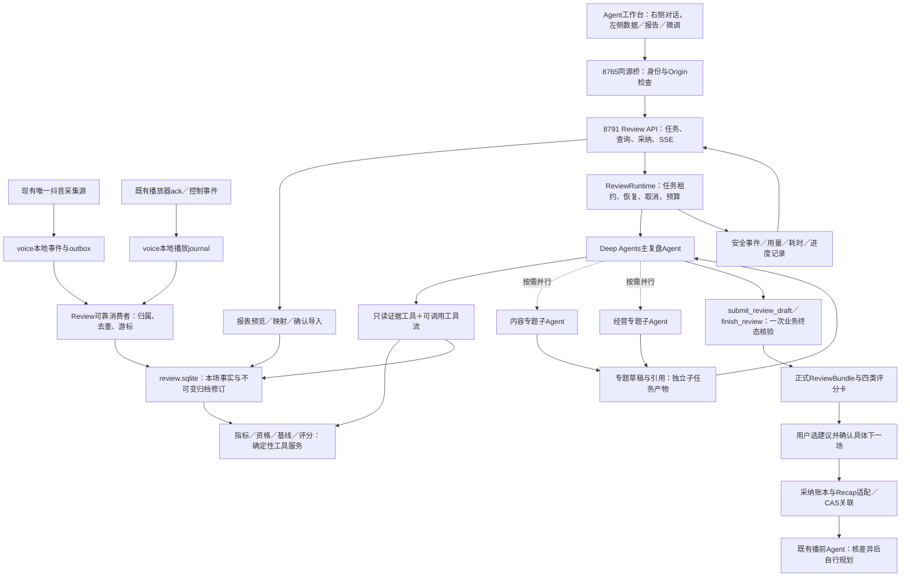

# 播中播后综合Agent：Harness工程开发计划

版本：LIVE-REVIEW-ENG-1.0。日期：2026-10-20（Asia/Shanghai）。状态：可评审工程设计，尚未业务实现。

本计划把LIVE-REVIEW-1.1总体方案、LIVE-SCORE-0.1数值评价和播前Agent三轮迭代后的实际教训合成一套实施合同。评分政策保留，不为工程化改变经营目标。旧播中实时干预方案、旧播后方案和本目录上级研究稿均保留。

## 1 首期交付边界

| 范围 | 本期实现目标 | 本期不执行的动作 |
| --- | --- | --- |
| 播中 | 按本场采集抖音公开事件、媒体播放时间线、连接／缺口和人工场记，形成可恢复归档 | AI不自动插播、切品、重排、改稿、改价、发券或停止直播 |
| 播后 | 导入用户授权经营报表，计算指标与评分；Agent按需取证，解释商品、稿件、模块、顾虑和经营瓶颈 | 不将评论当订单，不给没有数据的模块编造转化，不承诺单句带来多少GMV |
| 下一场 | 形成版本明确的建议候选；用户选中后交给播前，保留采用／暂缓／不适用的处置 | 复盘Agent本身不生成新话术或TTS，不直接更新商品和正式直播编排 |
| 本次工作 | 写清架构、文件／函数、数据、工具流、中间件、Skill、权限、上下文、恢复、验收和实施分工 | 不修改业务程序，不启动采集／付费模型／TTS，不安装或升级生产依赖 |

完成的业务判据：一场数据能从接入、封存、报表、指标、Agent结论一路追溯；没有经营数据也能诚实完成互动限定复盘；采纳建议能安全交到指定下一场。模块细粒度结论按数据资格启用，不以“每个格子都有分数”作为完成条件。

## 2 现有基线与复用决定

| 项目 | 本地已核实 | 工程决定 |
| --- | --- | --- |
| 运行时 | Deep Agents 0.7.25、LangChain 1.4.6、Core 1.6.10、LangGraph 1.2.15、SQLite checkpointer 3.1.2 | 保持现有锁定版本，先核兼容；不套最新网页中本地没有的参数 |
| 模型 | 既有chatgpt_plan／gpt-6.1-sol提供方适配器和本机安全凭据路径 | 复用provider入口、续期和工具往返；不复制令牌、不静默换计费来源；自动自然过期场景仍需实施验收 |
| 部署 | 声播8765、播前Agent8791，由既有桌面启动器启动 | 在8791增加独立Review router和Runtime，经8765同源桥访问；不再增加第三个端口／启动器 |
| 公开采集 | douyinLive v2.3.1与voice/app/live_source.py；现有唯一采集连接、归一化和事件DB | 在原持久化边界补outbox、未知／健康原件；Review消费者不另开第二个同房间采集器 |
| 播放 | server.py中Room状态与ack，编译稿有句／模块来源；日志尚不够完整 | 增加本地journal与缺口，不把role=monitor的瞬时WS快照当完整事件历史 |
| 报表读取 | 现环境已有openpyxl 3.1.5、numpy；pandas／statsmodels尚未安装 | CSV用标准csv，XLSX用openpyxl；首期评分／Wilson用小型版本化纯函数与参考值核验，必要时评审固定统计库依赖。研究推荐不等于已经接入 |
| 最新播前证据 | 本地v8已做定向离线验证／旧产物回放，无新的完整付费链路耗时 | 将已知故障固化为新模块的负例，不能把v8预期减少往返写成已实测提速 |
| 复盘交接 | voice已有import_recap、link_recap_to_preparation和expected_revision | 做显式ReviewBundle→Recap投影及幂等／对账，不假设当前dict接口已经覆盖完整语义 |

播前经验的核心不是复制旧RuntimeEngine。新包只借用小型稳定组件：安全模型adapter、严格引用／规范JSON工具、只读文件读取器、安全日志投影原则。直播复盘的目标、权限、状态和完成判断另有单一实现，避免把旧的生成、批准、音频、发布逻辑带进来。

## 3 总体Harness结构



Harness分两层：业务后端提供“事实、指标和操作的真实语义”；模型Harness提供“自主调查、工具执行边界、上下文、任务生命周期和交付核验”。采集器、计算函数和报表解析器是普通程序，不为它们各建一个Agent。

## 4 目录与职责所有权

以下路径均是未来拟新增或改动的位置，不表示本轮已经生成实现。

```text
D:/Codex project/shengbo-ops-agent/
  src/shengbo_contracts/live_review.py       # 全部Review DTO／错误码／schema导出
  src/shengbo_live_review/
    bootstrap.py                           # 资源创建／关闭／现有app挂载
    api.py                                 # /review/v1内网API
    runtime.py                             # 主循环协调；不放指标或SQL
    control.py                             # Goal解释冻结、等待回执／Inbox及完成查询适配
    reports.py                             # 草稿、证据依赖校验、正式报告／交付回执唯一服务
    jobs.py                                # 持久作业、去重／租约、完成唤醒
    agent_factory.py                       # 主／子Deep Agent与SDK中间件配置
    context.py                             # 当前目标、证据索引、压缩与精确回读
    middleware.py                          # 四个定制业务中间件
    policy.py                              # 唯一角色／工具／副作用权限注册
    tools.py                               # DTO到普通服务的薄封装
    flows.py                               # 可选机械组合工具，不是全局固定DAG
    repository.py                          # SQLite事务／CAS／唯一键
    artifacts.py                           # 规范JSON、原件、安全证据和引用校验
    ingest.py                              # voice outbox／journal消费者
    sessions.py                            # 绑定、租约、封存、迟到修订
    playback.py                            # attempt／segment区间与时钟
    report_imports.py                       # CSV／XLSX预览、映射、确认、拒绝行
    metric_definitions.py                  # 指标定义唯一注册
    metrics.py                             # 分子、分母、cohort、时间聚合
    scoring.py                             # 四类分数、基线、样本资格
    feedback.py                            # Review→Recap适配及采纳对账
    observability.py                       # trace、账本、进度和时间报告
  skills/review/<skill_name>/SKILL.md        # 四份唯一Skill原件，按角色投影可见目录
  tests/live_review/                        # 纯函数／契约／SDK假模型／集成
  verification/live_review/                 # 显式运行的授权真实验收
  .runtime/live_review/
    review.sqlite3                         # 事实／任务／指标／报告／trace正本
    checkpoints.sqlite3                    # 图计算检查点，独立连接
    artifacts/                             # 内容寻址不可变原件和产物
```

voice项目拟新增app/live_review_ingress.py、app/live_review_bridge.py；现有app/live_source.py和server.py只在已经确认的事件产生边界加入旁路，不复制第二套Room／normalize。UI新增Review工作区组件并复用既有对话布局机制；不在本计划重画整套前端视觉。

同一规则只放一个正本：工具权限在policy；数据模型在contracts；计分在scoring；报告完成语义在报告服务；中间件调用这些服务，不各写一套“似乎完成”的判断。所有read工具使用repository查询，不从提示词里猜路径。

## 5 主Agent、子Agent与程序怎样分工

| 执行者 | 输入 | 自主选择 | 可以产生的结果 | 实际权限 |
| --- | --- | --- | --- | --- |
| 主复盘Agent | 用户目标、固定归档修订、能力与指标索引、历史／政策引用 | 查哪个商品／模块、是否追加证据、何时委派、是否需要对比或小实验建议 | Findings、报告草稿、建议候选、待补数据问题 | 只读业务事实；写本次草稿／待确认问题；可完成本次Review，不可改直播 |
| 内容专题 | 指定问题、同归档、精确稿件／事实／评论引用、子预算 | 查原句、主题、反例、表达与内容四项评分 | 结构化子报告、证据引用、未知项 | 不可交付主报告、不可采纳或改稿；只读指定范围 |
| 经营专题 | 指定经营问题、同归档、指标／基线／报表口径、子预算 | 分解漏斗、核退款龄期、选择可比对照 | 经营发现与替代解释 | 不可自行改计分公式、目标、原单或优惠 |
| 确定性服务 | 版本化参数与可信scope | 无业务语义自我规划 | 可靠数据、计算、资格、可恢复作业、正式回执 | 通过明确API执行；不调用模型来判断加减乘除 |
| 人工控制器 | 登录身份、显示过的确认卡与选项 | 选择补数据、处理歧义、采纳建议、选择下一场 | 已确认映射／采用决定 | 人工授权业务动作入口，不通过模型自报身份取得权限 |

主Agent可以一次调用两个task并行调查内容与经营；共同读取同一不可变归档，子结果各自落独立草稿。主Agent合并冲突，不让两个子Agent同时写同一报告正文。简单目标如“看本场净额达标没有”不固定委派，也不强制做评论分类。

## 6 固定的是哪一部分，灵活的是哪一部分

| 环节 | 程序必须保证的内部顺序 | Agent保留的选择 |
| --- | --- | --- |
| 采集与封存 | 原件／事件保存→同事务outbox或可靠journal→消费去重→游标提交；封存固定截止与缺口 | 播中不运行运营模型；人工选择哪场要监控 |
| 报表导入 | 类型读取→字段／单位预览→必要歧义确认→确定性规范化→正式导入 | 需要哪种表、数据缺什么、是否先出有限复盘 |
| 指标评分 | 资格→同口径统计→固定基线／目标→评分→持久结果 | 只算某个指标／商品，追加别的分析，选择按需工具流 |
| 内容理解 | 精确读取→结构化判断→保存引用；格式错误有限纠正 | 研究哪句话、哪些顾虑、是否需要专题、保留不同解释 |
| 报告交付 | 草稿保存→同一服务检查引用／数值／原目标→正式回执→结束 | 如何组织报告、哪些建议优先、证据不足时怎样交付部分结果 |
| 采纳交接 | 确认快照→稳定操作ID→导入Recap→CAS关联下一场→回读 | 用户采纳什么；播前如何评估修改范围 |

提供五个可调用组合入口：prepare_review_context、build_product_panel、build_module_panel、compare_compatible_history、package_review_delivery。每个内部步骤确定，但没有强迫主Agent从第一个按顺序调用到第五个的总工作流。底层只读工具保留，模型可自行增补调查。

## 7 评分怎样融合进开发，而不是作为附录

| 评分要求 | 必须进入的工程部件 | 完成证据 |
| --- | --- | --- |
| 目标分、历史相对分、内容分、覆盖分分开 | ScoreResult.score_basis、scoring.py、报告投影／UI四类卡 | 丢掉低分指标不会让别的分变高；内容87.5不写成经营成功 |
| 净额目标900／1000得90 | 同龄支付退款cohort、整数金额、冻结GoalDefinition、score_target | 原值90000分／100000分，可回算并显示900元／1000元 |
| 历史持平60，1.25倍80，1.5倍100 | BaselineSnapshot与score_relative；比例上限另处理 | B=0返回null；比例B=.8、X=.9对应80，B=1不制造150%目标 |
| 内容四项0／12.5／25 | ContentAssessment引用原句及实际事实，程序求和 | 未知项不重标其余权重；错价单列严重问题 |
| 模块／句子时间证据 | publication映射、attempt／segment、时钟／延迟、mixed状态 | 播放不是发声保证；暂停不算播出；跨分钟UV不相加 |
| 公共评论仅为代理 | 评论分类结果与覆盖、主题组／观测用户分开、已核人分钟 | “买了”不变订单；少问题不自动高分；未核在线不算密度 |
| 样本与成熟度 | MetricResult、ScoreResult、Report.as_of与limitations | 3／50和30／500均6%，区间不同；退款D+1不比D+14 |
| 调试可解释 | 每次工具／模型／计算span、用量attempt、UI按块展开 | 点48分能查16／100、基线20%、来源、限制和原稿 |

上级23项基础指标以及评分细则新增的C／Q／T指标应在同一指标注册器合并，不建两个互不兼容的“旧指标／评分专用指标”实现。具体收口映射见01与03。

评价的可执行配方见07：逐项列数据字段、粒度、计算函数、数值映射、null出口及反例，供W2开发和W5验收直接使用。四项内容审核由K10主Agent或K13内容子提交同一typed ContentAssessment，程序评分；不是由评论分类工具K09代算。用户明确要重算时，Goal.refresh_mode和CalculationReceipt证明实际做过哪些计算，避免拿旧报告充新结果。

## 8 为避免重复三轮修补，开发前置的质量门

| 门 | 首次实现必须先做的事情 | 通过才允许做什么 |
| --- | --- | --- |
| G0 契约收口 | 明确ReviewRef、SourceKind、错误码、状态、金额、分页与时区；把旧设计草案的字符串ref／来源拼写做一次显式适配 | 并行开发消费方，避免各窗口各写DTO |
| G1 事实完整 | 两场同房、300条补档、掉线、循环／暂停、迟到、未知方法夹具；归档可复算 | 给模型开放资料和时间结论 |
| G2 数值可回算 | 目标／比例／退款／UV／覆盖和缺失反例；固定输入输出；正式指标单一注册 | 开放评分卡和报告数字 |
| G3 原生工具往返 | 假模型真实走Deep Agents工具调用、结构化返回、子Agent／错误反馈、压缩与恢复，不只单测函数 | 使用少量授权真实模型验证 |
| G4 完成与恢复 | 任务正本、图检查点、产物、待确认／未知动作分开；finish可核真实报告并直接结束 | 端到端声称“完成复盘” |
| G5 同版交付 | 同一次冻结构建核代码、契约、Skill、迁移、测试和桌面加载版本 | 更新用户正在使用的服务 |

每批合并同根因改动和相关回归；先检查真实失败入口，再补针对反例。没有新的修改／疑点，不反复全链调用模型。结构复查要求见05，不以“通过几百个测试”替代数据链路正确。

## 9 开发顺序与并行边界

| 工作包 | 先做的具体结果 | 可并行的工作 | 依赖与负责人边界 |
| --- | --- | --- | --- |
| W0 契约／夹具／接点冻结 | 统一DTO、schema、API目录、迁移编号、能力与完整场景夹具 | 提前整理现有报告样例和旧问题映射 | 集成者独占common contract；其余模块引用 |
| W1 归档／播放／生命周期 | 可靠摄入、同场隔离、实际播放journal、封存修订 | W2用合成归档开发 | voice接点由一位开发者负责，避免并行改server.py |
| W2 导入／指标／评分 | CSV／XLSX映射、cohort、基线、四类评分、缓存 | W1、W3均可用固定契约假服务 | 不等待真实交易API；真实样本不够时保留能力降级 |
| W3 Harness／工具／恢复 | Runtime、四中间件、三个角色、Skill、budget、task／finish、trace | W1／W2用适配器接入；UI可按schema做投影 | 不复制播前大运行时；按角色限制实际工具 |
| W4 API／UI／播前交接 | 对话入口、左侧展示与校正、SSE补发、采纳卡与对账 | 在W0后可做假数据UI；真实交接在W2／W3后 | 不与前端窗口同时改业务contract和voice接点 |
| W5 合并验收／结构复查 | 离线分组→SDK工具回放→冻结构建→少量同版真实调用→授权测试直播／报表 | 失败按共同根因批量修，不逐小改全回归 | 每个层级证据单独记录，真实链路不足不能升级声明 |
| W6 部署／回滚 | 将W5通过的同一构建更新到既有服务，核实际加载版本和回滚 | 不在部署时顺便改业务 | 无第三端口／启动器；原声播与播前可用性单独核验 |

W0通过后可以把W1、W2、W3、W4分别交给独立窗口；每份输入、产物、测试与交付要求见05。合并者负责统一接点、schema和最终版本，不能让各包各自自动重启生产服务。

## 10 当前不确定性及实施时的准确处理

| 待验证项 | 已有条件 | 处理方式 |
| --- | --- | --- |
| 实际经营表表头、时间粒度、订单／退款关联 | 用户能导出，尚未核对样本 | 开发reader preview，不猜字段；只有商品汇总就只给商品／整场分，不因此阻断基础归档 |
| 平台端音频与事件传输延迟 | 本地句子坐标可控，尚无完整平台校准 | 实现ClockEvidence与人工标定输入，未标定时禁严格句子归因；保留本地共现 |
| provider真实自然续期与工具子图恢复 | 已有adapter／旧探针，不能代替新链路验证 | 先假过期、工具call、取消、重放；授权真实短任务再核，不索取令牌 |
| 小商家历史基线少 | 数值政策已明确缺样本不强评分 | 仍给内容审核、真实经营数值及用户目标分；攒够条件后再打开相对评分 |
| 真实总耗时 | 只有旧播前耗时，Review是新任务 | 先分层埋点、真实记录；10分钟是优化目标，不砍必要信息、不伪造承诺 |
| 新开发后是否绝不再出错 | 已知根因可提前覆盖 | 用负例、同版验收和结构审计减少已知回归；未出现的错误仍允许发现后修订，不声称设计保证零缺陷 |

## 11 阅读与执行入口

| 文档 | 开发时必须解决的具体问题 |
| --- | --- |
| 01_数据契约与持久化.md | ID／ref／时间／金额、表／唯一键／事务、采集与封存、报表与cohort、基线／评分缓存 |
| 02_AgentHarness与上下文中间件.md | create_deep_agent配置、主子协作、四中间件真实hook、预算／摘要／恢复／取消和权限 |
| 03_工具与可调用工作流.md | 每个工具和flow的输入输出、内部步骤、错误与等待、资格与指标统一注册 |
| 04_API前端与播前交接.md | 同源API、异步任务、SSE、左右工作区、确认卡、采纳CAS、完整成功／失败时序 |
| 05_验收与实施任务包.md | 开发包、反例夹具、层级测试、性能计量、同版构建、结构一致性及交付证据 |
| 06_播前迭代教训预防矩阵.md | 真实旧问题→根因→新架构唯一落点→验收ID，不把旧已修缺陷说成当前仍复现 |
| 07_评价体系执行配方.md | 每个指标的输入、粒度、公式、评分资格、四项内容标准、数值与反例，接到同一工具及存储路径 |

所有路径、函数名、阈值与API在实施前以本工程包为统一基线；已有SDK签名和接点证据见research。发现真实样本需要改契约时先升版本并更新消费方夹具，不能在工具、Skill和后端各打一个补丁。

