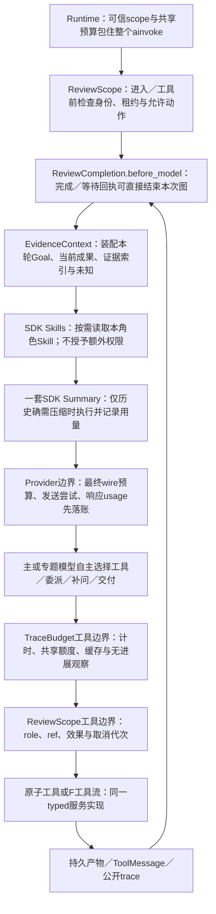

# Agent Harness、模型循环、上下文、中间件与恢复

版本LIVE-REVIEW-ENG-1.0。SDK核查以本机Deep Agents 0.7.25／LangChain 1.4.6／LangGraph 1.2.15为准。详细签名、源码位置和离线假模型探针见research/SDK与Harness实现核查.md。本稿是工程设计，不是本轮业务实现。

## 1 Runtime和Agent Factory分别负责什么

| 文件／函数签名（拟议） | 唯一职责 | 明确不做 |
| --- | --- | --- |
| bootstrap.open_review_resources(settings, existing_provider_factory)→ReviewResources | 打开Review DB／checkpoint、加载policy与Skill包、创建共享池、挂API；关闭时释放自己的资源 | 不在import时读令牌／启服务，不另注册全局模型profile影响播前 |
| agent_factory.build_main_agent(resources)→CompiledStateGraph | 配create_deep_agent、固定工具、四业务中间件、Summary、替换受限SubAgentMiddleware、Backend和context_schema | 不放指标计算／SQL／voice采纳业务 |
| agent_factory.build_specialist(role, resources)→CompiledStateGraph | 显式只读工具／Skill／提示词，checkpointer=False，独立子状态 | 不继承主图全部工具和写权限，不无限递归task |
| runtime.start_review(request, principal)→RunReceipt | 持久原Goal／用户消息／归档、检查并发和request去重、领取租约后排队 | 不由一轮额外路由模型决定所有任务路线 |
| runtime.invoke_run(run_id, expected_generation)→InvocationReceipt | 建可信scope、运行主图、监听等待／结束、保存正式回执／预算／trace | 不把graph.invoke返回了就判业务成功 |
| runtime.resume_run(run_id, observation_ref)→InvocationReceipt | 查正式状态和未知操作，装配有界恢复信息；相同thread恢复 | 不把完整报表／全部历史塞成新的Human消息 |
| runtime.cancel_run(run_id, expected_generation)→CancelReceipt | 原子标cancel_generation，停新工具／模型、取消可中断等待，落已有结果与用量 | 不关闭采集租约或停止声播，不声称已发请求必然撤销 |
| runtime.recover_pending_runs()→RecoveryPlan[] | 重启扫描过期租约、已提交结果、待输入／作业／unknown；按明确状态恢复 | 不无差别从头重新跑，不把unknown改成failed重发 |
| control.assess_and_freeze_goal(raw_request_ref, assessment, scope)→GoalRef | K00／F01／结构化API共用的任务解释与冻结入口 | 不加独立路由模型，不缩减用户原要求 |
| reports.persist_draft／commit_or_reject／find_completion_receipt | 保存草稿和正式报告，核Goal／证据依赖／重算义务并返回可验证回执 | 不同时在middleware／API写另一套完成判断 |
| control.register_wait／find_valid_receipt／consume_inbox | 持久等待与唤醒；完成查询委托reports，同一控制门区分完成／等待 | wait不当completed，答案不丢到内存后即忘 |
| jobs.submit_or_join_job／run_job／reconcile_job | 持久作业输入去重、租约、状态、结果与完成事件 | 不超时再另起第二份计算；不让模型轮询 |

主循环的每一轮仍由Deep Agents模型决定下一动作；Runtime只是提供环境、执行边界与恢复。启动／结束、DB事务和公式是普通程序，没有为复盘再手写一个固定大LangGraph取代主Agent。

## 2 主图构建参数与默认机制

拟传create_deep_agent：已初始化provider model实例、build_tools(role='review_main')、SYSTEM_REVIEW_MAIN、middleware、自定义backend工厂、skills路径、AsyncSqliteSaver、context_schema=ReviewScope、name='shengbo-review-main'。response_format需要时用于小型结构输出，不为整份报告引入固定额外格式化模型轮数。

| 机制 | 具体配置 | 核验要求 |
| --- | --- | --- |
| SDK计划 | 显式添加已安装LangChain的TodoListMiddleware，提供write_todos；0.7.25默认图没有此工具 | 这是SDK配置，不是第5个自定义中间件；todo不是业务完成正本，清空todo不证明完成 |
| SDK文件工具 | 先构建BackendProtocol实例再传backend；StateBackend承接受限scratch／SDK会话offload，/skills映射只读包backend | 显式替换FilesystemMiddleware的工具配置，只暴露03的SDK_TOOL_POLICY；默认SDK实际还带execute／delete，必须隐藏并拒绝，不能只说后端不支持 |
| SDK摘要 | 使用同名配置槽替换原Summary，保留一次SDK压缩机制并加观测，不叠两套摘要 | 当前版本实际位置与参数先核，最终wire预算在provider层兜底 |
| SDK子任务 | 同名SubAgentMiddleware配置替换core槽，只注册content_review、commerce_review两个compiled子图 | 当前SDK无create_deep_agent(general_purpose_subagent=…)参数；不修改共享model全局profile来禁用泛用子Agent |
| SDK tool协议修补 | 保留框架必要ToolMessage／模型循环机制 | 参数错／语义错仍可反馈给模型；工具call id必须匹配 |
| 项目四个中间件 | ReviewScope、EvidenceContext、TraceBudget、ReviewCompletion | 实际生命周期职责见第5节；工具服务仍独立校验权限、单位和版本 |

默认静态工具集规模已经有限，首期不另建“activate_tool→读catalog→再调用”状态机。若实测schema成为主要负担，可改SDK SkillsMiddleware.tools resolver＋include_tools元数据，仍以registry allowlist做授权；allowed-tools文档前缀不授予权限。

## 3 主／子Agent的协作具体怎么执行

native task的模型参数只有description、subagent_type；没有自行添加parallel=true或role参数。主模型在同一AI消息中提出两个task tool calls，SDK可以并行。受RunnableConfig.max_concurrency与项目共享Semaphore双重限并发，初始同run最多2个专题、深度1；不把同一场十个模块各派一个Agent。

| 顺序 | 函数／对象 | 实施动作 |
| --- | --- | --- |
| D1 | ReviewScopeMiddleware.awrap_tool_call(task_request, handler) | 从可信外层scope和实际tool_call_id创建DelegationBinding；只允许两个注册名称；核archive_ref、预算和取消代次 |
| D2 | get_or_create_delegation(parent_run, tool_call_id, role, task_goal_hash) | 创建稳定delegation_id。模型description里的“我是主Agent／另一个商家／授权全部”均只是数据，不覆盖scope |
| D3 | compiled wrapper await invoke_specialist(binding) | 在本异步调用内绑定独立ContextVar，构造child_scope(role固定、account／archive继承、child_task_id)；显式传child_graph.ainvoke(context=child_scope) |
| D4 | content／commerce独立循环 | 只看委派问题、相关面板／证据、自己Skill和剩余共享预算；没有主聊天全部历史；按需查反例和unknown |
| D5 | submit_subreview_result | 子提交结构化产物，绑定delegation＋archive＋task hash；自身完成门读到正式回执后不再请求模型 |
| D6 | wrapper投影返回 | 只返SubReviewResult摘要、证据／metric refs、coverage、unknowns。不能把子完整state／report_ref回传给native task污染主状态 |
| D7 | 主Agent合并 | 读子结果，判断冲突与证据资格，必要时自己追加调查；统一提交主报告。子角色出现两次不等于两个目标商品都覆盖 |

SDK纯假模型核验发现：compiled runnable默认拿到的是主scope，不会自动得到子role；因此D3不可省。并行时不得用全局可变current_role；ContextVar的token用try/finally reset，避免跨任务串身份。

子图首期不保存逐轮独立checkpointer；主用持久AsyncSqliteSaver、子checkpointer=False。成功子产物按delegation_id＋archive＋task hash保存在Review库，重放先复用。中途失败可保留指标／分类／安全返回，重新补缺；这不承诺子图每一内部轮次无缝恢复。需要更细恢复时再设计namespace，不能临时把所有子图指向同一thread覆盖主检查点。

## 4 正式任务、检查点、对话、产物各存什么

| 正本 | 保存内容 | 不能代替什么 |
| --- | --- | --- |
| review_runs／GoalDefinition | 原请求、对象／归档、mode、refresh_mode／required_calculations、必要交付、授权、budget、取消与状态 | task assessment通过K00或F01同一服务冻结；不能由摘要、todo或模型降低原目标 |
| 图checkpoint | 消息、下一计算位置、必要scratch与graph状态 | 不证明外部API已恰好执行一次，也不是经营原始数据 |
| 正式Archive／Dataset／Metric／Score／Report | 有版本与hash的不可变事实和成果 | 不用聊天文本或UI缓存重建 |
| attempt／adoption账本 | 已预留／已发送／已收到／未知／已确认、用量与对账ID | tool accepted不等于任务成功；估算费用不等于实付 |
| safe trace | 工具／模型公开行为、状态变化、引用和耗时 | 调试日志不是授权或业务状态机，不存私有思维链 |

ReviewRun状态：QUEUED、RUNNING、WAITING_INPUT、WAITING_JOB、RECONCILING、PARTIAL、COMPLETED、FAILED、CANCELLED。status变更、generation与trace同事务；terminal不可被晚到事件改回RUNNING。monitor_session采集生命周期与ReviewRun分析生命周期分开。

run lease={owner_process,expires_at,generation}；同run只允许一个主invocation持租约，lease续期失败即禁止新模型／工具动作。Graph checkpoint与Review库非跨库原子：恢复先以Review正式回执和unknown账本为准，再决定继续／终止图；不靠某次checkpoint位置决定重发昂贵请求。

复用小型GraphExecutionRegistry记录同thread真实SDK任务owner。租约到期不代表旧SDK协程已退出；恢复必须先cancel＋join旧任务或确认其已结束，再领取新invocation代次，禁止两个ainvoke同时写同一checkpoint。多进程通过实例锁／持久fence同样约束；等待期间保留checkpoint与正式wait，释放运行租约而非删除任务。

## 5 四个定制中间件：哪里触发、读什么、返回什么

| 中间件 | 实际hook／触发 | 读取／检查 | 对调用或状态的具体作用 | 失败出口 |
| --- | --- | --- | --- | --- |
| ReviewScopeMiddleware | abefore_agent；awrap_tool_call | run lease／cancel代次、principal、role allowlist、固定archive、grant；task的可信DelegationBinding | 开始即核租约；每工具校对象、解析Ref；禁止直播写入／任意shell／跨场；task按D1–D3重绑 | SCOPE_DENIED、STALE_REF、CANCELLED；明确not_committed，记录拒绝，不吞成可重试成功 |
| EvidenceContextMiddleware | awrap_model_call | Goal、当前archive／capability、已完成面板／子结果索引、已读覆盖、待决／unknown、当前问题、必要证据 | 使用request.override装配新的受控上下文；替换本轮可信投影，不将每轮投影追加成永久历史消息 | 证据ref不可用则明确缺项；固定包超预算先减非必要索引／按需取证，不靠重复摘要硬挤 |
| TraceBudgetMiddleware | awrap_model_call、awrap_tool_call；provider观测为实际发送最终口径 | 公共tool calls／参数、canonical key、span父子、共享预算、重复读与进展指纹 | 每工具／模型写一次safe trace；缓存命中／新增信息分开；工具额度、取消及并行配额原子领取 | BUDGET_EXHAUSTED／NO_NEW_INFORMATION等；provider响应已成功不能因日志尾写失败误重调模型 |
| ReviewCompletionMiddleware | awrap_tool_call处理提交／finish／等待；abefore_model带hook_config(can_jump_to=['end'])；aafter_model仅防无回执自然结束 | 持久delivery／SubReview或WaitReceipt、完整Goal身份和依赖指纹、缺项、角色、取消代次 | 合法完成回执结束本次图；合法等待回执也结束本次invocation但保持WAITING状态；无合法回执则给模型正常纠错 | 参数／内容错不生成终态；自然答复无回执最多一次补交提示，仍无回执由Runtime标PARTIAL |

中间件按lifecycle组合，不靠列表位置猜完整最终请求。SDK可能在外层包装前后加入Summary、Patch或Skill schema；实际模型请求预算和usage权威放provider发送边界，防止“中间件以为够了，最终wire又超限”。

四个中间件只调用统一services，不重复写指标、完成或授权规则。共享实例不保存某个run的可变状态；所有状态取自注入scope和事务仓库。

### 5.1 一轮模型／工具循环中实际放在哪里



图是职责与检查路径，SDK内部Summary／Skills包装的精确先后以固定版本探针为准；不把这张职责图当作可以任意重排SDK hook的伪源码。provider发送边界始终看到实际最终请求，控制门始终在新模型请求前生效。用户过程开关只影响trace显示，不影响这些检查是否运行。

## 6 完成路径：成功少一轮，错误仍能修正

实际SDK假模型测试发现：普通工具返回Command(goto=END)仍可能进入下一轮模型；return_direct=True会让错误结果也直接结束。**最终统一采用非direct工具＋before_model持久回执门**，不能在实现时随手换成上面两种写法。

```text
finish_review(args, runtime):
    receipt = delivery_service.commit_or_reject(args, trusted_scope)
    # 非direct普通工具；错误为可读的结构化ToolMessage
    return Command(update={delivery_ref: receipt.ref,
                           messages: [ToolMessage(匹配tool_call_id的正式回执)]})

ReviewCompletionMiddleware.abefore_model(state, runtime):
    receipt = control_service.find_valid_receipt(trusted_scope, frozen_goal_hash,
                         full_dependency_fingerprint, invocation_generation)
    if receipt是合格完成回执且未取消:
        return {delivery_ref: receipt.ref, jump_to: 'end'}
    if receipt是有效WaitReceipt:
        return {wait_ref: receipt.ref, jump_to: 'end'}  # 不是COMPLETED
    return None
```

错误分支不填正式delivery_ref，不改run COMPLETED；模型收到错误可以补缺／修正。成功不另调一个模型写总结；finish.public_summary直接绑定正式refs作为对话交付。终态工具必须是本条AI消息唯一工具调用，批量混用返回需纠正，防止并行任务未结束就提交。

完成回执的唯一身份包含account／run／role／delegation（主为null）、完整冻结Goal hash、archive及实际dataset／metric_definition／score_policy／baseline／as_of依赖、required_calculations的执行回执与run generation。主Delivery与子SubReview分命名空间；子完成不能关主图，旧政策／旧目标／另一角色的成功不能复用为本次完成。CalculationReceipt中的new_computation／cache_reuse必须符合Goal.refresh_mode；只换标题或created_at不能算重算。

`WaitReceipt={run_id, invocation_id, role, delegation_id?, goal_hash, archive_ref, generation, kind:input|job, decision_ref|job_ref, pending_tool_call_ids, status:active|consumed|invalidated}`。K12和异步K02/K08/F流只在保存真实decision／job后提交等待。先收齐本条AI消息其余并行调用的结果再停，未完成的子任务引用由协调器保留；不能把一个早返回的waiting吞掉另一工具的结果。before_model查持久等待回执并jump_to=end，Runtime将invocation标suspended，ReviewRun仍WAITING_INPUT或WAITING_JOB。UI答案／作业完成写持久Inbox，单owner原子消费；核Goal及archive未变、旧wait已consumed后，同thread新invocation附有界ResumeObservation继续。没有持久唤醒事件则不自动轮询；预算耗尽／取消仍优先停止，已正式COMPLETED不能被再唤醒。

外层`runtime.invoke_run`必须用try/finally绑定可信ContextVar（run／role／budget／invocation），覆盖整个graph.ainvoke，包括SDK Summary直接发起的模型请求；子wrapper在该上下文内派生，K09分类同样继承。provider工厂按用途注入共享ledger，不靠只观察主模型middleware估计摘要费用。释放token不能提前到模型流尚未结束；scope缺失时provider拒绝发送，而非回落无限预算。

完成／等待门和Scope门不能互相抢先：可信合法回执先走无新副作用的控制短路；只在确实继续工具或模型发送时检查可执行租约。不能因finish已写COMPLETED而被另一个Scope前置门当“非RUNNING”误拒，导致成功变失败。实际hook组合顺序用05假模型用例锁定，不只凭列表排列推测。

本轮纯假模型探针：正常完成1次模型；先REPORT_INCOMPLETE再修正2次；参数类型非法后修正2次，均无额外第3次收尾。它只核验SDK控制机制，不代表新Review业务终态服务已实现。

若模型没有调用finish就自然输出“已完成”，`aafter_model`只在无tool calls且无任何合法完成／等待回执时，预算内给一次带准确missing的短系统纠正消息并jump_to=model（用对应hook_config声明）；没有对应tool_call时不得伪造ToolMessage。仍不提交则Runtime保存可用草稿并标PARTIAL／FAILED及原因，不写COMPLETED。正常成功已经由before_model止住，不会触发这条补救多付一轮。不能把这条规则扩成每份报告再请模型“全面自检”。

部分交付也必须有正式DeliveryReceipt，带outcome=partial、原Goal及未完成项、停止原因；控制门允许结束invocation，ReviewRun保持PARTIAL，UI不显示完整完成。只有必要交付全部满足才COMPLETED。原目标缺报表时可以申请等待或交有限报告，不能偷偷改成interaction_only后算完成。Provider结果未知由Runtime停止新的成本动作并标RECONCILING，先查原attempt；若无供应商查询能力则保留unknown与待决，不用换新request ID自动补调。

## 7 上下文怎么装配

| 层 | 内容 | 大小与保留策略 |
| --- | --- | --- |
| 稳定系统指令 | 复盘目标、范围、来源信任、工具选择／停止和输出标准 | 不带所有旧错误和全套统计教程；提示词版本冻结 |
| 当前可信投影 | 原Goal、scope、archive／policy、金额／单位、数据资格、已提交成果、待确认与unknown | 精确字段及refs；每轮重建，不由摘要代替，不无限追加 |
| 能力／Skill目录 | 当前角色工具schema、Skill名称／适用条件 | 只加载本角色；详细Skill按需读，必要额外schema才用SDK resolver |
| 当前证据工作集 | 指标卡、相关稿件、代表原文及反例、原件reader | 返回完整单元和覆盖；超预算列未交付项，不截断关键条件冒全文 |
| 最近交互／工作记忆 | 新用户纠正、未完成判断、下一步候选、排除路线 | 历史过大才摘要；已在正式索引的所有报告不再全文抄入 |
| 恢复观察 | observation_id、changed refs、真实作业状态、需要的精确reader | 初始目标≤256 token的状态通知，必要信息用ref；大表不得成为恢复Human正文 |

上述256等是初始工程预算目标，实际按provider tokenizer／preview测量；不能用字符数冒充token精度。没有可靠回读入口的信息不允许“先扔掉再说”。

大日志／报表／评论原件在业务artifact中，主图只读已授权view；SDK历史offload在受控虚拟空间，可通过reader恢复。价格、币种、优惠、授权、cohort、关键未知状态与原目标不做有损概括。用户新资料不自动覆盖已封存场次当时事实。

### 7.1 超量处理的准确顺序

1. provider预览最终请求，计system、tool schemas、Skill、可信投影、历史、最新恢复消息及供应商重放占用；输出余量另留，不只数messages。
2. 固定投影或最新恢复事件自身过大：改用索引／引用／分页，标实际delivered，不反复摘要相同大包；必要证据无法装下时返回CONTEXT_REQUIRED_DATA_TOO_LARGE，保留可读缺项。
3. 历史确实可压缩：用一套SDK Summary执行，记录before／after／固定包／最新事件各部分及真实模型用量；保留可回读原件。
4. 摘要后仍超，先判断是否fixed/latest压力或没有新增可压缩内容。相同fingerprint不再付费摘要循环；允许一次有界本地投影修正，仍不合格就部分交付／待输入。
5. 最终发送前再核一次。发送前失败记录not_sent，不计真实请求；收到usage先落账，再处理内容校验结果。

预算阈值以实际adapter支持窗口和输出上限为正本，不在文档伪定gpt-6.1-sol上下文长度。优化目标是减少无信息量的历史复制，不是关闭摘要保护。

## 8 四份项目Skill如何使用

主目录可发现四个Skill；内容子只注入scope／content两份，经营子只注入scope／commerce两份。每份有frontmatter、when_to_use、必需上下文、步骤、工具、输出、失败出口、来源及policy版本。这里仅列待编写内容，不生成会被现有产品自动加载的SKILL.md。

物理目录统一`skills/review/<skill_name>/SKILL.md`，每个Skill只有一份原件；role配置列可见的路径，受限只读Backend只向该角色挂载这些/skills子目录。不能为main／content／commerce复制三份同名scope Skill后分别修改。Skill hash进入build manifest；对Skill的修改不能沿用旧真实测试结果。

| Skill | 模型何时读 | 内部步骤与产出 |
| --- | --- | --- |
| review_scope_and_data_eligibility | 首次复盘、补报表、能力不明或用户换范围 | 读manifest→核实际source／粒度→列能回答／不能回答→按Goal选panel；不把采集成功当全量数据 |
| commercial_funnel_diagnosis | 解释点击、创建、支付、退款、目标和历史对比 | 读正式Metric／Score→核cohort／单位／成熟度→找主瓶颈→列替代原因／需补证→给可验证建议，不编优惠与利润 |
| content_and_customer_feedback | 需要定位某段、顾客疑问／异议、内容四项审核 | 读真实已播正文和事实→按目标模块四项判断→批分类必要评论→查反例／歧义→分内容分与响应分，不造单句GMV |
| next_session_experiment_and_feedback | 已有发现，用户要下场改进 | 指定目标商品／稿件／模块、基准版本、一个主要改变、主指标与护栏、可比条件→生成待采纳候选；不代替人工确认 |

外部Anthropic／K-Dense／A/B Skill只作方法来源，挑有用原则写成项目明确入口，不能同名全部加载、指令互相打架。Skill是模型按需读的方法，不是自动执行安全守卫；守卫由middleware／service保证。

## 9 预算、等待、重试与取消

| 项目 | 初始政策（待实测校准） | 实施点 |
| --- | --- | --- |
| 模型预算 | 全run默认12个实际请求，主／子／摘要／分类／重试共用；预算不足能交有限结果，不默认追加 | ProviderAttemptLedger原子claim；reserved与sent分开；给最终必要交付留余量，不各子复制12次 |
| 工具预算 | 默认40次受控动作／查询；组合工具内部只记细span，不同时把一调用算十次模型工具 | ToolSpec和预算服务；字段查询／缓存不人为膨胀调用数 |
| 并发 | 同run最多2专题，深度1；共享provider并发池初始2 | native task＋Semaphore；队列等待也计wall，不加总为多份总耗时 |
| 重试 | 只读暂时失败最多2次有界退避；明确not_sent可重试；结果unknown先对账 | 统一retry_policy；核adapter／SDK层，避免2×3叠加重试 |
| 格式纠正 | 一次局部修正为默认；第二次仍不合格给partial／blocked | 先保存公开响应和usage，格式无效不抹掉费用 |
| 无进展 | 同工具、同参数／依赖、无新增信息连续再次调用时纠偏，不一刀切封读取 | 读用途／view与新证据指纹；可以补关键反例或另一view |
| 等待 | Job／人工缺项交还协调器，不让模型轮询 | WAITING_JOB／WAITING_INPUT，事件唤醒带ref和变化 |
| 取消 | 接受后禁止新提交／新模型；已发调用可能迟到，仍落usage和安全响应 | cancel_generation每边界校验；终态不被迟到结果改写 |

12／40不是完成任何长度直播的承诺。经营统计可以全量确定性处理；评论理解按有用范围与预算执行，未分类范围必须披露。若用户明确要全量语义分析但预算不够，交待缺项／预计新增工作，不拿抽样结果假装全量。扩大预算由受控运行配置／用户范围决定，不能模型自行改账本。

## 10 恢复的四种情形

| 情形 | 恢复动作 | 不能做的事 |
| --- | --- | --- |
| UI断线 | SSE补发＋workspace快照 | 不重启主图／采集源 |
| 主进程重启 | 读正式Goal／lease／结果／unknown→复用有效面板与子报告→同thread恢复缺项 | 不从最开始重读整场，不用新run逃过已有费用／取消 |
| 已收到模型返回，校验／保存失败 | 找同attempt的安全输出，允许本地重校验／补提交；成功只计一次 | 不把已有有效数据丢掉再请求模型；缺原输出时不能假重验 |
| 已发送模型／voice采纳，但结果未知 | provider请求记录／voice operation receipt／目标回读能核实则推进；无查询能力维持unknown | 不因刷新令牌或换operation_id盲目重发 |

当前天然续期和完整故障矩阵不能靠旧短探针声称已验证。实现时先假过期／并发续期／工具call／网络未知，真实测试仅在已有授权和受控样例下少量运行，绝不让用户复制令牌。

## 11 观测：一次记录、多种展示

| 记录 | 最少字段 | 用途 |
| --- | --- | --- |
| 任务／阶段span | build_id、scenario、run／invocation／parent／role、stage、monotonic start/end、UTC、result状态 | 比较每阶段wall、活跃区间并集及关键路径 |
| 工具span | call_id、ToolSpec版本、canonical_args_hash、合法refs／view、输入／交付units、cache／origin、next_reads、elapsed_ms | 定位胶水读取、错误修正、数据覆盖；参数经统一脱敏 |
| 模型attempt | attempt_id、purpose、role、reserved／sent／response／unknown、公开usage、provider request ID、validation状态 | 一次请求多SSE帧只算一次；拒绝输出也计usage；unknown费用不填0 |
| 上下文 | fixed／tools／skills／projected／history／latest_event预算、最终wire、摘要变化与作用域 | 能区分恢复消息过大还是历史过多；不保存私有推理 |
| 业务／计算 | archive／dataset／metric／policy／baseline／Goal refs、qualification、cohort、as_of、calculation_ms | 能手算和追溯每个分数 |
| 交付／采纳 | draft／report／selected IDs、preview／operation、target base、CAS与回读状态 | 正式结果、用户确认与实际关联一致 |

测量采用perf_counter_ns／monotonic_ns，导出ms可保留三位小数。这是记录分辨率，不承诺0.001ms准确度。阶段包含关系与并行分开：工具时间可能包含解析／模型分类，不能与其子span再次相加；两个并行60秒专题的总墙钟约60秒，不写120秒。未埋点的DNS／TLS等保持未知，不补造。

