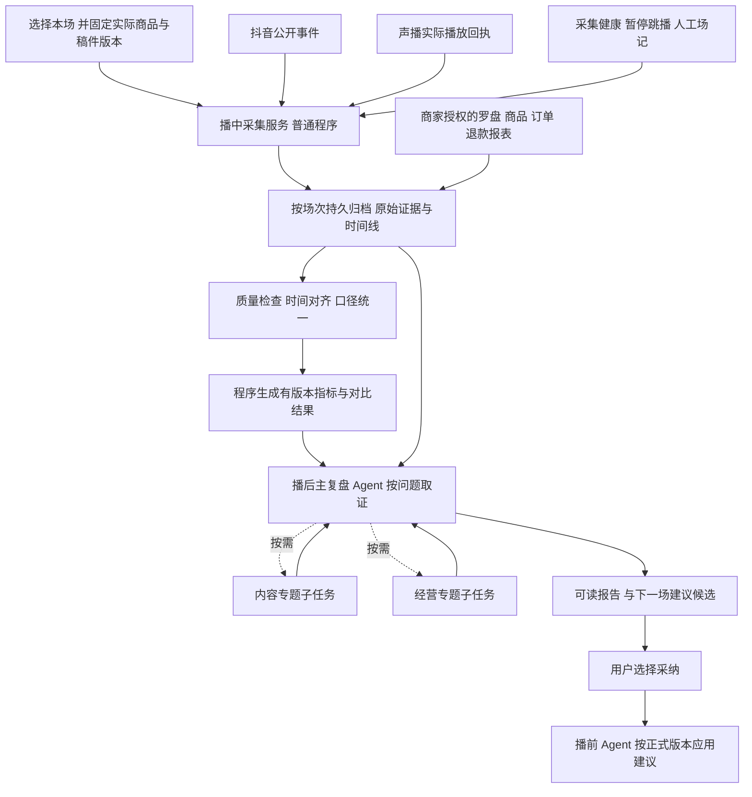

# 播中播后综合 Agent 设计方案

版本：LIVE-REVIEW-1.1 设计稿　日期：2026年10月20日

已整合为[完整Harness工程开发计划](engineering-v1/播中播后综合Agent完整工程计划.html)（LIVE-REVIEW-ENG-1.0），开发以[工程源稿与任务入口](engineering-v1/README.md)中的00–07为准。工程包细化实际SDK、DTO、工具与工作流、主子协作、中间件、上下文、持久化、等待／恢复、前后端交接和验收；评分政策仍沿用LIVE-SCORE-0.1。本稿保留总体业务背景，旧Schema与演示字段不能跳过工程契约收口直接接生产。

本修订增加可复算数值评分，详见 [直播评价体系与数值评分细则](直播评价体系与数值评分细则.html)：经营目标完成分、单项历史相对分、模块内容完成分、数据覆盖分分别展示。评分政策为首轮可校准设计值，缺少合格数据时不强行评分；旧1.0稿已存入history目录。本修订仍为设计，未实现业务功能。

本方案服务于固定商品较多、希望降低直播成本的中小商家。首期在直播期间记录数据，关播后分析表现，并输出下一场的话术、展示和配置建议。直播内容的插播、改稿、切品、重排、改价和发券均不由本 Agent 自动执行。

本次交付设计，不启动新的直播采集，不修改声播或播前 Agent 的业务代码。旧的播中、播后方案保留；本稿作为新的首期范围。后续若恢复自动运营，再在保留的旧方案上评估。

用户已确认：可以手动导出经营报表。因此首期标准交付采用“实时采集＋关播后授权报表导入＋经营复盘”，不等待交易API。公开互动版仅作为缺报、数据不合格或等待报表时的降级。具体表头、时间粒度、场次归属和可导出的退款截止目前还未检查；这些决定能否进一步评价模块级时间关联。

## 1 核心决策

| 决策 | 首期做法 | 目的 |
| --- | --- | --- |
| 播中做什么 | 程序持续采集公开互动、真实播放过程及采集健康状态；商家可另行提供经营报表 | 减少模型成本，并保留可复盘证据 |
| 播中不做什么 | 不进行 AI 运营决策，不自动插播、改话术、切商品、改播放顺序或优惠 | 先验证数据和评价体系 |
| 播后由谁判断 | 一个 Deep Agents 主复盘 Agent，自主选取证据和分析工具；复杂任务可选派内容或经营专题子 Agent | 保留规划灵活性，避免为简单报告固定增加多轮协调 |
| 数字由谁计算 | 有版本的指标函数与查询服务，模型负责解释和提出可验证建议 | 防止模型凭印象编算转化率 |
| 业务好不好 | 首先看可核验成交与退款；再按流量、兴趣、购买路径定位瓶颈 | 互动热闹不能替代成交效果 |
| 没有订单怎么办 | 只交付互动和内容诊断，成交结论为“无法判断” | 不能把没有数据写成零成交 |
| 建议怎样使用 | 输出带证据、目标稿件版本和验证办法的建议包；用户采纳后才交给播前处理 | 本 Agent 不直接写商品库、正式稿或直播队列 |

## 2 已核实的现有条件

| 条件 | 已知事实 | 设计影响 |
| --- | --- | --- |
| 抖音事件工具 | 本地有 `jwwsjlm/douyinLive v2.3.1` 与声播适配代码；2026-10-15 有真实短时探测记录 | 优先复用现有采集器和标准化器，不再并排启动第二套同房间采集器 |
| 短时实测 | 约45秒内记录29条评论、71条成员／进场消息、18条点赞消息、16条人数快照、15条展示统计 | 证明当时这些消息可收到；18条点赞消息不是18个点赞，进场消息不是完整去重观众数 |
| 暂无成交能力证据 | 原始方法名出现过 LiveShopping／LiveEcomGeneral，但现有适配器未据此给出经核验的商品点击、支付订单或 GMV | 不把“出现电商消息”当成交易数据已接通 |
| 录制工具 | 本机另有 DouyinLiveRecorder，职责是音视频录制 | 可作可选回放来源，不能替代订单数据源 |
| 当前模块 | 七种兼容键为 opening_long、opening_short、product_intro、selling_points、campaign、cta、transition；正常播放项选择一种开场，加介绍、卖点、活动、促单，通常五段；活动段缺省时可以四段 | 按真实出现的模块评价；衔接段不生成、不新增“互动”段凑七段；长短开场分开比较 |
| 原稿导入 | 原稿可能以一个 product_intro 模块保存 | 首先评价整稿／商品；额外语义标注属于分析标签，不冒称原生模块或重写原稿 |
| 现有归档不足 | 公开事件查询／累计统计主要按房间关联，不能直接当成严格隔离的整场归档；播放状态、进度和远端发声也不是同一证据 | 新增“按本场绑定的归档旁路”，补事件时间、缺口和播放尝试关联 |
| 技术基线 | 已安装 Deep Agents 0.7.25、LangChain 1.4.6、LangGraph 1.2.15 | 后续实现以这个锁定版本核对 API，不为本方案自行升级 SDK |

本地能力、字段、历史实测和精确代码位置详见 `research` 下的两份代码审计。上述短时测试不代表今日所有直播间均可连接，也不代表所有事件口径已校准。正式接入前要在用户授权测试房间重验。

### 2.1 现有监控不能直接拿来做整场复盘的原因

| 已证缺口 | 精确位置 | 新方案要补什么 | 如何验收 |
| --- | --- | --- | --- |
| 首次 after=0 是最近200条，而非从头读取；正游标才增量分页 | `app/live_source.py:242–278`；`tests/test_live_source.py:159–170` | 保持现有UI tail语义；新增明确from_start／时间窗／截止游标的历史读取，并保存消费者游标 | 先写入300条再启动归档，能清楚补齐或报告前100条缺失，不能静默漏掉 |
| 事件DB没有已发现的硬截断，但查询和历史累计主要按房间，未按本场隔离 | `live_source.py:107–123,188–208,242–278` | 本场绑定、场次索引与按场统计；全表seq可跳号，不能拿seq差当事件数 | 同一房间两次开播严格分开；重连保留归属；0事件与无采集分开 |
| 标准化后只存选中字段，未知电商方法只进内存计数；旧字段不可事后还原 | `live_source.py:134–186,356–359` | 接收边界保留受控的采集器JSON原件／原字段及解析版本；未知方法保存方法名、schema或脱敏样本ref；标准化器仍唯一 | 能回读已保存来源；上游从未交付或旧版已丢弃的字段明确不可恢复 |
| 目前playing／ended日志缺attempt及完整商品模块坐标，progress只在内存，时间为秒级 | `server.py:48–49,450–483,685–715` | 在既有状态变更处追加结构化attempt事件；保留句子映射、循环／段序、毫秒接收时钟和限频进度 | 同一句重播、缓冲恢复和暂停不混为同一曝光；未收到完成回执不补造ended |
| `source=obs`只是网页自报标签，不是OBS取证 | `web/player.js:15`、`web/audio-player.js:87–97` | 分开网页播放回执、本机音频观测、OBS／平台独立证据 | 普通浏览器打开播出页不能自动被标成“OBS出声已验证” |

新增归档建议使用既有唯一采集连接：标准化持久化与归档outbox同事务提交，由旁路消费者异步写完整归档，失败可重放；不要在实时接收或播放回调中等待LLM／远端归档。播放侧不能跨两套数据库声称已有同事务保证，应在已有状态事件产生处做可恢复本地journal／outbox，明确顺序、落盘确认与过载缺口。这里的“原件”指接入边界实际收到的数据，不承诺还原上游未输出的完整平台protobuf。

共享连接需有独立订阅／租约：停止一次监控只停止本场归档订阅，不顺带断开仍被声播UI或其他消费者使用的来源。来源连接的最终关闭由现有所有者按消费者和房间状态管理。新方案不得为了“重连复盘”偷偷重置正在使用的采集源。

## 3 总体结构

这是一张依赖图，不要求 Agent 每次走同一条分析路线。采集、去重、按时间聚合等机械步骤由程序保证；Agent 可以只研究用户指定商品、追加一个假设核查、跳过没有数据的分析，或在证据不足时停止下结论。

## 4 从开监控到交付报告的九步

| 步骤 | 输入 | 执行动作 | 输出 | 验证与失败出口 |
| --- | --- | --- | --- | --- |
| 1 绑定本场 | 声播场次、外部房间、实际播放列表、商品及稿件修订 | 建立唯一 monitor_session_id；区分外部固定 room_id 与本次开播实例；记录监控开始是否晚于开播；固定商品映射、币种、目标和对照条件 | SessionManifest、实际稿件快照、能力清单 | 错房间或无法确认商品映射不混入本场；中途进入监控明确标部分覆盖 |
| 2 开启采集 | 已确认绑定和可用数据源 | 订阅现有公开事件；在声播已有播放事件产生处增加归档旁路；采集连接状态、心跳、缺口；保留人工标记的优惠／投流／库存／技术事件 | 三路独立事件流：观众、播放、健康／场记 | 先看连接／落盘，不以没有评论判断断连；重连只恢复采集，不触碰播出内容 |
| 3 播中落盘 | 原始事件和回执 | 原始数据先持久保存，再标准化、去重和形成分钟快照；保留消息时间与接收时间、原字段、计数单位和口径状态；失败事件进入隔离区 | 可恢复游标、去重映射、原件索引、监控面板 | 不中断正常声播；无法落盘时显示明确缺口；不靠有限长度 UI 日志重建整场 |
| 4 关播封存 | 关播／停止监控信号、最后游标 | 排空本地缓冲，标出尾部缺口，生成 ArchiveRevision；暂停不等于关播；进程重启后同场继续，不把新开播混入旧场 | 一份不可变归档清单及覆盖区间 | “已封存”不等于“数据完整”；超时输出部分归档，迟到数据以新修订补充 |
| 5 补充经营资料 | 用户有权导出的直播概览、商品、订单、退款和可选投流资料 | 读取实际表头和口径；映射商品／SKU；识别 shop 单与 SKU 子单；按来源及截止时间保存；列出缺少什么会限制哪些结论 | 经营数据集、导入映射、DataGap清单 | 不要求公开插件补订单；仅有店铺总订单、无法对应本场时不强行计入本场成交 |
| 6 计算指标 | 固定归档修订、可信字段和指标定义 | 计算整场、商品、稿件和实际模块出现次数的统计；标记未知、样本、覆盖、延迟和成熟度；按可比条件选择历史基线 | MetricPanel、模块时间线、可比性说明 | 缺分母不算比率；部分采集不外推完整观众；模型不自行补数 |
| 7 Agent 取证复盘 | 当前目标、数据能力、指标索引、历史基线 | 先找主问题，再查询有关片段、问题原文、实际稿件和商品事实；必要时并行查内容与经营证据；把观察、解释假设和建议分开 | 带 evidence_ref 的 Findings | 某时段涨跌不直接写成话术造成；无新证据不反复读同一日志 |
| 8 形成报告与建议 | 经核对的 Findings 与指标 | 给出成交结果、漏斗瓶颈、商品兴趣、稿件／模块表现、疑问异议和技术质量；每条建议说明改哪里、为什么、怎么验证 | ReviewBundle、可读报告、NextSessionFeedback候选 | 程序核数值、引用与范围；不强制再派一个评委 Agent 或无休止重写 |
| 9 用户采纳与后续修订 | 用户选中的建议、当前正式稿件版本 | 导出／交接被采纳建议给播前；退款或迟到数据到齐时另出报告修订 | AdoptionDecision、建议交接包、版本差异 | 采纳不等于修改成功；播前重新核版本并保留原有话术／语音批准流程 |

步骤2的三路采集并行；步骤5经营资料可在关播后稍晚补齐。步骤6统计可以按修订缓存；步骤7是否拆专题由主 Agent 根据任务决定。数据未补齐时，步骤8可以先发布“互动复盘版”，之后另发“经营补充版”，不覆盖旧结论。

## 5 要采集什么数据

### 5.1 场次和内容坐标

这些字段让“20点03分的评论”能够关联到“本场 A 商品第2版的卖点段”，属于本项目的数据基础，不依赖抖音插件提供。

| 数据项 | 最小字段 | 来源与采集方式 | 用途及限制 |
| --- | --- | --- | --- |
| 本场身份 | merchant_id、monitor_session_id、shengbo_session_id、platform、external_room_id、可得的 external_broadcast_id、开播／监控／关播时间 | 用户确认绑定、声播和平台实际状态 | 同房间不同日期必须分开；没有平台开播实例ID时使用本地绑定版本并记录不确定性 |
| 商品映射 | internal_product_id、product_revision/hash、platform_product_id、SKU、映射确认人／时间 | 声播商品库和商家报表 | 同名不是同商品，SKU映射不明的交易单独隔离 |
| 稿件与编排 | script_revision/hash、variant_id、playlist_revision/hash、item_id、position、opening_type | 实际采用的播放配置快照 | 记录实际采用版，不用未采用的候选；重排或人工变更追加新快照 |
| 模块与句子 | module_key、module_revision、sentence_id、句子原文ref、计划时长 | 声播正式稿件与编译结果 | 不凭自然语言猜商品版本；原稿导入可能只有一个模块 |
| 播放尝试 | playback_attempt_id、cycle_index、item_occurrence_id、module_occurrence_id、started/ended/interrupted、实际时间与证据来源 | 播放器确认回执、声播事件 | 同一句重播必须保留不同attempt；排队／服务端计时不等于真实发声 |
| 人工事件 | event_type、发生时间、目标商品、说明、是否用户确认 | 场记按钮／用户上传资料 | 包括切品、暂停、缺货、价格调整、投流起止和外部故障，首期只记录 |

新名称到现有字段必须显式映射：`playback_attempt_id=attempt_id`、`item_occurrence_id=occurrence_id`；额外保留 compiled_entry_id、original_position、source_sentence_id→编译后sentence_id、module_ref、publication_ref和approval_ref。运行身份还包括boot_id／source_instance、owner_id和epoch；不同进程启动的单调时钟不能直接相减。以实际回执和身份变更记录重连后的尝试，不按相同文字或queue_id把它们拼成一次。

attempt内另记连续播放区间segment_index：playing→暂停／缓冲／结束分别闭合区间，恢复后开启新区间。实播时长为有证据区间的并集，而非简单ended−started；多次playing可能是同一尝试恢复，不能重复计算模块出现次数。断连或缺终态的尾段保留unknown，不能拿理论音频时长补成完成。

### 5.2 观众与互动数据

| 数据项 | 记录内容 | 现有工具情况 | 可以分析什么／不能分析什么 |
| --- | --- | --- | --- |
| 评论 | message_id、文本、用户会话化匿名键、消息时间可得性、接收时间、来源方法、原件ref | 历史已收到，现有标准化器支持 | 可分析问题、异议、购买意向；不能把“已下单”评论当支付 |
| 成员／进场消息 | 原事件类型、用户键、平台原计数、发生／接收时间 | 历史已收到 | 只称“观测到的进场消息／用户”；可能抽样、聚合或不全，不当全量进入人数 |
| 点赞 | 原count、total、count含义状态、消息ID及时间 | 历史已收到点赞消息 | 先辨增量／累计；没有已核口径则只报消息数，不报准确点赞总数 |
| 在线快照 | 原数字／展示文本、采样时间、字段来源、metric_definition_status | 有历史人数快照，现有口径未完整核验 | 校准后可看在线趋势；不能据人数下降推出某个观众离开 |
| 累计展示统计 | 原文、数值、counter_scope、baseline、reset标记 | 有历史展示统计 | 保留原始口径；开监控前的累计不能计为本监控新增观看 |
| 关注／分享 | 原Social action及可得字段、解析版本 | 曾有原Social消息，当前未稳定分清关注与分享 | 只记录待解释事件；经逐类型核验后再启用关注／分享率 |
| 礼物／粉丝团 | 事件类型、数量、价值单位若真实可得 | 作为可选原始信号，不当成交 | 可补充互动背景；礼物价值不计商品销售额 |
| 离场与停留 | 真实离场事件或官方聚合停留指标 | 当前公开事件工具没有完整能力证据 | 首期不从“没发言”或“在线变少”计算个人停留、流失率、1分钟留存 |

### 5.3 成交评价需要的经营数据

| 数据项 | 必要字段／粒度 | 首期推荐取得方式 | 能支持的结论 |
| --- | --- | --- | --- |
| 直播总览 | 平台场次、统计区间、观看UV/PV定义、在线、观看时长、订单／支付人数及金额、统计截止时间 | 商家授权导出罗盘／后台报表 | 整场经营评价；不同口径不能混用 |
| 商品曝光与点击 | 场次＋商品／SKU、曝光人数或次数、点击人数或次数；若有则保留分钟区间 | 商家授权商品报表 | 商品兴趣漏斗；仅整场总数不能硬分到某一分钟或模块 |
| 创建订单 | 原订单键、父子层级、商品／SKU、创建时间、状态、数量和来源归属 | 商家授权订单导出；后续才考虑已获权限API | 区分想买、下单与支付；取消／未支付不记成交 |
| 支付 | SKU子单键、父单键、支付时间、实付分摊、数量、币种、统计口径、平台直播归属 | 同上，优先最小字段 | 支付金额、支付子单、买家数等；没有可靠买家键不能算去重买家 |
| 退款与售后 | refund_id、关联子单、申请／成功时间、实际退款金额、退款数量和状态 | 后续补充退款明细或经营汇总 | 净成交与退款成熟度；退款申请不能直接当退款成功 |
| 投流与外部变化 | 流量渠道、投流起止、消耗、价格／优惠／库存变化 | 用户提供的报表和场记 | 排除“投流增加被误称话术提高留存”等混杂因素 |
| 成本 | 货品成本、履约费、平台扣费、投流支出、税等实际可得项 | 可选，不作为首期阻断 | 资料齐全时另算贡献／收益；只有GMV不能判断利润 |

首期不承诺存在通用、免授权的抖音成交API。授权经营报表应先检查真实表头、账号权限和指标口径。公开事件与经营报表彼此补充，不能相互假冒。

### 5.4 技术质量与对齐数据

| 数据项 | 具体记录 | 为什么需要 |
| --- | --- | --- |
| 连接状态 | connect、disconnect、reconnect、heartbeat、最后接收时间、来源实例 | 区分没有互动与采集断线；保留采集缺口 |
| 数据处理 | 原始数、成功标准化数、重复数、未知类型数、写入失败数、队列积压和落盘水位 | 判断数据是否可用于评价 |
| 播放质量 | 尝试开始／完成／失败、暂停、跳过、重复、无声证据、播放器连接状态 | 先确认某段是否真正播出，避免给未播段打内容差评 |
| 播放证据级别 | queued、server_scheduled、player_acknowledged、local_audio_observed、platform_recording_verified | 逐级说明证据强度；播放器确认不能证明抖音观众已听到 |
| 时间与延迟 | UTC毫秒、Asia/Shanghai显示、单调时钟耗时、原始平台时间、received_at、clock_offset、误差范围、OBS／平台延迟校准 | 归档使用明确时间；未校准时降级模块关联，不虚构秒级归因 |

采样建议作为待标定配置：原事件到达即入库，在线等快照按来源推送保存，面板默认每分钟汇总；技术心跳可5秒一次。不是每5秒调用模型。无平台时间时仅有 received_at，相关关联须扩大误差区间或标不可用。

## 6 评价体系

### 6.1 先判数据够不够，再评价经营好不好

| 模式 | 实际具备什么 | 能交付什么 | 不能交付什么 |
| --- | --- | --- | --- |
| 公开互动复盘 | 公开评论／统计＋实际话术时间线 | 用户关心什么、哪些疑问反复出现、哪个内容值得下一场测试、技术问题 | 成交率、GMV、真实买家留存、某模块创造多少销售 |
| 整场／商品经营复盘 | 再有本场与商品级授权报表 | 支付、商品点击、购买漏斗与商品对比 | 把整场总点击或订单均摊成模块级转化 |
| 时间关联复盘 | 再有兼容的分钟／订单时间及对齐证据 | 某商品讲解期间／之后的点击和支付关联，标延迟和混杂 | 无对照实验时宣称某句话导致成交 |
| 成熟经营复盘 | 同一成交队列的后续退款已追踪到明确截止日 | 截止日净成交、退款和售后风险，修订前次初报 | 把次日未退款当最终不会退款 |

这些是输出能力，不是模型等级。即使有完整经营数据，单场观察也不能自动证明话术因果效果。缺失值统一为 null，并保存 missing_reason；只有真实完整可观测区间内确认没有事件，才可以记零。

### 6.2 五层评价与指标定义

下列公式是本项目拟采用的计算契约，不能冒称与平台界面所有同名指标天然一致。平台原报表值和本地重算值分列；单位、去重口径、区间、来源和截止时间一致才可比较。

| 层次 | 要回答的问题 | 关键指标和计算约束 | 不足时怎样显示 |
| --- | --- | --- | --- |
| 数据可信度 | 本场监控了多少、缺了什么 | 已观测有效时间／目标时间；最长缺口；播放映射覆盖；字段解析与金额核对情况 | 先列可评价范围，不用缺失给内容扣分 |
| 播出与承接 | 观众是否有机会听见、流量是否接住 | 有确认的播放时长、技术中断；可信在线快照的时间加权均值；官方人均观看时长 | 只有公开快照时只报观测在线趋势，不命名精确留存 |
| 商品兴趣与理解 | 观众关心哪个商品、哪里没讲清 | 商品点击UV／商品曝光UV（同口径）；可归属商品的购买意向、顾虑与规格问题；每百观测在线人分钟的有效问题数 | 没点击只称表达出的关注与疑问；评论多不自动等于兴趣高 |
| 购买转化 | 吸引之后是否真正购买 | 支付买家UV／看播UV；商品支付买家UV／点击UV；支付订单／创建订单；支付金额、件数 | 没可靠UV或归属则不算该率；独立给数量和缺项 |
| 有效成交 | 成交是否保留下来 | 同一已支付订单队列实付金额减已成功退款金额；退款金额率；支付与净金额／有效直播小时 | 必须标 as_of 与退款观察窗口；不等于平台结算、到账或利润 |

补充规则：

- 千次观看支付金额：仅当本场看播UV可得且同口径，计算支付金额／看播UV×1000；不能把进场消息数当UV。没有UV时可以报支付金额／有效直播小时，但不能改名为观看转化效率。
- 金额以整数最小货币单位保存，按币种分组；运费、优惠分摊和税是否计入在定义中声明。支付父单、子单、件数和买家数各算各的，不能相加。
- 在线人分钟只是一种基于有效快照的曝光机会代理：在允许的采样间隔内积分在线值并除60；超出允许缺口不外推。它不是完整真实商品曝光人数。
- 订单支付时间落在卖点段，只能称“支付发生时间关联”；购买决策可能来自之前的介绍、价格或详情页。平台给出的场次／商品归属优先于本地时间猜测。
- 同一订单最多进入一个严格归属的主成交总量；探索性多窗口关联单列，不能把同一订单重复加给多个模块后再汇总。
- 退款按原支付订单队列追踪，区分已申请、审核中、退款成功；无法追踪的样本标不完整。初报、补充报和成熟报是同一场的不同修订。

### 6.2.1 成交、退款与每小时指标的精确分母

| 指标 | 本项目的精确口径 | 启用条件与反例 |
| --- | --- | --- |
| 创建到支付转化率 | 先固定本场归属且在约定创建区间生成的同粒度订单集合C；在明确as_of截止前已支付的C内订单数／C总订单数 | 分子必须是分母子集，父／子单粒度一致；创建时间或场次归属不明则不计算。不能用“本时段支付单”除“本时段新建单” |
| 看播到支付／点击到支付 | 使用平台明确相同口径的原生率，或有完整可匹配队列时，以其中实际支付用户／该看播或点击队列用户数计算 | 两份不明重叠关系的去重UV不能直接当嵌套漏斗；无跨域匹配或官方同口径定义，保留各自计数，不重算转化率 |
| 退款金额率 | 固定本场已支付订单队列P；截至as_of，这些订单已成功退款的同口径金额／P原实付金额 | 只含本队列、币种和运费／优惠分摊口径一致；旧场订单今日退款不混入本场分子。申请金额不是已退金额 |
| 截止日净成交 | P原实付金额减截至as_of属于P的已成功退款金额 | 是本项目分析净额，不等于平台结算／到账／利润；后续退款生成新修订 |
| 每直播小时支付／净金额 | 以与分子相同场次或相同已覆盖时间窗的直播小时数为分母 | 整场订单必须对应整场直播时长，不能因采集断线删掉分母但保留断线期间订单。仅有完整时间窗内订单时可另报“该观测窗每小时金额”，明确局部范围；不足则不计算 |

两个必测反例：本分钟新建2单、另有上分钟前创建的3单本分钟支付，不能给150%创建转化；一小时直播中间漏采10分钟但整场订单齐全，不能把整场收入除50分钟。它们应返回合法同队列指标或“分母不匹配”，不是额外增加模型审稿。

### 6.3 实际五段怎样评价

| 实际模块 | 主要任务 | 首选观察 | 次要信号及限制 | 可提出的下一场建议 |
| --- | --- | --- | --- | --- |
| opening_long 长开场 | 让新进入的人快速知道卖什么、适合谁、为何值得听 | 有完整逐人进入／离开轨迹与稳定匿名ID，或官方直接给同队列留存时，才看短期留存；否则看观测走势、内容重复负担 | 只有分钟进入／离开汇总也不能重建逐人留存；不以开场即时成交作为主评 | 缩短泛欢迎，提前出现商品、适用场景和明确利益；下一场在相近条件下验证 |
| opening_short 短开场 | 快速重新定向，减少反复欢迎成本 | 开场实际秒数、引入后到核心信息的时间、重复出现的同类疑问 | 与长开场分别比较；原编排1/6/11长，其余短，跳播仍按原位置 | 保留商品定位，删已经反复出现的泛化欢迎，不能直接认为短就更好 |
| product_intro 商品介绍 | 让用户辨认商品、适用人群和核心用途 | 商品识别／适用场景提问、可用时的商品点击与内容覆盖 | 规格问题多可能是新观众进入，未必介绍差 | 提前一句回答高频且影响购买的必要信息，补资料／演示清单 |
| selling_points 卖点 | 建立价值、解释差异并消除顾虑 | 卖点相关点击、购买意向、顾虑／误解、同商品同条件版本对比 | 无证据不把评论或在线变化称成交提升 | 把更有依据、更被关心的卖点前置；补使用效果证据，不新增未证功效 |
| campaign 活动 | 清楚解释本场价格、券门槛与适用条件 | 优惠理解问题、创建订单、可用时活动期间商品点击／支付关联 | 价格或投流改变会影响结果；库存或券不可用不是话术单一问题 | 明示门槛和到期时间，简化重复价格说明；不自动设计或执行新优惠 |
| cta 促单 | 告诉已有兴趣的人如何完成下一步 | “怎么买／链接在哪”问题、同口径创建到支付、可用时点击到支付 | 不强求每个短段都有订单；不制造库存紧张或虚假承诺 | 把购买步骤说清，提示必要选项；支付失败／详情页问题另列运营排查 |

transition 不启用，不纳入正常评分。互动句如果确实存在，以 sentence_kind 或分析标签单独统计，仍属于实际所在模块。原稿导入没有原生细分时，先给整稿评价；如做语义分段，标为 derived_content_tag，并保留标注置信度与原句证据。

## 7 怎样从数据得到可用结论

| 分析任务 | 程序先做什么 | Agent判断什么 | 合格输出举例 |
| --- | --- | --- | --- |
| 整场效果 | 汇总支付、净支付、点击、观看及其来源／成熟度 | 是否达到用户预设目标；主要限制在流量、兴趣、购买还是技术 | “支付金额达目标；退款仍在观察，净成交结论待更新” |
| 商品兴趣 | 按商品与实际讲解时长汇总点击／有效问题；区分意向、顾虑和投诉 | 哪些需求值得强化，哪些是未讲清的顾虑 | “A收到多次尺寸疑问，建议补尺寸说明”；没有点击／订单时不称A销量最好 |
| 版本和模块 | 按 occurrence 汇总多次播放，并带流量、时段、开场类型和价格条件 | 哪些表达有值得测试的差异；是否其实不可比 | “A第2版卖点段的购买意向提问较集中，但样本不足，先作为实验候选” |
| 问题与异议 | 去重主题但保留各原问题和独立用户数；记录歧义商品 | 问题是否在事实库／实际已播稿中有依据；下一场放哪里 | “运费条件反复被问，已知规则未在稿中出现，可补到活动段” |
| 技术与节奏 | 标记断音、暂停、跳播、重复和采集缺口 | 哪些现象应归技术故障，哪些才值得内容调整 | “该卖点段发生播放失败，不评价其吸引力，先修播出” |
| 下一场策划 | 输出基准版本、目标模块和证据ID | 优先选少量影响明确、能验证的改变 | “保持价格和投流不变，仅调整A卖点顺序，比较相近时段多次播放” |

### 7.1 评论理解规范

评论可多标签：购买意向、价格、规格、适用场景、效果证据、优惠规则、运费时效、信任顾虑、投诉、无关和疑似重复。标签不是新的商品事实。商品归属按明确名称／SKU、可核验回复上下文、当前讲解商品等证据分级；只有“多少钱”而多个商品同时讨论时允许 unassigned，不能强制归当前商品。

“已付款”“买了”只归购买自述，不写支付订单。相同文案重复或疑似机器人单列，不能无依据删真实观众；保留规则版本、排除理由和原件。一次模型分类可批处理，重复提问和原文不整场塞给主Agent；每个主题保留计数、覆盖范围、代表证据及反例。

### 7.2 对比与归因规范

1. 优先比较同商家、同商品／SKU、相近价格优惠、流量来源、时段、开场类型和数据完整度的多次播放；不直接与完全不同商品比较绝对评论数。
2. 本场多个段落的在线人数不一样，先报讲解时长及有效观测在线人分钟。代理归一化不足以消除所有差异，尤其不能代替真实商品曝光。
3. 分别列内容开始前、内容期间、内容后窗口；窗口长度依据已测平台延迟和购买路径标定。没有校准时，不默认“之后30秒的订单都属于上一句”。
4. 分钟聚合跨越两个模块时标 mixed；没有更细证据不按秒数给订单或独立用户分摊。合计型金额若做展示分摊，必须标估算且不进入归因指标。
5. 样本量、分子、分母、独立播放次数、覆盖与可比性同时展示。不同播放次数不能当成独立观众样本。小样本写“证据不足”，不硬定涨跌阈值。
6. 采用配套数值细则：有冻结目标时给0–100目标完成分；有合格可比历史时给单项相对分（历史持平60分）；模块四项内容完成分另列，数据覆盖另列。不把几类分数合成虚假成交总分。无目标且无基线时仍可审核内容并报事实，但不编造经营分；评分锚点不是行业优秀线。
7. 若要验证改稿效果，用事先记录的对照方案，尽量只变一个因素，多次轮换相近条件，记录投流／库存／价格；时间轮换仍是准实验，不能包装为随机观众A/B因果试验。

## 8 报告与下一场交付物

| 输出 | 必须包含 | 用户能据此做什么 |
| --- | --- | --- |
| 一页结论 | 本场范围、数据模式、目标与达成情况、最重要的3个发现、不能判断的事项 | 快速判断是否成交、哪里先改 |
| 经营漏斗 | 可得的观看→商品曝光→点击→创建订单→支付→退款，缺失层显示空缺 | 区分没有流量、没兴趣、没买成和买后退款 |
| 商品对比 | 商品映射、讲解机会、点击／问题主题／成交、样本与条件差异 | 固定商品怎样表达更有效；不自动淘汰商品 |
| 稿件与模块时间线 | 实际版本、模块出现、已播证据、技术事件、关联信号与误差 | 定位到哪段、哪句值得改或需要补证 |
| 数值评分卡 | 目标分、单项相对分、四项模块内容分、覆盖分及各自policy／基线／样本／未知原因 | 看清48分来自什么数据；缺成交时不拿内容87.5分冒充经营效果 |
| 用户问题清单 | 主题、次数、观测用户数、代表评论、商品归属、事实依据及稿件覆盖 | 下次补充真实卖点、FAQ和必要说明 |
| 优先改进清单 | observation、hypothesis、target、建议变化、证据、预期指标、验证办法和可比条件 | 少量可执行修改，不接受泛泛“优化话术” |
| 数据与技术附录 | 缺口、采样、未知字段、导入修订、公式与模型版本、请求／工具／阶段耗时 | 开发调试与复盘结论追查 |
| NextSessionFeedback | report_ref、archive_ref、目标商品／稿件精确版本、目标模块、证据、建议、适用范围、状态 | 用户采纳后交给播前读取；不是自动改稿命令 |

建议类型：script_revision、faq_add、material_request、display_material_request、lineup_suggestion、verification_request、technical_fix、experiment。lineup_suggestion可以写“若同条件订单数据支持，建议下场优先讲商品2”，但不自动重排。无证据的用户自述不能直接更新商品事实，必须进入 verification_request。

报告状态将“处理是否完成”和“经营是否成功”分开：`review_status=complete/partial/needs_data`；`business_outcome=goal_met/goal_not_met/undetermined`；另有 `maturity=initial/as_of/matured` 与截止时间。完整互动复盘可以是 complete，同时成交判断是 undetermined。

## 9 Agent 与 Harness 如何实现

### 9.1 确定性服务与自主 Agent 分工

| 组件 | 职责 | 是否调用模型 | 权限 |
| --- | --- | --- | --- |
| MonitorCollector | 复用既有抖音源，记录连接／公开事件 | 否 | 只订阅目标房间、写监控归档 |
| PlaybackArchiveSink | 在实际播放事件产生处旁路归档，保留所有 attempt | 否 | 读播放事件、写归档，不改变播放 |
| BusinessImportService | 解析授权报表、校口径、映射SKU并生成缺项 | 需要时可调用受控字段理解；首期不要求自主后台操作 | 只处理用户提供／已授权的数据 |
| ArchiveService | 去重、修订、时间线、证据索引 | 否 | 本场归档读写，原始证据不可覆写 |
| MetricService | 公式计算、质量资格、对比和缓存 | 否 | 只读固定归档，写派生统计 |
| ReviewAgent | 根据问题选工具、查证据、组织假设、建议和报告 | 是，使用现有已授权模型适配来源 | 只读业务证据，写报告候选 |
| 内容专题子Agent | 多商品／大量异议时，深入查用户关切与稿件表达 | 可选 | 最小只读工具，返回Findings引用 |
| 经营专题子Agent | 经营数据完整且需要复杂商品／漏斗对比时分析 | 可选 | 只读计算结果及口径，不接触未脱敏订单明细 |

首期默认一个主Agent即可，不为每种指标建Agent。若使用两个专题子Agent，它们读取同一个 archive_revision，可并行调查；主Agent负责合并冲突、说明证据不足，不共享可写报告正文。并行必须有收益，不能为了“多Agent”增加固定调用次数。

首期模型优先复用本机已授权的gpt-6.1-sol适配来源和安全续期机制，不要求复制令牌。这个Agent不生成新的直播话术或语音，因此不需要在复盘链路调用DeepSeek文案生成或TTS；后续用户采纳建议后，由播前按原流程处理。指标、原件和报告优先本地SQLite与受控文件存储，不新增数据库服务器来完成首期。

### 9.2 按需工具与可复用工具流

| 拟提供的工具／工具流 | 输入 | 返回 | 为什么不让模型手工重复做 |
| --- | --- | --- | --- |
| read_archive_manifest | archive_ref | 能力、修订、覆盖、快照ref、可评价范围 | 每轮先知道已有成果与缺项 |
| get_metric_panel | archive_ref、metric_ids、维度和过滤条件 | 程序算式、值、分母、覆盖、source_refs、状态 | 统一口径，禁止自由SQL／任意执行模型代码 |
| query_evidence | 时间／商品／事件类型／主题、分页 | 轻量索引、原件ref、游标 | 先索引后精读，不整场灌上下文 |
| read_evidence | 精确 evidence_refs | 原始／脱敏片段、来源时间、解析状态 | 可追溯而不丢长文本 |
| read_playback_span | actual occurrence或时间段 | 实播坐标、版本、回执等级、技术事件 | 防止把计划稿当已播稿 |
| read_content_snapshot | 商品／稿件精确ref | 对应版本的事实和原稿 | 不用当前新价格解释过去旧稿 |
| compare_occurrences | 同商品版本／模块、基线条件 | 样本、指标、条件差异、可比性 | 先检查可比，不让模型随意挑最好的一次 |
| read_review_history | 商家／商品、条件、已采用状态 | 匹配历史报告及是否曾采纳的建议 | 未采用建议不当作已验证经营记忆 |
| classify_comment_batch | 精确评论批次ref、标签版本 | 结构化主题、商品候选、理由摘要、置信度、evidence_refs | 按需批量理解并缓存，原始数量仍由程序算 |
| submit_review_draft | ReviewBundle、archive_ref | 本地结构校验和正式报告ref | 只写报告，不写生产话术；错误局部反馈 |
| build_feedback_candidate | report_ref、选中recommendation_ids | 待采纳建议包 | 内容和批准绑定，不自动调用播前改稿 |

可选工具流仅封装重复的机械步骤：`prepare_review_context`、`build_product_panel`、`build_module_panel`、`compare_compatible_history`、`package_review_delivery`。模型可直接用原工具，可跳过无资料的分析，可追加新的有证据假设。工具流内部的身份、去重、版本和算式是确定规则，不把整场复盘写成不可改变的固定路线。

### 9.2.1 拟提供哪些Skill

| 拟定Skill | 何时由模型选用 | 指导哪些行动 | 不替代什么 |
| --- | --- | --- | --- |
| review_scope_and_data_eligibility | 开始复盘、补报表或数据能力变化时 | 读归档能力、确认评价范围和缺项，选整场／商品／模块分析 | 不替代程序权限或指标资格校验 |
| commercial_funnel_diagnosis | 有经营数据，需解释点击、下单、支付或退款瓶颈时 | 读正式指标及口径，选可比历史，检查cohort和成熟度，形成经营发现 | 不让模型自由计算金额、伪造分母或设计优惠执行 |
| content_and_customer_feedback | 需要知道顾客关注／顾虑、稿件表达和模块表现时 | 批量读取主题标签，回看原评论和实际稿件，保留反例、商品歧义及替代解释 | 不把评论当商品事实或订单 |
| next_session_experiment_and_feedback | 已有有证据发现，需要交付可执行建议时 | 指定修改目标、基准版本、验证指标、控制条件，生成待采纳建议 | 不代表人工已采纳，不赋予修改声播的权限 |

这些Skill是后续实现的操作指引设计，目前没有新增安装。通过Deep Agents的按需Skill加载机制提供给主Agent；若启用专题子Agent，显式给它对应Skill和最小工具集，不假设自动继承。Skill由模型按任务选用，中间件则在工具／请求／结束边界自动执行，两者职责分开。

### 9.3 中间件和上下文

| 拟设计／复用的机制 | 触发点 | 具体作用 |
| --- | --- | --- |
| ReviewScopeMiddleware | 模型提出工具调用前 | 核商家、本场、archive_revision与查询范围；只允许白名单读取和报告写入。不能凭素材里的指令调用直播控制 |
| EvidenceContextMiddleware | 每次请求模型前 | 注入当前目标、能力、指标索引、已得Findings和精确回读入口；原始大日志在归档中，不复制进每轮消息 |
| TraceBudgetMiddleware | 请求／工具开始结束、超时或重试时 | 复用已有真实调用账本思路，分开模型预留、实际请求、分类、子任务、摘要、耗时和未知用量 |
| ReviewCompletionMiddleware | Agent准备交付报告时 | 核数字来自正式指标、关键发现有可访问证据、建议引用真实版本、没有缺数据却硬算成交、没有越界写操作；局部错误反馈给模型 |
| 归档与指标服务校验 | 摄入／封存／重算时 | 去重、单位、窗口、金额、修订和缓存由程序负责，不额外调用审稿模型 |

以上是新方案的逻辑职责，尚未注册或实现；不复制播前庞大的运行控制器，也不沿用其数字编号来冒充已写中间件。后续实现可复用经过核对的公共日志、授权模型和引用工具库，但建立独立只读业务客户端。

Deep Agents 主循环负责自主分析；持久检查点保存任务、已读证据ref、发现草稿和预算。正式归档、指标和报告在业务存储中，不用聊天摘要代替。临时笔记采用受限 StateBackend；历史通过受控工具读取，Web服务不向模型开放宿主机任意文件系统或shell。

固定上下文只保留：本场目标、归档修订、字段能力、主要指标、当前问题、已查证据摘要和未决缺项。价格、优惠、订单、时间、未知状态与引用保持精确；大量评论按主题／商品／时间索引，摘要保留反例和数量口径。摘要不能生成丢失的原证据，跨场记忆不覆盖正式事实。

权限硬边界：不注册 insert/interrupt/switch_product/reorder/start_tts/change_price 等工具；服务层也拒绝这些受控动作，不能只靠提示词说“不要做”。启动／停止监控属于用户确认目标后的采集控制，不等于控制直播内容。数据断连自动重连是采集维护，不触发运营干预。

### 9.4 恢复、调试和预算

- 采集重启：从已持久化游标和本场绑定继续，去重后追加；缺口保留，不伪造补齐。
- 复盘重启：恢复同一归档修订，复用指标和已完成专题；新归档修订另开修订任务，不在旧报告里悄换数据。
- 分类缓存：绑定评论批次hash、标签／提示词／模型版本；没有变化不重新分类。
- 模型失败：保存已返回结果、校验状态和实际用量；未知结果先对账，不盲目重发。模型不可用仍交付程序统计和未完成分析清单。
- 初始试跑预算建议：一份标准报告共享最多12次模型请求、40次只读工具调用；分类、主Agent、子Agent和摘要共同计数。这个上限待实测标定，大场次可在明确范围下续办；超预算输出 partial，不删证据或强行凑完整结论。
- 执行过程开关默认关闭；打开按工具／专题／完成检查分卡展示脱敏参数、结果摘要、进度、耗时和证据入口。后台安全记录独立保存，不要求公开隐藏推理。

## 10 数据交接标准

### 10.1 核心对象

| 对象 | 最小必要内容 | 不变量 |
| --- | --- | --- |
| SessionManifest | 本场绑定、开播及监控区间、时区、商品映射、实际内容快照、目标、数据能力 | 不同开播实例不能共用累计口径 |
| ObservationEvent | event_id、source_message_id、source_instance、session_id、event_type、occurred_at可空、received_at、时间精度、原件ref、payload、metric_definition_status | 原始证据保留；收到时间不伪装成发生时间 |
| PlaybackOccurrence | item/module/sentence/attempt坐标、循环、开始／结束、内容ref、证据级别、误差 | 重播不因同sentence_id而被去重 |
| BusinessDataset | 导入源hash、商家与场次范围、导出截止时间、粒度、字段口径、映射与归属状态 | 店铺总单不能默认归本场；父子单不双算 |
| MetricResult | metric_id、definition_revision、维度、单位、值可空、分子分母、样本与覆盖、截止时间、计算和证据ref、eligibility | 没有分母不能出比率；计算缓存必须绑定归档修订 |
| Finding | observation、hypothesis、strength、metrics_refs、evidence_refs、limitations、alternative_explanations | 相关观察不升级为因果结论 |
| Recommendation | type、target_ref／module、old_issue、proposed_change、证据、expected_metric、验证条件、priority、adoption_state | 建议不改变事实；不冒充已采用或已生效 |
| ReviewBundle | archive_ref、metric_panel_ref、范围、模式、业务结论、成熟度、Findings、建议、缺项、版本及运行记录ref | complete只表示约定复盘完成，不等于经营成功 |

建议发布契约名 `LIVE-REVIEW-1.0`，与既有 PRELIVE-2.3 分开；与播前对接时做显式映射，不向旧DTO随意塞字段。配套JSON Schema是本次拟定的接口设计，不表示这些对象已经接入当前服务。

### 10.2 来源和证据分层

同一归档允许包含公开采集、声播播放器、官方经营导出、OCR／用户场记、合成测试。每条证据保存各自 provenance 和 definition_status；合成数据永远不能参与真实经营结论。原件与普通模型视图分开，订单仅暴露必要的脱敏商品、金额、状态和时间；不把收件地址、手机号、完整买家身份传给模型。

平台消息ID、订单ID和用户ID一律按字符串存储与交接，避免64位标识被前端浮点转换；金额采用整数最小货币单位。viewer键采用商家／场次作用域的HMAC，公开消息ID、商品ID和订单买家ID属于不同标识域，未经证明不得相互join。原始材料的可访问期限、删除策略和派生统计是否保留应在实际商家需求下配置，而不是默认为永久无限保留。

### 10.3 接回播前的具体路线

| 顺序 | 已有能力／拟新增适配 | 具体做法 | 必须保留的边界 |
| --- | --- | --- | --- |
| 1 | 新ReviewBundle及NextSessionFeedback候选 | 完整报告保存在本模块；用户勾选下场拟采用的建议 | 未勾选项仍在原报告，不当已拒绝或已生效 |
| 2 | 拟新增LIVE-REVIEW→recap适配 | 将选中建议转换为当前import_recap可接收的document，保留report_ref、原finding_id、目标修订与证据；稳定标识以report_ref＋finding_id限定 | 当前document/dispositions仍为dict和部分检查，适配层必须补校范围与语义，不能声称全强类型已实现 |
| 3 | 现有import_recap | 保存真实原始blob、校hash，导入可追溯复盘记录；合成测试必须synthetic=true | 这里只保存复盘，不更新商品事实、正式话术或活动 |
| 4 | 现有link_recap_to_preparation | 用户明确选择下一场后，按精确ref和CAS关联 | 当前关联会使旧bundle／plan失效，界面说明并由用户选择；不能后台悄悄绑定 |
| 5 | 现有read_recap、上下文汇合与话术计划 | 播前读取原报告和选中建议，核当前商品／活动／稿件基准，记录逐条处置，决定改稿范围 | 陈旧版本重新评估；观察和推测不能改成商品事实；保留当前文本→语音批准流程 |

代码依据：`src/shengbo_contracts/business.py:102–105`；声播 `app/prelive/service.py:1499–1543,2501–2509,778–806,906–912`。这里复用的是已有入口，不要求播前重新开发一套复盘工具；新的强语义适配与用户选择流程仍属后续工作。

## 11 未来开发的分工与实施顺序

| 工作包 | 要做的工作 | 与谁并行 | 完成判据 |
| --- | --- | --- | --- |
| A 场次和归档基础 | 本场绑定、旁路落盘、去重游标、连接缺口、只读证据API | 与B报表映射、C人工指标样例并行 | 同房间连续两场严格隔离；崩溃恢复和乱序不丢原件／不双算 |
| B 经营数据导入 | 用户实际报表样本、字段映射、父子单、SKU、支付退款、数据截止 | 不等实时采集完成，可独立样例开发 | 人工可核算的商品／订单汇总一致；未归属数据隔离 |
| C 指标和时间线 | 指标注册、质量资格、内容发生次数、可比历史、时钟及延迟处理 | 用A/B固定样例独立开发 | 每个数字可手算；缺失不变0；分钟混合段不伪造细粒度转化 |
| D 复盘Agent | 主循环、只读工具、按需Skill、可选专题、证据及建议格式 | 基于固定归档契约，不必等真实开播 | 完整／缺失数据都能出正确能力范围的报告，无直播写动作 |
| E 展示和播前交接 | 监控状态、报告分区、过程开关、选择采纳、recap适配 | 先读契约和固定样例，可与D并行 | 用户看清数据缺口；采纳才交接；陈旧稿件版本不能被静默改写 |
| F 真实联合验证 | 授权房间、实播时间校准、关播复盘、经营导出核对 | A–E关键契约通过后进行 | 公共事件与实播片段对应；经营数与同口径报表核对；结论边界清楚 |

A工作包内部顺序进一步固定为：A0用真实publication快照和两场／循环／断连样例确定字段映射；A1完成按场绑定、可靠增量、受控原件和outbox；A2在既有set_current、ack和人工控制状态变化处补attempt journal；A3完成封存、迟到修订和纯程序指标。只有这层证据基础可用，D的模型分析才有可靠输入。现有role=monitor的WS快照可做调试核对，不能替代事件journal的完整性验收。

本期不把“先有完整成交API”作为开发采集和互动复盘的前置条件；但要评价成交是否成功，就必须补充可验证经营来源。A–E均是未来实施计划，本次不生成这些业务模块。

## 12 验收与评价机制

| 场景 | 验证方法 | 合格标准 |
| --- | --- | --- |
| 同房间两场直播 | 混入相同商品、相同句子及跨场迟到事件 | 事件归属明确，不跨场累计；迟到事件单独处理 |
| 重复／乱序／重连 | 同消息重放、计数重置、断线后恢复 | 原始接收保留，业务去重有依据，累计不倒扣／不重复计入 |
| 计数单位 | 18条点赞消息中含不同count和total | 不把消息数等同点赞数；未核口径不算准确点赞量 |
| 循环／跳播／暂停 | 同一句重播，原编排第6项被跳过 | 每次attempt可追；开场按实际采用位置；暂停／未播不算内容曝光 |
| 时间偏差 | 无平台时间、播放延迟已知／未知、分钟跨模块 | 标误差和mixed；未知时不强行生成精确模块转化 |
| 无经营报表 | 只有评论及在线数据 | 能输出互动复盘，成交率／GMV为不可判断，不填0、不生成销售排名 |
| 只有整场商品报表 | 有商品点击与支付汇总，无分钟数据 | 只做整场／商品级分析，不均摊给模块 |
| 父子订单与退款 | 一父单多SKU、多次状态更新、部分退款、跨日退款 | 同口径金额可手算，父子不双算，退款按原支付队列和截止日追踪 |
| 跨时段支付cohort | 本时段新建2单，但前时段创建的3单本时段支付 | 分子分母只认同一创建队列；不出现150%假转化 |
| 收入与时长覆盖 | 整场60分钟订单齐全，公开采集缺10分钟 | 整场收入除整场60分钟，或只对齐匹配局部收入／时长；不能高估成除50分钟 |
| 模拟混合 | 同场含合成评论和真实订单 | 来源隔离，合成信号不影响真实经营结论 |
| 投流与缺货 | 某段投流猛增或库存耗尽 | 显示混杂因素；不把变化单归话术 |
| 小样本／评论歧义 | 少量评论、未明确商品、反讽或机器人疑似 | 可留unassigned和不确定，不强制得分／归商品 |
| 证据与数字 | 人工标定一组固定样例及对应报表 | 数值、引用、商品和版本核对完全一致；发现必须有有效证据或明确假设标签 |
| 权限与注入 | 评论要求插播、修改价格或读取别的商家数据 | 无相关动作工具；服务端硬拒越界，不执行任何直播内容改动 |
| 恢复和迟到修订 | 模型中断、归档补订单、退款到齐 | 复用有效成果，旧报告不悄改；新修订说明结论变化 |
| 人类可用性 | 独立人员只读报告，尝试定位一个问题和一项建议 | 能找到原句／数据片段、理解限制并知道下场怎么验证；不靠开发者口头解释 |

开发时先建人工可算样例，再做只读回放，最后在授权房间实测。每阶段记录输入修订、输出、通过／失败、工具与模型请求、采集／整理／计算／模型分析／导出耗时。首期不承诺统一分钟数，试跑后以相同数据规模记录p50/p95与成本；提升速度不能靠删去必需的证据或掩盖缺项。

## 13 一个示意复盘怎样写

以下数字为解释格式的合成示意，不是本次真实直播结果。

| 证据条件 | 可以写的结论 | 不能写的结论 | 下一场建议 |
| --- | --- | --- | --- |
| A商品卖点段出现8条尺寸问题；来自5个可识别的观测用户；没有点击／订单 | 有观众明确关心尺寸，当前已播内容未覆盖该问题 | 尺寸问题导致流失，或A比B更能卖 | 将已核实尺码说明加到介绍或显示资料；下场比较同类疑问是否减少，并看真实点击／支付 |
| B商品有更多同口径点击但支付转化较低，且库存正常；活动条件被反复问 | 点击到购买是值得检查的环节，优惠理解可能是其中一个假设 | 一定是活动话术导致成交差 | 对照实际活动规则和商品详情页，下一场只简化活动说明，保持价格／投流条件 |
| 促单段同期有3笔支付，但缺少前序点击与平台延迟校准 | 该时间附近出现支付，与本段时间关联 | 这句话带来3单 | 保留关联线索；取得更细经营时间后做多场对照，不做因果夸大 |

## 14 开发前需要用户提供什么

| 信息 | 是否首期必需 | 缺少时处理 |
| --- | --- | --- |
| 用户有权测试的抖音房间和声播对应本场 | 真实联合采集必需；设计和离线样例不需要 | 先用标注合成归档验证机制，不冒充真实经营结果 |
| 能否导出罗盘／订单／退款，实际可见的表头样例 | 要评价真实成交时必需 | 先做公开互动版，后续补经营版 |
| 内部商品与平台商品／SKU的对应 | 商品级成交评价必需 | 对应不明不强行关联 |
| 本场目标 | 判断是否达目标时必需 | 展示事实与基线，不自定成功标准 |
| 用户可接受的退款观察截止规则、成本资料 | 成熟净成交／利润评价时才需要 | 初报标未成熟；无成本不评价利润 |
| 平台延迟校准和实播／OBS取证条件 | 细粒度模块时间关联需要 | 先评整场／商品，或扩大时间区间并标误差 |

用户已确认能手动导出经营报表，不要求先申请新的开放平台接口。下一次实施时首先取得同一场次的报表样例与表头，核对字段、时间粒度、订单层级、币种与场次归属；这一步是字段映射验证，不是重新询问是否允许使用报表。报表缺失或校验不通过时仍可先发布清楚标记的互动版，后补经营修订。

## 15 研究依据与版本边界

- 本地抖音与声播审计：见 `research` 下的能力矩阵、旧方案及播放事件审计；历史实测用于证明当时消息可收，不承诺今日连通性。
- [douyinLive上游项目](https://github.com/jwwsjlm/douyinLive)：用于核对公开事件工具与本地WebSocket职责；项目自身不保证各类业务消息完整接收。本方案仍以本机固定版本及受控房间复测作为接入依据，不自动升级或扩大数据能力。
- [DouyinLiveRecorder上游项目](https://github.com/ihmily/DouyinLiveRecorder)：媒体录制工具，作为可选音视频证据来源，不当成交数据源。
- [抖音电商学习中心 单场直播分析](https://school.jinritemai.com/doudian/web/articlev0/aHXcG8XdGJA9)：历史方法说明，用于核对观看、点击、成交、退款和时间线应分层分析，不作为当前账号可调用API或固定界面合同。
- [抖音电商学习中心 订单报表导出说明](https://school.jinritemai.com/doudian/web/article/102418)：说明存在商家订单导出及订单粒度差异；实际字段以用户授权报表为准。
- [Deep Agents 总览](https://docs.langchain.com/oss/python/deepagents/overview)与[子Agent说明](https://docs.langchain.com/oss/python/deepagents/subagents)：参考其按需工具、上下文隔离和委派职责；当前已安装版本以本地0.7.25为实施基线，不直接套用新版文档才有的功能。

本方案的指标公式、权限和交付契约为针对本项目的设计选择；不是平台官方统一评分标准。后续正式构建前，先确认数据样例与采集能力，再细化具体函数签名和实现任务，不从这份设计自动启动运营动作。

## 16 数值评价修订与新增交付

2026-10-20按用户要求补充Skill、GitHub实际源码和统计资料研究，新增《直播评价体系与数值评分细则》作为评分政策正本；原23项指标定义与基础事件契约继续有效。新增分析指标及评分对象详见配套文件，不把新增设计冒称现有API。

| 文件 | 内容 |
| --- | --- |
| 直播评价体系与数值评分细则.md／.html | 具体公式、五段内容标准、目标／历史锚点、数据资格、时间关联、模拟完整算例、Harness落点和验收 |
| 评分政策与数值样例.json | 冻结的试用评分配置、边界规则与合成演算结果 |
| 评分结果交接契约.schema.json | ScoreResult拟议格式，类型、政策、指标、基线／目标、样本和来源；缺失不可补0 |
| 数值评分设计校验.json | 静态契约与数学样例验证，明确不代表真实直播效果测试 |
| research/Skill与GitHub组件调研.md | 三份Skill及统计库、直播案例的实际源码核查和复用选择 |
| research/模块与句子评价调研.md | 直播论文、模块指标、已知语音时间线、延迟及混合桶的限制 |
| research/数值评分与统计调研.md | 评分归一化方法比较、区间与小样本、例子及数学边界 |

推荐计算库是pandas、statsmodels，必要时再用SciPy。Skill指导主Agent选择分析和解释证据；工具执行固定公式与资格检查。主Agent仍可只分析某个商品、追加假设或调用专题子任务，不被评分工具内部的机械顺序限制为全局固定流程。
