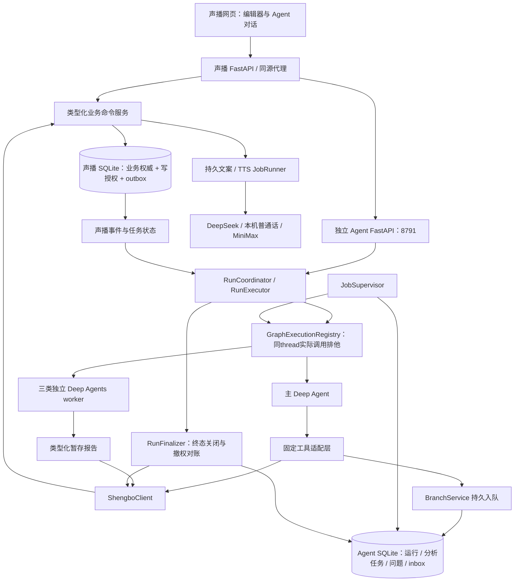

# 声播播前 Agent：后端工程设计 v2

状态：待实现设计。日期：2026-10-15。业务基线：[首期流程](../10_播前Agent首期流程基线.md)。本版替代旧 13—15 的技术方案；不改写已确认业务范围。本文及分册中的 Python 是拟实现的签名和算法，不是已经运行的应用代码。当前合同PRELIVE-2.3，最终复查修订日期2026-10-16。

## 1. 工程边界与阅读顺序

| 分册 | 实现者从中取得什么 |
| --- | --- |
| [01 类型与持久化](01_类型与持久化.md) | 类型、数据库所有权、状态迁移、幂等、跨进程一致性 |
| [02 运行时与中间件](02_运行时与中间件.md) | Deep Agents 装配、每个 Hook 的执行、工具调用边界、子任务与恢复 |
| [03 声播业务服务与事务](03_声播业务服务与事务.md) | 商品、草案、模块生成、播放编译、语音、候选发布、采用与开播的函数和事务 |
| [04 业务执行与上下文](04_业务执行与上下文.md) | 每步如何选能力、提供什么完整输入、调用哪些工具、何时汇合与局部回流 |
| [05 实施顺序与验收](05_实施顺序与验收.md) | 编码顺序、阶段出口、故障注入与验收证据 |
| [06 前端对接合同](06_前端对接合同.md) | 人工操作/对话、选区、版本替换、事件和成果定位如何连接后端 |
| [08 架构与挂载图](08_架构图与中间件Skill挂载说明.md) | 前端、主从并行、具体Skill/Middleware、人工门槛和调试记录 |
| [09 复盘输入与闭环](09_复盘输入与话术闭环设计.md) | 模拟/真实复盘接入、适用性、逐条处置与模块变化计划 |
| [10 人工确认](10_人工确认与语音门槛设计.md) | 澄清、整包文案→语音批准、过期与可信人工API |
| [11 原始运行记录](11_原始运行记录与调试台设计.md) | 主从树、时间线、原始输入输出、SDK与业务埋点、调试接口 |
| [12 用户编排](12_用户编排与重排设计.md) | 截图式卡片拖拽、同商品连续／穿插／随机、精确预览和应用 |
| [13 任务与上下文](13_任务识别与历史上下文设计.md) | 同主模型识别任务、历史研究复用、增量维护、按角色投影、摘要与定向交接 |
| [14 验收与素材](14_任务验收与素材准备设计.md) | 按本次Goal验收真实成果、首期素材清单与文件引用 |
| [15 工具流与协调](15_可复用工具流与Agent协调边界.md) | F01—F11可复用流程、模型判断／确定性服务／协调程序的边界 |
| [16 最终复查](16_最终复查修订与待讨论事项.md) | 线程排他、终态关闭、模型预算、历史版本选择和部分成果续接的最终合同 |
| [17 模型授权接入记录](17_ChatGPT授权模型来源与后续接入记录.md) | 本机已授权事实、chatgpt_plan／gpt-6.1-sol选择及后续续期/工具适配验收；当前仅记录 |

本次只交付工程设计，不实施 Agent、不迁移声播数据库、不发起模型/TTS/直播。交互依据为用户提供的[前端文档](<C:/Users/lizhe/Documents/ChatGPT/voice man/output/声播播前Agent前端交接方案20261015/声播播前Agent前端方案与后端交接说明.md>)；其中后台命名按本版映射，业务语义保留。

## 2. 运行拓扑与唯一写入路径



两个进程：现有声播负责业务、生成及播放；独立 Deep Agents 服务负责理解目标、选择能力、汇合分析和持续对话。两者共享类型化 HTTP 合同，不互相 `import server`，不共享 Python 环境或数据库连接。

两个数据库：**声播拥有业务真值**；Agent 只拥有计算与调度真值。前端不读取 Deep Agents checkpoint 判断业务完成。Agent 不通过鼠标配置声播，不直接写声播 SQLite。

同一业务操作无论来自人工还是 Agent，都调用声播的同一个 command handler。旧 API 也必须改为进入该 handler；不能保留一个跳过版本校验的旧写入后门。

## 3. Agent 与普通程序的职责

| 部件 | 输入与自主判断 | 能写什么 | 输出合同 |
| --- | --- | --- | --- |
| 主 Deep Agent | 用户目标、冻结选区、业务观察、任务结果与上场复盘；判断本次缺什么、调用哪项能力、改哪些模块 | 经工具提交候选/商品/配置/计划等可逆业务命令 | 真实业务回执；经守卫验证的本轮结果 |
| `product_facts` worker | 原材料、最小身份、商品 schema、已有相似商品；提取与对比 | 自己的暂存报告 | `ProductFactsReport`；不能直接覆盖商品 |
| `session_config` worker | 本场要求、历史配置、用户优惠及声音；辨识复用/失效/缺项 | 自己的暂存报告 | `SessionConfigReport`；不生成最终稿 |
| `audience_scenes` worker | 原材料与最小事实；必要时检索；分析顾客/场景/顾虑 | 自己的暂存研究报告 | `AudienceScenesReport`；证据和假设分开 |
| Coordinator / Supervisor | 持久队列、租约、输入清单、图检查点 | 运行状态、任务、inbox | 可恢复执行；不是另一个 LLM |
| InstanceLock / GraphExecutionRegistry / RunFinalizer | 数据根独占、同thread执行者、待关闭结果与远端撤权回执 | 执行锁、FINALIZING、关闭回执 | 旧图调用退出后才接管；所有真实终态统一收口，不追溯撤销合法成果 |
| 声播业务服务 | 类型、身份、版本、依赖、用户决定、业务规则 | 权威业务数据 | CAS 回执、产物、变化事件 |
| 文案/TTS JobRunner | 已批准执行范围的冻结计划/文本 | 符合 fence 的生成结果或内容缓存 | 逐项任务回执；不是新增 Agent |

三类 worker 是预编译可调用能力，不要求每轮全部启动。新商品准备可以三路并行；只改活动不启动商品分析；只换音色不调用文案模型；只解释已有产物可以纯读取。依赖校验由程序强制，主 Agent 的行动路线不写成固定的十节点线性图。

业务委派只有一条实现：`dispatch_analysis_batch → BranchService → JobSupervisor → role_graph.ainvoke(context=ChildScope)`。**不再同时设计原生 task 与备用 worker 两套路径。** 所有图的原生 `task` 对模型隐藏且在执行边界拒绝。

## 4. 已有基础与必须改造项

| 项目 | 当前源码具备 | 本版新增/改造 |
| --- | --- | --- |
| 商品/房间/知识/优惠 | 正式商品库、房间引用、Decimal 报价 | revision/CAS、全部字段处理记录、独立准备草案、版本引用与刷新 |
| 文案 | 整商品多版本、blocks/sentences、基础检查 | ContextBundle、逐模块计划、局改、不可变模块修订、replacement_ref |
| 播放 | 句队列、控制、网页 OBS 播出、状态监控 | occurrence 编译、跨圈长短开场、按编排位置跳播、采用快照输入 |
| 语音 | 本机/MiniMax、句级缓存、后台进度 | 持久任务/租约、只合成必需音频、输入 fence、整包清单 |
| Agent | 已准备 SDK 环境，尚无本业务实现 | 本版全部运行服务、工具、问题恢复、前后端合同 |

当前声播 `put` 每次自行提交，不具备多对象原子性；`run_job` 会重新读取可变配置；`script_order` 去重；默认循环只重绕句队列。这些不能用一层包装假装已经符合新合同。具体证据见[源码核验](../tooling/13_声播后端能力核验.md)。

## 5. 目录与模块边界

Agent 项目：`D:/Codex project/shengbo-ops-agent`。声播项目：`D:/Codex project/ecommerce-voice-agent`。以下是拟新增目录。

```text
shengbo-ops-agent/
  src/shengbo_prelive/
    config.py                  # 环境配置与校验；不把密钥传给模型
    container.py               # 依赖装配；唯一服务实例入口
    api/app.py                 # lifespan、路由、中止与健康状态
    api/routes.py              # 对话/run/question/material API
    contracts/                 # 与声播共享的 Pydantic 合同及版本常量
    persistence/store.py       # Agent SQLite UoW、迁移、仓库
    runtime/bootstrap.py       # 编译一次主图和三类图
    runtime/factory.py         # create_deep_agent 真实装配
    runtime/coordinator.py     # 接受意图、排队、取消、恢复
    runtime/executor.py        # 单次 invoke、租约、heartbeat
    runtime/execution_registry.py  # OS数据根独占＋同thread完整调用排他
    runtime/finalizer.py       # FINALIZING、远端撤权与执行者收敛
    runtime/model_adapter.py   # 最终provider载荷估算与attempt发送/结算
    runtime/scopes.py          # RunScope、ChildScope、可信构造器
    runtime/middleware.py      # fence/context/policy/action/completion/audit
    runtime/seed.py            # 初次输入与续跑事件；Skill 虚拟文件
    context/service.py         # 观察投影、manifest、按需读取
    context/selection.py       # 冻结/验证选区、仅本链 replacement 续接
    planning/assessment.py    # 同主模型提议的TaskAssessment及范围验证
    acceptance/compiler.py / acceptance/service.py  # 按用户Goal编译和回读验收
    actions/executor.py        # 稳定operation_id、动作账本与对账
    tools/main_tools.py        # 固定主工具映射，无通用任意命令工具
    tools/worker_tools.py      # 分角色读工具及类型化报告提交
    jobs/branch_service.py     # 分析批次与报告入队/校验
    jobs/supervisor.py         # 分析任务claim、续租、invoke、结果归档
    jobs/inbox.py              # 声播事件投递与主图唤醒去重
    materials/service.py       # 上传受理、解析任务、来源索引
    materials/parsers.py       # 文本、docx、pdf、图片与OCR适配
    research/web.py            # 搜索/原文读取；证据及抓取状态
    clients/shengbo.py         # 唯一类型化业务客户端
    observability/              # 原始安全载荷、追加事件、SDK callbacks、调试API
  skills/{main,product_facts,session_config,audience_scenes}/SKILL.md
  tests/{unit,contract,sdk,integration,scenarios}/

ecommerce-voice-agent/app/
  storage.py                   # 事务仓库，替换零散写入
  prelive/
    contracts.py / migrations.py / permissions.py / run_authorizations.py
    routes.py / registry.py    # 命令和查询显式注册，禁止反射猜名
    catalog_service.py / preparation_service.py / analysis_service.py
    context_service.py / script_service.py / playback_compiler.py
    job_service.py / audio_service.py / publication_service.py
    recap_service.py / approval_service.py  # 复盘业务权威、文案→语音批准
    audience_research_service.py / asset_service.py  # 历史研究绑定、素材清单
  server.py                    # 路由、旧API适配、同源Agent代理
  production.py / speech.py    # 复用底层合成；外层任务语义按新服务调整
  room.py                      # 接收编译快照，保留现有监控/播放协议
```

## 6. 应用启动与关闭：入口接线

```python
async def build_container(settings: Settings) -> AppContainer:
    # 先配置/目录归一，再排他；不导入声播server，不以PID文件冒充OS锁。
    resources = AsyncExitStack()
    await resources.__aenter__()
    try:
        instance_handle = InstanceLock.acquire(normalize_data_root(settings.data_root))
        resources.callback(InstanceLock.release, instance_handle)  # 最后释放
        store = await AgentStore.open(settings.agent_db)
        resources.push_async_callback(store.close)
        await store.migrate()
        client = ShengboClient(base_url=settings.shengbo_url, credential=settings.service_credential)
        resources.push_async_callback(client.aclose)
        caps = await client.query("read_capabilities", {}, scope=None)
        require_contract(caps, "PRELIVE-2.3")
        saver = await resources.enter_async_context(open_persistent_saver(settings.checkpoint_db))
        trace = await resources.enter_async_context(TraceServices.open(settings.observability_dir))
        await trace.migrate()
        await trace.recovery.reconcile_open_spans()
        graphs = GraphExecutionRegistry(instance_handle)
        services = make_services(store, client, settings, trace=trace, graphs=graphs)
        runtime = build_runtime(settings, services, saver)  # 02定义
        recovery = await services.recovery.reconcile_startup()
        return AppContainer(store, client, saver, services, runtime, recovery, resources)
    except BaseException:
        # 启动期间尚未开放消费者；已启动探针/图若存在也必须先join再关闭saver。
        await drain_started_graphs_before_resource_close(locals().get('graphs'))
        await resources.aclose()
        raise

@asynccontextmanager
async def lifespan(app: FastAPI):
    c = await build_container(load_settings())
    app.state.container = c
    workers = await start_background_services(c)  # supervisor、inbox、scheduler、trace outbox镜像/补写
    try:
        yield
    finally:
        await workers.stop_accepting()
        await workers.request_pause_and_cancel_models()  # 服务退出，不伪装成用户取消
        await c.services.graphs.drain_all_until_exited(warn_after_seconds=15)
        await c.close()
```

| 函数 | 唯一调用者 | 操作与失败行为 |
| --- | --- | --- |
| `load_settings() -> Settings` | lifespan | 验证URL/端口/目录/模型名/超时；密钥仅服务端取；缺失写入能力时health标不可用 |
| `InstanceLock.acquire(normalized_data_root) -> LockHandle` | build_container、所有DB/saver打开前 | 使用OS排他文件锁；同数据根第二进程即使换端口也拒绝；句柄持有至全部图退出与资源关闭 |
| `GraphExecutionRegistry.acquire_thread(thread_id, invocation_id) -> GraphHandle` | 主/子Executor | 覆盖状态读取、payload选择、图调用及最终状态读取；租约过期不自动释放 |
| `open_persistent_saver(path) -> AsyncContextManager[AsyncSqliteSaver]` | build_container的AsyncExitStack | 由生命周期保持连接；目前新依赖尚待安装/锁定；不能用 MemorySaver 宣称重启恢复 |
| `make_services(store,client,settings,trace,graphs) -> Services` | build_container | 构造全套闭包依赖、BudgetLedger/模型适配器和RunFinalizer，不用模块级“当前用户/商品”变量 |
| `build_runtime(...) -> RuntimeBundle` | build_container | 编译一次主图和固定三类图；每次invoke注入scope |
| `start_background_services(c) -> WorkerGroup` | lifespan | 启动持久队列消费者；请求只入库，不用临时create_task冒充可靠后台任务 |
| `WorkerGroup.request_pause_and_cancel_models()` | lifespan退出 | 停止claim并标记可信service_shutdown原因；请求取消当前SDK task，保存可恢复中断，不把所有run写成用户取消 |
| `GraphExecutionRegistry.drain_all_until_exited(...)` | lifespan退出、故障收敛 | 15秒只告警不强放锁；实际图协程退出后才能关saver和OS锁；未结束显示draining，不承诺已安全退出 |
| `drain_started_graphs_before_resource_close(graphs)` | build_container异常清理 | graphs未创建时无动作；已创建则join全部SDK task后才退出资源栈，原异常重新抛出 |
| `RunFinalizer.terminalize_run(...)` | Coordinator、取消/replace入口 | 所有真实终态先冻结派发、撤权/对账、收敛执行者；只有ClosureReceipt才能释放冲突slot |

`AppContainer.close`先核验GraphExecutionRegistry确实无活跃writer，关闭后台服务并flush trace应急记录/追加关闭事件，再逆序退出resources（trace、saver、client、store，最后OS锁）；若图协程未退出，保留锁和saver并显示draining，不能按超时强关它们。服务停机仅暂停可恢复执行，不把所有run改成失败/取消；真正用户终态另由RunFinalizer处理。`start_background_services`运行已装配的runtime.supervisor与scheduler/inbox，不再创建第二套图或重复supervisor。

TraceServices显式装配PayloadStore、TraceJournal、TraceCallbackHandler、health和outbox镜像；open/migrate失败标写入不可用，不启动新Agent动作。重启先对账未闭合span，不能用checkpoint伪造成功；关闭TraceServices及其SQLite/blob句柄由resources逆序管理。

独立 Agent 本地端口默认 8791，可配置；浏览器只访问声播同源 `/api/assistant/v2`，由声播代理服务端认证调用。声播既有端口和桌面入口保留。本阶段不引入登录云、任意 shell、宿主文件系统执行工具或新的 MCP 服务。

## 7. 一次用户任务的完整调用链

```text
POST assistant/v2/conversations/{id}/messages
  → parse_intent_request / resolve_principal / freeze_selection
  → RunCoordinator.submit_intent
  → AgentStore写run+inbox；scheduler取得scope active slot
  → ASSESSING_INTENT；RunExecutor.invoke_once(phase=intent)，同一主图只读识别
  → save_task_assessment保存IntentAssessment候选；确定性许可校验／必要澄清
  → Coordinator.freeze_goal（仅首次）；需要写入才AUTHORIZING→issue_grant
  → 同run/thread的RUNNING；RunExecutor.invoke_once(phase=execute)
  → GraphExecutionRegistry取得thread执行锁；同数据根OS锁已持有
  → build_main_input（首次）/ 恢复checkpoint / 投递可信事件
  → main.ainvoke(... context=RunScope)
      → before fence / observation projection
      → 模型选固定tool
      → ToolPolicy / ActionBoundary
      → 普通函数 / 持久analysis batch / 声播command
      → 读取真实回执继续判断
      → finish_turn → CompletionGuard
  → 图完全退出后保存InvocationOutcome，释放thread锁/invoke lease
  → WAITING保留slot等事件或答案；真正终态先RunFinalizer进入FINALIZING
  → 冻结派发→撤权/对账→收敛执行者→核验成果→ClosureReceipt
  → 才发布COMPLETED/READY_FOR_REVIEW/BLOCKED/FAILED/CANCELLED/SUPERSEDED并释放冲突slot
```

意图阶段不输出业务完成：同主模型先识别目标，Coordinator以13的真实许可证据首次冻结Goal后才授权；已冻结Goal不能通过计划修改。协调器不解析模型最终文字决定成功；`finish_turn` 回执须可验证。catalog_update已保存商品、完成相关研究维护并给出影响清单后可 `COMPLETED`；要求准备整场的任务需 `READY_FOR_REVIEW` 候选；明确缺少用户编排应进入等待，不能自动选择稿件、顺序或启动收费语音。

业务后台任务由声播负责；分析任务由 Agent Supervisor 负责。InboxBridge 仅把已验证声播 job 终态/关键失效事件转成主图可信事件。进度百分比送前端，不每秒唤醒 LLM。

关闭撤销的是继续写权限，不使已经合法保存的商品、研究、文案、人工批准或候选因生成run关闭而失效；最终成功复验依赖业务readset与ClosureReceipt，不要求已关闭grant继续active。撤权未知或旧图仍未退出则保留FINALIZING和冲突slot。WAITING_USER/WAITING_JOBS不是终态，首期grant.expires_at=null，跨夜只核验业务事实/批准当前性，不因纯等待重索授权。

## 8. 数据变化后的精确回流

所有产物保存 `readset`；字段/模块变化写 `invalidation_event`。失效是依赖关系的结果，不是把整场统统清空。

| 变化 | 必须重做 | 可复用 |
| --- | --- | --- |
| 活动变更 | 本场配置、相关开场/活动、引用旧条件的促单、受影响编译/音频/候选 | 商品事实、研究、无关联正文及相同句音频 |
| 商品关键事实变更 | 显式刷新本场引用后校准研究/卖点与引用该事实的模块 | 未引用变动字段的模块 |
| 只换音色 | 音频需求及清单、候选 | 话术、顺序和研究 |
| 只重排 | 编译、实际所需开场音频、候选 | 文本与相同音色的缓存；缺文本才补写 |
| 人工改一段 | 新模块修订、目标引用替换、相关音频/候选 | 其他段落逐字保留 |

`generation_epoch` 改变后，旧 job 不能直接激活结果；服务比较精确readset，完全未受影响项可通过显式 `rebind_unchanged_item` 生成新绑定回执。无法证明未影响则保持stale；成功内容可留缓存，不能让旧任务“抢回当前计划”。

## 9. 工程采用与排除记录

| 来源 | 采用 | 排除/修正 |
| --- | --- | --- |
| Deep Agents 0.7.25 | 原生模型循环、公开middleware、StateBackend、skills、LangGraph检查点与interrupt | 不使用未存在的launcher参数；默认task不等于权限隔离；Todo显式装配 |
| wodrake ERP实现 | 查入口链、显式工具注册、提示词分层、前端流式消息的组织经验 | 未接线factory、仅日志的context注入、模糊工具匹配、无校验worker输出、覆盖式trace均不采纳 |
| Learn Claude Code研究 | 工具循环、计划/任务分离、上下文按需、可恢复长任务、动作可验证 | 不照搬Claude专属Hook/Stop/持久队友语义，不另造第二个Agent循环 |
| 前端交接 | 人工和Agent同服务、冻结选区、版本冲突、follow_up/replace、采用分离 | 前端临时session命名与假设接口按06映射，不作为后端既成事实 |

SDK源码和外部资料的核验见[运行研究](research/SDK运行函数核验.md)、[wodrake审计](research/wodrake代码结构审计.md)、[声播事务依据](research/声播服务事务设计依据.md)。研究稿不是正式合同；术语或权威划分冲突时，以本目录00—06与08—16的PRELIVE-2.3合同为准。

跨分册发现与修订见[审查记录](07_设计审查与修订记录.md)，结构化入口见[设计索引](设计索引.json)。

面向理解的展开图见[前端、Harness、业务后端与Middleware/Skill挂载说明](08_架构图与中间件Skill挂载说明.md)。该说明不代表业务实现完成；模型来源选择以17的2026-10-16决议为准：未来Agent采用chatgpt_plan／gpt-6.1-sol；授权与独立短文本已由交接报告确认，正式Deep Agents适配待实施。声播文案DeepSeek和TTS配置不自动切换。

## 10. 编码前必须通过的技术探针

1. 安装并锁定 SQLite saver，证明含问题中断的同thread恢复；不用未安装的模块假称可运行。
2. 按17先核验chatgpt_plan正式适配，再对gpt-6.1-sol执行工具往返/ToolRuntime注入/结构化结果/摘要探针；已通过的独立短文本不替代SDK验收。显式配置模型，不走SDK默认供应商；其他provider另选另验。
3. 用探针图记录middleware实际顺序，证明原生task不可见且无法执行、after_model计数先于完成守卫。
4. 用两个真实SQLite/真实HTTP注入“提交后回包丢失、撤权与提交竞态”；不得用单库mock代替跨进程验收。
5. 声播播放器接编译快照并通过OBS浏览器源出声；常规播放禁止临时在线TTS补洞。
6. 旧图调用不退出时注入租约过期，验证同thread不能新增invoke/checkpoint writer；同数据根第二进程须被OS锁拒绝。
7. 所有成功/失败/阻塞终态经过统一关闭；正常关闭不破坏合法候选，撤权未知保持FINALIZING；最终provider载荷窗口和attempt取消/重启账本有真实探针。

上述是实施门槛，不是阻止本轮设计交付的未回答需求。暂未通过的探针在05中有失败出口；不擅自改框架或引入第二套主架构。

## 11. 本次修订的闭环和可观察性

本版合同为 **PRELIVE-2.3**，保留上场复盘的导入与显式绑定，作为4B的完整输入，不实现播后Agent。模拟文件见[复盘原文](fixtures/模拟上场复盘.md)和[结构化夹具](fixtures/模拟上场复盘.json)，均明确为合成测试资料；最终复查修订以16及对应分册正文为准。

新增整包文案到语音的人工门槛：在编排编译、得到精确AudioRequirements后展示 `AudioApprovalRequest`，可信人工命令生成 `AudioApprovalReceipt`；Agent只能申请/读取批准，不能批准自身。声播在TTS受理、领取、结果绑定及发布时验证批准仍有效。人工采用和开播继续独立。

一主三分析图不是四个共享大脑：主图选择能力、各角色图独立上下文并发分析，Supervisor只做普通程序调度。三路最长只需等待最慢的必要任务，而非把三段分析串行相加；实际耗时仍受模型配额和网络影响，不承诺固定速度提升。完整控制图见08。

M9扩展为安全原始事件采集，并由SDK callbacks覆盖摘要等旁路模型调用；声播JobRunner也记录自身文案/TTS过程。普通业务事件给前端展示状态，受限开发调试接口展示原始可观察消息、工具参数/结果与关联树。日志故障不能把已经提交的业务成功伪装成可重试失败。权限、载荷、安全过滤及降级规则见11。

## 12. 本次任务、历史研究与工具流增量

同一主Agent根据用户目标选择能力；S2/S3/S4不是每轮全跑。`save_task_assessment`记录可观察计划，确定性服务比较原Goal与允许effects；计划不是授权。普通“更新商品资料”按用户2026-10-16已确认策略执行：商品＋相关研究维护＋受影响话术清单，不自动改稿。历史研究存声播业务库，先查回、比对，再复用或局部重分析。

本期素材是需求清单与已有文件引用，不生成视频、不接实时hook。按目标需要清单时必须有真实持久产物；缺可选视觉素材不阻塞纯声音。`finish_turn`内部依据GoalAcceptanceSpec/Result验收，不能只凭模型说有稿或数据库有一个空版本行。

可复用工具流F01—F11在15列出：解析、历史影响、商品/配置保存、上下文/文案计划、模块生成、用户重排编译、人工批准后TTS、复盘/素材及目标验收。主Agent选择能力；Supervisor等程序负责执行、并发、等待和恢复。不新增一个强制总工作流或排序Agent。

## 13. 首次任务识别的调用边界

执行链以第7节和13分册为准，不再先授予宽权限再让模型判断。新run首先记录不可变用户事件、scope、selection，phase=intent；Goal/grant尚不存在。M1只验读权限和租约；M4/M5仅开放受限读、本地候选保存和问题。主图返回已保存的resolvable候选回执后，Coordinator验证许可并首次freeze_goal，再以稳定operation申请需要的写权限，安排execute invocation；不另起router模型。

结构化动作或覆盖明确完整指令形式的文本政策可免重复确认；对象/范围歧义才集中澄清。程序不宣称能普遍证明任意自然语言的全部授权含义。phase切换、Goal冻结、grant回执由服务控制，模型没有freeze_goal/issue_grant工具。
