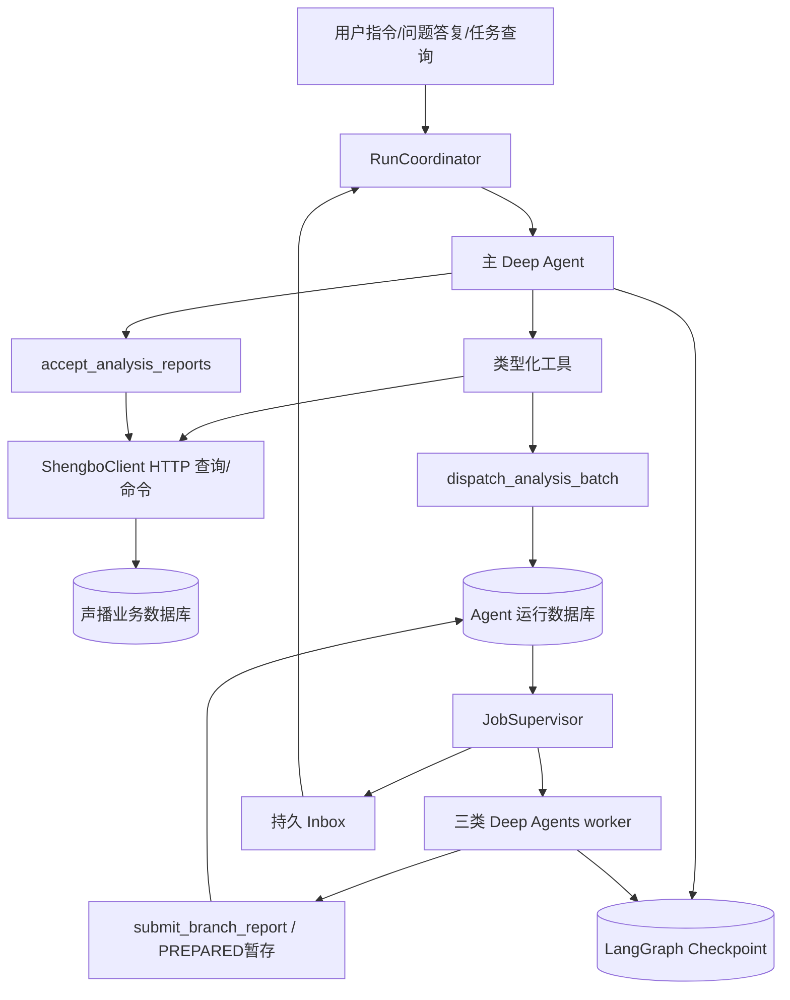

# 播前 Agent 运行时与中间件工程规格

版本：PRELIVE-2.3。运行基线：Python 3.12、Deep Agents 0.7.25、LangChain 1.4.6、LangGraph 1.2.15。本文定义模块、公开函数、调用顺序、状态读写与失败恢复；代码块是待实现伪代码，不是已运行业务代码。最终复查合同见16，已合入下列原始装配和算法。

## 1. 运行组件与数据所有权



| 组件 | 唯一职责 | 不拥有的数据 |
| --- | --- | --- |
| `RunCoordinator` | 用户任务排队、同线程互斥、图调用、问题恢复、结果核验 | 商品、场次、业务准备进度的正式真值 |
| `InstanceLock / GraphExecutionRegistry` | OS数据根独占与同thread实际图执行排他；失租后取消并等待旧writer退出 | 不以租约过期推断旧协程已退出，不代替声播业务fence |
| `RunFinalizer` | 所有真实终态统一收敛派发、grant、在途执行者与最终成果，保存ClosureReceipt | 不撤销已合法提交的成果，不把WAITING误作终态 |
| 主 Deep Agent | 依据任务目标和观察选择分析、补问、组装与业务工具 | 不能自己授予写权限、生成用户确认或伪造业务终态 |
| 三类 worker | 分别完成商品事实、本场配置、顾客场景的独立分析；交付 PREPARED 暂存报告 | 不直接保存正式商品、配置、话术、播放计划或声播 accepted report |
| `JobSupervisor` | 从数据库 claim 后台任务、执行 worker、收敛终态并唤醒主图 | 不进行 LLM 策划，不决定业务内容 |
| `ShengboClient` | 将统一查询与命令协议映射到 HTTP；携带程序注入的 grant | 不直接写声播数据库，不以本地缓存冒充已提交 |
| Agent DB | user run、invocation、branch job、question、staged artifact、scheduler/inbox/outbox、运行审计 | 不存另一套正式 preparation、SessionDraft、accepted report、ContextBundle、ScriptPlan、Playlist 或 Publication |
| 声播 DB | 正式商品、preparation、本场草案、accepted report/研究、上下文包、话术计划、编排、发布快照及授权 grant | 不依赖解析模型聊天来判断是否提交成功 |
| Checkpoint DB | messages、虚拟 files、模型待办、图执行位置和 pending tool call | 不替代业务数据库、授权数据库或任务调度表 |

所有正式业务写入必须通过声播 HTTP 命令。声播在同一业务事务中检查 grant、`write_generation`、对象版本与写入范围后提交并产生回执。Agent 本地检查只用于尽早拦截；业务提交不能仅靠 Agent DB 的“已取消”字段保护。

## 2. 标识、作用域与任务语义

### 2.1 运行身份

```python
AnalysisRole = Literal['product_facts', 'session_config', 'audience_scenes']

@dataclass(frozen=True)
class RunScope:
    actor_id: str
    work_scope: WorkScope          # 01定义：kind=catalog/preparation
    run_id: str                    # 不可变用户任务，跨唤醒保持
    invocation_id: str             # 一次 ainvoke / astream
    thread_id: str                 # main:{run_id}
    invoke_lease_epoch: int
    grant_ref: str | None          # 只读解释可空，写工具必须有有效声播grant
    write_generation: int | None
    phase: Literal['intent', 'execute']
    intent_event_ref: str         # 原始可信用户事件
    objective_ref: str | None     # intent为空，execute为首次冻结Goal引用

@dataclass(frozen=True)
class ChildScope:
    phase: Literal['execute']     # 可信构造器固定注入；无intent子任务
    actor_id: str                 # 从父run的可信principal取得，不从模型参数读取
    work_scope: WorkScope
    parent_run_id: str
    run_id: str                   # 必须等于parent_run_id；统一因果关联字段
    invocation_id: str            # 本次child attempt/lease的持久唯一调用ID
    branch_task_id: str
    batch_id: str
    role: AnalysisRole
    input_manifest_ref: str
    input_manifest_hash: str
    allowed_object_refs: tuple[str, ...]
    task_lease_epoch: int
    grant_ref: str | None
    write_generation: int | None
```

`RunScope/ChildScope` 为可信应用构造的 frozen dataclass，通过 `context_schema=` 声明、`ainvoke(..., context=scope)` 注入。模型工具 schema 不出现 account、actor、run identity、lease、grant 或 write generation 字段。工具不能从提示词中解析身份。

`work_scope.kind='catalog'` 任务可以只整理共享商品库，`preparation_id=None`；工具按 account 和商品对象校验。不得为能调用运行时而伪造 preparation。`kind='preparation'` 必须有 preparation_id，且归属校验通过；room/正式直播 session 通过业务引用读取，不在 Scope 中虚构。session_config worker 和本场发布/编排/语音工具只允许 preparation。

### 2.2 active-run slot 与 invoke lease

| 机制 | 作用 | 等待用户/任务时 |
| --- | --- | --- |
| active-run slot | 同准备作用域当前允许推进的用户 run；catalog 使用 account 级 catalog scope key | 保留给当前 run，后继 follow_up 不抢占 |
| OS实例锁 | 同规范化数据根唯一Agent进程，不能靠换端口绕过 | 由进程持有；所有图和saver关闭后最后释放 |
| GraphExecutionRegistry thread锁 | 同SDK thread在aget_state、select_input、ainvoke/astream及最终aget_state期间排他 | 图实际退出才释放；不能因租约过期或超时强放锁 |
| invoke lease | 同 `main:{run_id}` 当前执行者的DB claim/epoch；不自动保护saver写入 | 图退出后释放；后续唤醒仍需取得真实thread锁 |
| branch lease | 一个分支 attempt 的 worker 执行互斥 | 与父 invoke lease 独立；父等待不阻断子任务 |
| 声播 grant / write_generation | 正式业务授权与取消 fence | 正式取消/replace 以声播 revoke 回执为准 |
| 对象 CAS | 人工、多任务和 Agent 同时修改对象时防止覆盖 | 每次写均检查，不能因已有 run grant 而跳过 |

首期 `run_authorizations.expires_at=null`，只对本run冻结Goal有效，随显式终结/取消/replace撤销；跨夜人工等待不触发无入口的TTL过期。活动、引用、批准等业务当前性仍逐次检查。FINALIZING保留冲突active slot，直到撤权与图writer收敛有真实证据；新指令不能绕过收尾对账。

### 2.3 用户新指令

| 模式 | 程序执行 | 目标版本处理 |
| --- | --- | --- |
| `follow_up` | 创建不可变后继 run，关联 related_run_id，排队；不取消当前 run | 保存原始基准。到队首时仅沿前序修改链 replacement_ref 续接；人工/其他任务改动进入冲突处理 |
| `replace` | 先请求声播撤销旧 run grant；收到 revoke 回执后新 run 才可获得写授权与 slot | 旧未提交结果仅归档，不绑定新业务草案 |
| `new_task` | 创建独立 run/作用域。无冲突作用域可并行；同作用域按 slot 排队 | 不擅自继承或扩大前序任务写入范围 |
| 回答问题 | 可信答案事件绑定原 decision/question 与对象版本，恢复原 run/thread | 不创建替代任务，不修改原始用户任务意图 |
| 手动修改 | 直接调用同一声播命令服务做 CAS，不等待 Agent 队列 | 声播产生日志和依赖失效事件；Agent重读受影响项，不能覆盖人工新内容 |
| 查询状态 | GET 查询业务与运行视图 | 不创建 run，不唤醒模型，不改变目标 |

## 3. 目录与函数分工

```text
src/shengbo_prelive/
  runtime/
    bootstrap.py          # 编译运行组件，生命周期由container管理
    factory.py            # 主图和角色图
    coordinator.py        # 用户任务与图调用
    executor.py           # 单次图invoke、租约与恢复payload
    execution_registry.py # InstanceLock与同thread整段图执行锁
    finalizer.py          # FINALIZING、撤权对账、终态与ClosureReceipt
    model_adapter.py      # 最终provider payload窗口、attempt发送/结算
    scopes.py             # RunScope/ChildScope 构造与检查
    state.py              # 图 state
    seed.py               # 首次消息、Skills 与上下文文件
    middleware.py         # 本文第 6 节
  tools/
    main_tools.py         # 主工具的模型接口
    worker_tools.py       # 三角色分析与报告提交
    registry.py           # allowlist、工具分类与动态可用范围
  jobs/
    supervisor.py         # 后台任务循环与BranchRunner单分支执行
    branch_service.py     # 任务受理与暂存报告
    inbox.py              # 事件收敛和主图唤醒
  clients/
    shengbo.py            # 统一 HTTP 门面
  context/
    service.py            # 当前业务观察与完整上下文引用
  services/
    question_service.py   # 问题去重、答案校验
    turn_service.py       # 本轮结束回执
    budget_service.py     # 模型调用/研究/付费任务预算
  persistence/
    store.py              # 仅运行表与暂存产物
    checkpoint.py        # saver 生命周期
```

| 函数签名 | 调用者 | 具体行为与结果 |
| --- | --- | --- |
| `build_runtime(settings: Settings, services: Services, saver: BaseCheckpointSaver) -> RuntimeBundle` | container.build_container | 编译一次主图和三 worker；返回 Coordinator/Executor/Supervisor 所需装配，资源生命周期由00的container/lifespan管理 |
| `build_main_agent(model: BaseChatModel, deps: Services, saver: BaseCheckpointSaver) -> CompiledStateGraph` | build_runtime | 注册主工具、主中间件、RunScope 和 StateBackend |
| `build_worker_agent(role: AnalysisRole, model: BaseChatModel, deps: Services, saver: BaseCheckpointSaver) -> CompiledStateGraph` | build_runtime | 注册固定角色工具、ChildScope、独立终态守卫 |
| `build_model(settings: Settings, deps: Services) -> BaseChatModel` | build_runtime | 明确DeepSeek模型，使用下述受控适配器；max_retries=0，最终payload保护/持久attempt覆盖摘要旁路 |
| `async submit_intent(event: VerifiedIntentEvent) -> RunReceipt` | POST 指令入口 | 校验 intent mode、对象和范围；保存 run 与调度记录；对 replace 调用 revoke 流程 |
| `async RunCoordinator.drive_run(run_id: str) -> TurnOutcome` | InboxPump / 首次调度 / Recovery | 验证调度和active slot，委派RunExecutor.invoke_once |
| `async RunExecutor.invoke_once(run_id: str) -> InvocationDecision` | RunCoordinator.drive_run | claim租约并持有thread锁，图实际退出后才返回；等待/阶段切换保持原run，终态只提议给Finalizer |
| `async resume_answer(event: VerifiedAnswerEvent) -> TurnOutcome` | 答复入口→调度器 | 答案持久化后按 interrupt ID 恢复原图 |
| `async dispatch_batch(scope: RunScope, requests: Sequence[AnalysisRequest]) -> BatchReceipt` | dispatch_analysis_batch 工具 | 输入冻结、去重、任务/outbox 同事务持久化；不等待模型分支完成 |
| `async run_branch(task: ClaimedBranchTask) -> BranchOutcome` | JobSupervisor | 派生 ChildScope、独立 thread 调图、核验程序验证的PREPARED回执、写运行终态/inbox |
| `async reconcile_startup() -> RecoveryReport` | bootstrap 完成依赖后 | 扫描过期租约、未决命令、任务、问题与 inbox，先对账再恢复 |
| `async cancel_run(run_id: str, event: VerifiedCancelEvent) -> CancelReceipt` | 取消/replace入口 | 可信校验后调用统一Finalizer；revoke证明写权撤销，ClosureReceipt还证明本地图退出，不混为一个时点 |
| `async RunFinalizer.terminalize_run(run_id: str, requested_outcome: RunTerminal, *, cause: TerminationCause)` | Coordinator、取消/replace、故障入口 | 返回RunClosureReceipt或FinalizationProgress；冻结派发、远端撤权/对账、图/分支收敛、成果复核；关闭回执才发布终态/释放冲突slot |
| `async RunFinalizer.reconcile_finalization(run_id: str) -> FinalizationProgress` | 恢复/对账消费者 | 不再唤模型；续查稳定revoke operation和graph退出，真实证据齐备才闭合 |
| `InstanceLock.acquire(normalized_data_root: str) -> LockHandle` | 唯一container、打开saver之前 | 真正OS排他锁，拒绝同根第二进程；PID文本只可辅助展示 |
| `async GraphExecutionRegistry.acquire_thread(thread_id: str, invocation_id: str) -> GraphHandle` | 主/子Executor | 整段SDK读写排他；持有到实际graph task退出 |
| `async GraphExecutionRegistry.cancel_and_join(handle: GraphHandle, *, deadline: float) -> DrainResult` | heartbeat失租/Finalizer/停机 | 停新动作、取消SDK task并await；超时返回draining但继续持锁，不误报已退出 |
| `GraphExecutionRegistry.execution(thread_id, invocation_id)` | 主/子Executor的async with | 包acquire_thread，GraphHandle.invoke登记并await原生SDK task；退出必须join后解锁，不新增模型循环 |
| `async GraphExecutionRegistry.request_cancel_run(run_id)` / `cancel_and_join_run(run_id,warn_after_seconds)` | Finalizer | 按run定位已登记SDK task；前者请求退出，后者有限等待后给真实DrainResult；只操作SDK task，不能等待调用自己的Coordinator |
| `async GraphExecutionRegistry.drain_all_until_exited(warn_after_seconds)` | 服务停机/启动失败 | 全部图真实退出前不返回可关闭状态，warn只告警；不能用定时解锁代替join |
| `async query(key: QueryName, args: QueryArgs, *, scope: WorkScope | None) -> QueryResult` | 投影/工具/守卫 | ShengboClient按固定key和类型参数只读HTTP；服务凭据闭包持有，启动read_capabilities可scope=None，其余按业务scope读取 |
| `async command(key: CommandName, args: CommandArgs, *, scope: TrustedScope, operation_id: str) -> CommandReceipt` | 业务工具/报告接受/取消 | 程序注入 grant、generation、意图证据；稳定operation_id对账，超时未知不换ID重发 |
| `async ContextService.project(scope: RunScope | ChildScope) -> AgentObservation` | ContextProjection.before_model | 使用04注册的固定只读查询按scope汇合业务refs、当前精确约束与合法动作；不另造模型总线工具 |

以上签名依赖的 DTO 在领域/HTTP 协议分册统一定义；SDK 的 context、middleware、backend 等参数不增加私有扩展。每个模型工具固定映射一个命令/query key，不能由模型选择任意总线 key。声播命令入口为 `/api/prelive/v2/commands`；对话入口为 `/api/assistant/v2/...`，由声播同源代理至独立 Agent 进程 8791，模型不控制代理地址。

## 4. 图装配与生命周期

### 4.1 SDK 工厂装配

```python
def build_main_agent(model, deps, saver):
    return create_deep_agent(
        model=model,
        tools=build_main_tools(deps),
        system_prompt=deps.prompts.main,
        middleware=main_middleware(deps),
        backend=StateBackend(),
        skills=['/skills/main/'],
        permissions=virtual_file_permissions(),
        state_schema=PreliveState,
        context_schema=RunScope,
        checkpointer=saver,
        name='prelive-main',
    )

def build_worker_agent(role, model, deps, saver):
    return create_deep_agent(
        model=model,
        tools=build_analysis_tools(role, deps),
        system_prompt=deps.prompts.worker[role],
        middleware=worker_middleware(role, deps),
        backend=StateBackend(),
        skills=[f'/skills/{role}/'],
        permissions=virtual_file_permissions(),
        state_schema=AnalysisState,
        context_schema=ChildScope,
        checkpointer=saver,
        name=f'prelive-{role}',
    )

def build_runtime(settings, services, saver):
    model = build_model(settings, services)
    main = build_main_agent(model, services, saver)
    workers = {
        role: build_worker_agent(role, model, services, saver)
        for role in ANALYSIS_ROLES
    }
    runner = BranchRunner(workers=workers, deps=services)
    supervisor = JobSupervisor(runner=runner, deps=services, concurrency=3)
    executor = RunExecutor(main=main, deps=services)
    coordinator = RunCoordinator(executor=executor, deps=services)
    return RuntimeBundle(main, workers, coordinator, supervisor)

def build_model(settings, deps):
    # 17记录未来选择chatgpt_plan/gpt-6.1-sol；下式是待实现的应用工厂合同。
    # 工厂返回BaseChatModel兼容对象，凭据管理器留在服务端依赖，不放进模型state。
    return deps.model_factory.build(
        provider=settings.agent_provider,
        model=settings.agent_model,
        purpose='agent',
        request_guard=deps.provider_request_guard,
        attempts=deps.model_attempts,
    )

def virtual_file_permissions():
    # StateBackend只含本thread预置/归档；不授予模型任何文件写入口
    return [FilesystemPermission(operations=['write'], paths=['/**'], mode='deny')]
```

不传 `subagents=`，业务委派只经过持久分支工具。Deep Agents 可能自动注入 general-purpose/task；Policy 在模型调用和实际工具执行两处拒绝它。禁止 execute、delete、原始 SQL、任意 HTTP 和任意宿主文件工具。不存在另一个手写模型 while-loop。

### 4.2 Checkpoint

默认本机开发使用 `AsyncSqliteSaver`，打开于 lifespan、供全部图复用，thread ID 不同。实施时新增并锁定 `langgraph-checkpoint-sqlite` 与 `aiosqlite`，当前 SDK 准备环境尚无该模块。不能以 InMemorySaver 冒充重启恢复。

```python
@asynccontextmanager
async def open_persistent_saver(path: str):
    async with AsyncSqliteSaver.from_conn_string(path) as saver:
        yield saver
```

唯一调用方是00中`build_container`的AsyncExitStack；图只由`build_runtime`编译。这里不再声明另一套open_dependencies/compile_graphs启动流程。

禁止逐请求打开关闭 saver；先取得数据根OS实例锁再打开它。主和分支共享GraphExecutionRegistry，每个thread锁覆盖 `aget_state → select_input → ainvoke/astream → 最终aget_state`；lease只提供业务fence，不能代替checkpoint互斥。失租须停止新动作、取消并await旧图task退出；无法取消时保持draining/reconciling、持锁且不恢复同thread。新PID只有取得OS锁才能扫描恢复，不能只凭PID数字/固定超时推定旧writer死亡。退出要等全部图确实退出后才关saver及OS锁；15秒是告警阈值，不是强放锁期限。SQLite是首版本机部署选择，本期不支持多进程saver写入。

### 4.3 State

```python
class PreliveState(DeepAgentState):
    observation_ref: NotRequired[str]
    observation_event_seq: NotRequired[int]
    guard_retry_count: NotRequired[int]
    terminal_receipt_ref: NotRequired[str]
    intent_resolution_ref: NotRequired[str]

class AnalysisState(DeepAgentState):
    input_manifest_ref: NotRequired[str]
    observation_ref: NotRequired[str]
    observation_event_seq: NotRequired[int]
    report_receipt_ref: NotRequired[str]
    guard_retry_count: NotRequired[int]
```

State 只保存执行上下文和引用。租约/grant 真值不在 state；`ready` 不在模型 state 内决定。并发工具不同时覆盖无 reducer 的业务字段；观察投影由一个 middleware 单写，业务对象从声播查询。

## 5. 唯一子 Agent 派发与产物交接

### 5.1 模型工具 schema

```python
class AnalysisRequest(BaseModel):
    role: AnalysisRole
    object_refs: list[RecordRef | ArtifactRef]
    task_objective: str
    input_refs: list[RecordRef | ArtifactRef]

@tool
async def dispatch_analysis_batch(
    branches: list[AnalysisRequest],
    runtime: ToolRuntime[RunScope],
) -> dict:
    return (await deps.branch.dispatch_batch(runtime.context, branches)).model_dump()
```

模型不传 child identity、授权、输出文件路径或 task generation。`task_objective` 是子任务说明，不能扩大 object_refs 与原任务授权。

### 5.2 持久受理算法

```python
async def dispatch_batch(scope, requests):
    await scopes.assert_main_invoke(scope)
    capability = await scopes.read_authorized_capability(scope)
    normalized = validate_analysis_requests(requests, capability, scope.work_scope.kind)
    manifests = await freeze_input_manifests(normalized, scope)
    # manifests 的权威业务内容来自声播，Agent DB 只存快照引用与工作副本
    async with agent_repo.transaction():
        batch = await agent_repo.get_or_create_batch(
            run_id=scope.run_id,
            semantic_key=hash_requests(normalized, manifests),
        )
        for request, manifest in zip(normalized, manifests):
            await agent_repo.get_or_create_branch(
                batch_id=batch.id,
                role=request.role,
                input_hash=manifest.hash,
                source_refs=manifest.refs,
                write_generation=scope.write_generation,
            )
        await agent_repo.put_outbox(batch.id, event='BRANCHES_AVAILABLE')
    return BatchReceipt(status='accepted', batch_ref=batch.ref)
```

返回 accepted 前任务必须落盘。请求内 `create_task()` 不是受理保证。相同 role/对象/输入/目标去重；新材料导致新 hash 才创建新分析。catalog 拒绝 session_config。模型输入的 object_refs 使用01的 RecordRef/ArtifactRef，版本字段固定 revision，不另定义 ObjectRef.version。

### 5.3 后台执行算法

```python
async def supervisor_loop():
    while not shutdown.is_set():
        await concurrency_limiter.acquire()
        task = await agent_repo.claim_branch(worker_id, lease_seconds=60)
        if task is None:
            concurrency_limiter.release()
            await wake_or_timeout(max_seconds=2)
            continue
        spawn_managed(run_branch_and_release(task))

async def run_branch(task):
    scope = await scopes.child_from_claim(task)
    await scopes.assert_child(scope)
    config = graph_config(thread_id=f'branch:{task.id}', scope=scope,
                          trace_callbacks=deps.trace_callbacks, recursion_limit=100)
    try:
        async with deps.graphs.execution(config['configurable']['thread_id'], scope.invocation_id) as graph:
            # 排他覆盖所有checkpoint读写；不能先在锁外读state。
            snapshot = await worker[task.role].aget_state(config)
            if await prepared_report_exists(task, scope):
                return await finish_branch_from_receipt(task)
            payload = None if has_pending_checkpoint(snapshot) else await deps.seed.worker(task)
            async with heartbeat_branch_lease(task, interval_seconds=20,
                                              on_lost=graph.cancel_and_join):
                await graph.invoke(worker[task.role], payload, config=config, context=scope)
            final_snapshot = await worker[task.role].aget_state(config)
            receipt = await agent_repo.read_prepared_report_receipt(task.id)
            validate_report_receipt(task, receipt)
            return await agent_repo.complete_branch_and_enqueue_inbox(task, receipt)
    except (RunRevoked, StaleInput) as error:
        return await agent_repo.archive_branch_and_enqueue_inbox(task, status='superseded', error=error)
    except asyncio.CancelledError as error:
        await agent_repo.record_branch_interruption(task, 'interrupted')
        raise
    except Exception as error:
        return await agent_repo.fail_or_retry_branch_and_enqueue_inbox(task, classify(error))
```

`spawn_managed`仅调度已claim的数据库任务，关闭时收集/取消并归档；任务受理不依赖这个进程内对象。`graphs.execution`是应用async context manager，内部调用acquire_thread，并以registry登记的SDK task执行`graph.invoke`；它只包装原生ainvoke，不引入模型循环。退出前必须join SDK task，无法退出仍持锁。`run_branch_and_release`在实际图退出后的finally释放semaphore。过期claim只能安排drain/reconcile，原thread仍有活跃owner则不能新claim并发invoke；父run冻结派发后也不能claim。

失败、失效、成功等分支终态均持久写入inbox；重试使用同branch与新attempt/lease，最多2次，且先证明旧图退出。无可恢复人工interrupt的worker异常视为失败，不自动伪造答案。并行数：全局worker 3、同准备作用域最多3。每个worker独立thread、消息、files和Scope，不复制主state，不用Command.PARENT回并。父run真实终结统一由RunFinalizer收敛这些分支，不能因main失败让它们永久运行。

### 5.4 报告提交

三个角色各有不同typed report schema和模型工具名，固定wrapper汇入普通服务 `BranchService.submit_branch_report(scope, report)`；每个worker图只注册自己角色的提交工具。

```python
@tool
async def submit_product_facts_report(report: ProductFactsReport, runtime: ToolRuntime[ChildScope]) -> dict:
    return await deps.branch.submit_branch_report(runtime.context, report)

@tool
async def submit_session_config_report(report: SessionConfigReport, runtime: ToolRuntime[ChildScope]) -> dict:
    return await deps.branch.submit_branch_report(runtime.context, report)

@tool
async def submit_audience_scenes_report(report: AudienceScenesReport, runtime: ToolRuntime[ChildScope]) -> dict:
    return await deps.branch.submit_branch_report(runtime.context, report)

async def submit_branch_report(scope: ChildScope, report: BaseReport) -> dict:
    await scopes.assert_child(scope)
    validated = validate_role_report(scope.role, report)
    async with agent_repo.transaction():
        stage = await agent_repo.stage_artifact(scope.branch_task_id, validated)
        receipt = await agent_repo.prepare_report_receipt(
            task_id=scope.branch_task_id,
            role=scope.role,
            manifest_hash=scope.input_manifest_hash,
            artifact_ref=stage.ref,
            state='PREPARED',
        )
    return compact_receipt(receipt)
```

Agent DB 的 stage 不是研究权威结果。worker提交PREPARED回执后结束，Supervisor/inbox唤醒主；主工具 `accept_analysis_reports` 校验报告、导入受控blob后，固定调用 `client.command('accept_analysis_report', typed_args, scope=scope, operation_id=stable_id)`。声播同事务校验grant/generation/readset/schema/hash，保存accepted artifact并更新preparation引用。主工具回写远端ACCEPTED回执。只有声播 accepted report 可引用进 ContextBundle 或正式商品。模型最后自然语言不作为分析任务成功。报告带“缺资料/冲突/研究假设”仍可算分析交付；是否允许下一步写商品由声播规则决定。

## 6. 中间件注册、触发与方法体

### 6.1 固定注册顺序

```python
def main_middleware(deps):
    return [
        RunFenceMiddleware(deps),
        ContextProjectionMiddleware(deps),
        ToolPolicyMiddleware(role='main', deps=deps),
        ActionBoundaryMiddleware(deps),
        TodoListMiddleware(),
        CompletionGuardMiddleware(deps),
        ModelCallLimitMiddleware(run_limit=40, exit_behavior='error'),
        BudgetMiddleware(deps),
        AuditMiddleware(deps),
    ]

def worker_middleware(role, deps):
    return [
        ChildFenceMiddleware(deps),
        ContextProjectionMiddleware(deps),
        ToolPolicyMiddleware(role=role, deps=deps),
        ActionBoundaryMiddleware(deps),
        BranchCompletionGuardMiddleware(deps),
        ModelCallLimitMiddleware(run_limit=16, exit_behavior='error'),
        BudgetMiddleware(deps),
        AuditMiddleware(deps),
    ]
```

保留 SDK 默认 SummarizationMiddleware。自定义 middleware 按工厂规则插入核心栈后、Skills 等尾部前；不另写摘要器、不以自定义同名类替换基础中间件。保留 SDK 的 Filesystem、PatchToolCalls、Skills、模型兼容和模型工具循环。

| Hook | 实际顺序 |
| --- | --- |
| before_agent / before_model | 注册正序中实现该 Hook 的中间件 |
| after_model / after_agent | 注册逆序中实现该 Hook 的中间件 |
| wrap_model_call / wrap_tool_call | 注册第一个为最外层，返回时反向 |

ModelCallLimit 必须注册在 CompletionGuard 后面，保证 after_model 先计数，再允许 Guard jump_to model。Audit 不实现 after_model。所有自定义 Hook 实现 async 版本，只调用 `ainvoke/astream`。

### 6.2 RunFenceMiddleware / ChildFenceMiddleware

```python
class RunFenceMiddleware(AgentMiddleware):
    async def abefore_agent(self, state, runtime):
        await self.deps.audit.checked(runtime.context, 'M1.main_fence',
            lambda: self.deps.scopes.assert_main_invoke(runtime.context))
        return {'guard_retry_count': 0, 'terminal_receipt_ref': None, 'intent_resolution_ref': None}

    async def abefore_model(self, state, runtime):
        await self.deps.audit.checked(runtime.context, 'M1.main_fence',
            lambda: self.deps.scopes.assert_main_invoke(runtime.context))
        return None

class ChildFenceMiddleware(AgentMiddleware):
    async def abefore_agent(self, state, runtime):
        await self.deps.audit.checked(runtime.context, 'M2.child_fence',
            lambda: self.deps.scopes.assert_child(runtime.context))
        return {'guard_retry_count': 0}

    async def abefore_model(self, state, runtime):
        await self.deps.audit.checked(runtime.context, 'M2.child_fence',
            lambda: self.deps.scopes.assert_child(runtime.context))
        return None
```

intent阶段未有Goal，assert_main_invoke只验可信read principal、WorkScope、slot/run状态和invoke lease；execute阶段必须存在已冻结Goal。只读解释run可以不申请声播写grant，但仍必须有可信read principal和WorkScope。execute阶段的`assert_main_invoke`对grant_ref=None只允许GoalContract.allowed_effects为只读，所有mutates_business工具拒绝。主检查Agent DB的active-run slot、run状态、invoke lease epoch；FINALIZING/终态/dispatch_frozen立即禁止新动作，不因grant尚在对账就允许继续。intent阶段跳过read_completion_observation及Goal/grant读取，仅通过scope受限的商品/资料query取得观察；execute阶段固定通过声播`read_completion_observation`查询相关grant状态/最新write_generation与依赖当前性，缓存最多一个invoke的短期观察，正式写时声播仍重查。`assert_child`使用同一固定query并检查child task lease、parent run仍可执行及输入未失效，不要求父invoke lease仍存在。撤权/冻结或输入失效抛typed控制异常，runner归档后停止，不让模型“换个工具再试”。

### 6.3 ContextProjectionMiddleware

```python
async def abefore_model(self, state, runtime):
    scope = runtime.context
    view = await deps.context.project(scope)
    # view 内含完整内容的不可变refs、精确价格/约束、缺口、事件seq和合法动作
    pointer = await agent_repo.stage_observation(scope, view)
    return {'observation_ref': pointer.ref, 'observation_event_seq': view.event_seq}
```

投影 stage 只供本次模型观察；正式业务真值仍来自声播。每次模型行动前重取轻量观察，不把上传资料全文全部拼进系统消息。业务全量读取由 read_context/read_source/read_product/read_script 提供分页与定位。

### 6.4 业务上下文注入与 SDK 默认压缩

第 6.3 节 ContextProjectionMiddleware 同时实现以下 wrap；它只追加当前业务观察，不改 SDK 已处理的消息序列：

```python
async def awrap_model_call(self, request, handler):
    observation = await agent_repo.read_observation(request.state['observation_ref'])
    system = compose_system_message(
        request.system_message,
        immutable_user_intent=observation.user_intent,
        exact_constraints=observation.exact_constraints,
        current_objects=observation.object_refs,
        eligible_actions=observation.eligible_actions,
        unresolved=observation.blockers,
        full_context_refs=observation.full_context_refs,
    )
    return await handler(request.override(system_message=system))
```

对话历史压缩、历史 offload 和上下文溢出处理沿用 SDK 默认机制。商品库、本场、顾客研究、旧稿、用户决定及已绑定复盘完整输入保存在声播，持有不可变版本 refs；摘要不拥有这些业务事实。read_context/read_source/read_product/read_script 提供分页和定位，不把检索摘要当成完整输入。SDK 历史文件仅用于执行回溯，不替代业务正式存储。

预算中间件检查经过 SDK 压缩后的主模型请求估计 token；若超过配置上限且不能再安全压缩，返回 CONTEXT_LIMIT，要求按商品/模块拆分或缩小读取页，不静默删除关键原文。SDK 摘要内部模型调用单独观测 usage，不能假装它受主循环 ModelCallLimit 全部覆盖。

### 6.5 ToolPolicyMiddleware

```python
async def awrap_model_call(self, request, handler):
    policy = await policy_service.for_scope(request.runtime.context)
    tools = [tool for tool in request.tools if policy.model_visible(tool.name)]
    return await handler(request.override(tools=tools))

async def awrap_tool_call(self, request, handler):
    scope = request.runtime.context
    name = request.tool_call['name']
    policy = await policy_service.for_scope(scope)
    if not policy.execution_allowed(name):
        await deps.audit.decision(scope, 'M4.tool_policy', 'denied', tool_call=request.tool_call)
        return error_tool_message(request, 'NOT_AUTHORIZED')
    if registry.require(name).mutates_business and scope.grant_ref is None:
        await deps.audit.decision(scope, 'M4.write_grant', 'denied', tool_call=request.tool_call)
        return error_tool_message(request, 'NOT_AUTHORIZED')
    await deps.audit.checked(scope, 'M4.targets',
        lambda: policy_service.validate_targets(scope, name, request.tool_call['args']))
    return await handler(request)
```

既不信任模型可见工具列表，也不信任历史 tool call。task/execute/delete/write_file/edit_file 在所有角色真实调用时拒绝；主 Agent 通过 typed 工具保存业务候选/计划，worker 通过 typed 报告工具交接。读取FS仅能触及本thread的StateBackend预置文件和SDK归档，来源与业务范围在预置/读取服务校验；没有FilesystemBackend或宿主盘访问。虚拟文件禁止模型写入，SDK自身归档不走模型写工具。

### 6.6 ActionBoundaryMiddleware

```python
async def awrap_tool_call(self, request, handler):
    scope = request.runtime.context
    spec = registry.require(request.tool_call['name'])
    await deps.audit.checked(scope, 'M5.action_scope', lambda: scopes.assert_for_tool(scope, spec))
    if spec.name == 'prepare_required_audio':
        await deps.audit.checked(scope, 'M5.text_audio_gate',
            lambda: deps.approvals.require_current_for_tool(scope, request.tool_call['args']))
    # 同checkpoint重放沿用tool_call_id，派生稳定operation_id；服务另有语义任务key防重复生成
    identity = derive_action_identity(scope, spec, request.tool_call['id'], request.tool_call['args'])
    existing = await agent_repo.lookup_action_observation(identity.key)
    if existing and existing.status == 'unknown':
        await deps.audit.decision(scope, 'M5.reconcile', 'query_only', action_ref=existing.ref)
        return await reconcile_command_without_resubmit(existing, scope)
    try:
        if spec.mutates_business:
            async with short_preparation_action_lock(scope):
                return await handler(request)
        return await handler(request)
    except (GraphInterrupt, asyncio.CancelledError):
        raise
    except RemoteOutcomeUnknown as error:
        await agent_repo.record_unknown_action(
            identity, operation_id=error.operation_id, request_hash=error.request_hash
        )
        await scheduler.enqueue_operation_reconciliation(scope.run_id, error.operation_id)
        return ToolMessage(
            content=json.dumps({'status': 'pending_reconciliation', 'operation_id': error.operation_id}),
            tool_call_id=request.tool_call['id'],
        )
    except DomainError as error:
        return error_tool_message(request, error.code, refs=error.refs)
```

锁不能跨持久等待、模型生成或外部 job 持有。它只控制同轮主工具提交竞争；业务真正的并发边界是声播事务 grant fence/CAS/幂等账本。其具体写入回执由 typed 工具调用的 ShengboClient 返回。不要自动重试未知写命令，不吞 GraphInterrupt；GraphInterrupt 原样交给 LangGraph。

### 6.7 BudgetMiddleware

```python
async def awrap_model_call(self, request, handler):
    scope = trusted_model_call_scope(request.runtime.context)  # worker同计父run
    for attempt in range(2):
        ticket = await attempts.reserve_attempt(scope, purpose='agent_reasoning')
        try:
            # ContextVar只传可信attempt关联。实际payload在适配器发送前估算。
            async with attempts.bind(ticket):
                response = await asyncio.wait_for(handler(request), timeout=120)
        except BaseException as error:
            # 专用持久收敛不覆盖原异常；CancelledError/控制异常绝不转重试。
            await attempts.try_settle_from_observed_transport(ticket, error=error)
            if isinstance(error, (asyncio.CancelledError, GraphInterrupt, RunRevoked)):
                raise
            if attempt == 0 and await attempts.retry_permitted(ticket, error):
                await asyncio.sleep(0.5)
                continue
            raise
        # adapter已记实际响应；账本/trace结尾失败不得诱发重调已收到的模型。
        await attempts.try_settle_known_response(ticket, response)
        return response
```

最终窗口检查放在所选provider适配器的真实公开载荷构造完成后、网络发送之前。DeepSeek分支可用GuardedDeepSeekAdapter并核验锁定ChatDeepSeek；未来chatgpt_plan分支按17核验Responses消息/工具/SSE协议，不复用DeepSeek参数或假设。不能传一个不存在的SDK选项冒充实现。该适配器只包公开provider发送边界，不改变SDK循环。

```python
async def guarded_provider_send(payload, *, model_call_context):
    ticket = await attempts.resolve_or_reserve_for_actual_call(model_call_context)
    try:
        estimate = estimate_final_provider_payload(payload, provider_profile)
        require_request_fits(estimate, reserved_output=4_000,
                             reserved_tool_margin=settings.tool_margin,
                             estimator_safety_margin=settings.estimator_margin)
        await attempts.mark_attempt_sent(ticket, payload_hash=hash_payload(payload))
        response = await transport.send_without_automatic_retries(payload)
    except BaseException as error:
        await attempts.try_settle_from_observed_transport(ticket, error=error)
        raise
    await attempts.try_settle_known_response(ticket, response)
    return response
```

`estimate_final_provider_payload`覆盖system blocks、最终messages、过滤后tools schema、response schema及供应商序列化开销，不只计messages。M3/M4/SDK压缩后的最终实际请求都须过此门槛；估计input/余量/model profile/估算器版本和payload hash记入trace。超限在发送前以CONTEXT_LIMIT退出并按13拆分/分页，不静默丢Goal、价格、版本或批准。流式路径在第一字节发送前同样检查和标sent，完成/错误记录实际流状态；不得只保护非流式。

| 持久接口/对象 | 责任与不变量 |
| --- | --- |
| `reserve_attempt(scope,purpose) -> AttemptTicket` | Agent短事务按父run/invocation预占，稳定attempt_id；role/预算owner来自可信Scope，不接受模型身份 |
| `mark_attempt_sent(ticket,payload_hash)` | 实际transport发送前持久sent；标记后崩溃但发送是否发生不明，保守unknown，不假定免费 |
| `settle_attempt(ticket,result)` | 以唯一attempt幂等记已知响应/失败/usage；外层M6和adapter回报同ticket不能双计 |
| `reconcile_model_attempts(owner)` | 启动/取消收口：reserved且可证未发送→aborted_before_send；sent未结算→outcome_unknown；不能清零已发次数或虚构0元 |
| `model_attempts` | attempt_id、parent_attempt_id、run/invocation/branch/span、purpose、provider/model、state、payload_hash、usage、error、时间；状态reserved→sent→succeeded/known_failed/outcome_unknown，或reserved→aborted_before_send |
| `try_settle_*` | 结算错误保留应急证据/gap，冻结新请求，由恢复器补账；不能用日志/账本写失败重调已获响应 |

默认限制：SDK ModelCallLimit主图run_limit=40、worker=16，作为成功主循环步数保险丝；`Command(resume)`/`ainvoke(None)`可从中间节点续跑，计数沿执行段继续，不承诺每HTTP invocation自动清零。BudgetLedger对主/worker受管尝试按父run累计上限120，恢复不清零；预占和重试都原子计数。DeepSeek分支可配置单次输出上限4000 tokens；chatgpt_plan路由不支持同样的输出参数，该数只能作本地软目标，不能宣称供应商硬封顶，也不靠截断工具流假报成功。最终主请求估计输入上限24000，另留所选provider窗口余量。主模型常规可重试错误最多一次；sent后是否完成未知按原明示有限重试政策记录可能重复费用，取消/控制异常不重试。TTS unknown仍严格按10先对账或取得明确重试决定，不沿用主模型重试策略。

SDK默认摘要等旁路也经过adapter窗口检查，建立purpose=context_compaction的独立child ticket和usage，不占用同一个外层ticket、也不冒充包含在120受管上限内；需要实际调用点的可信CallContext明确关联。不得因M6有循环预算就宣称总金额或全部模型调用有精确硬封顶。文案、研究provider和TTS业务job预算在其声播受理/claim边界独立预占；未配置价格表时记录调用/tokens和unknown费用，不虚构人民币。BLOCKED_BUDGET等导致run真正终态时必须走§10 Finalizer，不能留下已派发付费job继续推进。

### 6.8 CompletionGuardMiddleware

```python
@hook_config(can_jump_to=['model', 'end'])
async def aafter_model(self, state, runtime):
    message = last_ai_message(state['messages'])
    if message.tool_calls:
        return None
    if runtime.context.phase == 'intent':
        return await deps.intent.guard_candidate_or_request_clarification(state, runtime)
    receipt = await turns.read_valid_receipt(runtime.context)
    if receipt is not None and await turns.validate_receipt(receipt, runtime.context):
        return {'terminal_receipt_ref': receipt.ref}
    retries = state.get('guard_retry_count', 0)
    if retries >= 2:
        raise IncompleteTurn('missing or stale finish receipt')
    return {
        'messages': [
            RemoveMessage(id=message.id),
            HumanMessage(content=machine_completion_requirements(runtime.context)),
        ],
        'guard_retry_count': retries + 1,
        'jump_to': 'model',
    }
```

只处理无tool_calls的最后AIMessage；不删除含工具调用的消息，不制造孤立ToolMessage。`read_valid_receipt`要求run_id、invocation_id、generation、输入/业务引用hash与当前一致；上次WAITING_JOBS不能替本次唤醒后的完成回执。Guard仅验证本轮拟结束结果，真正终态还须Coordinator经Finalizer取得ClosureReceipt才发送final，流式模型文字为provisional。

### 6.9 BranchCompletionGuardMiddleware

与主 Guard 使用同一有限纠正方法，但查询 Agent BranchService 已验证的 PREPARED 回执；报告 role、输入 hash、对象与 task lease 必须匹配。该回执只证明分析交付，不证明声播已接受。主后续必须显式accept后才能用于业务。

```python
@hook_config(can_jump_to=['model', 'end'])
async def aafter_model(self, state, runtime):
    message = last_ai_message(state['messages'])
    if message.tool_calls:
        return None
    receipt = await agent_repo.read_prepared_report_receipt(runtime.context.branch_task_id)
    if validate_prepared_receipt(receipt, runtime.context):
        return {'report_receipt_ref': receipt.ref}
    retries = state.get('guard_retry_count', 0)
    if retries >= 2:
        raise IncompleteBranch('missing validated PREPARED report')
    return {
        'messages': [RemoveMessage(id=message.id), HumanMessage(content='请提交本任务类型化分析报告。')],
        'guard_retry_count': retries + 1,
        'jump_to': 'model',
    }
```

### 6.10 AuditMiddleware

```python
async def awrap_tool_call(self, request, handler):
    # begin_or_stop持久化start和安全完整args失败时尚未执行业务，停止新动作。
    span = await audit.begin_or_stop(request, kind='tool')
    try:
        result = await handler(request)
    except BaseException as original_error:
        await audit.try_end_or_spool(span, error=original_error)  # 不抛出、不覆盖原异常
        raise
    await audit.try_end_or_spool(span, result=result)  # 失败仅标gap并暂停后续动作
    return result  # 已有真实业务回执不能因日志失败改成可重试业务失败

async def awrap_model_call(self, request, handler):
    span = await audit.begin_or_stop(request, kind='model')
    try:
        result = await handler(request)
    except BaseException as original_error:
        await audit.try_end_or_spool(span, error=original_error)
        raise
    await audit.try_end_or_spool(span, result=result)
    return result

async def aafter_agent(self, state, runtime):
    await audit.try_record_exit(runtime.context, checkpoint_refs=extract_refs(state))
    return None
```

`try_end_or_spool/try_record_exit`内部无抛出：记录异常写应急JSONL和健康gap，保留原结果/原异常。开始记录与结束记录的失败语义不同；原始载荷安全策略、SDK摘要等旁路callbacks、voice后台job和outbox补证全部按[11](11_原始运行记录与调试台设计.md)实现。普通日志只放去敏索引，独立observability.sqlite及payloads保存完整可观察原文；不保存凭据或承诺内部思维链。trace不负责重试或业务状态恢复。

## 7. 主工具与本轮结束

### 7.1 最小工具注册表

| 工具组 | 主 | 商品 worker | 本场 worker | 顾客 worker |
| --- | --- | --- | --- | --- |
| `read_source/read_context/read_business_schema` | 是 | 分配范围 | 分配范围 | 分配范围 |
| `search_catalog/read_product` | 是 | 是 | 选定商品 | 选定商品 |
| 04注册的场次/准备只读工具 | preparation | 必要只读 | preparation | 必要只读 |
| `search_web/fetch_web_source` | 需要时 | 否 | 否 | 是 |
| `dispatch_analysis_batch/read_analysis_batch` | 是 | 否 | 否 | 否 |
| 三个 `submit_*_report` wrapper→公共submit_branch_report服务 | 否 | ProductFactsReport | SessionConfigReport | AudienceScenesReport |
| 商品/配置/话术计划/生成/编排/语音 typed工具 | grant范围 | 否 | 否 | 否 |
| `request_user_decision/finish_turn` | 是 | 否 | 否 | 否 |
| `write_todos` | 是 | 否 | 否 | 否 |
| 只读虚拟文件、历史分页 | 是 | 本线程 | 本线程 | 本线程 |
| task、execute、任意 shell/HTTP/SQL | 否 | 否 | 否 | 否 |

具备工具不等于某个用户指令授权了所有行为。商品 attach/detach、版本选择、顺序、优惠力度、音色与采用等写工具必须检查真实 user_intent_ref 及允许字段；“再生成一版”不自动授权进入播放清单或批量付费语音。

### 7.2 finish_turn

```python
@tool
async def finish_turn(
    outcome: Literal['COMPLETED','READY_FOR_REVIEW','WAITING_JOBS','BLOCKED'],
    summary: str,
    runtime: ToolRuntime[RunScope],
) -> dict:
    scope = runtime.context
    await scopes.assert_main_invoke(scope)
    observed = await turns.read_completion_observation(scope)
    spec = await turns.acceptance_spec_from_original_goal(scope)
    acceptance = await turns.evaluate_goal_acceptance(scope, spec.ref, observed)
    pending = await agent_repo.pending_jobs(scope.run_id)
    decision = evaluate_turn_outcome(outcome, observed, pending, acceptance)
    if not decision.allowed:
        return {'status': 'rejected', 'blockers': decision.blockers}
    receipt = await agent_repo.put_turn_receipt(
        scope=scope,
        outcome=outcome,
        business_evidence_refs=observed.receipts,
        acceptance_result_ref=acceptance.ref,
        evidence_hash=decision.evidence_hash,
        summary=summary,
    )
    return compact_receipt(receipt)
```

COMPLETED 对商品保存、局部修改、只读解释等按GoalContract.required_evidence验证，不要求candidate或直播间。READY_FOR_REVIEW对完整准备任务要求声播可检查包当前有效。WAITING_JOBS 必须有已持久受理且存在监听的未完成 job，结束 invocation 但不终止 user run；BLOCKED 必须有可定位阻塞。纯澄清使用 interrupt，不能伪造已收到答案。

`finish_turn`本地回执只证明本轮拟结束条件，不另存业务ready，也不直接宣告整个run关闭。WAITING_JOBS保留执行权；真正COMPLETED/READY_FOR_REVIEW/BLOCKED须在SDK图退出后交RunFinalizer统一收口，失败/取消亦同。采用本场、发布播放快照是声播单独命令/用户操作，不由该工具冒充。

## 8. RunCoordinator 调用算法

```python
# runtime/coordinator.py，RunCoordinator方法；依赖由self容器绑定
async def drive_run(self, run_id):
    run = await agent_repo.require_run(run_id)
    if run.closure_ref is not None:
        return await agent_repo.read_closure(run.closure_ref)  # 晚到inbox不复活终态
    if run.state == 'FINALIZING':
        return await deps.finalizer.reconcile_finalization(run_id)  # 不再唤模型
    await scheduler.require_or_claim_active_slot(run)
    decision = await executor.invoke_once(run_id)
    if decision.requires_terminalization:
        # invoke_once的SDK task和thread锁已退出，避免Finalizer等待自己。
        return await deps.finalizer.terminalize_run(
            run_id, decision.requested_outcome, cause=decision.cause)
    return decision  # WAITING/阶段切换/服务停机暂停，不关闭run

# runtime/executor.py，RunExecutor方法
async def invoke_once(self, run_id):
    run = await agent_repo.require_run(run_id)
    await scheduler.require_or_claim_active_slot(run)
    lease = await agent_repo.claim_invoke_lease(run_id, seconds=60)
    if lease is None:
        return TurnOutcome(status='busy')
    invocation = await agent_repo.create_invocation(run_id, lease.epoch)
    scope = await scopes.main_from_run(run, invocation, lease)
    config = graph_config(thread_id=f'main:{run_id}', scope=scope,
                          trace_callbacks=self.deps.trace_callbacks, recursion_limit=200)
    try:
        async with deps.graphs.execution(scope.thread_id, invocation.id) as graph:
            snapshot = await main.aget_state(config)
            payload = await select_invoke_payload(run, snapshot)
            async with heartbeat_invoke_lease(lease, interval_seconds=20,
                                               on_lost=graph.cancel_and_join):
                await graph.invoke(main, payload, config=config, context=scope)
            snapshot = await main.aget_state(config)
            if snapshot.interrupts:
                return await save_waiting_user(scope, snapshot.interrupts)
            if scope.phase == 'intent':
                resolution = await deps.intent.require_current_resolvable(scope, snapshot)
                goal = await coordinator.freeze_goal(run_id, resolution.ref)
                # 同Agent短事务安排下一phase，只有thread锁释放后才可执行。
                return await coordinator.enqueue_after_goal_frozen(scope, goal)
            receipt = await turns.require_and_revalidate(scope)
            return await record_invocation_decision(scope, receipt)  # 不释放active slot
    except RunRevoked:
        return await record_revoked_invocation(scope)  # 已存在Finalizer意图则沿其结果收尾
    except (IncompleteTurn, BudgetExceeded, DomainError) as error:
        return await record_terminal_request(scope, classify_terminal_outcome(error), error)
    except asyncio.CancelledError:
        # graph context退出必须先join底层task。服务停机是暂停，不伪造用户取消。
        await record_interruption_decision(scope, trusted_stop_reason(scope))
        raise  # 可信取消入口另推进Finalizer；停机记录留给新PID恢复，不吞取消
    except Exception as error:
        return await record_terminal_request(scope, 'FAILED', error)
    finally:
        # execution context保证实际SDK task已退出；draining时不会提前到这里。
        await agent_repo.release_invoke_lease_if_owner(lease)
```

`select_invoke_payload`：

| 状态 | 传给图的 input |
| --- | --- |
| 无 checkpoint 首次运行 | 一条稳定消息 ID 的真实用户指令＋预置 Skill/上下文 files |
| 上次正常结束后收到 job 事件 | 新增一条稳定 inbox event ID 的可信 HumanMessage；不覆写整段历史 |
| 进程崩溃，有 pending checkpoint 且无人工 interrupt | `None`，先继续旧节点，不重复注入原始 seed |
| 等待用户，已有可信人工答案 | `Command(resume={interrupt_id: {'resolution_kind':'human_answer', 'answer_event_ref': ref}})` |
| 原问题目标因人工编辑而失效 | `Command(resume={interrupt_id: {'resolution_kind':'system_resolution', 'system_resolution_ref': ref}})`；返回stale引导重读，不充当人工批准 |
| 等待用户，没有答案 | 不调用模型，保留 WAITING_USER |
| 原 run 被撤权 | 不调用图，不释放旧结果写权限 |
| FINALIZING／已终态 | 不调用图；对账关闭或返回已有ClosureReceipt |

同thread实际SDK调用始终≤1，由OS实例锁和GraphExecutionRegistry强制，不能只凭有效lease数量证明。registry内部登记独立SDK task，`cancel_and_join`只等待SDK task，不等待外层drive_run/Finalizer自己。当前graph未退出则invoke_once不返回终态decision；外部取消可先撤销业务权，界面显示“业务已撤权，旧调用退出中”，但仍持thread锁和冲突slot。

主图恢复未完成invocation前不插入新job message；inbox先保留，旧调用收敛后再消费。每个invocation提交/消费用稳定事件ID和回执补偿跨Agent DB/checkpoint DB的非原子窗口。`record_*`函数只存本轮决定，不直接发布run终态；Coordinator只对真实终态调用统一Finalizer，WAITING/phase切换保留slot，服务停机保留可恢复状态。

## 9. 问题中断与恢复

```python
class HumanAnswerResume(BaseModel):
    model_config = ConfigDict(extra='forbid')
    resolution_kind: Literal['human_answer']
    answer_event_ref: str  # 可信持久答案事件，不是答案正文或可执行patch

class SystemResolutionResume(BaseModel):
    model_config = ConfigDict(extra='forbid')
    resolution_kind: Literal['system_resolution']
    system_resolution_ref: str  # QuestionService持久失效解决记录

QuestionResumeEnvelope = Annotated[
    HumanAnswerResume | SystemResolutionResume,
    Field(discriminator='resolution_kind'),
]

@tool
async def request_user_decision(questions: list[QuestionProposal], runtime: ToolRuntime[RunScope]):
    scope = runtime.context
    batch = await question_service.get_or_create(scope, questions)
    resolution = await question_service.valid_resolution(batch)
    if resolution is None:
        resumed = interrupt({'kind': 'USER_DECISION', 'question_batch_ref': batch.ref})
        resolution = await question_service.read_verified_resolution(resumed)
    if resolution.kind == 'system_resolution':
        await question_service.validate_system_resolution(batch, resolution, scope)
        return resolution.stale_receipt  # 只回报target_superseded/需重读，不返回approved
    await question_service.validate_scope_versions(batch, resolution.answer, scope)
    return resolution.answer.public_receipt

async def resume_answer(event):
    answer = await question_service.accept_verified_event(event)
    # 持久化后只向scheduler发answer事件；实际图调用统一经过drive_run
    await scheduler.enqueue_answer_wake(answer.run_id, answer.ref)
    return RunReceipt(status='accepted', run_id=answer.run_id)
```

问题按run、字段/对象、来源版本和内容去重；中断重放不能重复创建问题。人工答案必须来自真实对话/界面事件，模型只能提出问题，不能调用“已确认”工具。答复handler的actor、问题版本、对象版本通过后，人工resume分支只传answer_event_ref及固定kind，不信任其中夹带的业务patch；系统失效按下述另一分支处理。

`QuestionResumeEnvelope`是判别union：human_answer分支必须是可信answer_event_ref，system_resolution分支必须是QuestionService持久签发的system_resolution_ref；二者都校验run/decision/revision/原interrupt。模型不能构造system resolution，来源材料中的相同JSON也不能恢复图。`resume_answer`和既有前端普通回答入口沿用，新增系统失效消费者只将可信resolution持久化并投递wake，不在事件回调直接invoke。

`interrupt()`之前只能做幂等登记。中间件/工具不得吞GraphInterrupt；过期问题保留历史，以target_superseded的系统resolution唤醒旧interrupt，工具返回stale，主读取新事实后重问或继续获准动作，不能删除问题后永久卡住。审核卡edit_text是真实非批准答案：Goal内修改在同run恢复，改稿后重编译并新审；超Goal范围走replace，不将follow_up排在仍等待自己的任务后。详见10和16。

## 10. 统一终结、撤权、晚到结果与恢复

### 10.1 所有真实终态共用RunFinalizer

COMPLETED/READY_FOR_REVIEW/BLOCKED/FAILED/CANCELLED/SUPERSEDED都经过同一个技术性关闭流程。WAITING_USER/WAITING_JOBS以及服务停机暂停不是终态，不撤销仍需继续的grant。Finalizer是普通可信服务，不向模型暴露；模型的finish_turn只能提出待校验结果。

```python
async def terminalize_run(run_id, requested_outcome, *, cause):
    # 同Agent事务：幂等closure请求、FINALIZING、冻结全部本地派发/claim，保留slot。
    plan = await agent_repo.begin_or_read_finalization(run_id, requested_outcome, cause)
    if plan.closure_receipt is not None:
        return plan.closure_receipt
    if not plan.provably_no_remote_grant:
        try:
            revoke = await reconcile_or_submit_stable_revoke(plan)
        except RemoteOutcomeUnknown as error:
            await agent_repo.mark_finalization_reconciling(plan, error.operation_id)
            await scheduler.enqueue_finalization_reconciliation(run_id)
            return FinalizationProgress(state='FINALIZING', reason='revoke_unknown')
        require_revoke_committed(revoke)
        await agent_repo.record_finalization_revoke(plan, revoke)
    await agent_repo.cancel_unclaimed_branches(run_id)
    # voice revoke同事务禁止新job claim/绑定，未领取项取消；在途供应商只留真实结果。
    await deps.graphs.request_cancel_run(run_id)
    drain = await deps.graphs.cancel_and_join_run(run_id, warn_after_seconds=15)
    if not drain.all_exited:
        await scheduler.enqueue_finalization_reconciliation(run_id)
        return FinalizationProgress(state='FINALIZING', reason='graph_draining')
    await attempts.reconcile_model_attempts(run_id)
    # 仅复验业务证据/依赖，不要求已经关闭的grant仍active。
    evidence = await revalidate_committed_business_evidence(plan)
    return await agent_repo.commit_closure_and_release_slot(plan, evidence)

async def cancel_run(run_id, event):
    await require_verified_cancel_event(event, run_id)
    outcome = 'SUPERSEDED' if event.mode == 'replace' else 'CANCELLED'
    closure = await deps.finalizer.terminalize_run(run_id, outcome, cause=event)
    return cancel_projection_from_closure(closure)
```

`begin_or_read_finalization`是唯一终结入口，保存requested_outcome/cause/finalization_phase、dispatch_frozen和稳定revoke operation；已有terminal closure只回读，不被晚到取消改写。失败不伪装成用户取消，技术收尾可共用。并发成功/取消请求按该Agent事务先后确定冻结的requested_outcome，其来源记录完整；不能用晚到“完成”覆盖已有关闭请求。

声播revoke命令只返回真实committed回执；unknown通过同operation查询，未明确未受理不能盲重发。仅确定从未派发issue_grant、且在同Agent事务已冻结未来派发，或纯只读无grant时可免远端revoke；仍须等待真实图writer退出。AUTHORIZING中grant_ref未知也按run_id写revocation tombstone，issue_grant同声播事务检查；查询issue operation“暂未找到”不证明未来不会生效。

FINALIZING保留冲突scope slot，界面区分“撤权对账”“业务写权已撤销、旧图退出中”。撤权回执证明停止未来业务写，不证明旧SDK task已经退出；graph未退出不能解thread锁或关saver。无法取消的网络调用允许继续等待并记录unknown/可能费用，不能虚构退款或完全停止。业务写权已经撤销后，晚到文件可缓存，但不得激活当前manifest/草案。

成功关闭撤销的是后续写权，**不使此前合法提交的商品、accepted报告、话术、人工批准、Publication失效**。最终结果用业务readset、精确回执与ClosureReceipt证明；adopt/start检验合法成果及当前控制，不要求原生成run的grant仍active。若收尾期间人工修改使原成功证据失效，Finalizer保存requested_outcome及actual_outcome差异，降为带精确blocker的关闭结果，不假报READY。已保留成果通过continuation_options可在新合法run继续，旧grant不继承。

replace只在旧run有真实ClosureReceipt后获取冲突slot和新grant；撤权未知/旧图仍可能写checkpoint时等待对账。后台恢复Finalizer只读receipt/checkpoint/执行者状态，不重调模型“再完成一次”。

### 10.2 启动恢复步骤

1. 归一数据根并取得OS实例锁，再打开client、Agent DB/saver；第二进程拒绝，不能先放行任务。
2. 初始化GraphExecutionRegistry；新PID已取得OS锁才证明旧进程不再持有该数据根。进程内失租旧task必须先cancel_and_join，不能仅提升epoch接管同thread。
3. 优先恢复FINALIZING和cancel/replace关闭计划：对账原revoke operation、等待writer退出、补ClosureReceipt；不启动这些run的模型或提前释放slot。
4. 对业务写unknown先按operation_ref查回执，禁止直接重发；reconcile_model_attempts将可证未发与sent unknown分开，已发计数不清零。
5. 有效PREPARED分支补终态/inbox不重复模型；已有声播ACCEPTED回执只补本地确认，不再次导入。
6. 非终态运行取得对应thread锁后，pending checkpoint使用None续跑；人工中断等待真实answer，阶段切换依旧等旧图正常收敛。
7. 真实输入变化的分支标superseded；去重未消费inbox/outbox。已有ClosureReceipt的run只补投影，不再invoke。
8. 复核active slots、不可变Goal、grant/tombstone和队列前后关系后开放调度；首期expires_at=null，不靠偷偷续期恢复权限。

## 11. Skills、文件与上下文交接

运行 Skill 固定版本加载：主使用播前规划/商品组装/话术变更计划/检查交付；三 worker 各自装入对应业务 Skill。开发用 agent-harness-design、deep-agents-core 和教材不进入商家 Agent 上下文。业务模型与工具清单以04的build_main_tools固定映射为准，本文ContextService.project为普通服务方法，不新增未注册模型工具。

```python
def file_data(text: str) -> dict:
    return {'content': text, 'encoding': 'utf-8'}

def build_initial_files(role, skill_pack, input_manifest):
    files = {
        f'/skills/{role}/{skill.name}/SKILL.md': file_data(skill.text)
        for skill in skill_pack
    }
    files['/context/input-manifest.json'] = file_data(input_manifest.json())
    return files
```

这些虚拟路径与 `skills=['/skills/{role}/']` 一致。仅首次调用预置；恢复不能重新 seed 全部 files。Skill 不能通过商家附件替换，不使用 metadata.include_tools 动态注册新工具。全部业务工具在装配时注册，再按角色/状态过滤。

主向 worker 交接的是目标、输入 manifest、来源定位、对象 refs 和输出 schema；worker 向主交接PREPARED暂存报告ref、状态、缺口和证据索引，主accept后才取得声播正式artifact ref。没有父图全历史复制，没有整个 files 回并。话术计划所需的商品/研究/本场/旧稿/用户决定/已绑定复盘均以声播 ContextBundle 完整引用汇合。

## 12. 可执行验收与静态完整性检查

| 检查 | 动作 | 通过证据 |
| --- | --- | --- |
| 公开 API | fake model 编译主图与三 worker | 工厂无虚构参数；StateBackend 无 runtime 参数；Skill 可读 |
| 工具封口 | 模型正常工具列表与伪造 task/execute | 不披露且真实拒绝，通用子 Agent 无旁路 |
| 双层身份 | 两 child 同时请求对方商品/产物 | Scope/声播grant范围共同拒绝 |
| 持久受理 | accepted 返回后立刻杀进程 | 重启后 branch 全部可发现，无仅内存任务 |
| worker隔离 | 两 worker 写工作状态、提交不同报告 | 独立 thread/files，主只读声播接受的报告 |
| 终态守卫 | 模型未 finish/未交报告就声称完成 | 两次纠正后有限失败，无假 READY |
| Hook顺序 | 打点记录 before/wrap/after | after_model先模型计数后CompletionGuard；无重复注册 |
| 澄清恢复 | interrupt后杀进程，再从界面回答 | 同 run/thread，按ID resume，问题只登记一次 |
| follow_up | 等待任务时发送补充 | 后继排队，旧run授权不被隐式撤销 |
| replace | 旧worker在途时替换 | revoke提交后旧结果不能修改业务草案 |
| 手动CAS | 主读取后人工修改，再提交 | 声播拒绝旧expected revision，不覆盖人工内容 |
| global catalog | preparation_id=None整理商品 | 无伪造preparation，拒绝本场工具 |
| 崩溃对账 | 业务命令提交后、本地回执前崩溃 | 查询同operation，未重复写/付费 |
| 长上下文 | 超窗口历史与大来源 | 完整tool轮次保留，原文/业务上下文refs可回取 |
| 预算 | 模型重试、三worker同时运行、耗尽 | 所有尝试累计父run，受限后不自行扩预算 |
| 最终请求窗口 | messages短而system/tools很长、SDK摘要与流式请求 | 真实provider载荷超限时发送次数0；关键约束保留，估算版本可查 |
| attempt取消恢复 | reserved、sent、响应后结算前分别取消/杀进程 | 已发计数不清零，unknown非0元，不因结算写失败重复模型请求 |
| checkpoint排他 | 旧invoke暂不可退出时强制lease过期、第二进程换端口 | 同thread新invoke/checkpoint writer为0；同根第二进程被OS锁拒绝 |
| 统一终结 | 并行任务中父预算耗尽、revoke未知、正常完成关闭 | FINALIZING保留冲突slot；关闭后新claim/绑定为0；合法候选不因run关闭失效 |
| 跨夜等待 | 同一审核卡保持输入不变，推进时钟到次日 | grant无墙钟到期；活动/撤回/文案批准仍按业务当前性拦截 |

函数调用闭环：container的OS实例锁 → build_runtime/factory/supervisors/recovery；HTTP指令 → submit_intent → scheduler → drive_run → thread registry → SDK；主工具 → dispatch_batch → supervisor → branch thread registry → run_branch → PREPARED → inbox → drive_run → accept_analysis_reports → 声播ACCEPTED；问题 → 可信resolution → scheduler → drive_run(Command)；finish_turn/故障/取消/replace → Coordinator的统一RunFinalizer → FINALIZING → 声播revoke/对账＋writer退出 → ClosureReceipt → 发布真实终态。所有声明middleware在第6.1节有明确注册位置，设计尚未实现，不声称已通过运行。

SDK 核验证据见 [SDK运行函数核验](research/SDK运行函数核验.md)；研究记录含早期接线探索，正式函数/数据所有权以本分册及01/03/04为准。当前文档不宣称真实 DeepSeek、声播业务命令、磁盘恢复、TTS 或前端联调已经通过。

## 13. 本次新增的执行位置

不新增第十个Middleware。M3每轮观察提供 `recap_refs`、逐条处置完成率、当前 `audio_approval` 状态和可回读完整入口；S1解释复盘并制定模块计划，S2—S4不因挂复盘就取得额外写权限。复盘可在三路分析时并行导入，4B前汇合；重复导入同operation不新建副本。

M5在执行 `prepare_required_audio` 前读取当前审核绑定，缺批准返回 `TEXT_APPROVAL_REQUIRED`，引导主Agent调用 `read_text_review → request_user_decision`。M5只是早发现，声播事务必须再次强制检查；worker没有这些工具，不可能替主批准。QuestionService按问题类型保存目标/hash，interrupt只暂停当前主图；回答原问题可恢复原run，新目标扩权必须新run。详见10。

M9的实现以11为准覆盖完整安全载荷、调用关联、原始事件与独立摘要；开始记录应在动作发生前持久化，结束记录错误不得遮蔽原始业务结果。为了防止旧示例 `audit.end()` 的异常覆盖已提交动作，正式包装必须用11规定的无抛出结尾/独立补写策略，已知提交不能被重试。SDK持久checkpoint负责执行恢复；trace是调试证据，不能把重播日志当作重执行业务。

主/子并行控制仍是02§5的唯一typed队列实现。子任务输入彼此隔离，报告先PREPARED后主接受；主处于WAITING_JOBS时释放invoke租约而保留active-run槽，子租约不依赖父invoke。人工答复和后台结果经持久inbox唤醒，不能同一main thread并发执行两个ainvoke。


## 14. Callback、外层拒绝和观测生命周期的最终接线

```python
def graph_config(*, thread_id: str, scope: RunScope | ChildScope,
                 trace_callbacks: TraceCallbackHandler, recursion_limit: int) -> dict:
    return {
        'configurable': {'thread_id': thread_id},
        'recursion_limit': recursion_limit,
        'callbacks': [trace_callbacks.with_scope(scope)],
        'metadata': {'run_id': scope.run_id, 'invocation_id': scope.invocation_id,
                     'branch_task_id': getattr(scope, 'branch_task_id', None)},
    }

async def checked(scope, rule: str, check: Callable[[], Awaitable[T]]) -> T:
    handle = await audit.begin_check_or_stop(scope, rule)
    try:
        result = await check()
    except BaseException as original:
        await audit.try_end_or_spool(handle, error=original)
        raise
    await audit.try_end_or_spool(handle, result=result)
    return result

async def decision(scope, rule: str, outcome: str, **safe_details) -> None: ...
```

M9位于内层不能自动看到全部外层拒绝，因此M1/M2/M4/M5上文已经显式接checked/decision。M3在投影持久化时追加 `context.projected`（refs/hash）；M6每次reserve/release/limit-denied调用decision；M7/M8在终态receipt校验通过/拒绝/jump纠正时调用decision。所有方法共用11的安全Capture/Journal，不再造不同日志系统。原始control异常继续原样上抛，不因记录失败吞interrupt。

工厂启动、主/子invoke、所有before/wrap/after检查和业务job分别有采集责任；不能仅靠M9外壳声明已经记录final_model_messages。主与每个branch的graph_config独立配置callbacks，所以SDK摘要模型调用也可按实际scope关联；摘要预算仍单独计量。尚未能公开观测的字段显式unknown，不能猜测。


ChildScope构造补充：`child_from_claim(task)`验证有效claim后，在AgentDB创建/回读本lease_epoch对应的branch invocation（同attempt心跳/重复读取不换ID），从父run复制可信actor和run_id，验证run_id==parent_run_id，再返回frozen scope。每次恢复领取新lease创建新的invocation_id并链接原attempt；callback metadata不可缺省为null。`branch_invocations(invocation_id PK, branch_task_id, lease_epoch, parent_run_id, started_at, status)`保留历史，线程ID仍固定branch:{task_id}以恢复同一图。

## 15. 任务识别、上下文压缩与当前目标验收

S1新增13的TaskAssessment规则，仍由同一主模型选择能力；`save_task_assessment`为本地固定主工具。M3每次模型请求提供原Goal、当前Assessment/Spec refs、禁做项、关键条件/版本、缺口、历史研究索引；旧稿、原资料、完整历史研究等按需读。全文仍存权威业务refs，不能以摘要覆盖。

长上下文沿SDK已有Summarization/Filesystem offload，实际所选provider模型窗口、保留输出/工具余量和触发阈值需探针冻结；SDK摘要显式使用同一已选来源，不隐式回退默认供应商。长工具正文先安全持久保存后压缩传输；摘要后M3重注当前约束/批准/价格，不信摘要中的旧状态；关键原文超限时按商品/模块拆分。M9+callbacks保存摘要前后实际输入/输出及原文refs。详细Always/Progressive/Excluded矩阵在13。

execute阶段M4在派发和业务写前要求有效TaskAssessment，其proposed effects须是原Goal的子集；read_source等初始读取不要求提前完成判断，`save_task_assessment`本身也不授业务权。主可修订计划但不能改原Goal。角色之间不互传messages；仅必要时accepted结果→主创建InsightHandoff→新版InputManifest→新子任务，默认每角色一次有依据refine，受总预算约束。

CompletionService依据原Goal编译14的Spec，读声播业务证据和本地任务状态形成Result；finish_turn原模型参数不增加passed/approved/完成标准等可自报字段。M7结束前再次校验Result/readset。没要求生成话术的任务不因没有稿件失败；要求生成的任务必须回读真实正文/模块和job终态，不接受标题/占位/accepted回执假完成。素材清单在目标需要时属于真实产物，但缺可选视觉不阻断纯声音。

## 16. 两个phase的唯一装配与调度

| Hook／部件 | phase=intent | phase=execute |
| --- | --- | --- |
| scope构造器/M1 | 从runs注入phase/intent_event_ref，objective/grant空；检验读权限、slot、invoke lease | 首次冻结Goal必有；按原授权/租约检查 |
| M3投影 | 原始真实指令、精确选区、当前对象、有限许可政策、候选和歧义 | 原Goal、执行Assessment、历史/当前依据及批准状态 |
| M4/M5 | 受限读取、request_user_decision、本地save_task_assessment；拒绝dispatch/写业务/网络付费/TTS/finish_turn | 原Goal∩角色工具∩计划效果；写入仍需声播grant |
| M7 | 无tool_calls后验证当前IntentResolutionReceipt；resolvable只交协调器，不输出用户任务完成 | 按GoalAcceptanceResult及实际回执守卫 |
| invoke_once/Coordinator | 读取run.phase调用同main图；候选就绪后freeze_goal，安排授权/execute，释放本invoke租约 | 同run/thread续跑，按原真实结果结束/等待 |
| M6/M9/callbacks | 模型预算、原始记录同样计入当前run；记录首次Goal冻结/阶段变化 | 继续累计，不因phase改变清零父预算 |

`guard_candidate_or_request_clarification`：检查候选回执的run/invocation/原事件/对象版本/hash；resolvable返回intent_resolution_ref，needs_decision且无真实interrupt时有限纠正要求主调用问题工具，最多2次后阻塞；不伪造回答或自动批准。前置阶段也用同一持久QuestionService，问题kind=task_scope，回答后resume_phase=intent，不新建业务授权。

`select_invoke_payload`增加phase切换事件：前一intent图已正常结束且无pending节点/interrupt后，才在同thread注入稳定goal_frozen事件进入execute；若intent图未收敛先恢复旧调用，不能插入新消息覆盖pending工具。phase切换发生在协调器，不由模型state赋值；child_from_claim只接受execute父run，因此没有未授权worker。

背景授权服务 `authorize_frozen_goal`仅消费协调器持久outbox中的GoalReceipt；同run同Goal派发一次，取消在派发前原子阻止；已派发未知必须远端撤销。初始自由文本不能靠一个模糊“可信控制器”直接获得广泛写权，也不能每个确定性子步骤都重复问用户。


`read_completion_observation`的Goal仍为execute阶段必填；本轮不将其改成含糊的goal=None终态查询。M3在intent阶段使用原事件、选择和受限资源读取构造IntentObservation；ChildScope.phase由child_from_claim固定为execute，角色共有Hook读取phase时不会遇到缺字段。


## 17. 后续模型接入记录

2026-10-16用户选择只保存信息，未来Agent模型采用chatgpt_plan／gpt-6.1-sol。授权及独立短文本通过来自原交接报告；本册模型工厂、自动续期和工具适配尚未实现。CredentialManager属于可信基础设施，不是模型工具或业务Skill；详见[17模型接入记录](17_ChatGPT授权模型来源与后续接入记录.md)。本轮不读凭据、不接管/停连接服务、不发模型请求。
