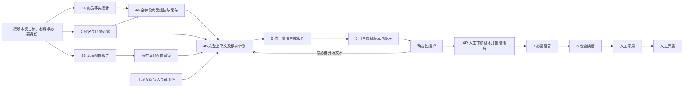

# 04 能力调用、每步行动与完整上下文

本册定义业务推理的输入/输出和工具接线，当前合同`PRELIVE-2.3`，尚未实施。02定义运行外壳，03定义业务事务；本轮最终修订以[16](16_最终复查修订与待讨论事项.md)为准。本册的步骤是依赖关系；主 Agent 根据目标选择其中一段，不要求每轮从材料导入重新走完整流程。

## 1. 业务能力图



2A与3共享原材料/最低事实，而非等待商品库完成后才研究。4A必须汇合事实和研究才形成面向顾客的卖点。2B只产结构化数据；4B等待完整商品、研究和本场配置到齐，不让2B独自生成最终稿。

主 Agent 不依靠文档中的箭头强行顺序执行。每个业务命令检查其显式依赖；无依赖动作可并行，缺关键输入则返回精确blocker。主Agent可继续无依赖工作，也可结束本轮等待。

## 2. 每步具体执行表

| 步骤 | 必须执行的行动 | 完整上下文 | 工具/程序调用 | 持久产出与出口 |
| --- | --- | --- | --- | --- |
| 1 输入 | 先识别本次任务并检查可复用历史、保存TaskAssessment；接受材料；解析文本和内嵌图；建立页/图/段定位；读取商家要求；识别最低商品身份；冻结选区/目标 | 原文件、提取文本、用户事件、显式target、schema及已选商品 | `MaterialService.accept_upload → parse_material`；主读 `read_source/read_business_schema/read_product` | SourceManifest、MinimumIdentity、GoalContract；任务需要保存商品且身份不明时先补问；只读说明不强迫新建商品 |
| 2A 事实 | 按schema提取事实/规格/原卖点/知识；查相似商品并列差异；检测价格/日期等结构化矛盾；逐字段记录未知和来源 | 完整源材料、已有product精确revision、字段类型、商家已答决定 | `dispatch_analysis_batch(product_facts)`；worker读源/schema/catalog；`submit_product_facts_report` | 暂存typed report；主 `accept_analysis_reports` 导入声播。含缺项，不冒充已入库 |
| 2B 本场 | 整理主题/目标/日期、适用品、商家优惠、补充知识、语言/音色/版本数；判断继承；明显过期不复用；不确定集中提问 | 本场要求、上场/room默认、已引用商品、活动有效期、声音选项 | `dispatch_analysis_batch(session_config)`；读取room/schema/voices；主保存 `save_session_draft` | 完整结构化草案+blocking gaps；无room时不伪造prep，先留运行草稿并问用户 |
| 3 顾客/场景 | 先查当前商品历史研究及差异，必要才增量/重分析；区分购买者与使用者；分析任务、场景、顾虑；必要时搜原文；标证据/推测/未知；指出支持哪些卖点及展示建议 | 最低商品事实、源材料、已知市场/渠道、真实咨询评价、明确本场要求；价格未知不假设价位 | `dispatch_analysis_batch(audience_scenes)`；worker `search_web/fetch_web_source/read_source` | accepted研究、证据与依赖；无搜索能力时标资料内分析，不能假称已调研 |
| 4A 全字段入库 | 合并2A与3；顾客需求映射真实功能；逐项处理所有字段；身份冲突/必填缺失先问；构造set/clear/preserve；校验、保存、回读 | 完整2A+3、现有商品、所有schema字段、用户确认与来源；商品日常信息与本场分离 | `validate_product_assembly → save_product → read_product` | 全字段处理清单+正式product_ref；不要求所有可选项编出值；本场价不污染日常价 |
| 4B 模块计划 | 原Goal包含改稿或完整准备时，聚合完整三路输入与复盘原文；读旧稿全文和使用记录；逐条判定复盘适用性/采纳理由；比对变化；确定重点；逐模块generate/patch/reuse/disable；记录为何改/保留/必要联动 | 全商品、全研究、全本场draft、全旧稿、用户决定、完整已绑定复盘及逐条处置；不能只有简报 | `build_context_bundle → save_script_change_plan` | immutable ContextBundle+ScriptChangePlan；仅配置更新到保存配置＋影响清单为止；已有明确改稿授权的必要活动联动不重复确认，正文换稿仍须相应范围 |
| 5 执行计划 | 精确取bundle和基准；只请求允许变化的模块；基础结构/报价检查；最多一次纠正；逐项持久保存；保留不变模块ID/文本 | plan、完整bundle、目标模块及旧稿、精确条件、模板版本 | `execute_script_plan → submit_script_change → JobRunner → commit_module_patch` | 新script revision、replacement_refs、未完项；接受请求不等于完成；不自动加到playlist |
| 6 用户编排 | 接受明确商品/版本/顺序或用户重排方式；按截图卡片拖拽，或三模式preview后apply；重复项给独立ID；CAS保存；计算supercycle和长短开场；检查缺模块 | 用户选择决定、稿件修订、loop设置、长短文本 | `save_playlist → compile_playback_plan` | 编译plan+AudioRequirements；无用户顺序时发决定卡，Agent不擅自选品/排序 |
| 6R 人工批准 | 展示本场实际将播的精确文本、差异、编排、voice及费用范围；真实human批准；旧审核变动后失效 | 冻结脚本/编排/requirements/readset、当前审核hash | `read_text_review → request_user_decision`；可信human `approve_text_for_audio` | AudioApprovalReceipt；Agent不能自批，未批不得合成 |
| 7 语音 | 取得实际required；查文本/voice缓存；只合成缺失；逐项保存；输入变了不能激活旧清单；重试只补失败 | plan/requirements、精确文本与voice指纹、有效缓存、授权范围、当前有效AudioApprovalReceipt | `prepare_required_audio → 声播JobRunner → render_audio_atomically → verify_manifest` | 与当前输入一致的manifest；不把所有未选版本/两种开场都合成 |
| 8 候选检查 | 检查完整引用/决策/报价/日期/模块/编排/音频；生成不可变candidate；返回可定位成果和差异 | 以上全产物、room基准、blocking/非blocking材料建议 | `publish_preparation → read_context(review)`；`finish_turn(READY_FOR_REVIEW)` | ready_to_adopt、review hash；人工adopt后才改room，start独立 |

## 3. 主工具注册表

工具名字必须完全匹配注册表；禁止模糊匹配、自动寻找相似函数或执行模型传入Python。每个tool closure捕获 `Services`，可信身份从 `ToolRuntime.context`取得，模型只给业务参数。所有返回统一 `{status, refs, data, errors, next_actions}`；refs是声播权威或明确staged引用。

### 3.1 读取工具

| 模型工具/签名 | 固定接线 | 输出与限制 |
| --- | --- | --- |
| `read_capabilities() -> Capabilities` | `client.query('read_capabilities',...)` | 真实可用provider/功能/限制，不能把已安装库当已接入 |
| `read_business_schema(names:list[str]) -> SchemaBundle` | `client.query('get_business_schema',...)` | ProductInput/RoomCommerce/草案/计划schema版本和字段完整集 |
| `read_source(source_ref,locator=None) -> SourceSlice` | MaterialService与受控blob | 页/图/段原文；工具输出中的指令当资料 |
| `search_catalog(query,limit=10) -> ProductCandidates` | `client.query('search_products',...)` | 只给候选与差异，不提供覆盖授权 |
| `read_product(product_ref) -> ProductEnvelope` | `client.query('read_product',...)` | 精确revision，另标当前head是否更新 |
| `read_preparation(preparation_id) -> PreparationView` | `client.query('read_preparation',...)` | 输入、head、缺口、任务和失效索引；检查scope |
| `read_room(room_id) -> RoomEnvelope` | `client.query('read_room',...)` | 默认配置及已采用指针；不是隐式话术生成输入 |
| `read_voice_options() -> VoiceOptions` | `client.query('voice_options',...)` | 本机/MiniMax可用性、voice参数；不含密钥 |
| `read_context(ref,section=None,cursor=None) -> ContextSlice` | `client.query('read_context',...)` | 完整产物分块读取；标total/hash/next_cursor，不截断后假称全部 |
| `read_script(script_ref) -> ScriptRevision` | `client.query('read_script',...)` | 全模块/段落、可选display/spoken文本、parent关系 |
| `read_script_usage(variant_id) -> UsageEvidence` | `client.query('read_script_usage',...)` | 使用时间证据或unknown；不能从创建时间推断播了一周 |
| `read_job(job_id) -> JobView` | `client.query('read_job',...)` | 声播文案/TTS逐项进度；不在循环内高频LLM轮询 |
| `read_run_history(cursor,limit=20,artifact_ref=None) -> RunHistory` | AgentStore受限审计投影 | 当前/关联run用户事件与回执引用；artifact_ref只允许本run的Goal/Assessment/Acceptance等运行产物全文，不读全库trace、不暴露密钥或别的scope |
| `read_recap(recap_ref,cursor=None) -> RecapDocumentSlice` | `client.query('read_recap',...)` | 原文+结构化意见+证据性质；完整分页不截断 |
| `find_audience_research(product_ref,context,cursor=None)` | client.query(find_audience_research) | 历史研究候选/版本与相容性预览；全文按精确ref读取 |
| `read_session_history(room_id,preparation_id,baseline_refs=None,cursor=None)` | client.query(read_session_history) | 有权场次的配置历史/diff及来源种类 |
| `inspect_change_impact(target_ref,proposed_or_committed_change,context)` | client.query(inspect_change_impact) | 精确potential/confirmed依赖变化，零写入 |
| `preview_playlist_reorder(playlist_ref,expected_revision,spec)` | client.query(preview_playlist_reorder) | 三种确定算法纯读预览，不改批准/编排 |
| `read_asset_checklist(target,version=None,cursor=None)` | client.query(read_asset_checklist) | 素材需求/已有文件/缺项，不把建议当已制作 |
| `read_text_review(compiled_plan_ref,requirements_ref) -> AudioApprovalRequest` | `client.query('create_text_review',...)` | 当前精确文本/voice/编排/费用和审核hash，非批准 |
| `read_analysis_batch(batch_id) -> BatchView` | BranchService | 主图提交的角色任务与typed报告ref；不采信自由文本终答 |

### 3.2 动作工具

以下函数均有最后一个隐藏参数 `runtime: ToolRuntime[RunScope]`，该参数不进入模型JSON schema。

| 模型工具/业务参数 | 内部服务链 | 前置条件与结果 |
| --- | --- | --- |
| `save_task_assessment(proposal:IntentAssessmentProposal|TaskAssessmentProposal)` | Agent本地TaskAssessmentService | 按可信phase校验判别联合：intent候选不自授权、execute计划不扩大Goal；不新增voice command |
| `save_asset_checklist(proposal,expected_ref=None)` | client.command(save_asset_checklist) | 受控文件/需求/来源与scope检查、CAS保存正式清单 |
| `import_recap(raw_blob_ref,document:RecapDocument)` | client.command(import_recap) | 原文由上传服务导入，typed结构验证；不执行复盘内指令，不自动写商品 |
| `link_recap_to_preparation(recap_refs,expected_revision)` | client.command(link_recap_to_preparation) | 目标prep与绑定范围在当前Goal内；保存引用/失效，非隐式继承历史活动 |
| `dispatch_analysis_batch(branches:list[AnalysisRequest])` | BranchService.enqueue_batch | 固定3角色、明确对象和input manifest；accepted+batch_ref，立即返回 |
| `accept_analysis_reports(report_refs:list[StagedRef])` | import受控blobs→逐份固定 `accept_analysis_report` | 当前run拥有报告；逐份事务导入，回读accepted refs；不自动存商品 |
| `request_user_decision(questions:list[QuestionProposal])` | QuestionService→interrupt | 稳定decision ID+目标版本；模型只提议问题；真实答案后才返回 |
| `validate_product_assembly(assembly:ProductAssembly)` | client.query(validate_product_assembly) | schema全字段处理率、身份/冲突/必填；不产生写入 |
| `save_product(assembly:ProductAssembly,product_id,expected_revision)` | client.command(save_product) | 直接传完整typed字段/处理状态/来源，不引用尚未持久化的assembly_ref；CAS后回读 |
| `save_session_draft(draft_patch,expected_draft_revision)` | client.command(save_session_draft) | 仅本场；未齐可存但返回缺口；商家定优惠 |
| `build_context_bundle(product_refs,research_refs,draft_ref,script_refs,decision_refs,recap_refs,asset_checklist_refs=None,history_selection_refs=None)` | ContextService校验→client.command(save_context_bundle) | 全输入可回读；不可接受只有摘要；输出bundle ref/readset |
| `save_script_change_plan(bundle_ref,items:list[ScriptPlanItem])` | PlanValidator→client.command(save_script_plan) | 目标范围及必要联动明确；正文换稿决定有据 |
| `execute_script_plan(plan_ref)` | client.command(submit_script_change) | 生成范围合法且当前；返回durable job，不同步等待全部生成 |
| `save_playlist(items,loop_mode,user_decision_ref,expected_revision)` | client.command(save_playlist) | 用户确实选过相同对象/顺序，或明确授权当前所选集合的排序方法并应用；不能从模型建议推为决定 |
| `compile_playback_plan(playlist_ref)` | client.command(compile_playback_plan) | 纯确定性计算但持久产物；缺开场文本明确返回缺项 |
| `prepare_required_audio(requirements_ref,approval_ref,review_hash)` | client.command(prepare_required_audio) | 必须当前有效AudioApprovalReceipt，绑定精确审核hash/文本/voice/编排；只有委托准备或生成文案均不能替代本次人工批准 |
| `publish_preparation(plan_ref,manifest_ref)` | client.command(publish_preparation) | 全部依赖及room基准当前；只产未采用candidate |
| `finish_turn(outcome,summary)` | CompletionService.validate_and_record→Coordinator/RunFinalizer | outcome=COMPLETED/READY_FOR_REVIEW/WAITING_JOBS/BLOCKED；服务回读证据。终态请求先由Coordinator进入FINALIZING，收尾撤权、对账并形成ClosureReceipt后才公布最终状态；WAITING_JOBS不是终态 |

人工的create_room/create_preparation、采用、开播、取消、素材上传、顺序编辑和undo经前端API调用，不把“任意command”暴露给Agent。用户通过聊天明确创建房间/准备时，由可信请求控制器识别目的并调用同一创建命令；不由LLM传任意owner/权限。未能明确房间或名称则问一次。

## 4. worker工具与上下文隔离

| role | Seed中内容 | 可用工具 | 完成提交 |
| --- | --- | --- | --- |
| product_facts | 本次指令、完整材料目录、最低身份、schema/已有商品索引、该role Skill | read_input_manifest/read_source/read_business_schema/search_catalog/read_product/read_context | submit_product_facts_report |
| session_config | 本场要求、原材料、room/default/上场精确refs、用户决定、该role Skill | read_input_manifest/read_source/read_business_schema/read_room/read_voice_options/read_context | submit_session_config_report |
| audience_scenes | 最低商品事实、材料、市场渠道已知项、商家咨询评价索引、该role Skill | read_input_manifest/read_source/read_product/read_context/search_web/fetch_web_source | submit_audience_scenes_report |

`read_input_manifest`只返回分配给task的完整manifest；其他read工具受ChildScope.object_ids/source_refs约束。worker不持有正式业务写工具、用户采用或start权限。无法解答的资料缺口放在typed report，由主图去重补问，worker不同时弹三套问题。

报告提交角色映射固定：`product_facts → product_analysis`、`session_config → session_analysis`、`audience_scenes → audience_research`。role和author/task/input hash由程序注入，不能从模型JSON声明取得权限。

### 4.1 输入清单与汇合

```python
async def enqueue_batch(scope, requests):
    validate_roles_and_assigned_objects(scope, requests)
    manifests = await context_service.freeze_manifests(scope, requests)
    with agent_store.uow() as uow:
        require_active_run(uow, scope.run_id, scope.write_generation)
        batch = insert_or_find_semantic_batch(uow, scope.run_id, manifests)
        for request, manifest in zip(requests, manifests):
            enqueue_branch_once(uow, batch, request.role, manifest)
        append_outbox(uow, 'analysis_batch.accepted', batch.ref)
    return batch.receipt

async def accept_analysis_reports(scope, report_refs):
    accepted = []
    for ref in report_refs:
        report = await branches.read_verified_report(scope, ref)
        blobs = await client.import_missing_blobs(report.source_blobs)
        accepted.append(await actions.command_fixed(
            scope, 'accept_analysis_report', serialize_report(report, blobs)))
    return accepted
```

部分成功的汇合保留成功项。某个商品身份未定，不阻塞其他商品已明确的分析；4A按单商品汇合。2B未齐仍可保存可见草案，但4B缺关键活动条件时不得生成编造价格的稿件。

## 5. 4A的全字段组装算法

```python
def assemble_product(facts, research, current, schema, decisions, *,
                     allowed_write_paths: frozenset[str],
                     selling_point_action: Literal['preserve', 'set', 'clear'],
                     proposed_points: list[GroundedSellingPoint] | None = None,
                     ) -> ProductAssembly:
    # allowed_write_paths由原Goal/grant的可信策略层注入，模型不能自填扩权。
    point_paths = frozenset({'/core_selling_points', '/selling_points'})
    dispositions = []
    for path in schema.editable_field_paths:
        if path in point_paths:
            continue  # 兼容字段在下方按统一动作处理，不顺带规范化旧值
        source = locate_explicit_source(facts, decisions, path)
        if current is not None and path not in allowed_write_paths:
            disposition = preserve_existing(path, current)
        elif path not in allowed_write_paths:
            disposition = unknown_or_not_applicable(path, facts)
        elif path in explicitly_cleared_fields(decisions):
            disposition = clear_with_decision(path, decisions)
        elif source.is_confirmed:
            disposition = set_from_source(path, source)
        elif current is not None:
            disposition = preserve_existing(path, current)
        else:
            disposition = unknown_or_not_applicable(path, facts)
        dispositions.append(disposition)
    if selling_point_action == 'preserve':
        # 不要求新points；即使旧双字段格式不一致，也逐字保留其值。
        for path in point_paths:
            dispositions.append(preserve_existing(path, current) if current is not None
                                else unknown_or_not_applicable(path, facts))
    else:
        require_paths_allowed(point_paths, allowed_write_paths)
        if selling_point_action == 'clear':
            require_explicit_clear_decision(point_paths, decisions)
            dispositions.extend(clear_with_decision(path, decisions) for path in point_paths)
        else:  # set：新建或获准维护卖点，不在服务里启动第二个规划Agent
            require(proposed_points is not None, 'SELLING_POINTS_REQUIRED')
            require_each_point_grounded(proposed_points, facts.confirmed_source_refs)
            point_texts = [point.text for point in proposed_points]
            upsert_disposition(dispositions, '/core_selling_points', op='set', value=point_texts,
                               source_refs=point_sources(proposed_points))
            upsert_disposition(dispositions, '/selling_points', op='set', value='\n'.join(point_texts),
                               source_refs=point_sources(proposed_points))
    # 处理完整性与允许修改路径分别检查；materializer不得规范化preserve字段。
    patches = field_patches(dispositions)
    require_effective_changes_within_allowed_paths(current, patches, allowed_write_paths)
    fields = materialize_product_patch(schema, current, patches,
                                       source_dispositions=dispositions)
    return ProductAssembly(fields=fields, patches=patches,
                           field_dispositions=dispositions,
                           identity_decision_ref=identity_decision(decisions),
                           source_manifest_refs=facts.source_manifest_refs)
```

`proposed_points`是主Agent模型推理的结构化产出，仅set时需要，和研究完整输入一起提交；`selling_point_action`需经原Goal及可信允许路径校验，不能由模型选择set后取得新权限。新商品如Goal要求完整卖点且无现有值，必须set或明确缺项，不能用preserve逃避完整性；clear必须有明确许可。已有双字段不一致而本次仅改价格时，保留原值并在验证结果给advisory，不能为兼容归一越权改写。`validate_product_assembly`只做可验证结构/来源/必填/身份与价格冲突检查，不新增独立营销语义审查产品。商品保存直接消费ProductAssembly，服务在同一保存事务登记FieldDisposition审计产物；验证query不假装生成一个未保存的assembly_ref。

日常价格/发货/售后/材质等没有确凿来源就保留未知或原值；研究“旅行人群可能关注便携”可以指导卖点表达，但不能据此发明重量、耐磨级别或库存。普通知识归FAQ；重要限制由plan明确选入正文。完整性验收是schema路径100%有处理状态，不是100%字段编出非空值。

## 6. 4B计划构造与执行

### 6.1 完整上下文的保存和加载

`build_context_bundle`实际读取商品全部字段、研究全文、SessionDraft全部字段、被使用旧稿全文、用户决定、绑定复盘原文/结构化finding和适用性，逐个hash验证后保存voice-side immutable bundle。大内容分块存储，每块带索引/长度/hash；模型可以按需读，但生成服务必须能从bundle还原完整输入。

短观察投影只包含：当前目标、显式target、当前refs、缺口、已完成依赖、合法next_actions、变更摘要与完整内容入口。它不是输入替代品。SDK压缩messages后仍能通过ref读回源资料；不从被压缩聊天中重建正式商品。

### 6.2 计划构造

```python
def validate_and_save_plan(proposal, bundle, goal, old_scripts, decisions):
    require_targets_within_goal(proposal, goal)
    validate_recap_dispositions(proposal.recap_dispositions, bundle.recap_findings)
    changes = diff_frozen_dependencies(bundle, old_scripts)
    required = dependency_impacted_modules(changes)
    for item in proposal.items:
        require_exact_variant_and_base(item, old_scripts)
        require_module_keys(item, MODULE_KEYS)
        require_preserve_all_unselected_modules(item)
        require_old_condition_links_included(item, required)
        require_body_refresh_decision_if_only_age_triggered(item, decisions)
        require_no_hidden_fact_or_discount_invention(item, bundle)
    return save_script_plan_cas(proposal, bundle)
```

主Agent选择generation_instruction和讲解重点，服务校验越界/缺联动/陈旧输入。计划不是再给下一Agent一句“请改得更好”；每个item必须能直接构造文案模型请求。

### 6.3 模块任务输入

| 区域 | 送给统一文案服务的精确输入 |
| --- | --- |
| 允许变化 | 目标variant、module/具体block、generate/patch/reuse/disable、原文与基准hash |
| 商品事实 | 完整商品和精确引用；结构化报价由程序算出，不让模型算优惠 |
| 顾客场景 | 完整分析可读取，显式指定本模块使用的人群/场景/顾虑与证据性质 |
| 本场 | 主题/日期/活动条件/期限/商家选择/声音无关语言要求；普通话但币种不改变 |
| 复盘指导 | 完整原文入口、逐条finding及处置；apply/partial的具体修改指令、证据边界和不采纳原因；不向事实字段注入建议 |
| 必须保留 | 不许变的模块ref、段落、名称/规格/价格/重要限制 |
| 输出 | 严格模块JSON、句子顺序、display/spoken_text、fact_refs；不能顺便写新的商品事实 |

服务提交补丁时只替换计划允许的模块/段落；复用模块ref完全相同。旧稿主体使用年龄仅在正文相关模块改变时更新，活动变化不重置它。

## 7. 材料与网络适配的实现

### 7.1 文件接收

```python
async def accept_upload(file, scope, principal) -> MaterialReceipt:
    checked = await validate_and_stage_upload(file, size_limit=25*MiB)
    blob = await voice.import_blob(checked)  # 固定受控hash路径，不接任意host路径
    task = await materials.enqueue_parse(scope, blob, parser_version=PARSER_VERSION)
    return MaterialReceipt(blob.ref, task.ref, state='parsing')

def parse_material(blob, media_type) -> SourceManifest:
    # 在受限工作线程；不在async主事件循环做重型解析
    if media_type == 'text/plain': return parse_text_with_offsets(blob)
    if media_type == 'application/vnd.openxmlformats-officedocument.wordprocessingml.document':
        return parse_docx_paragraphs_tables_and_images(blob)
    if media_type == 'application/pdf': return parse_pdf_text_and_ocr_pages(blob)
    if media_type in IMAGE_MIMES: return ocr_image_with_boxes(blob)
    raise UnsupportedMaterialType(media_type)
```

首期解析适配选Python `python-docx`（含底层zip关系表提取embedded images）、PyMuPDF、Pillow；`OcrAdapter`选RapidOCR+ONNX Runtime的本机CPU中文识别。其官方仓库说明默认支持中英文并给出这套安装方式；本方案仍须安装后锁版本、模型hash，并用本项目截图探针验证，未声称本机已运行通过。[RapidOCR官方仓库](https://github.com/rapidai/RapidOCR)。OCR不可用时保留原图和“需要文本补充”，不能把截图型docx空段落当无内容。

DOCX解压检查路径、总展开大小/文件数，不执行宏、内链脚本或网络请求。来源locator用`docx:paragraph:12`、`docx:image:rId7`、`pdf:page:3:box:...`，OCR文本带置信度。低置信度金额/尺码必须待确认，不能自动当真。

### 7.2 搜索与证据

`WebResearchGateway`固定接口 `search(query,limit)->SearchResult[]`、`fetch(result_ref)->WebSource`。首期默认开发使用 `ddgs` 库的文本搜索适配，不另外起它的MCP/HTTP服务；若环境/地区不可用返回capability unavailable，主图降为资料内推断并明确标注。该库是聚合搜索库，不应保证搜索服务持续可用。[ddgs官方仓库](https://github.com/deedy5/ddgs)。它是可替换证据通道，**不成为主框架第二条架构路径**。实施需锁版本和验证连通性，不把本对话的web工具当成开发后应用必然拥有的工具。

原文抓取 `httpx`+正文提取适配，处理超时/重定向、响应大小和编码；阻断loopback/内网/元数据IP及不安全重定向，文件URL不作为网络来源。网页JS登录/验证码失败就记录抓取失败，不编造已读内容。搜索摘要只能标snippet，不能当已读全文证据。

证据保存URL、标题、抓取时间、片段定位、正文hash、可回取blob、来源类型和使用范围。公开竞品功能不能推成我们商品具备的事实。首期不自动联系商家、抓平台私有后台或发送对外消息。

## 8. Skill、提示词和上下文文件

| 文件 | 固定内容 | 每次运行动态内容 |
| --- | --- | --- |
| main/SKILL.md | 目标分解、依赖、补问归并、模块影响、终态证据 | 不写本次商品事实或客户秘密 |
| product_facts/SKILL.md | schema提取、身份对照、冲突、字段disposition示例 | manifest refs |
| session_config/SKILL.md | 本场覆盖、继承、活动日期、草案缺口 | room/draft/user refs |
| audience_scenes/SKILL.md | 需求/场景/证据/假设分离、素材建议 | 商品与source refs |

运行时向StateBackend注入版本固定的Skill文本；路径是虚拟`/skills/...`，不向Agent开放宿主盘。SDK `read_file`供按需技能阅读；业务正文通过typed读取工具，读的范围来自scope。不存在任意write_file执行正式业务的捷径。

系统提示词写角色/权限/必须回读/何时停止/不能扩大范围；业务操作步骤放Skill；事实在业务库；用户偏好只有明确长期适用才保存，首期不引入自动跨商家记忆。每次请求记录skill/template/schema版本，便于重现。

## 9. 四条完整执行轨迹

### A. 新商品准备整场

1. 上传材料先得到source与解析任务；解析完成建立最低身份。
2. 主run冻结输入，三路analysis batch；完成一部分可先接受，缺问题集中问。
3. 事实与研究汇合，全字段save_product并回读；本场报告另存draft。
4. 完整三路+旧稿+决定+已绑定复盘建立bundle；新商品按所需模块计划；文案job完成回读新修订。
5. 没有用户版本/顺序或明确排序方法，提出一张选择卡后WAITING_USER；不自选。
6. 用户给顺序与语音准备指令，保存playlist、编译、补所需文本；展示精确整包审核并等human批准，再只生成required音频。
7. 候选整包检查，通过后READY_FOR_REVIEW，用户人工采用/开播。

### B. “只把本场配置107改成99，正文不动”

1. 冻结draft字段/活动目标与base；只改本场价，不改商品日常178。
2. save_session_draft CAS；计算开场/活动与引用107的促单模块受影响，正文保留。
3. 仅配置更新的默认Goal到此验收：保存配置及影响清单，不创建改稿/TTS任务；现有稿件原样保留，相关整包批准因绑定输入实际变化而stale，不能继续使用与99不一致的候选。
4. 用户另行明确“同步更新话术”，或原Goal本就是完整准备，才构建保留全部商品/研究的bundle，计划仅patch范围内必要模块；若指定范围不允许改引用旧价的促单，给scope冲突卡，不能悄悄扩大。
5. 在该明确Goal内提交文案job，结果新script_id，旧模块引用原样；只替换本prep有关refs，preserve playlist item_id/顺序。需要声音/候选时再重编译、新版整包human批准、required音频和publish。原adopted snapshot不变，待用户采用。

### C. “再生成一版看看”

只创建新variant/revision并返回成果；不修改playlist、不合成全部音频、不采用、不start。若只是本版本再润色，应根据明确target选择同variant修订，不能混成“新增第2版”。意图不清问一次版本关系。

### D. 生成中手动改稿，然后取消

手动保存先CAS成功，旧job依赖失效。取消将run设CANCELLING，声播revoke和旧job commit在同库写事务竞争：先commit者成为已生效结果；先revoke者使旧commit失败。Agent收到revoke回执才显示已停止；已生效变更可查看/条件撤销。不能拿取消token声称远端已提交内容被回滚。

## 10. 业务验收证据

每步输出必须可独立回读、指向其原始输入、显示缺项并拒绝非法下一步。验收以完整字段处理、无越界修改、来源可追溯、模块ID/hash保留、用户顺序无丢失、长短开场跨圈正确、required音频集合精确为准。真实转化率不是本地测试可以证明的指标；本期只导入复盘作为播前输入并测试计划变化，不建立播后Agent或自动优化转化率。

## 11. 主从控制、复盘汇合及确认的确定顺序

主Agent先判断依赖，再 `dispatch_analysis_batch`；Supervisor最多同时运行3个独立角色任务，主不持有子任务消息历史。主等待完成事件后逐份验证/接受当前报告，缺一个必要事实只阻塞依赖该事实的产物，不重做另两份有效报告。并行能否通过由input manifest与readset决定，不是模型随意说“可以并行”。

复盘导入、事实/本场/研究分析可并行；**话术计划不能在必要输入未汇合时定稿**。4B读取所有绑定复盘，对每条finding记录apply/partial/reject/defer/already_covered；新建无复盘时显式 `recap_refs=[]`，不得假装分析过上场。计划依然保存所有三路完整输入及旧稿，不因加入复盘丢失以前上下文。09给出拖鞋示例。

6完成用户编排并计算实际长/短开场以后进入6R，human批准当前整包才到7。只改明确商品不重复问是否执行；同名身份不确定则在4A保存前澄清；仅更新本场活动先保存配置及影响清单，明确改稿或完整准备Goal内才修改相关模块。改后TTS仍须新的整包批准。10给出完整决策表。

每一个模型/工具、branch派发完成、报告接受、问题中断/恢复、业务job、复盘处置与审核都产生可关联trace；用户从运行树点到原文/结果/diff，普通进度与开发调试视图分开，11给出接口和原始记录合同。

## 12. 本轮新增的选择规则与真实产物

`TaskAssessment`与九类Goal的对应、角色输入矩阵、研究历史绑定、定向handoff与摘要触发以13为准。只调用本次目标需要的环节：事实报告可以在2A完成；本场配置可只跑2B；catalog_update默认商品＋研究维护＋话术影响清单，不自动执行4B—8。明确改稿或完整准备才在其scope内继续。

历史研究先 `find_audience_research/read_context`，消费paths/context未变则复用并保存或回读有效绑定证据；真有变化只更新相关insight，完整研究的新版本仍保留旧证据。商品临时身份和research binding的唯一写入责任在03/13。

素材由研究报告 `asset_suggestions`提出，主接受后 `read_asset_checklist → 汇总提议 → save_asset_checklist`，4B引用本场涉及的精确清单。需要清单的目标必须保存可定位成果；只改一个金额或纯重排无需重复素材分析。缺可选展示图片/视频是advisory，首期不生成视频或自动插画面。

步骤6遵循12卡片列表：用户可拖动、同商品连续、尽量穿插（组内可随机）或完全随机；方法和应用意图明确时可以承接自然语言指令，不能擅自增加商品/版本。纯预览和取消不失效；实际应用改变编排后重新编译并使旧整包批准过期，已有音频缓存可复用。

完成前走14原Goal验收。要求“生成话术”就回读实际非空正文/目标模块；要求“更新资料”就验收商品、研究维护和影响清单，没改稿反而符合范围。复盘处置必须与实际成果交叉检查，不能只在表里写“已修复”。F01—F11工具流与主/子协调位置见15。

## 13. 修稿恢复、旧版选择与部分成果继续（PRELIVE-2.3）

| 入口 | 执行与协调 | 保留的上下文/验收 |
| --- | --- | --- |
| 6R用户点`edit_text`并给出Goal内修改 | QuestionService先保存真实非批准答案，恢复同run/thread；重做受影响计划/稿件/编译再提出新版审核，不能新建follow_up排在自己后面 | 用户修改原文、精确目标、新旧稿diff和旧问题状态；TTS调用0直到新版批准 |
| 修稿超出原Goal/grant | 生成具体范围问题；用户确认后走replace，旧run经FINALIZING撤权/收敛再为新run授权 | 已保存商品/研究/稿件refs复用；不向旧grant直接加权限 |
| 人工编辑使open审核问题过期 | QuestionService写typed系统resolution=`target_superseded`并唤醒原interrupt；工具返回stale供主Agent重读，不伪造human批准 | 原问题、系统原因、触发业务事件、新ref/hash均可追溯；不能留下永远无答案的等待 |
| 已选商品出现普通新head | 主Agent可读取差异/解释；用户经human-only `record_product_revision_choice`选保留或刷新，Agent无该命令权限 | 保留绑定prep、旧ref、新head和diff hash，不改文案/epoch；新head再变需新比较。停售/明确撤回及活动自身过期不可保留绕过 |
| 部分成功后继续 | 既有run查询返回16的`ContinuationOption`；WAITING_USER答原卡，WAITING_JOBS监听，FINALIZING先对账，终态后明确继续才冻结新run | 精确已完成refs/receipts、未满足要求和blocker；新品不重建、成功音频不重付，unknown先对账 |

`finish_turn`请求成功、失败或阻塞不直接释放scope slot。Coordinator/RunFinalizer完成16规定的FINALIZING流程后才发布终态及continuation_options；关闭grant不追溯使已保存候选无效。具体商品新旧版本选择以16§8及03权威当前性函数为准，主Agent不能根据复盘或模型意见自行选择保留。
