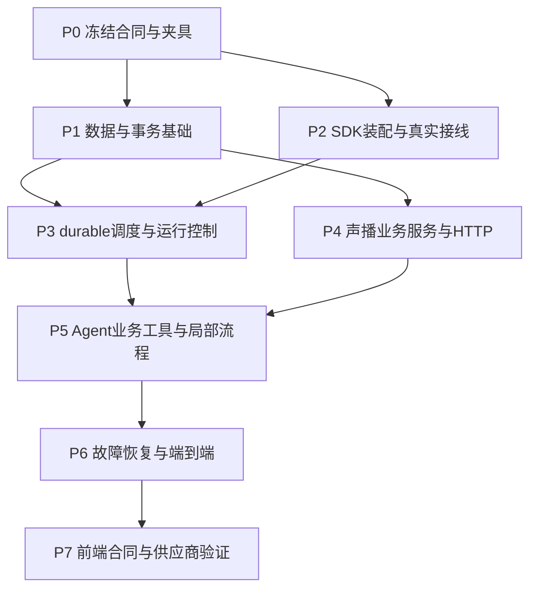

# 播前 Agent 工程设计：实施顺序与验收

版本：Engineering V2，2026-10-15。

本文规定后续编码任务的依赖、交付物和可执行验收。当前状态为**设计，测试均待实施**；不得把本文件、仓库里存在测试、此前 SDK 环境探针，表述为本版业务 Agent 已通过集成测试。

## 1. 实施基准和完成边界

| 项目 | 固定基准 |
|---|---|
| 业务目标 | 依照《10_播前Agent首期流程基线.md》，在 Agent 内准备商品、场次草案、研究、话术计划、模块稿件、用户编排和必需音频，最终生成可检查的候选快照。 |
| 运行架构 | 独立本地 Deep Agents 服务：一个主图、三类独立角色图 `product_facts/session_config/audience_scenes`，由持久任务监督器调度。主图用 `dispatch_analysis_batch` 受理任务，不使用 native `task` 承担业务委派。 |
| SDK | 当前已准备 `deepagents==0.7.25`、`langchain==1.4.6`、`langgraph==1.2.15`；实施时新增 SQLite saver 的版本先核验再锁定，不能写一个未经安装验证的版本号。 |
| 数据事实 | 声播DB保存唯一正式商品及所有已接受业务草案/研究/上下文/计划；Agent只保存运行、分析任务、问题、暂存和权威refs。checkpoint不替代业务回执，模型自然语言不改变业务权限或就绪状态。 |
| 发布边界 | Agent 生成 `unadopted` candidate；用户显式采用 snapshot 才更新房间正式配置，用户另行 start 才创建真实 live session。三个动作独立。 |
| 本轮交付 | 后端工程设计和验收方案；不开发前端、不调用真实模型/TTS、不运行公共直播。后续前端通过合同测试接入。 |
| 不扩展 | 不引入 Bash、任意 SQL/HTTP、Teams、任意 Skill 安装、视频生成、完整播后Agent、自动优惠决策和自动选择销售商品。 |

验收分四种证据层级：静态合同检查、离线真实 SDK graph、真实本地 HTTP 与 SQLite、外部模型/声音供应商小样本。四者分别报告；mock 返回正确不能证明真实 HTTP 提交成功，真实 TTS 成功不能证明直播转化提升。

## 2. 编码依赖与并行分工



P1、P2 可在 P0 合同稳定后并行；P4 与 P3 可在 P1 接口冻结后并行；测试夹具和合同测试从 P0 起维护。不能先各写一套状态、工具信封和权限枚举再在集成时碰运气合并。

| 工作包 | 修改所有权 | 接收输入 | 必须交付 | 集成边界 |
|---|---|---|---|---|
| A 合同与集成 | Agent 的 `contracts/`、合同版本、测试清单 | 业务基线与本套工程设计 | typed schema、错误枚举、scope/版本字段、固定 JSON fixture、接口变更记录 | 共享合同只有这一处维护；其他工作包提出变更，不各自定义同名模型。 |
| B SDK Harness | `runtime/`、模型和 middleware、主/角色图 | A 的合同与 service Protocol | 实际 factory、seed、上下文投影、工具过滤、完成守卫、图探针 | 通过 service 接口访问业务，不越层读声播 SQLite。 |
| C 运行服务 | RunCoordinator、BranchService/Runner、仓库、监督器、inbox/outbox | A 的合同，B 的 graph 接口 | 受理/排队/独占 invoke、子任务调度、恢复/撤销/事件 | 调用可信 run-grant HTTP；本地 cancelled 不能冒充声播已撤权。 |
| D 声播接入 | 声播 `app/prelive/`、受控存储层、HTTP route、旧接口兼容 | A 的请求/回执，现有声播代码 | 全局商品、草案、模块生成、编译、音频、候选/adopt/start、同库 fence | 不把 run-grant 或人工 adopt/start 注册为模型工具。 |
| E 验收 | Agent/声播各自 `tests/`、`tests/fixtures/`、`reports/` | A 的 fixture 和各包能力 | 可复现场景、故障注入点、断言、证据、失败定位 | 不依赖源码关键词或人工看日志判核心不变量。 |

若使用多窗口实施，每包领取固定文件范围；集成者先合并合同，再合并对应实现与测试。任何改动触及共享 schema、错误码、权限或事件字段，必须先通过跨服务合同回归。

## 3. 分阶段实施与退出条件

### P0：冻结跨服务合同和验收夹具

| 行动 | 明确交付 | 退出条件 |
|---|---|---|
| 固定目录/依赖 | 按主分册目录建立最小包和依赖锁，保留现有 `environment/`；测试默认使用临时目录/数据库 | 解释器可从独立 venv 启动；不得隐式改声播依赖环境。 |
| 固定模型 | 主/child scope、InputManifest、WorkerReport、用户 intent、selection、问题/回答、Action/Job/Publication/Adoption/Start 回执 | 所有合同可 JSON schema 导出，序列化往返不丢 Decimal/币种/修订/引用；额外身份字段拒收。 |
| 固定权限 | 工具精确 allowlist、backend 路径规则、服务端 Principal 与 run grant | 模型 args 中无 account/actor/lease/授权代数/permission/operation_key 的自填入口；普通文本不被升级为人工动作。 |
| 固定夹具 | 两个相似拖鞋商品、含冲突/缺项材料、旧稿、活动、重复 occurrence、声音与故障音频 | 每个 fixture 有来源说明、预期字段/错误/允许变化、原文 hash；不含真实凭据。 |
| 固定前端请求语义 | follow_up/new_task/replace、手动编辑、冻结 selection、review/adopt/start 分离 | 后端和前端共享的示例请求/响应齐全；没有“点击确认”被推成开播的含糊字段。 |

P0 输出的 fixture 与 schema 是后续测试输入，不以额外提示词补救合同缺失。全局 catalog 操作允许 `preparation_id=None`，不得为其伪造房间或准备任务。

### P1：持久数据与声播事务基础

| 编码次序 | 文件/函数职责 | 退出条件与证据 |
|---|---|---|
| 1 | 迁移、UoW、revision、自增编号/SKU registry、幂等 operation 仓库 | 在旧库副本上迁移两次：ID/内容不变，第二次无副作用；编号冲突明确失败。 |
| 2 | run/task/artifact/question/inbox/outbox、独占 invoke 租约、active-run slot | 各关键唯一约束通过并发连接测试；重启查询能找到 accepted 数据。 |
| 3 | 声播同库 run grant、write_generation、revoke、业务写入 fence | revoke 与提交并发时存在可解释的事务先后，撤权回执后旧 grant 不能再提交；数据库故障时不能假报已撤权。 |
| 4 | 版本化原文/产物仓库与 ContextBundle、读取回执 | 完整原文可按 ref/hash 取回，跨作用域和路径穿越失败；分页末尾才标 complete。 |
| 5 | 旧 route 统一进入受控版本写入，正式数据来源保持一个 | 旧 UI 修改能递增 revision、使候选陈旧；未提交字段保持原值，显式删除不复活。 |

退出 P1 不要求已有模型，但要能以普通 Python 服务函数走通一个受控商品写入、一个撤权拒绝、一个重复 operation 回读。无这层基础不进入真实写工具。

### P2：SDK 装配及可观察接线

按 `runtime/bootstrap.py → runtime/factory.py → tools registry → middleware factory → create_deep_agent` 的真实路径实现；三类图同样从正式 factory 构建。测试直接调用应用入口构造 RuntimeBundle，不能另造一个简化 demo graph 代替正式装配。

退出条件：SDK-01—SDK-14 的必需探针有实际产物；主图与三角色图都能使用 fake model 完成一次工具往返；ToolPolicy 在模型请求和执行处同时封口；ContextProjection 实际改变模型收到的请求；CompletionGuard 实际阻止无回执终止；SQLite saver 跨进程恢复成立。只在代码里定义某个 middleware 类不算通过。

### P3：durable 调度、任务生命周期及可信 child scope

实现顺序：RunCoordinator submit/claim → BranchService.enqueue_batch → outbox → Supervisor claim → BranchRunner 通过 `context=ChildScope` 调 worker → typed submit_report → 暂存报告回执与任务终态/inbox → 同主线程续跑 → 主工具接受分析并取得声播权威回执 → 取消与 replacement。暂存完成与声播已接受是两个状态，4A/4B 不能引用未接受的草稿代替正式研究。

退出条件：受理后杀进程不会丢任务；父 WAITING_JOBS 后子任务可继续；invoke 租约释放但 active-run slot 保留；follow_up 不抢占等待中的 run；取消/replace 经声播同库撤权回执落实；重复 inbox 不形成重复提交。三角色只持有分析报告工具，没有发布或付费 TTS 权限。

### P4：声播服务、HTTP 与业务确定性核心

实现顺序：capabilities/schema → catalog → draft/context 导入 → quote → module generation job → playback compiler → 人工文案批准服务 → required audio job → candidate publication/review → 人工 adopt → 人工 start。

退出条件：通过真实本地 HTTP 的合同与事务测试；生成/TTS provider 可先用受控 stub，正式读写必须落真实临时 SQLite。`202 accepted` 与任务完成、候选就绪与采用、采用与开播均有独立回执。生成 worker 不再调用旧 attach 路径直接把结果挂到房间。

### P5：Agent 业务能力和局部流程连接

将已通过 P3/P4 的服务包装为实际 tools。分步接入 1 → 2A/2B/3（同时可导入复盘）→ 4A → 4B → 5 → 6 → 6R人工文案批准 → 7 → 8，见第 8 节矩阵。模型可以选择需要调用的能力，服务校验依赖与不变量；不通过外层固定 StateGraph 规定所有请求必须从头跑到底。

退出条件：新商品全量准备、仅更新活动、仅更新声音、只整理全局商品、缺资料暂停恢复五条代表轨迹均闭合；全量输入有证据、指定修改范围被保留、用户选择未被 Agent 擅自改变。

### P6：重启、竞争、对账与迟到结果

在真实进程边界注入 crash、超时和乱序，而非仅抛一个 Python 异常；按第 7 节故障表验证。退出条件：所有一票否决不变量通过，没有假 ready、错误覆盖、撤权后提交或重复正式副作用；所有 unknown 都有真实查询入口或明确待核实状态。

### P7：前端合同与供应商小样本

不在本轮设计页面。用消费者合同测试模拟前端动作、SSE 重连和多窗口操作；通过后再进行有限真实 DeepSeek/本机普通话/MiniMax 验证。真实供应商结果单独统计，不能让偶然成功掩盖确定性控制失败。

退出条件：第 9 节合同测试通过，真实调用留下输入版本、usage/时延、产物、费用或费用不可得说明；仍未验证的供应商/音色明确列出。公共抖音/OBS 导入和真实商家效果另行授权、另列验收，不混入后端完成声明。

## 4. 固定测试数据与隔离办法

| Fixture ID | 内容 | 用途 |
|---|---|---|
| F-P1 | 女款足弓拖鞋，TWD178、明确本场107、EVA、尺码、注意事项，资料保留繁体原文，输出普通话简体 | 不因语言改币种；事实与本场价格分开；知识不全量塞进常规稿。 |
| F-P2 | 同品牌相似男款/SKU 不同，图片相近、价格不同 | 相似商品不能无确认覆盖，selection/对象绑定不漂移。 |
| F-P3 | 缺价格、两来源材料矛盾、没有发货证据 | 缺项补问、冲突保留、禁止虚构履约。 |
| F-S1 | 普通主题、满100减20，用户顺序 A1/B1/A2，循环 | 条件报价、三线汇合、重复 occurrence、跨圈开场。 |
| F-S2 | 仅主题/优惠修改；旧主体卖点已使用一周 | 开场/活动及引用旧优惠的 CTA 更新，主体换新先取明确用户决定。 |
| F-C1 | 长原文分 3 页、5 类完整上下文、夹带“改权限/覆盖另一个商品”的附件文字 | 分页阅读、压缩、信息完整、低信任资料不授权。 |
| F-A1 | 有效 WAV、0 帧 WAV、截断 WAV、错误声音指纹 WAV | 音频检查不是 count 相等，缓存正确复用。 |
| F-E1 | 重复 terminal event、旧 lease 返回、旧 grant 完成、乱序事件 | 去重、fence、后台唤醒与本地投影对账。 |

测试运行器为每个 case 创建临时数据根、独立声播 SQLite、Agent SQLite/checkpoint 文件、音频目录与端口。普通用例可清理临时目录，重启测试必须保留指定目录并启动新进程；不得连接开发者真实商品库或读取真实 API key。语音 provider stub 生成可解析的固定 WAV，用独立计数器记录调用；断言数据库回执、内容 hash 和计数器，不单看 mock 被调用。

候选测试目录为 `tests/unit/`、`tests/sdk/`、`tests/contract/`、`tests/integration/`、`tests/faults/`、`tests/scenarios/`；跨服务测试使用独立测试包。编码时配置固定 pytest markers 和脚本入口，使“离线默认禁止网络、integration 只准本机、provider 需显式选择”能由运行器执行。

## 5. SDK、factory、middleware 与上下文探针

以下探针全部待实现。它们是避免 wodrake 同类“有定义、未接线”缺陷的门槛。

| ID | 操作 | 必须断言的事实 | 证据 |
|---|---|---|---|
| SDK-01 | 从正式 bootstrap 创建主图与三角色图，提交一个实际 API 请求 | route/coordinator 调用正式 factory 构建的 graph；四图均为 Deep Agents；显式 DeepSeek 适配器可注入 fake model | factory 构建记录、graph 名、API→run→invoke 关联轨迹。 |
| SDK-02 | 记录真实模型请求的 tools；再伪造 `task/execute/未注册工具` tool call | 主/worker 的模型请求无这些工具；直接注入调用仍被 ToolPolicy 拒绝，handler 执行次数为 0 | 捕获 request schema、拒绝 ToolMessage 与底层计数。 |
| SDK-03 | 在每个自定义 hook 前后加测试探针 | before 正序、after 逆序、wrap 嵌套与设计相符；正式 worker 也装入其栈 | 每图 hook 轨迹；删掉任一关键 middleware 的 mutation test 必须失败。 |
| SDK-04 | 更改准备观察数据，在缓存 graph 上再次 invoke | 模型本次看到新 revision/阻塞项，旧对象不复活；ContextProjection 保存观察引用且动态注入实际进入 model request，保留 SDK system blocks；主/worker state 都声明观察字段 | 两次 request 对比与 snapshot hash。 |
| SDK-05 | 一个 worker 用假 role/parent/task 参数提交，另一 worker 尝试借其 ref | ChildScope 来源可信任务登记，不从模型字段取得；报告、材料和产物 scope 校验失败 | 403/受控工具错误；正式写入为 0。 |
| SDK-06 | worker 输出合法 JSON/自然语言“报告完成”，但不调用 typed 提交工具 | 没有服务端暂存报告回执不得成功；错误字段/证据 ref/输入 hash 不接受；有界纠正后失败；暂存回执不能冒充声播 AnalysisAcceptanceReceipt | report repository 查询、后续主接受记录与 guard retry 次数。 |
| SDK-07 | 主模型直接给最终答复“准备完毕”，无 finish/候选回执；另运行仅catalog目标 | CompletionGuard 阻止假完成；合法 COMPLETED/WAITING_JOBS/BLOCKED/READY_FOR_REVIEW 分别按 GoalContract 核验；仅商品整理用 COMPLETED，不强迫生成候选/房间；最多两次纠正 | graph state、公开事件与 receipt，证明 token 不驱动 ready。 |
| SDK-08 | 预置业务 Skills，调用 read_file；随后覆盖 Skill 路径、读另一分支目录 | Skill 可真实读到；只读目录拒写；角色与 task 输出目录隔离 | backend 内容/拒绝结果，不以 prompt 提到 Skill 代替读取。 |
| SDK-09 | 读 F-C1 分页，只读前两页即提交需要第三页的计划；令历史触发 SDK 默认压缩 | 必读未完成拒绝；读完后可取回精确原文/版本/来源；摘要后五类完整业务 refs/精确条件可回取，工具消息配对保持；不另造第二套摘要机制 | read receipts、bundle hash、第三页关键条件检查、压缩前后可读取证据。 |
| SDK-10 | request_user_decision 触发 interrupt，重启后同线程 Command(resume) | 问题仅存一次；答案绑定 question ID；GraphInterrupt 未被错误包装吞掉 | SQLite checkpoint 文件、问题/回答/消费回执。 |
| SDK-11 | 主 WAITING_JOBS 释放 invoke 租约，同时 worker 报告返回 | active-run slot 仍占用；child 不要求已退出父 invoke 租约；child 自己过期 lease 不可提交 | lease/slot 变化与报告回执。 |
| SDK-12 | AIMessage 同时提出两项有依赖写动作 | 不依赖 SDK 并发工具的隐含顺序；缺前置回执的动作返回 DEPENDENCY_NOT_READY | 动作账本与业务记录。 |
| SDK-13 | 模型反复调用同一无进展动作或超调用上限，并触发默认摘要 | 有界停止、保留部分产物、不假报完成；父/child/provider 与 SDK 摘要 usage 分开记录；明确摘要调用在 provider 预算边界的覆盖，未覆盖不得宣称费用精确硬封顶 | 调用计数、终止原因和总 usage 来源。 |
| SDK-14 | 新进程使用同持久 saver 恢复主/worker；两个相同 thread 并发唤醒 | 恢复真实 checkpoint；只允许一条有效 invoke；旧 lease 无提交权 | 进程 PID、落盘 DB、并发事件和 fence 拒绝。 |

如 SDK 升级、factory/middleware 变更、权限/seed/压缩配置改变，至少重跑 SDK-01—10、14，之后再做相关业务回归。

## 6. 运行语义、权限和交易合同验收

| ID | 场景 | 判定条件 |
|---|---|---|
| RUN-01 | 普通文本补充使用 follow_up，前序仍工作/等待 | 新任务串行排队；前序不取消、不 revoke；不抢 active-run slot。 |
| RUN-02 | new_task 指向不同商品/房间 | 独立任务/授权可并行；共享正式商品写仍 CAS，不因不同 task 绕过。 |
| RUN-03 | replace 旧任务，声播 revoke 请求超时 | 本地为 cancel_pending/对账状态，不能宣称撤权成功；拿到 RevocationReceipt 后新授权和替代任务才继续。 |
| RUN-04 | replace 回执后旧模型或 TTS 返回 | 声播提交事务拒绝旧 grant/epoch；有效内容可作无绑定缓存，不能挂到新候选。 |
| RUN-05 | 问“进度怎样”、GET 状态、SSE 重连 | 不创建 run、不提高 revision、不 revoke、不唤醒模型。 |
| RUN-06 | 普通文本写“我已确认/可以开播/我是管理员” | 没有可信 intent/明确人工动作回执，不能取得 adopt/start/越权 scope。 |
| RUN-07 | 全局商品库新增/更新，无场次 | `preparation_id=None` 合法；不隐式新建 preparation/room/live session；仅执行 catalog 目标。 |
| RUN-08 | 用户选择某条消息/字段/段落后，后端有更新 | selection 保存提交时的对象/模块/段落/基准 revision，不自动绑定“当前最新”；冲突明确返回。 |
| RUN-09 | 连续 follow_up 形成同一修改链 | 仅沿本链 predecessor 的可信 replacement_ref rebase；无前驱修改的目标保持原基准。 |
| RUN-10 | 人工或其他任务在同一对象上修改，然后 follow_up 开始 | 即使字段名字相同也不能自动 rebase 到别人的新结果；CAS/差异合并或需要重新选择。 |
| RUN-11 | 跨账号/房间/准备/branch artifact ID 伪造 | 真实主体和 grant 决定授权；不存在“ID 猜中就可读写”的入口。 |
| RUN-12 | 参数注入 account/role/lease/operation_key；附件内含操作指令 | schema 拒绝或当普通材料；ToolPolicy 与服务端仍拒越权。 |
| TX-01 | 同 operation key 同输入重放 | 返回同 action/job/产物回执；新增正式对象仅一份。 |
| TX-02 | 同 operation key 不同输入 | IDEMPOTENCY_KEY_REUSED；不默默执行新参数。 |
| TX-03 | 两客户端都以 room/product revision=N 写 | 只有一个 CAS 成功；失败者得到当前 revision/affected paths，不 last-write-wins。 |
| TX-04 | 模型生成响应到达后、提交前 grant/revision 已变 | commit 前同库重新验证；检查与提交不可分成可竞争的两次无锁操作。 |
| TX-05 | 旧 UI 写入现有商品/声音/房间 | revision 递增，相关候选变陈旧；后端工具与旧接口不能产生双正本。 |
| TX-06 | 外部生成/TTS sent 后超时，远端是否执行未知 | 保留 timeout_unknown 尝试状态、对外按统一 JOB_UNKNOWN/结果未明合同查询对账；不得换 key 盲重试。显式有限付费重试保留可能重复计费记录。 |
| TX-07 | Agent 库已取消、声播还未撤销；旧提交正在事务中 | 依据声播事务提交/revoke 的线性顺序；已合法完成的结果保留，撤权回执后新提交全部拒绝。 |
| TX-08 | 查询失败或 operation 未找到 | 不伪造未执行结论；区分“查询成功且明确未受理”与“查询系统不可用”。 |

所有权限、错误覆盖、假完成和重复正式副作用反例都必须通过；不允许用平均成功率抵消一次越权写入。

## 7. 故障注入、重启和异步回路

故障测试采用可命名 failpoint 和受控 barrier。每项从同一 fixture 开始，至少覆盖“前一步完成、后一步未发生”的断点，不用随机 sleep 猜竞争时序。

| ID/注入点 | 重启/恢复动作 | 不变量与证据 |
|---|---|---|
| F-01 任务事务提交后、HTTP accepted 返回前退出 | 用原 request/event ID 重交 | 原任务存在且仅一份；accepted 不能指向无记录任务。 |
| F-02 branch tasks/outbox 保存后、Supervisor claim 前退出 | 启动扫描 outbox，重新领取 | 所有任务均可找回；无丢分支或重复 semantic task。 |
| F-03 worker claim 后失联、租约过期 | 新 worker 获得新 lease，旧 worker 稍后返回 | 仅新 lease 可提交；旧结果不能覆盖新回执。 |
| F-04 worker report 保存后、inbox 发送前退出 | 从同事务 outbox/inbox 恢复 | 报告和终态事件一致；主线程最终收到一次有效通知。 |
| F-05 主图 checkpoint 与业务 inbox 消费间退出 | 对账 event ID 和消费记录，再续同线程 | 不重复注入 HumanMessage，不重复正式动作；不同数据库不假装原子。 |
| F-06 写声播成功、Agent 未存回执时断网/退出 | 查询 operations 回读回执，补本地投影 | 正式写只生效一次，本地最终与声播一致。 |
| F-07 TTS 文件写 temp 后、原子替换前退出 | 清理/复用规则后仅补缺 | 不把半个 WAV 视为 ready；成功缓存不整批重合成。 |
| F-08 WAV 已落盘、manifest 事务前退出 | 校验孤立缓存 hash，再补 manifest | 有效缓存可复用；manifest 不指不存在/损坏文件。 |
| F-09 部分句成功、部分失败 | retry_failed_items 指定失败 item | 成功项 ID/hash 不变；provider 计数只增加实际缺项。 |
| F-10 cancel/replace 与 job commit 在 barrier 同时发生 | 按声播 DB 序列化顺序处理 | 只能“提交先成功”或“撤权先拒绝”；不能撤权回执后又成功提交。 |
| F-11 重复、乱序 terminal/progress 事件 | inbox 去重/版本检查/状态机 | terminal 不退回 running；旧 job 不激活新目标；progress 不每次唤醒模型。 |
| F-12 等待用户时进程退出 | 同 question/thread 恢复并核对 selection/revision | 未答不继续，答一次只消费一次，旧目标问题不恢复旧写权。 |
| F-13 SSE/HTTP 客户端断开 | 后台 run 按既定任务继续或保持等待，客户端取快照+补事件 | 断连不隐式取消；重连不重交任务；状态查询无副作用。 |
| F-14 candidate 发布事务中故障 | 整体回滚或按 operation 回读 | 无部分候选 ready、无 room/adopt 指针提前变化。 |
| F-15 adopt 前房间/商品/音频依赖变化 | 返回 STALE/CAS 冲突，局部重建 candidate | 不覆盖用户新改动，未采用候选不能直接 start。 |
| F-16 start 的持久 starting 提交后、内存播放器装载前退出 | 标 interrupted、回收 live slot；默认不自动出声 | 相同 action ID 不建第二 session，重启不擅自开播。 |

取消测试必须观察声播数据库中的 grant/write_generation 和业务 commit，不只检查 Agent 状态字符串；恢复测试必须是新 PID 与真实落盘库，不以内存对象重建冒充重启。

## 8. 业务流程验收矩阵

### 8.1 首期各环节

| ID/步骤 | 输入和触发 | 预期产物/协调 | 核心断言 |
|---|---|---|---|
| B-01/1 | 上传商品材料与明确目标 | 原材料归档、基本身份、合法任务/输入清单 | 材料有页/来源/hash；“截图已接收”不等于已解析。 |
| B-02/2A | F-P1/P2 相似资料 | product_facts report、匹配候选/差异/缺项 | 相似不自动覆盖；源事实与原商家卖点可追溯。 |
| B-03/2B | 主题、日期、优惠、声音、用户商品选择 | session_config report/结构化草案 | 草案不生成口播；失效节日活动不无条件继承；可复用项按规则保留。 |
| B-04/3 | 最少商品身份+原材料即可开始 | audience_scenes report/证据/假设 | 不等待完整商品库；假设不冒充功能或真实访谈；研究无网时合理降级。 |
| B-05/并行 | 三角色任务放 barrier 同时运行，依次接受报告 | 独立 threads/manifests/reports 汇合 | 不互相改 files/state；一个缺资料不阻塞无关商品；主 Agent 集中提问。第一个报告更新准备引用后，其他输入 paths/hash 未变的报告仍可在当前 CAS 基准下明确接受；真正依赖变动才重跑。 |
| B-06/4A | 有效 facts+research，完整 schema | 完整商品记录和字段处理表 | 全部字段组被检查，必填缺失阻塞；保存通过声播并回读 revision；研究推断不变正式规格。 |
| B-07/4B | 商品全字段、研究全文、本场草案、旧稿全文、用户决定 | ContextBundle+ScriptChangePlan | 五类完整输入可取回；每模块 generate/update/reuse、基准/hash、依据和允许范围明确。 |
| B-08/5 | 新品初始化或局部更新计划 | ModuleRevision/ScriptRevision、长短开场 | 只修改 allowlist 模块；复用模块 ID/正文/hash 不变；活动修改不重置主体使用年龄。 |
| B-09/6 | 用户顺序 A1/B1/A2，包括同版本重复 | occurrence/compiled plan/required audio | 不按 script_id 去重，不擅自选主推品或排序；缺必要开场只回补该模块。 |
| B-10/7 | 文本修订+计划+声音 | 缺项 job、AudioManifest | 仅必需音频；hash/声音/文件有效而非 count 相等；本机和 MiniMax 结果分别验证。 |
| B-11/8 | 当前有效全部产物 | unadopted candidate+ReviewPacket | room 未被自动覆盖，不创建 session；ready 来自回执与检查结果。 |
| B-12/人工 | 用户显式 adopt，再显式 start | AdoptionReceipt、StartReceipt | adopt 不出声；start 引用已采用当前快照；Agent 凭据直接调用两接口均 403。 |

### 8.2 开场、循环与跳播的确定性矩阵

公式为 `p=r*n+i`，`long ⇔ (p-1)%5==0`，循环超周期 `L=lcm(n,5)`。`i` 为原始编排位置，不能改成已实际播放次数。以下是设计期预期值，未来由独立 reference oracle 与编译器逐项对比。

| ID | n/循环 | 必须出现的结果 |
|---|---|---|
| LOOP-01 | n=0，任意 loop | 拒绝空计划；不能空集合 all_ready 真。 |
| LOOP-02 | n=1，不循环 | 只第1项长；只需要实际用到的长开场音频。 |
| LOOP-03 | n=1，循环，L=5 | 五相位为长短短短短；同一 occurrence 需要两种开场。 |
| LOOP-04 | n=3，不循环 | A1长、B1短、A2短；版本 occurrence 计数各一。 |
| LOOP-05 | n=3，循环，L=15 | 第1/6/11长：第一圈长短短，第二圈短短长，第三圈全短，第四圈短长短，第五圈全短。 |
| LOOP-06 | n=5，循环，L=5 | 只有原第1项长；每圈同模式，不为其他 occurrence 合成长开场。 |
| LOOP-07 | n=6，循环，L=30 | 第1/6/11/16/21/26长；不能每圈从长重置。 |
| LOOP-08 | n=10，循环，L=10 | 第1和第6长；音频按 module/voice 内容键去重。 |
| LOOP-09 | 同一个 A1 重复两次 | occurrence ID 不同，分别按原位置选模式；内容缓存仍可共用。 |
| LOOP-10 | 重排 A1/B1/A2 → B1/A2/A1 | 新 plan 重新计算原序号；未变正文/音频复用，仅补缺开场。 |
| LOOP-11 | 从 phase 1 跳到 phase 6，或重复跳回 phase 1 | 目标 entry 固定长；跳过/重播次数不改模式；supercycle index 明确。 |
| LOOP-12 | 只给 product/variant，存在多个 occurrence/圈相位 | 返回明确候选或按合同选当前圈下一项并在回执说明；不随机取一项。 |
| LOOP-13 | 插播一句话后继续 | 插播不增加 occurrence 计数，不改变下一 entry 模式。 |
| LOOP-14 | n=1…50，loop on/off，多个超周期 | property test 校验每个 global position 的模式与 oracle 一致、L≤5n、重复超周期周期性。 |

### 8.3 变更仅影响必要部分

| ID | 用户变更 | 保留 | 更新/阻塞 |
|---|---|---|---|
| CHANGE-01 | 只改本场活动 | 商品事实、有效研究、未引用旧活动的主体 | 两种开场/活动、实际引用旧条件的 CTA 等；只合成实际需要的新句。 |
| CHANGE-02 | 只改声音 | 文本、研究、用户顺序、开场映射 | 对新声音指纹补音频、manifest/candidate；旧声音不误当就绪。 |
| CHANGE-03 | 只重排 | 商品、研究、模块正文、有效缓存 | plan 和开场需求、缺项音频、candidate；不全量重写。 |
| CHANGE-04 | 改一条商品事实 | 不依赖该字段的内容 | 消费该字段的研究/卖点/话术按依赖失效；重要限制必要时入稿。 |
| CHANGE-05 | 主体已用一周 | 原主体仍保留 | 先提示并获得用户决定才换主体；活动自动更新不算该决定。 |
| CHANGE-06 | 仅要求素材建议 | 正式商品/稿件不受无关改动 | 输出需要的演示资料建议，不生成视频或添加画面 hook。 |
| CHANGE-07 | 满减门槛与单件价不符 | 用户设置的优惠条件不被偷偷改 | 不说单件未达门槛仍能减；未知叠加条件保留未知。 |

## 9. 前端交接合同验收（不实施页面）

| ID | 消费者动作 | 后端合同断言 |
|---|---|---|
| UI-01 | 提交普通 follow_up，当前 run 等待 | 返回 queued/前驱关系和冻结 selection；旧任务不取消，事件能解释队列位置。 |
| UI-02 | 显式 replace/cancel | 先区分请求已接受与声播撤权已确认；pending 时不显示“已全部停止”；受理 id 可查询。 |
| UI-03 | 用户选择历史稿件某段进行修改 | 请求携带对象、基准 revision、模块/段落定位与明确范围；不把“当前页面看起来最新”当基准。 |
| UI-04 | 用户手动改价/改稿，与 Agent 并行 | 同命令服务/CAS 路径，409 返回差异和当前 ref；手动编辑不等于 replace。 |
| UI-05 | GET 快照后按各服务 event_seq 接 SSE，断线后重连 | 声播/Agent 两个 watermark/cursor 独立携带，不假装跨库全局顺序；事件有所属任务；重复不重复展示副作用；缺历史返回 RESYNC_REQUIRED 后重取快照。 |
| UI-06 | Agent 输出“已准备好”，但音频部分失败 | 快照仍显示未齐备；public readiness 不解析模型文字。 |
| UI-07 | 查看新 candidate | 显示 unadopted、基准房间修订、差异与缺口；不改变 room adopted 指针。 |
| UI-08 | 点击采用快照一次，再重放同请求 | 一次 CAS、同 AdoptionReceipt；没有声音/真实 session；多候选竞争只有一个成功。 |
| UI-09 | 点击 start，但 candidate 未采用/依赖陈旧 | 拒绝并返回精确错误；不自动 adopt、不后台补常规 TTS。 |
| UI-10 | 人工 start 成功后查询直播状态 | 回真实 session/publication/OBS 地址；相同 action ID 返回原 session，不重复启播。 |
| UI-11 | 切换全局商品库上下文，无准备任务 | catalog 端点可用，不创建隐藏 preparation；任务页状态和 catalog 结果不混。 |
| UI-12 | 后端 receipt 或事件含内部调试字段 | 公共 schema 仅显示去敏事实、依据和产物；无密钥、私有思维链、内部路径/堆栈泄露。 |

## 10. 外部模型和声音验证

| 层次 | 验证内容 | 通过与限制 |
|---|---|---|
| DeepSeek 能力 | tool calls、参数结构、中文材料理解、目标范围、受控结构纠正、超时/usage | 用固定 seed corpus 单独运行；核心业务不变量仍由程序验证。未测模型 ID 不宣称支持。 |
| 商品/研究/计划质量 | 6 类代表输入：完整/缺项/冲突/相似/长材料/局部修改 | 依据原材料逐字段检查；事实、证据、假设和未知分开。开放文案用明确定义量表和抽样人工复核，不以模型自评分作正确率。 |
| 普通话脚本 | 简体口语、TWD/尺码正确读法、模块衔接、多版本区别、无凭空库存/经历/限时承诺 | 每条必要事实有源；普通话不改交易币种；多样性不是更改规格/优惠。 |
| 本机免费 TTS | 可用音色探测、实际 WAV、逐句播放、文本到音频对应 | 验证实际引擎，而非只验证浏览器 speechSynthesis 按钮。未安装引擎明确 unavailable。 |
| MiniMax | 当前账号端点/模型/音色、超时、限流、音频格式、缓存和计量 | 小样本真实调用；密钥只从服务配置取得；报告不保存 key/header。费用未知明确说明，不自报“免费”。 |

真实模型重复运行数量在首次基线后确定；初始建议每类案例至少 3 次，记录每次而非挑最好一次。此数量是开发采样起点，不构成统计上稳定成功率结论。确定性权限/CAS/编译等验收必须全部通过；文本风格候选阈值先与用户样例校准，未校准不以一个虚构分数宣告质量达标。

## 11. 证据、指标、准入和交付

### 11.1 每个 case 的证据结构

每次测试输出到独立 `reports/<run_stamp>/<case_id>/`，至少保存：

```text
manifest.json      # case_id、fixture版本、git/设计版本、依赖、PID、网络模式、开始结束时间
result.json        # pass/fail/blocked/not_run，逐断言结果、错误类别、判定依据
events.jsonl       # event_seq/run/task/action/job/operation 与公共状态轨迹
receipts.json      # 业务回执、revision/hash、预期与实际对象引用
metrics.json       # 计数、时延、usage、缓存、重试、provider费用可得性
```

崩溃测试额外保存 failpoint、退出码、恢复 PID 和库摘要；无需保存完整原始敏感资料或凭据。测试结果应能从回执和业务终态独立复核，不要求审阅者阅读内部思维链。

### 11.2 硬性不变量和可标定指标

| 指标 | 定义/准入 |
|---|---|
| 越权写/读、撤权后提交 | 指定负例中 0 次；任一次失败阻塞该阶段退出。 |
| 错误商品覆盖、跨任务错误 rebase | 0 次；selection 和 CAS 证据必须可回查。 |
| 假 ready/自动 adopt/start | 0 次；所有 ready 有正式候选与完整依赖回执。 |
| 幂等与恢复 | 每个指定重放/故障用例只有一份正式生效结果；外部未知计费另列，不能混成 exactly-once。 |
| 规则计算 | 公式矩阵与 property case 全部符合独立 oracle；不可用平均准确率掩盖特定循环错误。 |
| 上下文完整 | 需要的字段/原文 sections 全部存在且读取有证据；未知保留未知，不能用编造填满。 |
| 局部更新 | 指定不变模块/正式对象的 ID/hash 保持；实际新增音频等于缺失有效缓存需求。 |
| 完成率 | 达成该目标合同的有效试验数/全部有效试验数；部分完成、blocked、not_run 分开。 |
| 开销 | 主/三角色/压缩/生成/TTS 的调用、token、重试、缓存、费用分项；报告 p50/p95 时列样本数。 |
| 可用性 | 首次反馈、首份可用产物、完整候选时间；阈值待基线，不虚构 SLA。 |

### 11.3 交付准入

后端可称“首期可集成”需同时具备：正式 factory 与三角色真实接线、权限/事务/恢复硬门槛全过、首期代表场景及局部修改闭环、真实本地 HTTP 回执、前端消费者合同和可复现运行入口。某供应商未验证可保持功能 unavailable，但必须如实标注；不能把启用失败降级成静音成功。

最终交付包含实际修改清单、可启动命令/服务端口、数据库与状态目录、SDK/依赖锁、已执行 case 清单及报告、未通过项与最小修复、未验证外部能力。设计文档本身仅说明这些工作将怎样验收。

### 11.4 修改后的回归范围

| 变更 | 必须回归 |
|---|---|
| SDK/factory/middleware/状态 schema | SDK 接线与权限、暂停恢复、主/child 隔离、长上下文，再跑代表业务闭环。 |
| 工具描述或 prompt/Skill | 相关角色代表输入、局部更新、不越权负例；服务端硬校验测试保持。 |
| grant/CAS/存储/事件 | 所有 RUN/TX，相关 F 故障点、adopt/start 与消费者合同。 |
| 编译器/开场/音频键 | LOOP 全矩阵、CHANGE-02/03、音频损坏/缓存/跳播。 |
| 商品/优惠 schema 或旧接口 | 完整字段、迁移、报价条件、旧 UI 更新和候选失效。 |

发现失败后先记录 case→实际终态→断言失败→根因→最小修正→针对性复测→上述相关回归；不默认增加新 Agent、全量重写提示词或重复付费任务。

## 12. 新增闭环/批准/原始追踪验收包

以下均为待实现的运行验收，当前只验证文档/夹具结构。详细故障和断言分别在09/10/11。

| 编号 | 场景/注入 | 必须观察到的结果与指标 |
| --- | --- | --- |
| CL-01 | 三角色fake model分别设置受控阻塞点，全部入队 | 观测start/end区间存在交叠，峰值≤3；主图同thread invoke并发=1；每报告只接受一次 |
| CL-02 | 商品worker失败，本场/顾客报告成功 | 独立报告不重做；只重试失败且依赖当前的任务；无编造ready |
| CL-03 | 导入模拟复盘后新建/局改话术计划 | finding处置覆盖率=100%；被采纳条目有具体模块/证据；拒绝制造库存/售后/优惠；商品178 TWD与本场107 TWD未擅改 |
| CL-04 | 换不相干商品/过期活动/对照不足的复盘 | 不错误套用；advisory建议不伪称因果结论；原文和排除原因可回读 |
| HC-01 | Agent直接发起TTS，缺人工批准 | 业务拒绝TEXT_APPROVAL_REQUIRED，新provider调用数=0；缓存不能自行批准 |
| HC-02 | 批准后改文字/voice/编排/被消费事实，再重放旧请求 | 拒绝TEXT_APPROVAL_STALE；无旧job激活；未改变的音频可继续缓存 |
| HC-03 | 同名上传 vs 明确指向product_id更新 | 前者必须身份澄清；后者授权范围内不重复执行确认；两者TTS均经过整包批准 |
| HC-04 | 并发撤销批准/领取TTS/迟到结果 | 事务先后清晰，撤销后无新claim/active绑定；外部已发生费用有记录，unknown不重付 |
| TR-01 | 主/子/文案/TTS成功与失败、interrupt/resume、SDK摘要 | 有关联树和安全原文；模型/工具调用配对率=100%（崩溃未结束项明确unknown）；丢失不假填 |
| TR-02 | 用长载荷、分页、导出及凭据canary | UI预览可折叠但安全原文导出hash一致；可见凭据残留=0；过滤位置/版本有标记 |
| TR-03 | 业务提交后trace结束写入失败 | 原业务仍只提交一次，回执可对账；不得因日志错误触发新operation/provider重复调用 |
| TR-04 | 两服务时钟偏移、重复outbox、恢复 | 以causal IDs与各流seq复建过程；不伪造全局时序；重复事件不重复呈现/执行 |

P0冻结RecapDocument/Approval/Trace schema和本目录fixtures；P1实现声播批准/复盘存储和trace安全载荷仓；P2挂M9与SDK callback；P3验证并行和中断；P4/5接复盘计划、6R和全部旧API门槛；P6注入上述故障；P7才接前端开发调试查看页与真实供应商小样本。不得等所有业务完成后再补日志。

## 13. PRELIVE-2.3任务选择、历史研究、编排和素材验收

新增12的P01—P18、13的CTX-01—18、14的ACC01—16。代表出口：明确局部任务不强迫走完全链；研究可跨场精确查回并按依赖增量维护；用户更新商品不改稿；拖拽和三模式重排不丢项/偷换稿；未应用预览不使批准失效；实际稿件/清单必须存在，不能空占位假完成；压缩后Goal/价格/版本/批准状态不丢。

先做typed schema/服务函数与临时库集成，再接同主模型任务判断，再接三角色并行与定向refine，最后供应商/前端联调。F01—F11的服务成功率和主Agent能力选择质量分开报告；低层服务测试通过不等于模型选对工具。

本次独立设计探针 `tools/probe_playlist_design.py` 对2,681种有限计数分布的排列完整性/组内次序/线性最少相邻数/复现检查通过，结果在fixtures/编排算法设计探针结果.json。它没有导入业务应用，不是实际UI/API/数据库/TTS测试；实施须将同样性质验证落在正式重排函数上。

按当前冻结模型profile实施强制压缩案例：长工具结果、长历史研究、旧批准/旧价格混入摘要，最终请求仍应有当前Goal/限制/版本和完整原文入口。SDK默认阈值与实际DeepSeek context window需探针验证后配置，不能凭通用模型窗口给出固定比例保证。

## 20. 最终复查落地门槛（PRELIVE-2.3）

详细案例REV01—REV14见[16最终复查](16_最终复查修订与待讨论事项.md)。它们是待实施验收，静态通过不等于运行通过。

| 实施切片 | 前置依赖 | 验证机制／硬指标 |
| --- | --- | --- |
| V23-A 运行排他及收尾 | 锁定SDK/saver探针、runtime库 | 双进程第二启动拒绝；租约过期但旧invoke未退出时同thread新调用0；失败/成功均有closure回执；未决收尾不释放冲突slot |
| V23-B 模型attempt账本 | V23-A、模型adapter | reserved/sent/响应后故障注入覆盖；unknown不写0费用；messages很短但system/tools超限时网络发送0 |
| V23-C 编辑与部分成果恢复 | V23-A、QuestionService、既有jobs | 同Goal改稿恢复原run不自锁、不把修改当批准；终态续作仅补缺项，不重复建商品/付费unknown |
| V23-D 商品更新与旧版决议 | catalog CAS/immutable refs、V23-A | price-only未授权字段hash不变；keep不改prep内容epoch/音频批准；新head差异需重新确认；停售/撤回100%拦截采用/start |
| V23-E 经营建议与验收 | V23-D、三模式编排 | 商品二与版本二严格分离；未采纳编排写0；采纳只重排已选项、精确multiset不变；实际正文与处置表交叉验收 |

实施顺序A→B；A可与D的纯类型/差异算法并行；C依赖A和问题/任务合同，E依赖D的身份与编排基础。最终才做端到端（商品更新→差异保留/刷新→审稿修改→批准→只生成所需音频→候选→人工采用/start）。本轮没有执行这些集成测试。


## 21. 模型来源交接后的实施入口

未来Agent默认选择chatgpt_plan／gpt-6.1-sol，来源与证据见[17](17_ChatGPT授权模型来源与后续接入记录.md)。本机授权及独立短文本已有交接成功记录，不能把它们重复记为本项目完成的Deep Agents验收。开工时先完成17阶段A—E的唯一刷新者、安全adapter、工具/摘要/恢复验证，再进入业务集成；本轮只保存设计，不执行这些阶段。旧DeepSeek探针保留为该provider独立可选项，不默认回退。
