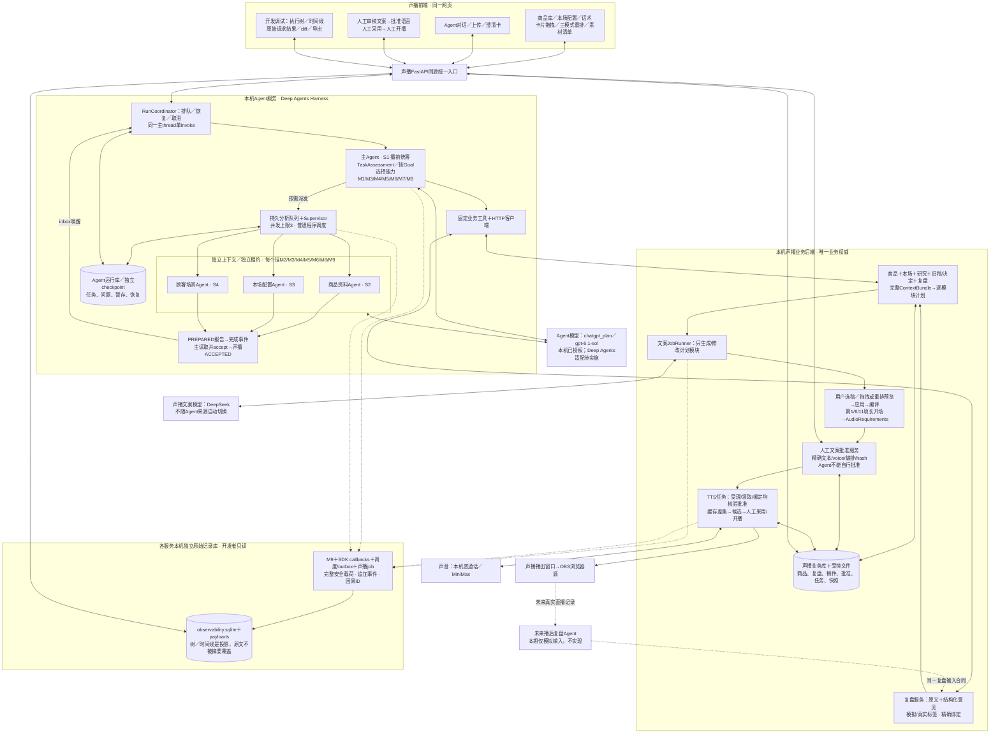
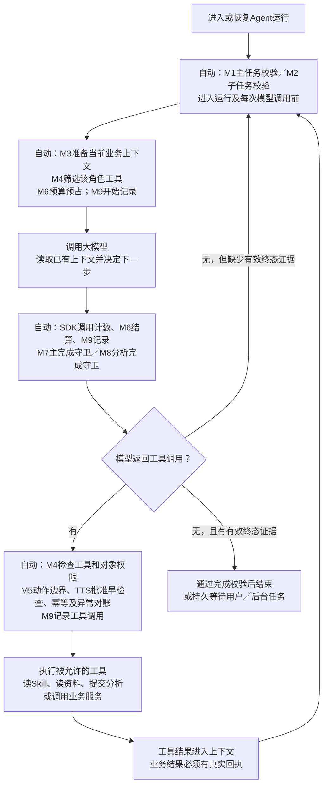
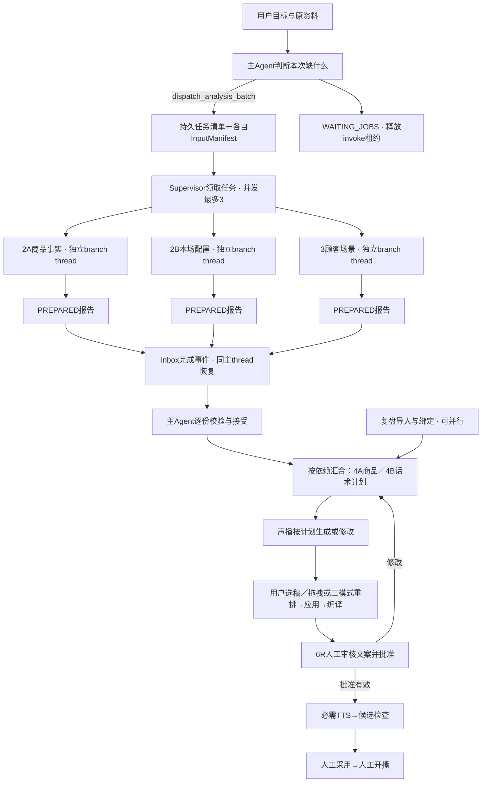

# 架构图、Middleware、Skill 与模型接入说明

日期：2026-10-15。性质：对既有v2设计的展开说明，不是业务代码或已接通证明。基于PRELIVE-2.3：新增复盘输入、文案→语音批准及完整调试记录；保留数据权威和主/分析Agent边界。M1—M9、S1—S4仅为本说明的图例编号。

## 1. 当前实现状态

| 项目 | 当前事实 |
| --- | --- |
| Deep Agents依赖 | 已有独立SDK环境；安装不代表业务Agent完成 |
| 本业务自定义middleware | 0个已实现；02分册给出9个拟写类、签名、算法与注册顺序 |
| 本业务运行Skill | 0份已写正文；04分册规划4份，不是7份 |
| 业务Agent项目 | 当前只有.venv/environment/README等准备文件，无src业务实现 |
| 声播 | 已有商品/房间/话术/TTS/播放器基础；新版本/CAS/冻结计划等改造尚未实施 |
| OpenAI订阅授权通道 | 独立连接交接报告已确认本机授权及gpt-6.1-sol短文本成功；本窗口仅记录，正式Deep Agents适配待实施，未读取凭据或发起模型测试 |

开发时供Codex使用的agent-harness-design/deep-agents-core是开发指导Skill，不是商家运行时的四份业务Skill。

## 2. Harness服务与声播业务后端

| 层 | 核心职责 | 典型例子 |
| --- | --- | --- |
| 前端 | 用户操作、资料上传、显示进度/成果、人工修改和确认 | 左侧商品/配置/话术编辑，右侧Agent对话 |
| Agent服务中的Harness | 承载模型判断和工具循环；装配Skill与middleware；分派/恢复分析；控制权限和任务生命周期 | 判断缺哪些信息、调用哪类分析、只改哪些模块、等待用户答复 |
| 声播业务后端 | 维护唯一业务数据与业务规则，执行被请求的动作 | 保存商品、Decimal算价、按计划生成话术、编译顺序、合成音频、播出 |

Harness是Agent的运行机制，不等于HTTP服务本身。本项目把它放在独立Agent进程中；声播是另一个进程。两个进程都运行在本机。人工操作和Agent工具最终调用同一套声播业务服务。声播后台也可以调模型生成文案，但这个受计划约束的任务不等于再启用一个自主策划Agent。

## 3. 拟自写的九个Middleware

| 编号/类名 | 挂载到谁 | 程序自动触发的位置 | 检查或产出 |
| --- | --- | --- | --- |
| M1 RunFenceMiddleware | 主Agent | 进入图、每次调用模型前 | 当前run/租约/写授权有效；取消或replace后的旧run停止推进 |
| M2 ChildFenceMiddleware | 三类分析Agent | 进入子图、每次调用模型前 | 子任务租约、父run状态、被分配输入有效；不依赖父invoke一直运行 |
| M3 ContextProjectionMiddleware | 主与三类分析Agent | 每次调用模型前、组装模型请求时 | 拉取当前业务观察、精确约束、缺口与完整资料refs；保留SDK已有系统内容 |
| M4 ToolPolicyMiddleware | 主与三类分析Agent | 发给模型工具表时、每次实际执行工具前 | 过滤各角色工具，拒绝task/shell/越界对象；历史调用也重新校验 |
| M5 ActionBoundaryMiddleware | 主与三类分析Agent | 每次工具执行前及异常返回时 | 稳定action/operation标识、范围/版本及TTS前批准早检查、未知结果对账；业务提交仍由声播事务强制校验 |
| M6 BudgetMiddleware | 主与三类分析Agent | 每次模型请求及重试前后 | 预占/记录受管调用预算、超时和usage；不是全部费用的精确硬封顶 |
| M7 CompletionGuardMiddleware | 主Agent | 模型返回后；无tool_calls准备结束时检查 | 回读真实完成回执；不能只凭模型说“完成”结束 |
| M8 BranchCompletionGuardMiddleware | 三类分析Agent | 模型返回后；无tool_calls准备结束时检查 | 必须有验证过的PREPARED类型化报告；不冒充声播已接受 |
| M9 AuditMiddleware | 主与三类分析Agent | 模型与工具调用前后、图退出时 | 安全完整可观察输入输出、ID/hash/耗时/usage；SDK callbacks及业务job补齐旁路，不因日志失败重做业务 |

主Agent的自定义集合：M1/M3/M4/M5/M6/M7/M9。每个分析Agent的自定义集合：M2/M3/M4/M5/M6/M8/M9。三类分析Agent共用这套执行保护，但各自Skill、输入和工具不同。

这些middleware随Agent模型/工具循环反复触发，不按“商品整理结束后才打开权限检查”的业务步骤开关。它们具体执行顺序以02分册的注册表与Hook正序/逆序规则为准；表中编号不代表单一线性执行顺序。

## 4. 复用SDK现成的Middleware

| 现成能力 | 挂载/触发 | 本项目做法 |
| --- | --- | --- |
| SkillsMiddleware | 各Agent启动发现相应Skill目录；模型读Skill时提供内容 | 配置不同角色可见Skill；不重写另一套技能系统 |
| FilesystemMiddleware | 虚拟文件读取；SDK上下文offload | StateBackend虚拟文件，不开放宿主盘；业务写入仍用typed工具 |
| SummarizationMiddleware | 上下文达到阈值时 | 保留默认摘要；完整业务原文保存在可回读refs中 |
| PatchToolCallsMiddleware | 处理历史未配对工具消息等兼容情况 | 复用SDK，不自写第二套 |
| TodoListMiddleware | 主Agent使用write_todos时 | 显式装配；不是权威业务任务队列 |
| ModelCallLimitMiddleware | 模型循环计数/限制 | 主40、分析16的设计保险丝；after_model先计数再完成守卫 |

SDK可能注入的SubAgentMiddleware/task不用于本项目业务委派；M4同时隐藏和拒绝task，业务只走typed持久分析队列。模型兼容等底层适配沿SDK实现，不再包装成新的业务Skill。

## 5. 拟编写的四份业务Skill

下列名称为便于理解的展示名，逻辑包仍对应04中的四行。尚未写SKILL正文；主包内的四种方法不冒充四份独立Skill。

| 编号/逻辑包 | 给谁 | 什么时候按需读取 | 具体指导什么 |
| --- | --- | --- | --- |
| S1 main：播前统筹与交付 | 主Agent | 分解准备目标、合并报告、全字段入库、制定话术变化计划、交付检查 | 依赖/缺项/补问；商品组装；完整上下文、逐条复盘处置及模块generate/patch/reuse/disable；终态证据 |
| S2 product_facts：商品资料整理 | 商品资料分析Agent | 解析提取结果、匹配相似商品、整理字段候选时 | 事实与来源、全字段处理、身份区分、冲突/未知；不直接覆盖商品 |
| S3 session_config：本场配置整理 | 本场配置分析Agent | 整理主题/活动/优惠/音色、复制上场配置时 | 长期资料与本场覆盖；继承/失效/待确认；结构化草案，不提前写最终话术 |
| S4 audience_scenes：顾客与场景研究 | 顾客场景分析Agent | 定位购买者/使用者、调研需求/顾虑、提出展示建议时 | 来源与假设区分、需求/场景/卖点依据、素材建议；不能发明商品规格 |

程序先给每个Agent提供其Skill的名称、描述与读取入口；模型按需读正文和配套资料。不能把全部角色Skill全文一起塞进一个共享框，声称每个Agent都已经遵守。

## 6. 整体架构图：前端、主从、复盘、确认与记录

图为待实现设计；未来Agent选择chatgpt_plan／gpt-6.1-sol，声播文案DeepSeek仍独立配置，语音为本机普通话/MiniMax。授权交接和待实施边界见第9节及17分册。

Skill绑定具体Agent，Middleware绑定具体循环钩子；声播自身后台生成/TTS不经过主图M9，必须由自身adapter和outbox记录。APPROVAL是声播后端强制的业务门槛，M5仅提前发现；人工操作不伪称触发主Agent中间件。调试原始记录是单独数据库，图中业务库仍唯一，Agent运行库不持业务正本。

导出图：[总架构PNG](figures/01-architecture.png)、[可编辑SVG](figures/01-architecture.svg)。

## 7. Middleware实际触发图

这张图展示任何一个Agent的运行生命周期；主/分析Agent分别选M1/M2和M7/M8。所有业务步骤一旦调用模型或工具，都会进入相应执行位置。图只展示触发位置，非Hook注册细节的替代。

SDK SkillsMiddleware启动提供对应角色目录，读取正文发生在上图CALL的读Skill工具中；FilesystemMiddleware支撑虚拟文件读取，SummarizationMiddleware在上下文阈值满足时自动压缩，TodoListMiddleware只在主Agent调用write_todos时工作。完成守卫纠正有次数限制，预算也有限，不形成无限循环。

## 8. 业务环节如何对应Skill和Middleware

| 业务环节 | Agent/Skill | 自动middleware与业务校验 |
| --- | --- | --- |
| 接收目标/最小身份、决定派谁 | 主/S1 | 主栈M1/M3/M4/M5/M6/M7/M9；上传解析属于材料服务 |
| 商品事实整理 | 商品分析/S2 | 分析栈M2/M3/M4/M5/M6/M8/M9 |
| 本场活动配置整理 | 本场分析/S3 | 同分析栈；不同输入及工具，不共享其他角色写权限 |
| 顾客与场景研究 | 顾客分析/S4 | 同分析栈；网络证据是数据，不取得额外工具权限 |
| 全字段商品入库、完整上下文汇合 | 主/S1 | 主栈；保存时M4/M5先检查，声播事务再执行授权/CAS/字段校验 |
| 制定并执行话术计划 | 主/S1 | 主栈；真正文案生成job由声播执行冻结计划/lease/readset校验，不再套主图middleware |
| 用户编排、语音准备、候选检查 | 主/S1；用户明确选择 | 主栈保护Agent调用；编译/报价/音频校验是声播确定性服务，不虚构额外Skill |
| 人工修改、采用、开播 | 用户直接操作前端 | 直接进入同一业务服务；不经过Agent模型循环，因此不伪称触发M1—M9；声播权限/CAS/快照校验仍必须执行 |

## 9. 核心模型API与ChatGPT账号

2026-10-16用户交接已完成：独立连接工具报告本机Sign in with ChatGPT及套餐使用授权成功，gpt-6.1-sol真实短文本取得response.completed。用户本轮明确选择先保存到设计，构建Agent时再实现。本窗口没有重新授权、读凭据或调用模型；这些历史成功不等于Deep Agents工具、摘要、恢复和自动续期已验收。

| 通道／用途 | 当前决定／状态 |
| --- | --- |
| Agent模型 | 未来采用chatgpt_plan／gpt-6.1-sol，继续Deep Agents；不嵌套完整Codex Agent |
| 公共Responses API | 正式推理入口；OAuth由后端注入，不能用18791测试页当推理代理 |
| 现有DeepSeek | 声播业务文案配置保留；其他Agent provider仅在明确选择后使用，不静默回退 |
| 本机普通话／MiniMax | TTS保持独立，授权文本模型不证明语音权限 |

安全凭据路径、唯一刷新者接管、消息/工具转换、SSE终态、阶段验收和原交接来源统一保存在[17模型授权记录](17_ChatGPT授权模型来源与后续接入记录.md)。后续开发从该册进入，不要求用户复制token，不把凭据放入state/checkpoint/trace。旧版“本应用尚未授权”的笼统表述由本记录替代。

协议仍须按实施时的[官方模型与推理说明](https://developers.openai.com/siwc/token-sharing-open-source/models-and-inference)和[预览限制](https://developers.openai.com/siwc/token-sharing-open-source/preview-limitations)核验；授权和一次短文本成功不能证明任意模型永久可用或额度无限。

## 10. 主从控制和并行的执行图

主/子使用同一个Deep Agents SDK，可以使用相同模型；“主/次”描述统筹和专门分析，不是必须使用大/小两种模型。主只负责决策与受控业务写入；三类分析Agent只提交报告。Supervisor不思考经营策略；图上的并行是可观察的真实任务并行。

主等待后台时active-run槽仍保留，不能让同thread另一用户run抢占；子任务自己的租约继续续租。任务完成后inbox唤醒主，逐份按精确readset验证。单个失效报告只重算相关任务，不能因此丢掉另外两份有效报告。实际调用日志能验证start/end区间是否交叠。

导出图：[并行与闭环PNG](figures/02-control-loop.png)、[可编辑SVG](figures/02-control-loop.svg)。

## 11. 复盘与人工确认具体放在哪里

| 位置 | 行为 | 对应设计 |
| --- | --- | --- |
| 输入接收 | import_recap＋显式link；原文完整保存，模拟醒目标记 | 09 |
| 4A保存前 | 同名身份不明/关键事实冲突时问清；明确唯一目标更新不反复问 | 10 H01—H07 |
| 4B定计划 | 全商品/本场/顾客场景/旧稿决定/复盘汇合；逐finding采纳与模块关联 | 09及04 |
| 6R到7 | human批准整包话术；M5早挡，声播提交/claim/commit强制校验 | 10 |
| 候选就绪 | 先人工采用，再单独人工start | 03及10 |
| 全程 | 自动记录调用、分派、汇合、处置、确认与版本diff；调试台查原件 | 11 |

模拟复盘不是新的用户指令来源，它不能擅自降价、换商品、改顺序。主Agent必须把每条意见变成apply/partial/reject/defer/already_covered及具体理由，再决定生成/修改哪些模块。新增复盘不取代既有完整三路输入。

## 12. 本轮可复用工具流与上下文架构

新增讲解图：[分层与工具流PNG](figures/03-toolflows-context.png)、[可编辑SVG](figures/03-toolflows-context.svg)。完整F01—F11目录及职责见15；任务判断、历史研究、按角色上下文和压缩规则见13，按目标验收与素材见14。

主Agent先识别目标、读历史并保存结构化计划，再按需调用工具流或S2/S3/S4。历史商品/研究/配置/复盘/素材存声播业务库；每次模型只读当前动作所需内容，原文精确ref始终可回取。摘要与offload不改写业务原件，也不复活旧批准。

用户重排方式属于可信排序决定，算法不调用LLM；纯预览零业务变化，实际保存才使对应编译/批准失效。横向协作采用accepted typed handoff和新任务，不共享worker历史。按原Goal验收，不把“只更新资料”错误要求成整场候选。

第三张图中主Agent可直接进入工具流，不必经过任何分析Agent；需要独立分析时才走中间的持久队列。只读意图阶段与正式执行阶段复用同一主图，前者尚无Goal/grant，Coordinator首次冻结Goal后才授予实际所需权限，phase由程序控制。该增量不表示业务代码已开发。

## 13. 最终复查的边界补图

见[最终复查边界图PNG](figures/04-final-review-boundaries.png)及[可编辑SVG](figures/04-final-review-boundaries.svg)。它补充人工审稿修改、旧商品版本保留/刷新、OS/thread执行排他、最终payload尝试账本和统一收尾的位置，详见[16](16_最终复查修订与待讨论事项.md)。原有M1—M9、S1—S4和主/分析角色保持，未新增第十类Middleware。运行控制服务由代码触发，human决定不会变成模型自选工具。
