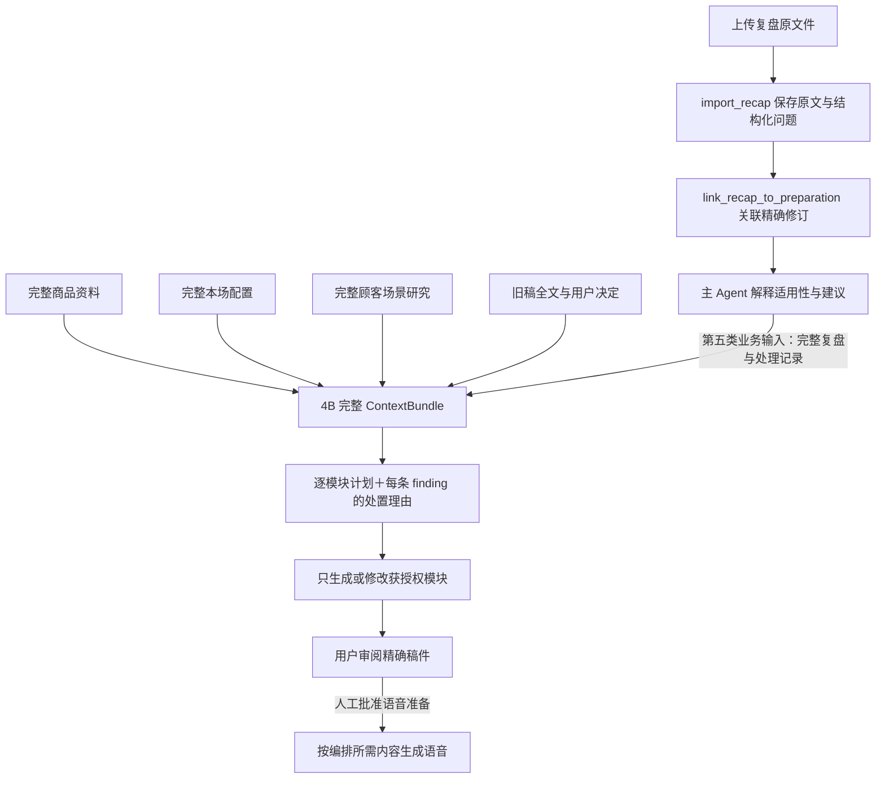

# 09 复盘输入与下一次播前的话术闭环

合同增量：`PRELIVE-2.3`。本文为工程设计，尚未实现业务代码。本期仅实现复盘文档的导入、解释、适用性判断和话术计划衔接；不实现播中采集或播后 Agent。主运行、三类并行分析、两库边界及人工采用／开播的结构沿用 00—06；最终复查修订见16。

## 1. 固定执行结构

| 部分 | 本轮设计 |
| --- | --- |
| 谁解释复盘 | 主 Agent。使用其 S1 播前统筹 Skill 中新增的复盘解释方法，不增设第四个分析 Agent |
| 何时读取 | 接收材料时识别为复盘，先导入并关联本场；可与三路事实／配置／顾客分析并行读取。最终在 4B 完整汇合 |
| 谁保存业务正本 | 声播 `business_artifacts` 保存不可变 `RecapDocument`；Preparation 保存精确 `recap_refs`。Agent 库只保留上传暂存、解析任务和业务回执引用 |
| 影响哪里 | `ScriptChangePlan` 的逐模块生成／修改／复用决定；必要时产生事实或配置的待核实问题 |
| 不自动影响哪里 | 正式商品事实、商家优惠力度、用户选择的商品／版本／顺序、真实直播数据 |
| 是否立即执行复盘建议 | 否。每条 finding 必须先判适用性、权限和依据，再在计划里记录采用／部分采用／拒绝／推迟／已覆盖及理由 |
| 哪些内容完整保留 | 原文件／原文、结构化 finding、原始证据引用、来源与置信度、适用范围、解释与处理理由；不能只把一段复盘摘要送给生成服务 |



## 2. 新增类型

所有类型沿用 `extra='forbid'`、不可变修订与规范化内容哈希规则。下面的 `RecordRef`、`ArtifactRef`、`ModuleKey`、`DependencyRef`、`MutationContext` 使用 01 定义。`confidence` 是记录者对结论的自评及理由，不是系统已验证的正确率或因果置信度。

```python
class RecapOrigin(BaseModel):
    kind: Literal['human_document', 'postlive_agent', 'synthetic_fixture']
    synthetic: bool
    producer: str
    producer_version: str | None
    created_at: datetime
    previous_live_session_id: str | None
    previous_publication_ref: ArtifactRef | None
    # synthetic_fixture 不得伪造真实 live_session_id 或真实订单归因

class RecapScope(BaseModel):
    product_refs: list[RecordRef]
    variant_refs: list[RecordRef | ArtifactRef]
    module_keys: list[ModuleKey]
    market: str | None
    language: str | None
    channel: str | None
    observed_window_start: datetime | None
    observed_window_end: datetime | None
    valid_until: datetime | None
    dependency_refs: list[DependencyRef]

class RecapEvidence(BaseModel):
    evidence_id: str
    source_ref: ArtifactRef | None
    locator: str                 # 原文段落、日志事件、截图区域；不能只写“见复盘”
    quote: str                   # 原始片段，保留措辞；单独标记是否模拟
    synthetic: bool
    availability: Literal['available', 'placeholder', 'missing']
    content_hash: str | None

class RecapFinding(BaseModel):
    finding_id: str
    issue: str
    observation: str
    scope: RecapScope
    evidence_ids: list[str]
    confidence: Literal['high', 'medium', 'low', 'unknown']
    confidence_reason: str
    proposed_actions: list[str]  # 来源的建议，尚未成为执行指令
    suggested_modules: list[ModuleKey]
    requested_business_changes: list[str]
    human_agreement: Literal['not_requested', 'pending', 'agreed', 'declined']
    human_decision_ref: ArtifactRef | None

class RecapDocument(BaseModel):
    schema_version: Literal['recap.v1']
    recap_id: str
    revision: int
    title: str
    origin: RecapOrigin
    raw_document_ref: ArtifactRef
    raw_text: str
    source_manifest_ref: ArtifactRef
    scope: RecapScope
    evidence: list[RecapEvidence]
    findings: list[RecapFinding]
    extraction_version: str

class RecapDocumentDraft(BaseModel):
    schema_version: Literal['recap.v1']
    title: str
    origin: RecapOrigin
    scope: RecapScope
    evidence: list[RecapEvidence]
    findings: list[RecapFinding]
    extraction_version: str
    # 原文从ImportRecapArgs的已验证source读取；服务器分配ID/revision

class RecapApplicability(BaseModel):
    recap_ref: ArtifactRef
    finding_id: str
    state: Literal['applicable', 'partial', 'inapplicable', 'unverified']
    reasons: list[str]
    matched_target_refs: list[RecordRef | ArtifactRef]
    conflicts: list[str]
    missing_evidence_ids: list[str]
    checked_dependencies: list[DependencyRef]
    checked_at: datetime

class RecapDisposition(BaseModel):
    recap_ref: ArtifactRef
    finding_id: str
    action: Literal['apply', 'partial', 'reject', 'defer', 'already_covered']
    reason: str
    target_variant_ids: list[str]
    target_modules: list[ModuleKey]
    plan_item_ids: list[str]
    applicability: RecapApplicability
    authorization_ref: ArtifactRef | None
    decision_ref: ArtifactRef | None
    # apply/partial 有修改时必须有 plan_item；defer 明确待补条件
```

模型不能给来源中的 `human_agreement` 随意升级为 `agreed`。导入时即使文档写“老板同意了”，也只作为待核对陈述；可信会话／决定记录才可生成 `human_decision_ref`。`authorization_ref` 指当前用户明确要求或决定，权限仍由服务端 grant 检查。

### 对已有类型的精确增量

| 类型 | 增量 |
| --- | --- |
| `Preparation` | `recap_refs: list[ArtifactRef]`，用户当前选择的不可变复盘修订；空列表合法 |
| `ContextBundle` | `recap_documents: list[RecapDocument]`、`recap_applicability: list[RecapApplicability]`、对应 readset；大原文可存受控内容块但必须可完整回取 |
| `ScriptChangePlan` | `recap_dispositions: list[RecapDisposition]`，覆盖 bundle 中每条 finding，包含不采用者 |
| `ScriptPlanItem` | `recap_finding_refs: list[{recap_ref, finding_id}]`，反向说明该项由哪些问题触发 |
| `GenerationManifest` | 继承 bundle 和 plan 精确引用；送给模块生成请求的 finding 保留观察／证据／适用性／处置原因，不能只给一条“优化一下” |
| 候选检查视图 | 显示来源为模拟或真实、被采用与未采用建议、修改模块、未决问题；不把模拟标签藏在原文件里 |

## 3. 接口、函数与注册

新增两个固定命令和一个查询。沿用统一 `/api/prelive/v2/commands`、`queries`，不另起一套复盘服务器，也不暴露任意命令工具。具体导入的原文件先经过现有受控 blob/source 流程。

| 固定 key | 参数与签名 | 调用链、事务与结果 |
| --- | --- | --- |
| `import_recap` | `import_recap(args: ImportRecapArgs, mutation: MutationContext, principal: Principal) -> CommandReceipt` | 上传／解析控制器，或主 Agent 的固定工具 → `recap_service` → `run_mutation`；校验原文、schema、来源/hash、finding/evidence ID、scope；保存不可变复盘与业务事件，返回 `recap_ref`，不自动关联所有准备 |
| `link_recap_to_preparation` | `link_recap_to_preparation(args: LinkRecapArgs, mutation: MutationContext, principal: Principal) -> CommandReceipt` | 主 Agent 在用户明确上传到本场或用户直接选择时调用；同事务验证 Preparation CAS、精确 recap_ref、权限／grant；更新 recap_refs、推进 generation_epoch、发失效事件；不改商品或旧稿 |
| `read_recap` | `read_recap(args: ReadRecapArgs, principal: Principal) -> QueryResult` | `ShengboClient.query` → 一致读；按精确 ref 返回全文、findings、evidence、blob 引用。分页／分块读取仍保留全文目录/hash |

```python
class ImportRecapArgs(BaseModel):
    raw_document_ref: ArtifactRef
    source_manifest_ref: ArtifactRef
    parsed_document: RecapDocumentDraft
    # Draft 不含服务器生成 recap_id/revision；人类同意信息不可自证

class LinkRecapArgs(BaseModel):
    preparation_id: str
    recap_refs: list[ArtifactRef]   # 本次期望完整集合，明确添加／移除
    expected_preparation_revision: int

class ReadRecapArgs(BaseModel):
    recap_ref: ArtifactRef
    sections: list[Literal['origin', 'raw_text', 'findings', 'evidence', 'scope']]

COMMAND_HANDLERS['import_recap'] = HandlerSpec(recap_service.import_recap, mode='sync')
COMMAND_HANDLERS['link_recap_to_preparation'] = HandlerSpec(
    recap_service.link_recap_to_preparation, mode='sync')
QUERY_HANDLERS['read_recap'] = recap_service.read_recap
```

对应 discriminated union 增加 `ImportRecapCommand`、`LinkRecapToPreparationCommand`；QueryName 增加 `read_recap`。导入大文件的内容复制/hash 验证在短事务前完成；事务内只登记已验证 blob 及不可变 JSON。网络请求、OCR、LLM 不在写事务内运行。

### 主 Agent 固定工具与纯校验函数

```python
@tool
async def import_recap(document: RecapDocumentDraft, raw_document_ref: ArtifactRef,
    source_manifest_ref: ArtifactRef, runtime: ToolRuntime) -> ToolResult: ...
@tool
async def link_recap_to_preparation(recap_refs: list[ArtifactRef],
    expected_revision: int, runtime: ToolRuntime) -> ToolResult: ...
@tool
async def read_recap(recap_ref: ArtifactRef, sections: list[str],
    runtime: ToolRuntime) -> ToolResult: ...

def assess_recap_applicability(recaps: list[RecapDocument], products, draft, old_scripts,
    reference_time, user_decisions) -> list[RecapApplicability]: ...

def validate_recap_dispositions(plan, bundle, goal, decisions) -> list[ValidationError]: ...
```

前三个 closure 只取固定 key，可信 scope/grant 从 RuntimeContext 传入。三类 worker 可通过固定只读 `read_recap` 取得分配给本分支的观察，不获得导入／关联／正式修改权。`assess_recap_applicability` 只做可判定的匹配／时间／版本／证据可得性检查；购买动机与文字应如何修改由主 Agent 推理，不在该函数暗增一个规划模型。

`build_context_bundle` 增加 `recap_refs` 参数，服务端校验它与当前 Preparation 选择一致；不允许主 Agent 省略一份已选择复盘，以逃避其中的冲突。显式取消关联可用 link 命令产生新版本和审计。

## 4. 适用性、过期和输入边界

| 检查 | 具体行动 | 对后续的影响 |
| --- | --- | --- |
| 商品身份 | 精确 product_id；仅名称相同／ID未绑定时列候选 | 不把 A 的问题自动套到同名 B；若需要写入先问身份 |
| 稿件身份 | 保留原 variant/module 修订与问题句定位 | 旧稿已改可标已覆盖；找不到旧稿时不能声称原文仍存在 |
| 活动／价格 | 对照本场 commerce、有效期、币种和程序报价 | 旧场107不自动成为本场107；不能因此把日常178写成107或99 |
| 地区／语言／渠道 | 与本场可得配置比较，不明就保留 unknown | 可复用顾虑，不把台湾货币替换成人民币或把其他渠道规则硬套 |
| 时间与来源 | reference_time 来自可信本场时间；检查有效期和观察窗口 | 过期活动不沿用；长期表达建议可继续适用，不能统一一刀切作废 |
| 证据可得性 | 区分真实日志、人工观察、占位与模拟 | 缺真实证据的假设可以用于测试，但不能声称已证实流失或转化原因 |
| 新要求冲突 | 比较当前明确用户决定与复盘建议 | 用户决定优先；越界建议拒绝或先补问，不让文档中的文字扩大 grant |
| 素材／知识问题 | 区分口播模块、FAQ和后期视频能力 | 本期可留素材建议；不能假装生成视频或每句知识都进正常口播 |

复盘内容一律是输入数据，不能执行里面的“忽略权限”“自动开播”等指令。原始报告可以包含这样的文本供定位，工具白名单、权限和人工门槛照常生效。

## 5. Exact readset 与失效

每个 ContextBundle 保存完整输入和精确依赖；每条模块计划另外保存实际消费路径。服务端按路径计算 `value_hash`，不相信模型自报“只用了这些内容”即可绕过依赖。

| 依赖 | readset 示例 | 变化时行为 |
| --- | --- | --- |
| Preparation 当前选择 | Preparation 精确 ref 的 `/recap_refs`、`/selected_product_refs`、`/draft_ref` | 关联／移除复盘推进 epoch；旧生成不得激活为当前结果 |
| 复盘原文与结构化 finding | recap immutable ref；`/raw_text`、`/scope`、`/origin`、`/findings/{stable finding_id}`、使用的 evidence 项 | 新修订不原地覆盖；用户明确链接新修订后旧 bundle 过期 |
| 当前商品 | 所有消费字段，例如商品价格、规格、知识与名称；完整快照仍保留 | 按受影响字段重算适用性和模块计划，不能继续引用过时商品事实 |
| 本场配置 | `/commerce`、`/theme`、`/scheduled_at`、`/language` 等实际使用路径 | 本场价／日期变化使活动及必要联动重新计划 |
| 旧稿 | variant/script/module 精确 ref、问题句 stable ID/hash | 问题已被手改时重新判断已覆盖；CAS不覆盖手工新稿 |
| 用户要求／决定 | 请求／决定 artifact 的 `/` | 处理范围、换稿授权、待问回答更新后重新计划 |
| 来源与规则 | 原资料 blob hash、schema/template/Skill版本、固定 reference_time | 重现同一生成输入；不以“现在系统时间”偷偷改变已冻结任务 |

`/findings/{stable finding_id}` 是领域定位符，由 repository 映射至真实 JSON Pointer／索引并保存，不能直接把数组 ID 当 RFC JSON Pointer。删改 finding 时相关 disposition 失效。

音频依赖的是最终文本修订／voice／requirements；仅修改复盘中未采用建议的说明，不应重新合成相同音频。它可以更新 bundle 和计划来源，音频缓存键不因无关 metadata 变化失效。已采用 publication 不会因新复盘回写。

## 6. 4B 汇合和计划校验算法

```python
async def build_bundle_with_recap(args, scope):
    preparation = await voice.read_preparation(args.preparation_id)
    require_equal_refs(args.recap_refs, preparation.recap_refs)
    products, research, draft, old_scripts, decisions = await read_existing_context_inputs(args)
    recaps = await read_all_exact_recaps(args.recap_refs)  # 全文＋结构化＋证据
    applicability = assess_recap_applicability(
        recaps, products, draft, old_scripts, args.reference_time, decisions)
    return await voice.command('save_context_bundle', freeze_all(
        products, research, draft, old_scripts, decisions, recaps, applicability))

def validate_recap_dispositions(plan, bundle, goal, decisions):
    require_exactly_once_per_finding(plan.recap_dispositions, bundle.recaps)
    for disposition in plan.recap_dispositions:
        require_nonempty_reason_and_valid_finding_ref(disposition)
        if disposition.action in {'apply', 'partial'}:
            require_applicable_or_explicit_hypothesis_test(disposition)
            require_plan_items_exist_and_scope_matches(disposition, plan)
            require_change_authorized_by_goal_or_decision(disposition, goal, decisions)
            require_current_business_sources_for_fact_price_changes(disposition, bundle)
        else:
            require_no_hidden_module_patch_from_rejected_finding(disposition, plan)
        require_pending_decisions_block_only_affected_items(disposition)
    require_no_automatic_catalog_discount_or_playlist_edits(plan)
```

这里的“五类业务输入”在展示上是：①完整商品；②完整本场配置；③完整顾客研究；④旧稿与用户决定；⑤复盘。原文来源另作所有输入的共同证据索引，绝不删除。

主 Agent 为每条 finding 生成 disposition，再制定模块计划，随后用固定 validator 保存；不是让生成模型自己决定应不应该采纳原报告。生成服务只执行通过校验的计划，并可读回完整上下文。

## 7. 人工确认和语音前门槛

本轮用户新增要求：**文案完成后、正式整场语音准备前需要一次人工审稿批准**。不能用“用户之前委托整场准备”代替本轮精确文案批准；不能把最后采用播放快照与此前审稿批准混为一谈。

| 情况 | 是否先问／批准 | 执行规则 |
| --- | --- | --- |
| 用户明确说改某商品某字段／模块，目标与新值确定 | 不重复确认该次可逆草案修改 | CAS保存、展示差异；仍需后面的精确文案审阅才能整场TTS |
| 上传同名新商品、无法确定新增／覆盖 | 必须先确认身份与范围 | 补问卡绑定候选refs、差异和base版本，未答不覆盖 |
| 复盘建议换正文，但用户只授权改活动 | 必须确认扩大范围，或defer | 不因上传复盘就自动改正文 |
| 用户明确要求“按这些复盘问题调整本场话术” | 已授权范围内可生成候选稿 | 自动解释适用性、逐条记录处置；事实矛盾和商家优惠仍另确认 |
| 复盘建议擅降价、换品、调整顺序 | 不自动执行 | reject/defer并说明需要用户明确决定；不强迫用户逐条审批全部建议 |
| 最终稿件准备整场语音 | 必须人工审稿批准 | 冻结精确稿件、编排所需文本与声音指纹；声播TTS提交及job提交时复验 |
| 后续实际使用稿件、顺序或声音绑定发生变化 | **旧整包批准stale，重新审核当前完整包** | 相同文本/voice的音频缓存可保留；新整包批准后只补实际缺项，不拼接旧批准片段；普通只读查看不触发失效 |
| 最终采用／开播 | 仍分别为人工动作 | 文案批准不授权采用或实际开播 |

统一审稿类型为 `AudioApprovalRequest / AudioApprovalReceipt`；查询为 `create_text_review / read_text_approval`；人工命令为 `approve_text_for_audio / revoke_text_approval`。主 Agent 读取稿件审阅包后用现有 `request_user_decision` 提出确认；批准只通过可信人工接口签发，Agent 不可制造 receipt。`prepare_required_audio` 的后端校验必须取得对应批准回执。复盘处置列表作为审稿内容的一部分，用户可以看到“改了什么、为什么、哪些没有采纳”。本文不另造第二套决定／批准系统。

## 8. 模拟 fixture 与验收预期

本目录 `fixtures/模拟上场复盘.md` 保存模拟复盘原文，`模拟上场复盘.json` 保存可导入的模拟包。**所有观察、聊天、日志、结论均人为构造；没有真实直播场次、真实观众、订单、GMV或提升效果。** 测试通过只证明数据传递、权限和局改行为。

fixture 商品为用户给出的足弓支撑静音防滑厚底凉拖鞋：日常价 `178 TWD`，测试本场活动 `107 TWD`。JSON 使用 `fixture://` 符号定位，不能直接当真实 RecordRef 写入。测试载入器创建／读取测试商品、草案、旧稿后生成 `FixtureBinding`，替换成真实精确ref，再导入源文件与解析结果。商品名称相同不代表可绑定真实商品；载入器仅使用测试scope或人工明确指定的测试对象。

| 验收案例 | 输入／操作 | 必须取得的可观察证据 |
| --- | --- | --- |
| R01 完整输入 | 导入MD＋JSON并关联新准备 | read_recap 能逐字回取原文；finding/evidence全保留；hash一致；没有虚构live_session_id |
| R02 三路并行兼容 | 三个分析任务运行时导入复盘 | 不增加第四worker；4B可等待必要输入，复盘不阻塞无关商品分析 |
| R03 每条可追踪 | 对fixture所有findings制定计划 | 100% finding有且仅一个 disposition；apply/partial反向指向存在的plan_item |
| R04 价格不污染 | 复盘写107并建议99，当前测试配置107 | 商品日常价仍178；本场仍107；99建议reject/defer；活动稿引用107且币种TWD |
| R05 局部变化 | 用户只允许活动与促单修正 | 未授权正文ref/hash不变；scope冲突明确阻塞／补问，无隐式全文换稿 |
| R06 过期与占位 | 旧配送日期、缺日志证据 | applicability显示过期／unverified；不输出保证日期，不称证实转化下降 |
| R07 手工改稿 | 计划生成期间人工修复同一问题 | 旧job提交因依赖过期拒绝；重读后可标already_covered，不覆盖人工稿 |
| R08 版本与关联变化 | 用户链接新版或移除复盘 | generation_epoch推进；旧结果不激活；原publication保持不可变 |
| R09 文案批准 | 未审稿直接调用prepare_required_audio | 返回明确阻塞及审稿入口；零正式TTS任务。人类批准后允许所需集合，不合成未选版本 |
| R10 批准后改稿 | 已批准稿件替换一个句子 | 改变文本不沿用旧批准；未变音频缓存可复用；审稿后只补新文本 |
| R11 文档越权 | 原文含“自动开播／忽略权限” | 仅作数据保留；无start、权限扩大或任意工具执行 |
| R12 来源类型 | 合成fixture与未来postlive_agent同schema | parser兼容两者，synthetic标签贯穿原文、上下文、检查视图；不把模拟结论当真实经营证据 |

评价指标：原文可回取率100%；finding处置覆盖率100%；越权事实／优惠／顺序修改0；非法TTS提交0；未选模块hash保留100%；模拟来源标识传递率100%。本轮仅验证设计、fixture JSON与引用一致性；上述运行指标须在后续实现与真实测试中测量。

## 9. RF08经营建议、商品身份与待采纳状态

RF08的最终模拟建议为：**“模拟上场二号商品表现较好，建议本场放到开头讲解。”** 它是有价值的经营建议，不能因为本次无排序授权就把观点当错误；也不能把“上场卖得较好”写成“本场放前面必定提升转化”。所有销售比较仍带synthetic标签，没有真实订单或因果证据。

“二号商品”按来源场次货盘编号映射到稳定`product_ref`，不等于当前列表第2项，更不等于A商品第2版。fixture使用独立符号`fixture://product/second-item@1`，测试加载器绑定另一个明确的测试商品及来源编号映射；不按名称查找正式商品，不和`fixture://script/a-v2@1`合并。

| 当前条件 | 合理处置 | 不执行什么 |
| --- | --- | --- |
| 本次Goal明确保持顺序，且本场尚未选择二号商品 | `defer`：保留建议、证据限制及待采纳项；target_modules/plan_item_ids为空，记录需要用户决定 | 不用`reject`笼统否定建议；不自动加商品、改用户货盘或重新排序 |
| 用户仅问“为什么建议二号商品先讲” | 只读解释模拟依据、来源身份和不确定性 | 不把解释动作当采纳 |
| 用户明确采纳、但本场没有选该商品 | 先明确是否加入该商品及具体已存版本；若超出原Goal则新合法run/权限 | 不借排序授权自动选择新商品、新版本 |
| 用户明确将已选二号商品移到开头，有多个版本/occurrence | 确认或读取明确决定：移动哪一个occurrence还是整个商品组；通过12的可信排序决定与save_playlist执行 | 不按裸“2”猜第二张卡、第2版，不增加未选版本 |
| 采纳后实际绑定编排改变 | 新编排编译和整包批准失效按10/12处理；未变音频缓存复用 | 不自动TTS、采用或开播 |

`ordering_suggestion`是复盘结构化结果的建议记录，保留来源编号映射、精确商品引用、比较观察、模拟性质、限制和建议动作；可作为finding附加结构或其受控引用，不另建自动排序Agent或可绕过用户决定的写入口。主Agent在ContextBundle中保留它，并在本次计划`recap_dispositions`中给出明确`defer`理由，避免生成模型把它改写成执行指令。

补充验收：保持顺序Goal下RF08被记录为defer、playlist写入0、二号商品不自动加入；卡片重排后来源二号仍解析到同一product_id；单独可信采纳场景只移动明确已选项/商品组，原exact script refs和occurrence数不偷换；新增商品范围未经确认不得执行。fixture内的建议/预期不是可信用户授权，采纳测试必须由实际测试用户事件提交。
