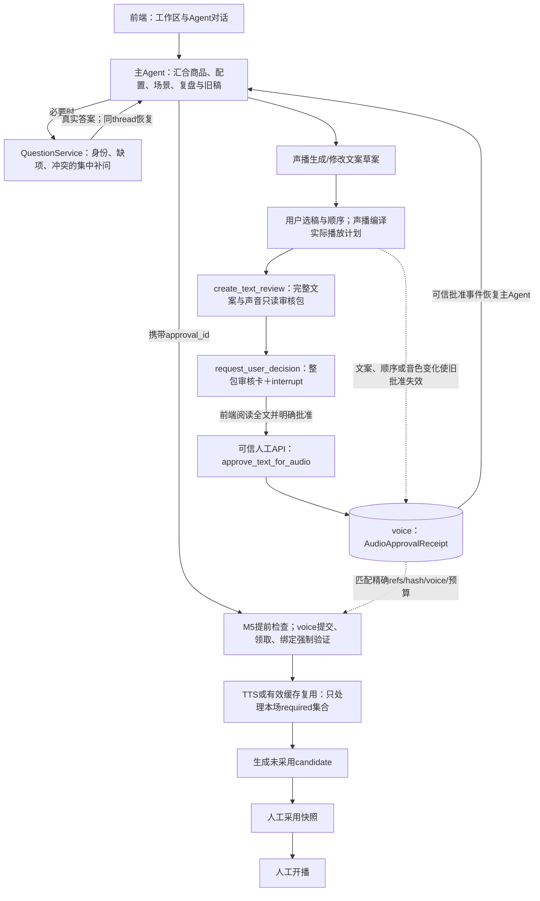

# 10 人工确认、文案批准与语音生成门槛

合同增量 `PRELIVE-2.3`，设计稿，尚未实现。本文将“需要用户决定的事项”和“文案到语音的明确批准”变成可编码的服务合同。沿用现有九类中间件、两库所有权和主/子 Agent 调度；不增加第十类中间件，不把人工确认只写在提示词里。最终复查中同run修稿、FINALIZING及商品新旧选择的统一依据见[16](16_最终复查修订与待讨论事项.md)。

## 1. 本轮确定的变化

1. 用户明确指定商品和修改内容，且目标唯一、范围合法、没有冲突时，直接修改可逆草案，不再问一次“确定修改吗”。
2. 新上传资料与现有商品同名、但没有可靠身份线索时，必须询问“更新哪个现有商品，还是新建不同商品”；同名不是覆盖许可。
3. **本场最终文案、用户选稿与顺序、长短开场编排及声音设置齐备后，先给用户看整包文案。用户批准之后才能调用 TTS。** 本机免费声音也遵循这条门槛。
4. 批准生成语音、采用本场快照、正式开播是三个不同的动作；前者不能替代后两者。
5. 批准覆盖本场实际需要的内容，不等于批准所有历史版本、所有长短开场或后续新生成的版本。

旧稿03中“不增加逐份脚本 approve”应改成：不做逐句/逐稿反复批准，但新增一次**本场整包文案到语音的批准**。任何旧例子里 compile 后立即 TTS 的链路，都在中间插入本门槛。

## 2. 确认点与处理矩阵

| 编号 | 场景 | 必须确认什么 | 不需重复确认什么 | 阻断位置与继续条件 |
| --- | --- | --- | --- | --- |
| H01 | “把商品P1的本场活动改为满100减20”，明确P1及字段 | 没有冲突时不再确认保存配置 | 仅配置更新默认保存草案＋列话术影响，不自动改稿；原Goal明确含同步改稿或完整准备时才更新范围内模块 | 正常工具→声播CAS/影响查询；绑定输入变化使旧整包批准stale；明确改稿后准备声音仍要H10 |
| H02 | 新上传“同名商品”，没有明确P1/SKU/型号对应 | 更新现有候选P1/P2，还是新建；展示差异和来源 | 问题回答后不再次确认同一范围内保存 | 商品身份决定未有可信回执时，save_product拒绝覆盖；研究可继续但不能将候选当正式商品 |
| H03 | 上传资料明确写“替换P1”，并且P1身份无冲突 | 通常无需再问身份 | 不因同名再弹确认 | 目标ref和CAS有效即可；若型号/规格证据与P1矛盾，转H02 |
| H04 | 名称、型号、活动、知识库出现不同价格/条件 | 要采用的价格及条件、有效期、对象 | 已明确选定且版本不变的同一事实 | 相关商品/报价和促销模块阻断；无关资料整理可继续，不能猜一个低价 |
| H05 | 缺少必要字段，无法完成对应任务 | 一次列出当前已知的必要缺项，说明用途及可不填项 | 不为缺少非必要素材阻断全部准备 | 主 Agent 归并各分析报告缺项，通过问题批次补问 |
| H06 | 只允许改活动，但正确修改还必须联动其他商品/正文 | 展示新增对象和字段，明确是否扩大范围 | 不能把普通“同意”解释成任意范围授权 | 可信控制器创建扩大范围的新replace run，撤销旧grant后再授权；旧run不越界resume |
| H07 | 用户已在网页手改目标，Agent仍持旧版本 | 展示差异，选择保留人工稿、基于新版继续或撤回本次 | 不能静默用最后写入覆盖 | CAS/readset冲突；旧决定过期，读取新基准后重新计划 |
| H08 | 正文已使用较长时间，建议换一版 | 是否刷新旧正文、哪些版本/模块 | 用户仅改本场主题时不附带重写正文 | 不同意则保留正文；同意在原授权内按范围更新，超范围转H06 |
| H09 | 沿用上次活动，已明显过期或条件不适用 | 必要时问新的有效活动；可选择本场无该活动 | 不询问“能否继续使用已确定失效的活动” | 失效活动自动排除，缺新配置则禁用campaign或补问；不得恢复旧优惠 |
| H10 | 文案、选稿顺序、编译和声音已经齐备 | **批准本场精确文案清单及音色用于语音生成** | 不逐句批准、不重复确认同一有效整包 | create_text_review→人工approve_text_for_audio→有效Receipt→TTS |
| H11 | 批准后改了实际播放文案、顺序、选稿、声音 | 批准新版整包，展示与上次批准的差异 | 不重新合成仍可复用的相同音频 | 旧批准stale；新批准后按缓存差集生成 |
| H12 | 准备试听 | 已批准文本内的明确小样；若仅允许试听，不能批量合成 | 播放已有静态音色示例不用进入TTS批准 | 无缓存、需要TTS的小样同样检查批准；不接受任意免费文本绕过 |
| H13 | 改用收费供应商/模型、增加超出已批准的合成量或重试预算 | 新收费范围、数量/费用估计及未知项 | 已批准范围内的正常分项执行 | 与H10合成一张卡；超限不自动换供应商或扩大预算 |
| H14 | TTS供应商超时，是否已经扣费未知 | 若确需再次产生可能重复付费的调用，说明未知结果后决定 | 先查询已知operation/job结果不需要确认 | 标UNKNOWN并对账；不以普通重试自动重新付费 |
| H15 | 全部音频齐备，候选快照完成 | 人工采用哪个candidate | 语音批准不等于采用 | human adopt_snapshot，校验review hash/room CAS |
| H16 | 已采用且检查通过，准备播出 | 人工开播动作 | 采用时不顺便开播 | human start_prepared_room；Agent无此工具/权限 |
| H17 | 已选旧商品ref出现普通新head，且本场消费字段有差异 | 展示精确新旧值和受影响句，用户选保留旧版或刷新 | 无关字段改变只提示；已展示且新旧ref/diff未再变时不重复问同一差异 | human-only record_product_revision_choice保存绑定prep/新旧refs/diff hash回执；keep不改内容/epoch/有效音频批准；refresh走同UoW刷新；停售/明确撤回、活动自身过期强制拦截，不能keep绕过 |
| H18 | 审稿卡点“修改文案”或编辑器手改使当前卡过期 | Goal内真实edit_text答案恢复原run；超范围另做明确范围选择 | 修稿不是批准；不另排follow_up等待自己的WAITING_USER | 原问题回答/typed系统resolution唤醒→重读/局改/重编译→新版审核；详§8 |

模型可建议提问，但目标、价格冲突、版本冲突和TTS批准由服务确定。子 Agent 只汇报问题；通常由主 Agent 汇总补问，避免三个分析 Agent 各自向用户重复问同一事项。

## 3. 文案审核包：只读投影

沿用统一queries入口，增加两个固定查询：

| query | 调用者 | 结果 |
| --- | --- | --- |
| `create_text_review` | 前端；主 Agent工具read_text_review | 根据当前已保存的草案、话术、playlist和编译结果构造AudioApprovalRequest；**纯读、不写DB、不调用TTS** |
| `read_text_approval` | 前端；主 Agent | 指定批准回执的状态、依赖、预算使用和失效原因 |

`create_text_review` 中的create指“构造投影”，不意味着创建业务对象。request_id从preparation_id和规范化review_hash派生，同输入重复查询得到同一ID。投影时间不参与hash。问题卡若需要保存展示快照，由QuestionService保存其不可变副本，不改变声播业务状态。

```python
class AudioApprovalRequest(BaseModel):
    request_id: str
    preparation_id: str
    preparation_revision: int
    generation_epoch: int
    playlist_ref: ArtifactRef
    playback_plan_ref: ArtifactRef
    requirements_ref: ArtifactRef
    script_refs: list[ArtifactRef]
    module_refs: list[ArtifactRef]
    readset: list[DependencyRef]
    reviewed_text: list[ReviewedSentence]
    voice_selection: NormalizedVoiceSelection
    compiler_version: str
    normalization_version: str
    cost_scope: AudioCostScope
    review_hash: str
    blocking_issues: list[ReviewBlocker]
    prior_approval_diff: list[ReviewDiff]

class ReviewedSentence(BaseModel):
    sentence_ref: ArtifactRef
    display_text: str
    spoken_text: str
    display_text_hash: str
    spoken_text_hash: str
    module_key: ModuleKey
    compiled_entry_ids: list[str]
    audio_key: str

class AudioCostScope(BaseModel):
    provider: str
    model: str
    required_unique_characters: int
    cache_verified_keys: list[str]
    missing_audio_keys: list[str]
    max_new_vendor_requests: int
    max_preview_requests: int
    max_preview_characters: int
    automatic_retry_limit: int
    estimated_amount: Decimal | None
    currency: str | None
    pricing_basis_ref: ArtifactRef | None
    price_status: Literal['free', 'estimated', 'unknown']
    # unknown不是0；展示字符数/请求数上限，需明确接受未知费用或选择本机免费方案
```

审核包包含**本场实际需要的唯一句子正文**，并能展开其playlist出现位置。重复播放不重复展示成多份待批准稿，但编排顺序、重复项和开场位置仍需完整显示。所有需要的长短开场都列入包，未使用的另一种开场不进入本次批准和TTS需求。

`readset`保存引用价格、活动有效期、商品适用限制等真正被消费的数据路径及hash，方便发现旧优惠/旧价格。审核包使用完整已保存话术，不能只展示模型摘要或聊天里的节选。

哈希规范：review_hash只包含确定的业务输入、精确refs、消费readset、文本/声音指纹和**用户授权费用上限**；`cache_verified_keys/missing_audio_keys`是查询时观察，不参与批准签名，避免其他任务新增缓存使正在阅读的卡片无故失效。默认费用上限按本审核包的全量唯一requirements及明示重试额度构造，界面同时显示“最多合成量”和“当前预计新增量”。若用户明确只允许使用缓存，则将请求/字符额度固定为0；缓存后来损坏时阻断，重新决定，不能擅自合成。新增缓存只能减少实际使用，不能扩大费用上限。

## 4. 批准回执：声播权威、人工才能签发

固定commands增加：

| command | 权限 | 行为 |
| --- | --- | --- |
| `approve_text_for_audio` | 可信human会话；Agent服务凭据不可调用 | 在voice事务内重建当前审核包、比较hash/refs/readset，写AudioApprovalReceipt及outbox |
| `revoke_text_approval` | 可信human会话 | 同事务撤销批准、停止新领取和新绑定、标待执行任务取消；保留历史和已生成缓存 |

```python
class AudioApprovalReceipt(BaseModel):
    approval_id: str
    preparation_id: str
    review_request_id: str
    review_hash: str
    approved_refs: list[ArtifactRef]
    approved_readset: list[DependencyRef]
    playlist_ref: ArtifactRef
    playback_plan_ref: ArtifactRef
    requirements_ref: ArtifactRef
    voice_fingerprint: str
    text_fingerprint: str
    scope_hash: str
    allowed_uses: set[Literal['preview', 'required_audio']]
    cost_scope: AudioCostScope
    human_actor_id: str
    decision_id: str | None
    answer_event_id: str
    operation_id: str
    approved_at: datetime
    # 状态由权威表投影；不可变回执本体不因后续撤销被覆写

class ApproveTextForAudioCommand(BaseModel):
    preparation_id: str
    expected_review_hash: str
    expected_preparation_revision: int
    expected_requirements_ref: ArtifactRef
    mode: Literal['preview_only', 'preview_and_required_audio']
    accepted_cost_scope_hash: str
    decision_id: str | None
    decision_revision: int | None
    # actor来自human会话；不接受客户端human=true或模型生成的approved=true

def create_text_review(args: TextReviewQuery, *, principal: Principal,
                       reader: BusinessReader) -> AudioApprovalRequest: ...

def approve_text_for_audio(args: ApproveTextForAudioCommand, *,
                           operation_id: str, principal: HumanPrincipal,
                           store: VoiceStore) -> AudioApprovalReceipt: ...

def revoke_text_approval(args: RevokeTextApprovalCommand, *,
                         operation_id: str, principal: HumanPrincipal,
                         store: VoiceStore) -> ApprovalStateReceipt: ...

def require_current_audio_approval(uow: VoiceUnitOfWork, *,
                                   approval_id: str,
                                   requirements_ref: ArtifactRef,
                                   use: Literal['preview', 'required_audio'],
                                   operation_context: MutationContext) -> AudioApprovalReceipt: ...
```

approve的事务顺序：human权限→幂等回读→读取当前preparation/playlist/plan/requirements→重建完整审核包→校验expected refs、review_hash和非阻塞状态→核对用户选择与费用范围→写不可变receipt及当前批准索引→写operation receipt/outbox→提交。审核包在用户看完到点击期间有变化则返回 `TEXT_REVIEW_STALE` 和新差异，不能用旧批准自动带过。

批准/撤销更新独立approval状态和事件，不递增preparation的输入generation_epoch，不修改被审阅的脚本/plan/requirements。音频job进度、缓存新增和manifest就绪不属于文案输入，不反过来使自己的批准失效。发布包记录approval_ref，但不会要求该ref事先存在于其自身审核hash中，避免循环依赖。

建议voice持久化表：

| 表 | 关键内容 |
| --- | --- |
| `audio_approval_receipts` | approval_id PK、prep、receipt_body、review_hash、state(active/stale/revoked)、state_reason、revoked_at |
| `audio_approval_usage` | approval_id、reservation_id UNIQUE、audio_key、use、item_id、attempt、reserved_chars/requests、state；并发领取同事务预算预留 |
| `audio_approval_events` | 批准/失效/撤销事件历史；也可复用已有change_log及outbox，不另维护不一致真值 |

Receipt是“这个human批准了这份精确输入”的证据，**不是run写授权**。Agent仍须通过既有grant/write_generation检查。用户只同意生成另版文字、未授权音频任务时，即使页面上存在别的批准，也不能自动进入TTS。

## 5. 语音任务必须在哪些地方检查

```python
def prepare_required_audio(
    preparation_id: str, requirements_ref: ArtifactRef, *,
    approval_ref: str,
    expected_generation_epoch: int,
    mutation: MutationContext, principal: Principal,
) -> JobReceipt: ...

def claim_audio_job_item(job_id: str, item_id: str, *, owner: str,
                         store: VoiceStore) -> AudioItemLease: ...

def commit_audio_item(lease: AudioItemLease, asset: VerifiedAudioAsset, *,
                      store: VoiceStore) -> AudioItemReceipt: ...
```

| 执行点 | 强制检查 | 没通过时 |
| --- | --- | --- |
| M5 ActionBoundary调用工具前 | 是否有匹配approval_ref、当前状态和目标；缺失时返回确定的needs_decision | 主 Agent读审核包并发一张卡；不能无限重复调用工具 |
| voice提交prepare_required_audio事务 | 有效human批准、精确requirements、当前readset/epoch、允许required_audio、run grant | `TEXT_APPROVAL_REQUIRED/STALE/REVOKED/SCOPE_MISMATCH`；不建可执行任务 |
| voice后台claim事务 | 批准仍有效，job输入不变；新vendor调用预算预留；相同audio_key去重 | 不调用供应商，待更新批准或停止 |
| 外部TTS之前 | 再核对lease和可用授权观察，读取被冻结文本 | 缩短撤销窗口；不能把这次读当替代最终事务验证 |
| voice绑定音频结果事务 | 批准有效、lease有效、当前requirements匹配、grant/epoch有效 | 音频可以留内容缓存，但不得将当前manifest标ready |
| publish_preparation | AudioManifest与被批准requirements匹配，批准没有stale/revoked | 不生成可采用的candidate；返回差异与阻塞 |
| adopt/start | 保留原review/room/current性检查，同时校验candidate中的批准关联 | 拒绝旧批准产生但目前已失效的待播包；不改变历史publication |

供应商HTTP调用不在SQLite写事务内；撤销发生在外部调用已发出之后，可能仍产生已发生费用或晚到文件，无法承诺撤销会追回这部分费用。但撤销提交之后，不允许新领取、不允许旧结果重新激活当前manifest。已运行的直播不因“撤销播前批准”自动停止，直播停止仍是人工控制；下一次开播重新检查。

## 6. 试听与批量合成的明确边界

1. 选择音色和查看参数不调用TTS，不需要音频批准。供应商提供的现成静态音色示例可以播放；没有示例则不伪造一个无需批准的合成入口。
2. 本场用户文本的试听，无论免费或收费，只能从**当前已批准审核包**选择具体sentence_ref或其连续片段，不能把一个任意文本框接到preview_audio绕过门槛。
3. 首期默认每次批准可含1次、最多160个中文字符的小样；审核卡展示该额度。小样不进入本场required AudioManifest、不让本场ready。超额度需要新的明确范围批准。
4. “仅批准试听”生成 `allowed_uses={'preview'}`，不能提交prepare_required_audio；用户之后选择“按本清单生成整场”才签发允许required_audio的新回执。两张回执都保留历史，不能由Agent自行升级。
5. “批准并生成本场语音”生成 `allowed_uses={'preview','required_audio'}`，可以先试听后批量；这是本次整包批准的一部分，无须再逐句确认。
6. 默认只合成审核包中必需且没有有效缓存的音频。试听片段若恰好等于完整句子、所有voice/renderer指纹一致，可按内容键复用，但绑定required manifest之前仍须检查required_audio批准。
7. 改音色、供应商、模型、语速/风格等会改变voice_fingerprint，旧试听和批准不能被静默用于新声音。供应商失败不自动换到另一家。

收费信息：本机语音明确free；供应商有已核验价目配置时显示估计，不宣称精确账单。价格未知时显示unknown和字符/请求上限，默认提供本机免费选项；用户明确接受本轮未知费用才可签发对应受限批准。unknown不写成0元。超时未知调用的预算预留不能自动释放，再发付费调用需要对账或明确的新重试决定。

## 7. 批准的失效、缓存和重复执行

| 变化 | 批准状态 | 处理 |
| --- | --- | --- |
| 本场实际文案display_text或spoken_text变更；选中模块被换稿 | stale | 更新稿件后重建整包审核，展示差异；旧音频仍可作内容缓存 |
| 增删版本/重复项、改变playlist顺序、循环/编译开场规则 | stale | 重编译并重新批准；声音相同的句子尽量复用缓存 |
| 改音色/供应商/model/语速/风格/normalizer | stale | 新声音参数审核；旧音频不可伪装新声音 |
| 本场实际绑定的价格/促销/必要限制路径变更，或活动自身过期/信息被明确撤回 | 整包stale或blocked | 按授权重新计划对应模块，未变缓存可复用；不能只刷新hash继续使用旧活动，不能局部批准仍称整包有效 |
| 用户撤销批准 | revoked | 停止新执行与新绑定；历史记录及缓存保留 |
| 编辑未选中的其他版本、其他商品、聊天标题、仅UI折叠/排序展示 | 不失效 | 不影响本场plan/requirements与消费readset |
| 原文件旁注、无关商品字段变更，但本场引用和消费路径均没变 | 不失效 | 保留批准；依赖校验按真实消费路径而不是全库任何事件 |
| 本场显式刷新到新的商品/脚本/playlist ref，即使文字暂时相同 | 首期保守stale | 新的精确refs重新审核；不自动沿用旧签名。已缓存音频可继续复用，不等于重新付费 |
| 仅出现普通商品新head，本场仍固定旧ref | 不因head本身使音频批准失效 | 消费字段有差异时采用/start需要human新旧选择；keep只写独立选择回执，不改绑定文本/voice；refresh才按上行失效。停售/明确撤回及活动自身过期仍blocking |
| 重复点击相同批准，operation_id相同 | 返回原receipt | 不签发重复额度，不再发相同TTS |
| 同requirements有效批准下重试确定失败项 | 保持active，受预算约束 | 同任务/音频键幂等，不能重复合成成功项 |

**缓存是内容复用，不是用户授权。** 缓存100%命中时也必须有匹配的本场批准，才能绑定manifest和发布本场；确认后可以不调用任何供应商。反过来，文本改动导致批准失效，也不删除未受影响句子的缓存。

`preparation_revision`用于审核期间CAS；`generation_epoch`用于任务fence；`review_hash`绑定精确文案、顺序、声音、消费事实及费用范围。三者不能互相替代。审核不依赖“模型说用户已经看过”。

## 8. 问题批次、卡片、聊天和恢复

沿用QuestionService，不新增审批Agent。扩展问题种类：

```python
DecisionKind = Literal[
    'task_scope', 'identity', 'missing_fields', 'fact_conflict', 'scope_conflict',
    'playlist_selection', 'body_refresh', 'target_conflict',
    'expired_campaign', 'text_audio_approval', 'paid_scope', 'product_revision_choice',
]

DecisionState = Literal['open', 'answered', 'superseded', 'cancelled']

class TextAudioApprovalQuestion(BaseModel):
    decision_id: str
    revision: int
    kind: Literal['text_audio_approval']
    run_id: str
    scope: WorkScope
    request: AudioApprovalRequest
    choices: list[Literal['approve_preview', 'approve_full', 'edit_text', 'reject']]
    state: DecisionState

async def read_text_review(runtime: ToolRuntime[RunScope]) -> AudioApprovalRequest: ...

async def request_user_decision(questions: list[QuestionProposal],
                                runtime: ToolRuntime[RunScope]) -> DecisionReceipt: ...

async def accept_verified_answer(event: VerifiedAnswerEvent) -> AnswerReceipt: ...

async def accept_audio_approval_event(event: VerifiedBusinessEvent) -> AnswerReceipt: ...

class QuestionSystemResolution(BaseModel):
    resolution_id: str
    kind: Literal['target_superseded']
    decision_id: str
    decision_revision: int
    triggering_business_event_ref: ArtifactRef
    current_target_refs: list[RecordRef | ArtifactRef]
    current_review_hash: str | None
    reason: str
    # 由QuestionService从真实变更事件构造；没有human_answer/approved字段。

async def resolve_superseded_question(event: VerifiedBusinessEvent) -> QuestionSystemResolution: ...
```

业务事实补问优先批次化：分析完成后合并同商品同字段相同问题；冲突不合并成模糊一句。独立可完成工作不必因一个问题停止。若身份没确定，研究结果保持临时身份，正式保存等待身份答案。音频批准在最终稿齐备后单独整包展示，不与尚未知的身份/价格补问混成一句“全部同意”。

卡片与聊天共用decision_id、revision和同一request_hash。普通问题答案保存到Agent answers表后，再把answer_event_ref放进 `Command(resume=...)`；恢复原run和原thread，不换一个上下文空白的新Agent。

**音频批准有额外的voice权威提交**：

```text
主Agent read_text_review → request_user_decision(text_audio_approval)
  → QuestionService保存确定request快照并interrupt
  → 前端展示全文、编排、音色、数量/费用范围与三个结果选项
  → human选择批准（卡片或明确回复同一decision）
  → 声播可信人工API调用approve_text_for_audio
  → voice同事务写AudioApprovalReceipt＋audio.approval_granted outbox
  → 可信事件同步Agent QuestionService（幂等写answer_event）
  → scheduler唤醒同run/thread，Command带QuestionResumeEnvelope的human_answer分支与answer_event_ref
  → 主Agent读回receipt，再调用prepare_required_audio
```

Agent凭据不能调用approve命令。对话中的自然语言批准也必须经过**声播可信人工请求层**：原始human消息、reply_to_decision_id及当前decision版本一起处理；语义唯一、对象和批准范围明确时转换为相同human命令。多个待决事项下仅“可以”指代不清则补问，不能让模型自己生成human身份。内部Agent对话、子报告、模型自由文本“用户同意”都不是批准事件。

跨库恢复：先voice提交批准，再同步Agent答案；若同步失败，voice outbox重投、Agent按approval_id/decision_id去重即可。若voice回复超时，先查operation/approval，禁止直接签第二份额度。页面重新打开通过read_text_approval及问题状态重建，不需要用户重复授权。已存在批准而Question未关联时，QuestionService只在hash、scope、decision当前性和human来源均匹配时接纳。

用户选择“修改文案”时不批准、不合成。`edit_text`及其修改原文/精确目标先作为真实非批准答案落QuestionService；若在原Goal/grant内，恢复**同run/thread**，M3给出用户修改要求，主Agent只重做受影响计划、稿件和编译，随后提出新版审核。原展示快照可以superseded，但必须保留已回答事件和interrupt的恢复关联。不能把修稿建成follow_up排在仍WAITING_USER的原任务后。若原Goal只是audio_prepare等、未含改稿，或扩大商品/字段范围，则按H06创建明确范围的replace，旧任务经FINALIZING撤权/收敛后再授权新run；不向旧run追加写权限。

人工编辑器保存导致open审核卡的目标/ref/hash变更时，QuestionService从真实业务变更创建`QuestionSystemResolution(kind='target_superseded')`，幂等保存resolution并发`decision.system_resolved`事件，唤醒原interrupt。`Command(resume=...)`带QuestionResumeEnvelope的`resolution_kind='system_resolution', system_resolution_ref=...`分支；工具读回后返回`status='stale'`、当前refs和重新读取动作，主Agent据原Goal重新规划。系统resolution不是人工批准、不是缺省“同意”，不创建AudioApprovalReceipt，也不直接启用TTS。旧卡可以失效，但不能永远留着一个无合法答案且无人唤醒的interrupt。原始human答案、系统resolution及新问题分别留trace。

新旧商品选择使用16§8唯一的`ProductRevisionChoice`及human-only `record_product_revision_choice`。卡片/聊天必须绑定prep、已选旧ref、观察到的新head和diff hash；Agent可解释差异和提问，不能调用该command或给自己签保留许可。`keep_pinned`只保存choice artifact/索引，不推进内容epoch，不因选择本身作废原有效AudioApprovalReceipt；`refresh`在同UoW走已有刷新逻辑，精确引用变化后重审。动态采用检查hash包含当前差异/control/choice，不能与音频审核review_hash混用。选后又出现新head须重比较；当前停售/明确撤回、活动自身过期强制阻断，不能用旧保留回执绕过。

单机首期grant.expires_at=None，随run明确终结/取消/replace撤销；跨夜等待本身不要求用户重复授权，但活动期限、撤回、实际改稿等仍照常校验。任务终态先进入FINALIZING收尾对账，期间不把未确定撤权/退出写成“已停止”。06的continuation_options使用户能补答原问题、监听既有job、先对账或在终态后明确开启只补剩余部分的新任务；不会恢复旧grant、重复建已保存商品或自动重付unknown请求。

## 9. M1—M9及Skills中的落点

| 组件 | 本增量落点 |
| --- | --- |
| M1 RunFence / M2 ChildFence | 原授权及租约检查不变；human批准不能使已撤权run复活 |
| M3 ContextProjection | 主Agent当前观察增加open decisions、当前approval状态及失效原因；不把receipt全文复制到每个子Agent |
| M4 ToolPolicy | 子Agent无人工批准/采用/开播工具；主Agent可查审核包、提出问题、执行已授权音频任务，但无approve工具 |
| M5 ActionBoundary | 语音工具前读取有效批准及目标；缺失返回needs_decision；真正安全边界仍为voice事务 |
| M6 Budget | 模型预算与TTS批准预算分开；TTS字符/调用额度在voice同库预留，不靠模型自报 |
| M7 CompletionGuard | 本次目标要求音频时，无有效批准、有效manifest不得报READY_FOR_REVIEW；WAITING_USER必须来自真实interrupt |
| M8 BranchCompletionGuard | 子Agent仅报告缺项/冲突，不伪造用户决定 |
| M9 Audit | 记录提出问题、展示审核hash、真实回答、批准/失效/撤销、阻断工具、TTS预留/执行/绑定等事件 |
| S1 main | 增补确认矩阵、配置更新不暗中改稿、最终稿汇合后审核、Goal内edit_text同run恢复、旧版差异选择、批量TTS与试听界限、scope expansion路径；这是执行说明，不替代server gate |
| S2 product_facts | 标相似商品、证据矛盾和必要缺项，不能因名称相同自行覆盖 |
| S3 session_config | 标旧活动失效、费用范围和声音参数；缺失/未知不能写默认已确认 |
| S4 audience_scenes | 研究判断保持假设和证据，不能充当人类身份、活动金额或音频批准 |

## 10. 接线图



图中“用户批准”是实际人工事件，不是一个由模型自动向前走的节点。人工不开启批准时，主Agent保留WAITING_USER，可继续同scope内不冲突的只读解释；不能通过另一条preview_audio路径偷偷合成。

## 11. 直接用于实现的验收集

| 用例 | 输入/动作 | 必须观察到的证据 | 失败判定 |
| --- | --- | --- | --- |
| A01 | 精确P1字段更新 | 没有多余执行确认，草案CAS成功；TTS仍等待最终批准 | 为明确修改反复问，或自行合成 |
| A02 | 只给同名新上传 | identity决定卡含候选差异；正式商品未覆盖 | 名称相同直接覆盖 |
| A03 | 不存在批准直接调用音频命令 | voice错误码TEXT_APPROVAL_REQUIRED；无vendor请求 | 只在UI隐藏按钮而接口能执行 |
| A04 | 模型或子Agent伪造approved=true | schema/权限拒绝，无AudioApprovalReceipt | Agent能调用approve或篡改human字段 |
| A05 | 用户整包批准后调用required TTS | receipt绑定精确refs/hash/voice，required差集正确 | 合成历史所有稿或未使用开场 |
| A06 | 批准后改一句话/改顺序/改音色 | 旧receipt stale、待领取停止、旧结果不绑定当前manifest | 旧批准继续合成或候选ready |
| A07 | 无批准但缓存100%命中 | 仍拒绝manifest绑定；批准后0次vendor调用完成 | 有缓存就跳过人工门槛 |
| A08 | 仅批准试听后请求整场 | required_audio scope拒绝；仅允许选定小样且数量有界 | 用试听接口循环合成整场 |
| A09 | 任务中途撤销批准 | revoke事务后无新claim；晚到asset只作缓存；事件可定位 | 回执已撤销而晚到任务再次ready |
| A10 | 同卡双击、断网重发、Agent重启 | operation幂等；一个批准额度；同run恢复不重复付费 | 重复receipt造成重复额度/任务 |
| A11 | voice批准已提交但Agent同步失败 | outbox重投恢复WAITING_USER；无需重复确认 | 两库状态永久分叉或自动重签 |
| A12 | 卡片打开后用户手改稿再点批准 | TEXT_REVIEW_STALE，展示新版差异 | 批准旧稿被静默映射成新稿 |
| A13 | scope扩展答复 | 旧grant远端撤销，新run精确新范围；旧interrupt不越权恢复 | 只增加答案就扩大旧grant |
| A14 | provider超时未知、再次重试 | UNKNOWN可见；对账或新明确重试决定；保留预算预留 | 自动再次发可能重复收费请求 |
| A15 | 批准完直接尝试start | 未采用拒绝；adopt成功仍不发播放指令；start另需人工 | 批准音频顺便采用或开播 |
| A16 | 审核卡edit_text，修改在原Goal内 | 真实非批准答案，同run/thread恢复→局改→新版审核；无需取消旧任务 | follow_up等待自己、假批准或新稿未重审就TTS |
| A17 | 用户手改使open审核卡hash失效 | typed target_superseded系统resolution唤醒原interrupt，工具返回stale；无approval | 旧卡失效但执行永远等待，或把系统事件当human批准 |
| A18 | 仅要求更新本场优惠配置 | 配置保存＋影响清单；脚本/TTS写入0；旧整包批准按实际绑定变化失效 | 没明确改稿就自动重写活动/促单 |
| A19 | P@4已选、P@5普通差异，用户keep | 精确choice回执；不改文本/epoch，不重TTS；采用检查纳入choice | 要求所有新head都强制刷新，或Agent自己签keep |
| A20 | keep后当前商品停售/信息明确撤回 | adopt/start blocking；旧资料仍历史可读 | 旧keep回执绕过当前控制 |
| A21 | 间隔一夜回答输入仍有效的审核卡 | 原run正常恢复，无纯等待引起的重复授权；依旧验证活动/撤回 | 基础设施TTL到期死等，或跨夜忽略业务有效期 |

质量门槛：以上强制边界反例必须100%阻断；每条确认可定位原始用户事件、decision版本、审核hash、对象refs、voice事务回执及后续实际工具调用。设计阶段仅完成这些合同和测试定义；待实现后以真实持久记录和供应商mock调用计数验证，不用聊天文字作为成功证据。

## 12. 编排预览与真实变更的区别（本轮补充）

12的重排预览、取消、再次随机但未应用，以及保存相同精确顺序的no-op，均不改变被审核内容，不使批准失效。只有实际应用使playlist/文本/voice/消费事实等绑定输入变化，才按本册失效规则处理；后续缓存可复用，但新包仍须可信human批准。按Goal只生成文本的任务可以完成文案交付，不意味着获准TTS。


补充：若真实edit_text答案本身已经明确给出新增目标和具体修改对象，可信意图校验可把该原始事件作为replace的新Goal授权证据，不再重复询问同一修改。只有目标、范围或冲突仍不明确时才澄清；任何情况下均不扩原grant。
