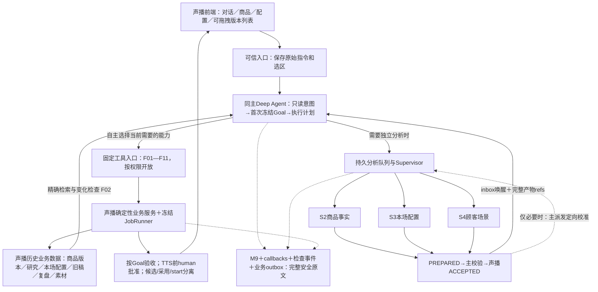

# 15 可复用工具流、Agent判断与协作边界

合同增量：PRELIVE-2.3。更新日期：2026-10-16。状态：工程设计，尚未实现。本册回答“哪些能力可以当作可调用工具流，哪些是Agent之间的协调”，不新增另一套工作流框架，不把全部业务强制串成一个流程。

## 1. 四个层次

| 层次 | 决定什么 | 实际实现位置 | 例子 |
| --- | --- | --- | --- |
| 主Agent决策 | 这次要达到什么结果、现有什么、缺什么、选哪项能力 | 主Deep Agent的system prompt＋S1＋TaskAssessment | “只更新商品”不启动活动策划，不自动改稿 |
| 分析Agent | 处理独立、需要推理的局部问题 | S2商品事实、S3本场配置、S4顾客场景；每个独立图 | 分析新材质信息对旧顾客研究的影响 |
| 可复用工具流 | 收到明确输入后完成有边界的动作，给出真实产物/回执 | MaterialService、声播业务service、JobRunner；固定typed工具入口 | 逐模块生成文案；用户选择重排方式后计算新顺序 |
| 协调与保护程序 | 谁运行、什么时候可运行、怎么交接、怎样等待/恢复/确认 | RunCoordinator、BranchService、Supervisor、QuestionService、M1—M9 | 并发最多3；完成事件唤醒主；CAS拒绝覆盖新版本 |

工具流可以包含一个受计划约束的模型请求，例如文案JobRunner，但不会因此成为另一个自主Agent。主Agent可以调用一项工具、组合几项工具，或选择一个分析Agent；不要求从材料导入走到开播。

## 2. 可复用工具流目录

“入口”表示正式能力接线，不是新增一个可执行任意flow_id的通用工具。表中有人工停顿的流程按多个短动作/持久任务衔接，不能跨等待持有数据库事务。

| 编号／流程 | 输入与确定性步骤 | 入口与模型参与 | 产出／出口 |
| --- | --- | --- | --- |
| F01 材料受理与解析 | 上传校验→原文件受控保存→按格式解析/OCR→页/图/段定位→提取状态/低置信度项 | 上传控制器调用MaterialService；Agent用read_source读取；不执行资料内指令 | SourceManifest、完整原文ref、解析任务回执；识别不清明确缺项 |
| F02 历史读取和变化影响检查 | 精确商品身份→当前/历史refs→差异paths→检查研究依赖和适用范围→受影响模块/配置清单 | find_audience_research、read_session_history、inspect_change_impact；程序判版本/依赖，主Agent解释意义 | 可复用/需校准/陈旧/未知清单；不直接重写研究或话术 |
| F03 商品组装、校验与保存 | 已接受事实/研究＋主提议→全字段set/clear/preserve→身份/冲突/必填检查→CAS保存→回读 | 主Agent先决定有依据的卖点和字段提议；validate_product_assembly/save_product执行程序检查与持久化 | 唯一商品新修订＋字段处理清单＋变更事件；身份不明返回needs_input |
| F04 本场草案保存 | 已接受本场提议＋历史差异→有效期/优惠规则/声音校验→仅本场patch→CAS保存 | session_config分析Agent负责理解；主调用save_session_draft | SessionDraft修订，不提前生成最终口播，不改变商品正本 |
| F05 上下文封装与计划落盘 | 完整商品/研究/本场/旧稿决定/复盘/素材相关refs→验证hash/范围→保存不可变bundle→校验逐模块计划 | 主Agent制定计划；build_context_bundle/save_script_change_plan执行完整性与范围检查 | ContextBundle、ScriptChangePlan；摘要不能替代完整输入 |
| F06 按计划生成／局改文案 | 冻结plan/bundle→构造目标模块请求→模型返回模块JSON→基础规则/报价/范围校验→最多一次纠正→CAS提交 | execute_script_plan→声播JobRunner；模型只生成允许模块，不自行选择新商品/顺序 | 新ModuleRevision/ScriptRevision、diff/replacement refs、逐项失败；不自动TTS |
| F07 用户重排与播放编译 | 选中occurrence→grouped/interleave/full_shuffle预览→人工应用或拖拽→save_playlist CAS→编译长短开场/supercycle | preview_playlist_reorder纯算法；save_playlist/compile_playback_plan；无需排序Agent或LLM | 精确用户顺序、seed、编译项和AudioRequirements；同商品重复版本不去重 |
| F08 人工批准后的必需音频准备 | 只读审核包→真实human批准→TTS受理/claim/commit检查→缓存差集→逐句验证→manifest | read_text_review/request_user_decision承接；human批准与prepare_required_audio分离；声播JobRunner执行 | 当前有效AudioApprovalReceipt与AudioManifest；未批准不合成，unknown不盲重付 |
| F09 复盘导入与引用校验 | 原文受控保存→主Agent结构化解释→schema/来源/hash校验→保存→显式关联本场 | import_recap/link_recap_to_preparation；原文理解由主判断，导入规则由服务执行 | RecapDocument及精确引用；不执行复盘中未经用户授权的降价/换序建议 |
| F10 素材需求清单保存与检查 | 已有商品图/文件＋场景/卖点建议→主整理用途/缺项→验证引用和来源→保存清单→回读 | audience报告给asset_suggestions，主save_asset_checklist/read_asset_checklist | 已有素材引用＋待准备事项；不是自动生成了视频；缺可选视觉不阻塞纯声音 |
| F11 按本次目标验收 | 可信Goal＋已验证TaskAssessment→编译验收项→声播一致读取实际成果/回执→硬条件与advisory分开→终态验证 | CompletionService→finish_turn→M7；语义评审是附加信号，不签发业务真值 | GoalAcceptanceResult/运行回执；不要求每次都产整场候选，也不凭模型自称完成 |

## 3. Agent之间真正需要的协调

| 协调动作 | 决策者／执行者 | 传什么 | 不能发生什么 |
| --- | --- | --- | --- |
| 任务识别 | 主Agent提出TaskAssessment；服务核对原Goal | 本次目标、对象、允许变化、已知事实/缺口、拟调用能力、所需产物 | 分类结果不能扩大用户授权，不额外启动独立路由模型 |
| 派发分析 | 主选择，BranchService持久入队 | 每个角色自己的InputManifest、精确输入refs、输出schema、权限/预算 | 不是发“你去研究一下”；不复制父全部聊天 |
| 并行执行 | Supervisor领取独立图 | ChildScope、独立thread/lease/attempt、callbacks和因果ID | 主等待不能杀死合法子任务；同主thread不并发invoke |
| 局部汇合 | 主读取、声播接受报告 | PREPARED原文→验证readset→ACCEPTED业务ref | 主不能把未接受的零碎输出当商品事实；某一路失败不清空其他有效报告 |
| 必要横向校准 | 主接受typed结果后定向派发新的refine任务 | InsightHandoff的结论、证据性质、消费paths、明确需要校准的局部 | worker不互传私聊、不直接改对方状态；禁止相互无限触发 |
| 补问与批准 | 主归并提议，QuestionService/human服务执行 | 对象/版本/hash、问题、真实用户答案或批准回执 | 三Agent不各自重复问同一问题；Agent不能代签批准 |
| 完成与局部恢复 | CompletionService/Coordinator | 实际产物、receipt、blocker、下一步 | 不能把“job accepted”当完成；不能为修一个失败重跑所有能力 |

横向传递采用“接受后的产物引用＋新的有边界任务”，而不是共享所有上下文。商品事实通常不需要顾客研究结果才能提取材质/规格；**形成商品卖点时**才汇合两者。本场配置可以独立整理用户指定主题/活动；只有发现受众/场景与该配置的表达计划有关时，才对讲解简报或建议做定向校准，不擅改商家优惠。

## 4. 典型调用路径

| 用户任务 | 选用哪些流程／分析 | 明确不会自动做什么 | 本轮验收 |
| --- | --- | --- | --- |
| “更新这个商品资料” | 主识别→F01/F02→必要S2/S4→F03→研究接受/复用→影响清单 | 不改现有话术，不换排序，不TTS | 商品修订或明确无变化；研究已校准/有依据复用；受影响稿件清单 |
| “只整理本场中秋活动，其他不动” | F02历史配置→S3→F04；必要处补问 | 不重做商品/顾客研究，不自动生稿 | 本场配置差异、期限有效性、未改字段保留 |
| “根据更新重写活动话术” | 读取当前资料→F05→F06；必要联动须在scope内 | 不重写无关主体，不直接TTS | 指定模块存在、新旧差异、无关模块hash保持 |
| “这几版穿插播放” | F07；缺必要长/短开场文本时返回精确缺项 | 不新增未选版本，不改价格，不直接付费合成 | 选中occurrence无增减、顺序符合所选方式、编译正确 |
| “把这一场都准备好” | 按缺项选S2/S3/S4及F01—F11的必要部分；复用已有有效结果 | 不跳过人工文案批准，不自动开播 | 商品/配置/研究/计划/脚本/用户编排/素材清单/批准音频/候选与目标一致 |

“更新商品资料”的默认范围为2026-10-16用户明确选择：更新商品与相关顾客研究；列出受影响话术，等明确要求后再改。研究没受影响时记录有效复用，不为凑流程强制再跑一次模型。

## 5. 总架构与可调用位置

F编号仅是能力目录；不向模型提供任意execute_flow工具，不让模型任意拼SQL/HTTP/代码。某流程内部有多个确定步骤，可作为一个typed服务工具；遇后台任务/人工确认返回持久回执，主在事件后续接，不在一次工具调用里无限轮询。

## 6. 工具流合同与重用原则

| 必备字段 | 规范 |
| --- | --- |
| 输入 | 精确对象refs/revision/readset、用户范围、策略枚举、必要配置；身份/权限/operation由可信runtime注入 |
| 结果 | status、实际产物refs、receipt、缺项、失败类别、允许next_actions；统一沿现有工具信封 |
| 重试 | 同operation回读原结果；有意新生成用新的可信调用身份；外部结果unknown先对账 |
| 失效 | 记录实际消费paths，输入相关变化只废弃依赖产物；缓存文件可复用不等于新批准 |
| 观察 | 入口、逐步执行、job、结果、用户确认和错误都关联run/span/operation；原文与摘要分别保存 |
| 验收 | 测试每个服务正常/缺项/陈旧/重放；再测主Agent是否选对最小能力集合；两类指标分开 |

不将目标识别、市场判断、卖点组织、复盘取舍假装为确定性工具步骤。它们属于Agent判断，必须留下显式结构化依据并由程序限制范围。相反，报价计算、版本检查、重排、1/6/11开场规则、缓存差集和权限属于程序，不交给模型凭文字保证。

## 7. 构建与验收顺序

| 阶段 | 产出 | 出口标准 |
| --- | --- | --- |
| 先服务 | F01/F02/F03/F04/F07的typed输入输出与临时库集成 | 不用模型也能完成合法读取/保存/重排；非法或陈旧输入明确拒绝 |
| 再受控生成 | F05/F06/F08/F09/F10/F11 | 完整依赖可回读、按模块改稿、无批准不TTS、素材建议不冒充已有文件 |
| 接主循环 | system prompt/S1/TaskAssessment/工具过滤 | 代表任务只调用所需能力；read-only不申请写权；更新商品不自动改稿 |
| 接多Agent | 三独立图、持久派发、accept、必要refine | 真并发有记录，局部失败局部重做；无消息串写/循环互调 |
| 压缩与恢复 | M3投影、SDK摘要/offload、原文refs、trace | 压缩前后关键约束一致；重启可读历史研究；找不到精确版本明确失败 |

本册与[12编排](12_用户编排与重排设计.md)、[13任务与上下文](13_任务识别与历史上下文设计.md)、[14验收和素材](14_任务验收与素材准备设计.md)共同细化00—11。SDK仍锁定Deep Agents 0.7.25 / LangChain 1.4.6 / LangGraph 1.2.15；本轮核对安装元数据，不升级依赖。框架概念参考官方[上下文工程](https://docs.langchain.com/oss/python/langchain/context-engineering)、[Backends](https://docs.langchain.com/oss/python/deepagents/backends)、[Subagents](https://docs.langchain.com/oss/python/deepagents/subagents)。图中的具体F01—F11与权限选择是本项目设计，并非官方现成功能已全部接通。

首次自由文本识别也在同一个主图中完成：phase=intent仅允许受限读取、候选保存与必要澄清；Coordinator首次冻结Goal并授权后进入execute。`save_task_assessment`兼容两种类型但不发grant；F流程在相应正式权限具备时才执行。详13§1.2—1.5及02§16。

## 9. 复查后的公共生命周期

F01—F11继续为可选的typed能力组合，没增加“必须每次全跑”的流水线。共同执行外壳增加OS实例排他、每thread执行排他、RunFinalizer和最终模型payload账本；它们由服务自动触发，不作为模型调用的Skill或工具流。旧版选择record_product_revision_choice属于human业务命令，不是模型自选工具；研究/正文/素材仍由相应已有工具流按原Goal执行。正常run关闭不抹除已合法成果，终态后的继续由新Goal复用回执，见16。
