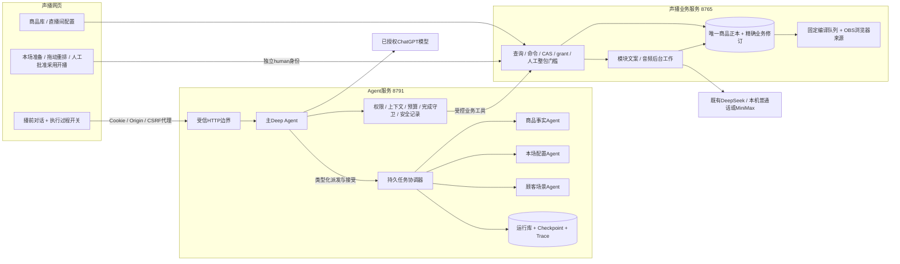

# 首期构建与验收记录

合同PRELIVE-2.3。2026-10-16用户正式授权构建完整播前Agent，并确认执行过程开关默认关闭、关闭只隐藏显示。这是实装记录，前17分册仍保留设计形成过程；是否实现/是否验证以本文件及实际测试为准。

## 交付位置和启动

- Agent：`D:/Codex project/shengbo-ops-agent`，项目README含操作、安装、测试与维护说明。
- 声播业务及前端：`D:/Codex project/ecommerce-voice-agent`。
- 桌面快捷方式：`C:/Users/lizhe/Desktop/声播.lnk`，继续使用原名称和入口。launcher同时确保业务8765和Agent8791就绪，重复启动复用现有服务。
- 更新前备份代码保存在本计划snapshots；实际商品库迁移前另通过SQLite backup在声播runtime/backups保存快照。更新时已先确认原直播间均stopped，再停止已核实的旧服务，避免三列旧写法与新修订表共存。
- 新服务保持本机loopback；浏览器仅接触声播端口，由可信代理连接Agent。独立三方向服务凭据用DPAPI加密，OAuth不进入前端或工具参数。旧18791连接测试服务已经安全停止。

## 实装结构

主Agent按本次需求选择动作。不是每次强制执行全部步骤。独立三路实际并行，子报告先PREPARED，主验收后才保存为声播正式analysis。业务服务是商品、配置、话术、批准和播出结果的权威；Agent只持执行历史与引用。

## 功能与校验边界

| 环节 | 实际行为 | 校验/评价 |
|---|---|---|
| 上传和任务识别 | 文本/常见文档/图片读取，目标分类、原文授权引用、同名身份确认 | 严格DTO、内容hash、拥有者/会话验证；资料指令不授权；不可纠正越权硬拒绝 |
| 商品与研究 | 商品全字段、冲突/缺项；顾客与场景历史复用和增量研究 | 唯一正本、精确ref、CAS；事实和研究假设分开；未请求不改稿 |
| 本场与并行分析 | 当前配置、历史、本场目标；三路持久分析 | 同本场范围锁；三路started早于任一prepared；接受后才进入正式上下文 |
| 上下文与计划 | 完整商品、研究、本场、旧稿、复盘及决定汇合，逐模块计划 | 完整原文保留；传输摘要不冒充正本；计划显式generate/patch/reuse/disable |
| 文案与编排 | 模块化生成/局改；拖动、连续/穿插/随机重排 | 真实非空模块读回；重排base和preview hash；原位置第1/6/11长开场 |
| 人工确认 | 同名创建/更新、排序、精确整包语音批准、旧版差异、采用及开播 | 不能由模型批准自身；批准必须current并绑定operation/review/preparation；硬停售撤回拦截 |
| 语音与候选 | 仅编排所需句子、缓存复用、后台任务、候选生成 | 已批准整包；WAV文件/内容/归属校验；候选不等于采用或开播 |
| 复盘输入 | 原文件可信导入blob、结构化解释、关联本场 | 精确上传ref、原文hash、synthetic标记、lineage；建议不自动改价/顺序 |
| 恢复与取消 | SQLite checkpoint、幂等回执、撤销未来写、真实任务退出后释放 | 未知请求不自动重发；明确4xx为known_failed；未核实的外部结果保留阻碍 |
| 调试界面 | 默认隐藏的分块事件、参数、摘要、完整安全payload展开 | 开关不停止记录；主/子ID、invocation、事件序号可追踪；私有推理和凭据排除 |

四份运行Skill已写在Agent项目skills目录，对应主、商品事实、本场配置、顾客场景。通过原生SkillsMiddleware发现并按需读取。9个自定义中间件对应RunFence、ChildFence、ContextProjection、ToolPolicy、ActionBoundary、Budget、主完成守卫、子完成守卫、Audit；原生规划、文件上下文和摘要继续使用Deep Agents。

前端说明设计中的业务假设没有作为后端事实：身份、范围、版本、批准、事件DTO以实际共享合同为准。编排项具有独立occurrence_id，商品版本和脚本修订分开；重复循环句保留源句ID并使用唯一播放ID。

## 已执行测试（持续核对，最终数值见附加结果）

- 最终声播完整隔离Python回归：214项通过，0失败、0错误、0跳过；跳过真实.env，未改正式库。
- 最终Agent完整回归：115项通过，另7个subtest通过；包含provider、资料、安全、恢复、事件、上下文和完整业务集成。
- Agent责任集成：API、中间件、Runtime业务集成35项通过，包括真实Deep Agents SDK与三路并行完整播前闭环。其余provider、资料、安全、恢复与事件测试另在整套回归统计。
- 助手Chromium：30项断言通过。工作台真实浏览器点击验证拖动、三种重排、准确模块hash、CSRF续建、采用后开播以及旧版差异。
- 完整隔离闭环：真实Engine/native工具→三路并行→3报告接受→完整ContextBundle→7模块计划→后台稿件生成→人工排序→人工整包批准→测试WAV→未采用候选→READY_FOR_REVIEW及关闭回执。此测试的模型、文案和WAV是明确模拟；不据此声称真实供应商或成交效果已通过。
- 真实本机SAPI普通话：生成4.8秒、22050Hz、单声道有效WAV，未调用付费TTS。
- 真实DeepSeek单模块：仅一次opening_short请求，严格返回两句并落实指定场景，用量1879 tokens；隔离临时本场，未读写正式商品库。
- 真实ChatGPT provider工具往返：两次请求、本地工具执行一次，最终结果使用工具返回且response.completed。最终完整Runtime真实只读探针：5次真实请求，全部succeeded，最终COMPLETED，acceptance_ok=true，0额外摘要调用。真实模型曾给出非逐字授权引用，收到安全工具错误后自行纠正，验证没有放宽原句校验。业务输入为隔离空库，不上传真实商家数据。
- 凭据续期并发、失败和原子保存使用受控模拟测试；尚未等待自然过期进行长期真实续期观察。

## 本轮发现并修复的问题

| 问题 | 修复 |
|---|---|
| runtime注入字段与extra=forbid冲突 | 私有工具schema显式注入，公开schema隐藏；真实SDK防伪测试 |
| 流式completed包含空output丢失工具/文本 | 收集output item和增量，仅完成后合并；真实工具往返验证 |
| 人工快答被SDK返回覆盖 | 仅清除本次实际消费的inbox值，短事务比较；40ms答复完整闭环通过 |
| 仅判断“不是stale”会接受无批准 | 必须current且精确绑定人工操作和整包hash |
| 跨任务SSE误用每run序号 | 持久全局游标单独保存，事件原sequence不改；交错/重启测试 |
| 构造时先写库后加锁 | 先OS独占锁，失败或关闭按资源所有权清理 |
| 同名新建证明只能信浏览器 | 固定human回调后controller精确回读验证；冻结后不偷偷扩大目标grant |
| 模型稍有参数错误直接终止整任务 | 明确可纠正输入错误返回标准ToolMessage，每run同类最多3次；越权/未知副作用不软化 |
| 商品材料与复盘原文件需模型重写base64 | 服务端可信读取精确材料并导入业务blob，保留lineage和可见工具流 |
| 重排UI字段、seed、旧版差异不一致 | 使用真实proposed_items/resolved_spec/preview_hash和observed_head_ref |
| 固定工具schema触发反复摘要 | 只统计可压缩消息，6000触发/1500保留；原生reported总usage不代替消息触发依据；大历史压缩一次后不重复 |
| finish已通过还请求结束语，后续失败把完成改成BLOCKED | M7/M8在已验收handoff/finish/报告后直接结束SDK轮次，不再消耗模型请求 |
| 空研究查询或旧版本研究冒充“研究已维护” | 商品更新验收逐个回读最终商品精确修订的有效研究，空items或旧ref不能通过 |
| 单模块任务仍套整版提示词后抽句 | 独立单模块DTO与请求，完整上下文和计划指令入参；旧整版生成行为保留；usage与事实引用落库 |

## 最终启动检查

最终代码已启动：声播8765、Agent8791均健康，observability healthy=true、spooled_events=0；浏览器cookie/CSRF到30命令/27查询及Agent代理接线检查通过。现有1件商品、2个直播间保留。再次执行桌面同一launcher返回成功并复用服务，未产生重复运行实例。网页实际双栏与窄屏助手已查看，截图及安全检查结果保存在Agent项目verification目录。

最终浏览器回归：助手30项断言；工作台8组场景0页面错误；原音频播放器5项和保存恢复8项通过。完整回归后没有继续修改业务代码。

## 前端纠正说明（2026-10-16）

用户指出旧实现没有遵循 Agent 主体的前端方案，本轮已将默认首页重构为右侧完整对话、左侧内联成果与微调工作台。旧的侧栏、窄屏浮动入口、弹窗式成果工作区不再代表默认页面。当前实现及新增验收见《19_Agent主体前端纠正与验收.md》。

## 实际边界

首期完成播前准备，不生成播中/播后Agent。模拟复盘不是实际业务观测。真实OBS推流、抖音账号连接、声音主观质量、真实成交率和长期OAuth续期不由本地隔离测试证明。外部模型/网络失败会保留已完成成果和安全诊断；未知计费结果不会自动重发。当前文件保留策略为本地持续记录，需后续加入可配置保留/归档。
