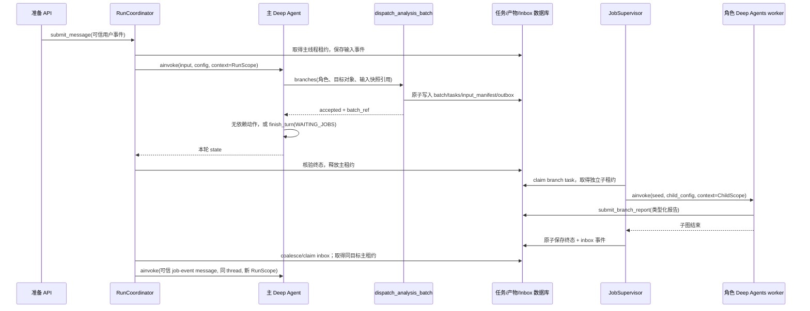

# Deep Agents 0.7.25 运行装配与函数合同核验

核验日期：2026-10-15。性质：工程设计输入与 SDK 源码核验，不是业务代码，不代表集成测试已经通过。仅写入本文，未调用真实模型、未读取凭据、未修改声播。

2026-10-15 同轮修订：已阅读《声播播前Agent前端方案与后端交接说明.md》的任务排队、手动编辑、确认与取消语义；接口命名仍由后端工程方案统一。以 `main:{run_id}` 标识不可变用户任务的主线程；`follow_up` 排队、`replace` 才撤销旧任务写入权限、`new_task` 创建独立任务。下文已按该语义修正，不沿用“普通新消息立即提升目标修订并替换旧任务”的旧默认。

## 1. 唯一装配决策

本项目采用一个主 Deep Agent、三类预编译 Deep Agents worker、一个本地持久任务监督器。主 Agent 用 `dispatch_analysis_batch` 提交所需分析能力，工具事务受理后立即返回；监督器在后台调用对应 worker。主 Agent 可以继续无依赖动作，也可以通过 `finish_turn(WAITING_JOBS)` 交还本轮执行权。任务终态进入可信 inbox，由运行协调器唤醒同目标主线程。

三类 worker 固定为 `product_facts`、`session_config`、`audience_scenes`。它们只写分析产物，不直接写正式商品库、房间、播放计划或发起付费语音。它们都由 `create_deep_agent` 编译，但不注册进主 Agent 的 `subagents=`；业务委派不走默认 `task`。主与 worker 的原生 `task` 均采用模型工具过滤、实际执行拒绝两层封口。这样可通过明确的 `context=ChildScope` 注入身份，避免原生 task 自动复制和回并父 state 的副作用。

该结构不固定主 Agent 的能力调用顺序。主 Agent决定本次需要哪类分析、要处理哪些商品、是否需要补问、是否需要生成话术；工具与服务执行依赖和权限校验。



## 2. 核验依据与旧文档必须修正的细节

核验环境：`D:/Codex project/shengbo-ops-agent/.venv/Lib/site-packages`。SDK 为 `deepagents==0.7.25`、`langchain==1.4.6`、`langgraph==1.2.15`。

| 核验点 | 实际代码与结论 | 本设计要求 |
| --- | --- | --- |
| 工厂参数 | `deepagents/graph.py:276` 的公开参数含 `middleware/state_schema/context_schema/checkpointer/backend/permissions`；没有 `launcher`、`task_scope_factory` 或 `general_purpose_subagent` 工厂参数 | 不新增伪 API；launcher 是我们应用的普通服务函数 |
| Backend | `backend: BackendProtocol \| None`；`StateBackend.__init__()` 无 runtime 参数 | 传 `StateBackend()` 实例，首次 invoke 的 `files` 传入预置文本；不用旧 Skill 的 `lambda rt: StateBackend(rt)` |
| task 子上下文 | `deepagents/middleware/subagents.py:_validate_and_prepare_state` 会把父 state 的非排除字段复制给子；隔离模式只重置消息为任务描述 | “隔离”不等于全部业务 state 隔离；我们显式组装 worker seed |
| task 回并 | `_return_command_with_state_update` 把非排除、变化的子 state 更新回父 state | 不依赖其默认回并；worker 通过产物库交接 |
| task 的 runtime | task 内部调用 `subagent.ainvoke(subagent_state, subagent_config)`，不显式传 child `context=`；LangGraph 可继承父 runtime.context | 继承只能得到父身份，不能据此声称每次动态注入了可信子身份 |
| 工具请求 override | `ToolCallRequest.override` 公开支持 `tool_call/tool/state`，不包括 `runtime` | 不用未公开 config key 或改 runtime 私有结构注入权限 |
| 默认通用子 Agent | 工厂自动添加 general-purpose，工具通常继承父自定义 tools | 主/worker Policy 同时过滤和拒绝 task，阻断权限绕路 |
| 待办 | `TodoListMiddleware` 未在本版本工厂基础栈自动添加 | 主 Agent 显式注册；todo 不是权威业务任务表 |
| Hook 顺序 | `langchain/agents/factory.py`：before 类按注册顺序，after 类逆序；wrap 第一个为最外层 | 表中必须明确注册顺序与实际调用顺序 |
| 文件内容格式 | `deepagents/backends/protocol.py:187` 的 FileData 是 `content: str`、`encoding: str` | 不再使用历史 `content: list[str]` 样例 |
| 持久检查点 | 当前环境只有 `base/memory/serde`，未安装 sqlite saver 模块 | 实施阶段添加并锁定 `langgraph-checkpoint-sqlite` 与 `aiosqlite`，验证后才能宣称重启恢复 |
| AsyncSubAgent | 工厂注释明确该能力目前面向 LangSmith 部署图 | 本地后台 job 不使用 AsyncSubAgentMiddleware |

官方资料入口：[Deep Agents 定制](https://docs.langchain.com/oss/python/deepagents/customization)、[自定义中间件](https://docs.langchain.com/oss/python/langchain/middleware/custom)、[LangGraph 中断](https://docs.langchain.com/oss/python/langgraph/interrupts)、[AsyncSqliteSaver](https://reference.langchain.com/python/langgraph.checkpoint.sqlite/aio/AsyncSqliteSaver)。本文实现判断以实际锁定版本源码为准。

## 3. 必须分开的身份、State 与完整业务上下文

### 3.1 RunScope 与 ChildScope

以下为应用类型设计，不是 SDK 新参数。类型使用 frozen dataclass；由可信协调器创建，作为 SDK 的 `context_schema` / `context=` 使用。服务依赖对象通过装配闭包持有，不放入可序列化 state，也不把 API 密钥写入 context。

```python
@dataclass(frozen=True)
class RunScope:
    account_id: str
    actor_id: str
    preparation_id: str
    goal_revision: int
    thread_id: str
    run_id: str                 # 不可变用户任务，跨多次 invoke 稳定
    invocation_id: str          # 本次可信 invoke / wake 记录
    lease_epoch: int            # 本次线程租约的 fencing token
    write_generation: int       # run 的写授权世代，cancel/replace 后失效
    input_event_id: str
    objective_ref: str          # 经服务确认的本次目标与完成合同

@dataclass(frozen=True)
class ChildScope:
    account_id: str
    preparation_id: str
    goal_revision: int
    parent_run_id: str          # 审计关系，不是授权凭证
    write_generation: int       # 当前父 run 写授权世代快照
    batch_id: str
    branch_task_id: str
    role: Literal['product_facts', 'session_config', 'audience_scenes']
    object_ids: tuple[str, ...]
    input_manifest_id: str
    input_manifest_hash: str
    task_lease_epoch: int
```

`dispatch_analysis_batch` 的模型参数没有 account、actor、parent_run_id、child_task_id、lease 或 role 权限列表。模型只请求固定角色及本准备任务中的对象引用。服务先验证请求，服务端生成任务 ID、输入清单、角色权限和 ChildScope。worker 工具从注入的 `runtime.context` 读取身份，并回查任务注册表校验，不接受模型声称“我是主 Agent”。

父调用退出 WAITING_JOBS 后，子任务仍可运行。子任务要求当前 active-run slot 仍属于 parent_run_id、run 的 write_generation 仍有效、子任务租约仍有效、输入仍适用；不能要求已退出父 invocation 仍持有 invoke 租约。parent_run_id 由程序派生并回查，单凭这个字符串不构成授权。

### 3.2 Graph State

```python
class PreliveState(DeepAgentState):
    observation_ref: NotRequired[str]
    observation_event_seq: NotRequired[int]
    guard_retry_count: NotRequired[int]
    terminal_receipt_ref: NotRequired[str]

class AnalysisState(DeepAgentState):
    input_manifest_ref: NotRequired[str]
    report_receipt_ref: NotRequired[str]
    guard_retry_count: NotRequired[int]
```

`messages/files/todos` 由 SDK 对应 state/middleware 提供。State 不保存授权真值、正式商品副本、最终 ready 真值。主工具尽量返回普通结构化结果/ToolMessage；并行工具不各自写同一个无 reducer state 字段。观察快照由 ContextProjectionMiddleware 单写者更新。

### 3.3 完整业务上下文

权威业务上下文位于不可变 input manifest / ContextBundle 与正式声播 API。主 Agent 系统消息只放当前目标、精确约束、阻塞项、合法动作和引用索引。商品字段、研究证据、本场配置、旧稿全文、用户决定完整可回取；不能把这五类内容压成一段摘要后丢弃原文。

StateBackend 的虚拟文件只存本线程的按需上下文副本、工作草稿、Skills 和 SDK 历史归档。跨线程交接使用带 hash 的产物引用，不是拷贝整个 `files`。准备服务验证正式写入的 input manifest 与当前 revision；模型读到了旧副本不代表可以提交旧结果。

## 4. 工厂装配：只使用真实公开 API

### 4.1 装配函数签名

| 文件与函数 | 输入 | 返回/作用 |
| --- | --- | --- |
| `runtime/bootstrap.py::build_runtime(settings, services, checkpointer) -> RuntimeBundle` | 已验证配置、服务集合、持久 saver | 一个主图、三个角色图、Coordinator、Supervisor |
| `runtime/models.py::build_agent_model(settings) -> BaseChatModel` | 明确 DeepSeek 模型名、超时、重试、凭据的服务配置引用 | 显式创建 ChatDeepSeek；不走默认 Anthropic |
| `runtime/factory.py::build_main_agent(model, services, saver) -> CompiledStateGraph` | 模型与依赖 | 主 Deep Agent；注册主工具与主中间件 |
| `runtime/factory.py::build_analysis_agent(role, model, services, saver) -> CompiledStateGraph` | 固定 role | 对应 worker；不包含正式写工具 |
| `runtime/seed.py::build_main_input(event, snapshot, skills) -> dict` | 可信消息、当前观察、版本固定的业务 Skills | 首次含 messages/files；续跑仅新增消息和必要文件更新 |
| `runtime/seed.py::build_worker_input(task, manifest, skills) -> dict` | 已注册任务和只读输入 | 新消息＋该角色 Skill＋选定上下文文件；不带父图历史 |
| `runtime/policy.py::policy_for_role(role) -> ToolPolicy` | 主角色或固定 worker role | 不可变工具 allowlist、路径规则、资源范围规则 |

建议装配轮廓如下，属于实现者需要转写的工程设计：

```python
backend = StateBackend()

main = create_deep_agent(
    model=model,
    tools=build_main_tools(services),
    system_prompt=load_main_system_prompt(),
    middleware=build_main_middleware(services),
    backend=backend,
    skills=['/skills/main/'],
    permissions=workspace_permissions(),
    state_schema=PreliveState,
    context_schema=RunScope,
    checkpointer=saver,
    name='prelive-main',
)

workers = {
    role: create_deep_agent(
        model=model,
        tools=build_role_tools(role, services),
        system_prompt=load_role_system_prompt(role),
        middleware=build_worker_middleware(role, services),
        backend=StateBackend(),
        skills=[f'/skills/{role}/'],
        permissions=workspace_permissions(),
        state_schema=AnalysisState,
        context_schema=ChildScope,
        checkpointer=saver,
        name=f'prelive-{role}',
    )
    for role in ANALYSIS_ROLES
}
```

不传 `subagents=`，不启用 fork，不传 `interrupt_on=`；澄清使用明确的业务工具内 `interrupt()`。默认 task 虽可能由工厂注入，但 Policy 不向模型提供、也不执行。公共工具 allowlist 同样禁止 execute、原始 HTTP、原始 SQL 与任意文件系统访问。

装配必须在应用启动时完成一次，复用已编译图。图不持有可变当前用户、当前商品或当前 task；这些通过每次 `context=` 与输入传递，防止并发串号。

## 5. 中间件注册与实际调用次序

### 5.1 主图注册表

用户 middleware 固定按下表顺序传给工厂。默认栈在自定义前包含 Filesystem、可能的 SubAgent、Summarization、PatchToolCalls；其后还有 Skills、缓存适配与内容兼容中间件。首期不自写第二个模型循环。

| 注册序号 | 中间件 | Hook 与签名 | 输入/动作 | 返回 |
| --- | --- | --- | --- | --- |
| 1 | `RunFenceMiddleware` | `async abefore_agent(state, runtime)`；`async abefore_model(state, runtime)` | 校验 `runtime.context`、active-run slot、write_generation、主 invoke 租约 epoch；取消或被 replace 的旧 run 立即停止 | 正常 None；失效抛应用 RunSuperseded，由 runner 归档 |
| 2 | `ContextProjectionMiddleware` | `async abefore_model(state, runtime)`；`async awrap_model_call(request, handler)` | 从准备服务读取最新观察 manifest；模型调用时追加精确可信快照与读取索引；不搬全量原文 | state 的观察 ref/event_seq；`await handler(request.override(system_message=...))` |
| 3 | `ToolPolicyMiddleware` | `async awrap_model_call(request, handler)`；`async awrap_tool_call(request, handler)` | 过滤 role allowlist / 当前能力；执行前再次验证，封口 task/execute 和越界对象 | ModelResponse；ToolMessage 或 Command；拒绝时标准错误，不调用 handler |
| 4 | `ActionBoundaryMiddleware` | `async awrap_tool_call(request, handler)` | 工具名分类，验证版本与 task 状态，登记动作账本；不从模型接收 operation_key；等待正式回执 | handler 原结果；原始异常转换标准错误，GraphInterrupt/取消必须原样抛出 |
| 5 | `TodoListMiddleware` | SDK 自带 hook/tool | 显式提供 write_todos；仅协助模型计划 | SDK 状态，不作为业务完成依据 |
| 6 | `CompletionGuardMiddleware` | `@hook_config(can_jump_to=['model','end']) async aafter_model(state, runtime)` | 有 tool_calls 时放行；无 tool_calls 时检查终态回执与目标完成合同 | 正常 None/receipt ref；未满足时移除本条暂定 final，追加纠正消息并 jump_to model；最多 2 次 |
| 7 | `ModelCallLimitMiddleware(run_limit=40, exit_behavior='error')` | SDK before/after_model | 限本次主 invocation 模型步数 | SDK 限制异常由 runner 记录，不能伪装完成 |
| 8 | `AuditMiddleware` | `async awrap_model_call`、`async awrap_tool_call`、`async aafter_agent` | 本地记录去敏事件、耗时、usage、结果引用；不得吞异常 | 透传；末尾写审计元数据 |

所有自定义运行路径使用 `ainvoke/astream` 与异步 Hook，不混用仅实现 async Hook 的图去 `invoke()`。工具 I/O 使用异步 HTTP/数据库；必须使用同步解析器时由受限工作线程运行，不能阻塞事件循环。

### 5.2 运行次序

`before_agent/before_model` 按注册正序；`after_model/after_agent` 逆序；wrap 按注册顺序形成外到内嵌套。主图 after_model 中 ModelCallLimit 先计数，再执行 CompletionGuard；Audit 未实现 after_model，不产生该阶段节点。Guard 跳回不能跳过模型调用计数。实现时必须用事件轨迹测试核对工厂合成后的实际节点，不仅查看传入数组。

`CompletionGuard` 的跳回使用 Hook 返回的 `{'jump_to': 'model', ...}`，不能在 after_agent 里再自行 `ainvoke` 一个图。after_agent 只归档，不负责补做业务。对含 tool_calls 的 AIMessage 不删除、不重排，避免破坏 tool_call_id 配对。

### 5.3 Worker 差异

worker 使用 `ChildFenceMiddleware → ContextProjectionMiddleware → ToolPolicyMiddleware → ActionBoundaryMiddleware → BranchCompletionGuardMiddleware → ModelCallLimitMiddleware(run_limit=16, exit_behavior='error') → AuditMiddleware`。不需要 TodoList 或用户澄清工具；其缺口随报告返回主 Agent 汇总。after_model 同样先计数，再做完成守卫。

BranchCompletionGuard 只认服务端已接受、input hash 正确的 `submit_branch_report` 回执。worker 最终自然语言或结构化 JSON 本身不作为任务成功证据。没有回执最多纠正 2 次，再返回失败任务而不是无限重试。

SDK 自动压缩可能直接调用摘要模型，主循环 ModelCallLimit 只限制 Agent 主循环调用数，不能把它当作所有模型费用的精确上限。服务还需记录压缩、生成、研究和 TTS 独立 usage；费用硬限需要在实际 provider 调用边界落实。首期不声称依赖 SDK 步数限制即可精确封顶人民币金额。

## 6. 工具与服务函数的确定边界

### 6.1 主 Agent 对模型暴露的运行控制工具

```python
@tool
async def dispatch_analysis_batch(
    branches: list[AnalysisRequest],
    runtime: ToolRuntime[RunScope],
) -> dict: ...

@tool
async def read_analysis_batch(
    batch_ref: str,
    runtime: ToolRuntime[RunScope],
) -> dict: ...

@tool
async def request_user_decision(
    questions: list[QuestionProposal],
    runtime: ToolRuntime[RunScope],
) -> dict: ...

@tool
async def finish_turn(
    outcome: Literal['READY_FOR_REVIEW','WAITING_JOBS','BLOCKED'],
    summary: str,
    runtime: ToolRuntime[RunScope],
) -> dict: ...
```

`finish_turn` 不是让模型随意改任务状态。服务按目标合同验证：READY 必须有正式回读一致的准备包；WAITING_JOBS 必须有有效未完成 job、持久监听以及下一步依赖；BLOCKED 必须有可定位的阻塞与原因。WAITING_JOBS 只结束本次 invocation，不把用户 run 标为终止，也不释放 active-run slot 给后继任务。询问由 request_user_decision 中断，不用 finish_turn 假装拿到用户答复。

### 6.2 worker 工具

共用 `read_input_manifest/read_source/read_business_schema/read_existing_product/read_context`；商品角色可 `search_catalog`；本场角色可读取当前 room 与优惠 schema；研究角色可使用受限 `search_web/fetch_web_source`。三角色各持有一个类型明确的最终提交工具，不接受任意 JSON 文档写入。

```python
async def submit_product_facts_report(
    report: ProductFactsReport,
    runtime: ToolRuntime[ChildScope],
) -> dict: ...

async def submit_session_config_report(
    report: SessionConfigReport,
    runtime: ToolRuntime[ChildScope],
) -> dict: ...

async def submit_audience_scenes_report(
    report: AudienceScenesReport,
    runtime: ToolRuntime[ChildScope],
) -> dict: ...
```

这些工具内部汇入 `BranchService.submit_report(scope, typed_report)`。正式 report 中 task ID、role、manifest hash、时间、状态、作者来源由服务填充，不让模型传。模型负责报告业务字段、证据引用与缺口；引用必须属于分配的输入或真实研究抓取结果。

### 6.3 关键普通 Python 服务签名

| 函数 | 合同 |
| --- | --- |
| `BranchService.enqueue_batch(scope: RunScope, requests: Sequence[AnalysisRequest]) -> BatchReceipt` | 校验 role/对象/输入；以 role+对象+输入 hash 去重；任务和 outbox 同事务；返回 accepted |
| `BranchRepository.claim_next(worker_id: str, now: datetime) -> ClaimedBranchTask \| None` | CAS claim/租约 epoch；仅一个 worker 拿到一个 attempt |
| `ChildScopeFactory.from_claim(task: ClaimedBranchTask) -> ChildScope` | 读取任务注册事实，派生不可扩权身份；不解析模型描述中的权限 |
| `BranchRunner.run(task: ClaimedBranchTask) -> BranchOutcome` | 构造 role seed，独立 child thread 调用图；读取报告回执，事务保存终态/inbox |
| `BranchService.submit_report(scope: ChildScope, report: BaseReport) -> ReportReceipt` | active run/write_generation/task lease/input 校验，typed schema 与引用校验；重复内容返回同一回执 |
| `InboxService.append(event: TrustedEvent, dedupe_key: str) -> InboxRef` | job 终态和事件事务原子提交；不由模型伪造 job 完成事件 |
| `RunCoordinator.drive(run_id: str) -> TurnOutcome` | 核验 active-run slot，claim/coalesce inbox、同 thread 互斥、构建可信 Scope、调用主图、核验与保存结果 |
| `RunCoordinator.submit_intent(event: VerifiedIntentEvent, mode: IntentMode, related_run_id: str \| None) -> RunReceipt` | follow_up 创建后继 run 并排队；replace 原子撤销旧 write_generation 后创建替换 run；new_task 建独立任务并校验资源冲突 |
| `RunCoordinator.resume_answer(decision_event: VerifiedAnswerEvent) -> TurnOutcome` | 验证 actor/问题/输入版本/interrupt ID；保存决定后 Command(resume=...) |
| `RecoveryService.reconcile_startup() -> RecoveryReport` | 扫描过期租约、未决动作、待处理 inbox；查远端回执后决定续跑/unknown/失败 |

`JobSupervisor` 是应用生命周期内的普通持久队列消费者，不是另一个 LLM Agent。启动时创建其 asyncio 任务用于消费数据库队列是允许的；不得用请求内 `asyncio.create_task()` 替代持久入队与恢复。

## 7. 图调用合同与线程互斥

### 7.1 主图首次/普通续跑

```python
thread_id = f'main:{run_id}'
config = {'configurable': {'thread_id': thread_id}, 'recursion_limit': 200}
result = await main.ainvoke(input_state, config=config, context=scope)
snapshot = await main.aget_state(config)
```

RunCoordinator 先核验 preparation 的 active-run slot，再获得数据库 invoke 租约并执行图；同 thread 的另外请求只入 inbox 或返回 BUSY，不并行调用。invoke 租约以 epoch 防旧执行者提交。等待用户或后台任务时只释放 invoke 租约，active-run slot 仍归该 run，排队 follow_up 不抢占它。每次调用重新从数据库构建 scope，不信任 checkpoint 中的租约。

普通补充指令按 `intent_mode=follow_up` 创建后继 run，保存 related_run_id 与原始对象基准，等待前序 run 正常终止后才取得 active-run slot；执行前只沿该修改链的 replacement_ref 续接。若期间人工或其他任务改动对象，进入 CAS 冲突处理，不能无条件重绑最新版本掩盖冲突。

只有 `intent_mode=replace` 或取消显式撤销旧 run 的 write_generation，旧线程保留审计。`new_task` 创建独立准备任务/作用域，非冲突资源可并行，跨任务共享正式商品仍受对象 CAS 保护。回答现有澄清问题与 job 事件续同 run/thread。手动编辑不排队，直接进入同一命令服务做 CAS、记录变更并使受影响产物失效；它不等于 replace。状态查询使用 GET，不创建消息、不变更目标、不唤醒 Agent。

### 7.2 worker 调用

```python
child_config = {
    'configurable': {'thread_id': f'branch:{task.branch_task_id}'},
    'recursion_limit': 100,
    'metadata': {'branch_task_id': task.branch_task_id, 'role': task.role},
}
result = await workers[task.role].ainvoke(
    build_worker_input(task, manifest, role_skills),
    config=child_config,
    context=child_scope,
)
```

worker 的 graph state 与 files 由独立 thread 隔离。父子图仅通过完整输入清单和产物库传递，不使用 `Command.PARENT`、不依赖 task 的隐式 state 合并。worker 并行数首期全局 3、同 preparation 最多 3；相同语义任务不重复启动。各角色内多商品可拆成多个 bounded task，不一次塞无限上下文。

以上 seed 调用仅用于尚无检查点的首次执行。worker 崩溃后的 pending-checkpoint 续跑调用 `ainvoke(None, config=child_config, context=fresh_child_scope)`，不重新注入 seed 覆盖文件或追加重复任务消息。主图同理：前次正常结束才投递新 inbox message；已有非终态执行先恢复旧 run。人工中断使用第 8 节的 Command(resume)，不能用 None 跳过答复。

### 7.3 对工具并发的限制

SDK 可能执行一个 AIMessage 中的多个 tool call。只读工具可以并行；主写工具由 ActionBoundary 的 preparation 级短事务/CAS 控制，单次调用中的业务写串行提交。工具之间有依赖时第二个工具读不到依赖回执就返回 DEPENDENCY_NOT_READY，而不是猜测执行顺序。主线程互斥不等同于同轮多个工具已自动串行。

## 8. 人工澄清、中断与答复恢复

### 8.1 request_user_decision 工具执行

1. 从 runtime.context 取得当前 scope。
2. 服务规范化、去重、持久化 QuestionBatch，绑定目标与对象版本。
3. 若已有同版本真实答复，直接返回答复 receipt；避免重复问。
4. 调用 `interrupt({'kind':'user_decision', 'question_batch_ref': ref, ...})`，等待值仅用 JSON 可序列化字段。
5. 恢复时工具从头重放；步骤 2 必须幂等，不能重复写问题或执行业务副作用。
6. interrupt 的返回值只承载 `answer_event_ref`；工具从数据库读取可信已存答复，验证问题和版本，再返回 DecisionReceipt。

不要在 interrupt 前做不可幂等正式写入。不要用 broad `except Exception` 吞掉 GraphInterrupt；工具中断必须传播给 LangGraph。

### 8.2 协调器恢复

协调器读取 `await main.aget_state(config)` 的 interrupts，验证用户渠道事件后持久化答案，再用原 thread：

```python
await main.ainvoke(
    Command(resume={interrupt_id: {'answer_event_ref': answer_ref}}),
    config=config,
    context=fresh_scope,
)
```

这里使用自定义业务 interrupt 的 resume 数据，不套用 HumanInTheLoopMiddleware 的 `decisions:[approve/edit/reject]` 协议。多个 interrupt 时按 ID 匹配，禁止仅按“下一条”恢复。新的 scope 使用新 invocation_id 与新 invoke 租约 epoch，同一 run_id/thread_id 和仍有效的 write_generation。过期问题的回答保存为历史并返回 STALE_DECISION，不恢复旧业务写入。

## 9. 后台任务及重启恢复

| 情形 | 程序处理 | 允许 Agent 做什么 |
| --- | --- | --- |
| branch 已受理，父本轮结束 | 数据库 job 继续执行；outbox 保证可被消费者发现 | 等待 job 事件或做其他无依赖动作 |
| worker 在提交报告前崩溃 | 租约过期后尝试恢复独立 branch thread；若无可恢复检查点则新 attempt，仍用同任务和输入 | 继续分析；不能重复创建正式业务对象 |
| 报告已入库但图还没结束就崩溃 | Recovery 读已接受 report receipt，任务可完成，不重复模型研究 | 主 Agent 读取已有产物 |
| 旧目标 worker 晚回来 | 对比 goal_revision；报告归档 superseded，不发“可应用”事件 | 如内容可复用，由新目标显式引用并重新验证 |
| 语音/生成任务超时 | 查 ActionLedger+后端 job 精确状态；unknown 不重发付费任务 | 查询/告知阻塞；不另造 operation key |
| 相同 job 事件重复投递 | inbox dedupe_key 与消费记录拒绝重复；事件只在协调器接受后标记消费 | 一次有效续跑 |
| 主 graph 调用完成，inbox 消费标记前崩溃 | 先查 run invocation 与最终 receipt；已有结果则仅补消费，不再次发同消息 | 不重复提交动作 |

检查点数据库保存模型执行状态，业务数据库保存任务/产物/动作/租约/inbox，两者事务不能假装原子。通过稳定 run/event ID、动作幂等与启动对账弥合崩溃窗口。事件的 HumanMessage ID 固定为事件 ID，重复注入要按 ID/消费记录去重。

## 10. Skills 与上下文预置

首期只向运行 Agent 装入本项目业务 Skills，不加载开发用的 agent-harness-design 或 deep-agents-core，也不把 Learn Claude Code 教材塞进商家上下文。

| 角色 | 业务 Skill | 预置上下文 |
| --- | --- | --- |
| 主 Agent | `prelive-planning`、`catalog-assembly`、`script-change-plan`、`preparation-review` | 当前目标/约束、schema 版本、对象与产物索引、合法动作、用户决定引用 |
| 商品资料 worker | `product-facts-normalization` | 原资料与定位、已有候选商品、全字段 schema；无不相关商品 |
| 本场 worker | `session-config-normalization` | 本场原意、上场可继承配置、选定商品映射、优惠与期限 schema |
| 顾客场景 worker | `audience-scene-research` | 同一原资料/最低商品识别事实、既有研究、可访问研究工具及边界 |

每角色初始 `files` 示例：

```python
files = {
    '/skills/product_facts/product-facts-normalization/SKILL.md': {
        'content': skill_text,
        'encoding': 'utf-8',
    },
    '/context/input-manifest.json': {
        'content': manifest_json,
        'encoding': 'utf-8',
    },
}
```

`skills=['/skills/product_facts/']` 指向同一个 StateBackend 虚拟路径，目录名和实际文件一致。worker 不继承主 Skill，不使用 fork。Skill 配置由构建时静态版本固定，写入 input manifest 的 skill version/hash；模型不能上传新 Skill 覆盖系统 Skill。

文件权限使用公开 `permissions=`：先 allow write `/workspace/**`，随后 deny write `/**`；read 只允许已预置 `/skills/**`、`/context/**`、`/workspace/**` 与允许的 SDK 历史路径，其余拒绝。实际工具服务同样验证 SourceRef/ArtifactRef 归属。文件副本不是业务正式存储，write_file 不会发布商品或配置。

业务 Skill 首期不使用 `metadata.include_tools` 动态添加工具，避免 Skills 在模型调用内层重新披露未审计工具。所有业务工具在工厂静态注册，Policy 根据角色和状态过滤；执行前始终再次验证。

## 11. CompletionGuard 的确定算法

### 11.1 主 Agent

`CompletionGuardMiddleware.aafter_model` 只读取最后 AIMessage；若有 tool_calls，返回 None。无 tool_calls 时读取服务端本次 invocation 的 finish receipt：

1. receipt 的 run ID、invocation ID、write_generation、goal revision、input snapshot 与当前 scope 一致；上次 WAITING_JOBS 回执不能替代本次唤醒后的 finish receipt。
2. READY_FOR_REVIEW 必须满足冻结的完成合同与最新版本；WAITING_JOBS 必须存在已受理有效任务和监听；BLOCKED 必须有机器可定位的原因。
3. 合法则允许图终止，最终 API 状态来自 receipt；模型文本仅作说明。
4. 缺 receipt 或 receipt 过期，删除该 AIMessage（按 message ID），追加机器生成的补救 HumanMessage，`guard_retry_count+1`，返回 jump_to model。
5. 纠正 2 次仍失败，抛 IncompleteTurn，由协调器保存 FAILED/INCOMPLETE。不能自动生成 READY，也不能进入无限模型循环。

after_model 修改消息时使用公开 RemoveMessage；不删除包含 tool_calls 的消息、不留下孤立 ToolMessage。API 必须把未通过 Guard 的流式文本视作 provisional，不提前展示为最终成功。

### 11.2 worker

worker 查的是当前 branch_task_id 对应的正式 ReportReceipt；文件里的 JSON、最后自然语言以及模型提供的 report_ref 均不能自行视作回执。报告可带 missing/conflict 状态并成功交付分析，但主 Agent 后续是否能写商品取决于缺口类型；分析任务成功与商品准备就绪是两个状态。

## 12. 必须补的探针与验收证据

下表均为未来实现验收，不在本轮宣称已通过。

| 编号 | 验证步骤 | 必须证据 |
| --- | --- | --- |
| SDK-01 | 工厂装配 fake model 主图与三 worker；检查工具集合 | 主/子 model request 均无 task/execute；直接伪造调用被拒绝 |
| SDK-02 | 两个 worker 同时运行，不同文件与 object scope | thread/files 隔离；无法读写另一 branch 的对象 |
| SDK-03 | typed batch 事务受理后立即杀进程 | 重启可找到全部任务；没有“返回 accepted 但数据库无任务” |
| SDK-04 | 父 WAITING_JOBS 释放租约，子继续 | 子可正常写报告；旧子租约不可写 |
| SDK-05 | 三角色只提交报告，主合并正式商品 | worker tools 无正式 save/publish/paid TTS；越权请求被拒绝 |
| SDK-06 | 主/worker 未提交终态即输出完成 | Guard 拒绝；两次后有限失败，无假 ready |
| SDK-07 | 自定义澄清 interrupt，进程重启再 Command(resume) | 同 goal/thread；问题只存一次，答案来源真实事件 |
| SDK-08 | 用户回答前变更商品/目标 | 旧答案不恢复旧目标；旧任务产物不能发布 |
| SDK-09 | 单 AIMessage 同时调用两个互相依赖写工具 | 未满足依赖的调用被拒绝；无顺序猜测 |
| SDK-10 | 原目标 job 晚完成、新目标已开始 | superseded 归档；新检查包不引用旧 binding |
| SDK-11 | 重复终态事件与主调用结束窗口崩溃 | inbox 去重，动作 ledger 不重复正式写/计费 |
| SDK-12 | 大上下文触发压缩 | 五类完整上下文可回取；来源/输入 hash 不丢；压缩 usage 单独记录 |
| SDK-13 | 最小 StateBackend 首次 seed Skills | 已预置 Skill 能被索引与 read_file；模型无法覆盖 Skill |
| SDK-14 | 安装 SQLite saver 后跨进程恢复主/子图 | 真实落盘 checkpoint、独立 thread、无内存 saver 冒充恢复 |

在依赖新增、SDK 版本升级或中间件名单变更后，先重新运行 SDK-01/02/06/07/13/14，再做业务集成验收。当前静态核验只证明接口与代码路径存在，以及旧设计中的几处默认假设需要修正。
