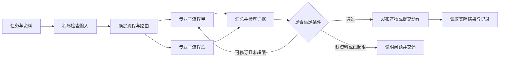

# 多 Agent 协作：设计方法论调研 v1.0

调研日期：2026-10-07（上海时间）。范围：先研究通用设计方法与统筹模式，不在本轮定稿声播三个阶段的实现，不安装框架、不写Agent代码。

## 1. 调研结论及证据范围

LangGraph 是需要显式状态、条件分支、可恢复任务和阶段子流程时的优先候选。是否最适合具体应用，需要在业务任务、模型兼容性和小型原型上验证。框架提供运行机制，不能代替任务拆解、证据设计和动作接口。

本次使用官方文档、厂商工程文章与研究原文。厂商案例说明特定系统的经验，不能作为所有场景的效果保证；论文结果也受任务、模型和实验条件限制。本轮没有实际运行或横向压测这些框架。

研究原文《Towards a Science of Scaling Agent Systems》当前v3于2026-04-08修订，比较多种架构，发现收益与任务结构相关，工具密集和顺序依赖任务可能付出较高协调成本。因此，评价应包含单Agent基线和总成本，不用Agent数量替代效果。[论文原文](https://arxiv.org/abs/2512.08296)

## 2. 先区分四个概念

| 概念 | 设计时要回答的问题 |
|---|---|
| 业务模块 | 哪一段业务由它负责，交付什么结果？ |
| 工作流 | 哪些步骤按已知顺序执行，什么条件决定下一步？ |
| Agent | 哪个部分需要模型根据证据动态选择查询、工具或行动？ |
| 框架 | 如何实现工具回合、状态、调度、恢复和观测？ |

一个业务模块可以由程序节点、模型节点与工具Agent共同构成；一个节点也可以只是字段检查。逻辑上的多个Agent可以使用同一家模型，不意味着必须多模型、多服务器或多套数据库。

固定步骤与模型自主决策的区别见[Anthropic基础模式文章](https://www.anthropic.com/engineering/building-effective-agents)和[LangGraph工作流说明](https://docs.langchain.com/oss/python/langgraph/workflows-agents)。前者最初发表于2024-12-19，适合参考基本模式；具体工具与SDK用本次当前官方文档核对。

## 3. 综合提炼的八步设计法

以下是结合资料形成的设计方法，不是某个框架宣称的统一标准。

### 第一步：确定任务成功的可观测结果

写清用户要获得什么，输入实际有哪些，成功如何验证，错误成本、延迟和费用限制是什么。区分能观测的结果与暂时无法观测的经营效果。

产物：任务定义、可用数据清单、硬性约束、评价集和简单基线。验证：至少能举出一个成功案例、一个失败案例，以及二者的判断依据。

### 第二步：画任务依赖图

逐项标出：先后依赖、可独立并行、按条件分流、失败后返回位置。按数据依赖决定顺序，不按“岗位名字”直接决定Agent数量。

产物：节点/依赖清单。验证：每个节点所需数据在执行前可获得；并行分支不依赖对方未完成的结果；汇总节点明确等待哪些必要结果。

### 第三步：判断哪里需要独立Agent

考虑拆分的理由：专门知识/工具很多；需要隔离上下文；任务可独立验证；工具权限明显不同；可并行处理；不同团队需要独立维护。

优先保留在同一模块的情况：只是字段检查或一次明确改写；上下文高度共用；步骤紧密依赖；拆分只增加消息往返。只有SOP或领域说明变化时，可以先用按需加载的Skill。

产物：每条Agent边界的理由，以及哪些保留为普通节点。验证：去掉该Agent后，是否出现可测的能力、上下文或维护问题。[LangChain的拆分动机](https://docs.langchain.com/oss/python/langchain/multi-agent)

### 第四步：选择协作模式

| 模式 | 适用条件 | 设计时的关键约定 |
|---|---|---|
| 顺序流程 | 后一步依赖前一步产物 | 每步有输入、输出与通过条件 |
| 并行后汇总 | 子任务彼此独立 | 分支各自产物，明确汇总和缺失处理 |
| 路由 | 输入类别决定不同处理路径 | 分类依据、兜底路径和误分流处理 |
| 主Agent调用子Agent | 子任务需要动态决定，并由中心汇总 | 委派范围、预算、结果返回和终止条件 |
| 控制权交接 | 专家要接管后续交互或处理 | 接管者、传递上下文、完成/交还条件 |
| 生成—评审—修订 | 有明确评价标准，修订有价值 | 评审证据、最多轮次、失败交付方式 |

这些模式可以嵌套；例如外层顺序流程，某一步内部并行查证，内容生成后限次修订。Skill是按需提供知识/指令的一种方式，本身不代表多一个执行者。

OpenAI官方文档明确区分“把Agent当工具调用”和“handoff后由另一Agent接管”，还区分模型统筹和程序统筹。这说明不同Agent交换结果与交接控制权需要分别设计。[官方编排说明](https://openai.github.io/openai-agents-python/multi_agent/)

### 第五步：设计每个Agent的信息范围与交接对象

每个Agent收到足以完成任务的资料；长期原文留在可检索存储中，不向所有Agent重复塞完整历史。共享的是经过定义的事实、引用和产物，私有的是该任务的工作状态与局部消息。

交接对象至少写明：任务ID、对象ID、版本、结果、证据、缺失/不确定项、当前状态和下一步。摘要需要保留证据定位，避免下游无法复核。模型返回一句“已完成”不能替代明确产物。

Anthropic研究系统说明了独立上下文及清晰委派的重要性；这是研究场景的经验，本方法只借鉴其边界与返回格式设计，不外推其性能数字。[工程案例](https://www.anthropic.com/engineering/multi-agent-research-system)

### 第六步：定义状态所有权与执行权限

至少区分：原始证据、工作草稿、已发布事实、实际执行记录。每种对象明确谁能写、谁只能读、是否需要确认。

并行结果先各自保存，由一个汇总节点合并；共享字段明确按ID合并、覆盖或拒绝冲突。会影响真实系统的动作由一个明确入口提交，不能靠Agent互相口头约定避免冲突。

检查点用于保存任务进度，不能替代业务数据库或动作账本；选择了内存检查点也不会自动获得重启恢复。[LangGraph持久化文档](https://docs.langchain.com/oss/python/langgraph/persistence)

### 第七步：设计反馈、失败与停止

动作先产生提案，验证条件后提交，读取环境结果再判断完成。每种工具明确“成功”是什么意思，例如写入成功、状态改变和声音播完是不同结果。

任务设最大回合、超时、费用或工具次数限制；缺数据、工具失败、等待确认、取消都有出口。重试真实动作时保持幂等标识，并核对是否已经执行；框架恢复不能代替外部接口的幂等设计。

LangGraph的interrupt可保存状态等待外部输入，但恢复时中断所在节点可能从头执行，因此副作用与确认节点的顺序需要专门设计。[官方中断机制](https://docs.langchain.com/oss/python/langgraph/interrupts)

### 第八步：用基线和消融验证复杂度是否值得

比较同一测试集下的规则/单次模型、单Agent带工具、拟定协作方案。尽量统一模型、工具、输入与计算预算；预算不同时分别报告。

评价至少包含：完成质量、事实/证据正确性、错误动作、端到端延迟、模型调用与token/费用、重复工作、恢复结果。删去一个Agent或评审循环再测，判断它究竟贡献了什么。

生成者与评审者可以同模型但用不同上下文；这不保证独立正确。事实问题仍须核对外部证据或程序基准；多数票不能把无依据说法变成事实。

## 4. 用LangGraph表达上述方法

| 元素 | 业务含义 | 不应混淆的地方 |
|---|---|---|
| State | 这项任务当前已知的信息与进度 | 不是把所有聊天历史合成一份全局记忆 |
| Node | 一个可执行步骤 | 不要求每个节点都是Agent |
| Edge / conditional routing | 下一步及进入条件 | 已知阶段可由程序决定，无需每次询问模型 |
| Parallel branches | 可独立执行的任务 | 仍需处理结果合并、冲突和超时 |
| Subgraph | 一个可独立封装的子流程 | 输入输出可与父图不同，需做适配 |
| Checkpointer | 中断/失败后可恢复的任务状态 | 不自动保证外部动作仅执行一次 |
| Interrupt | 等待确认或补充输入 | 恢复后要重新检查已过期的事实/状态 |

LangGraph的subgraph允许独立开发并通过输入输出接口组成父图。这直接支持“多个开发窗口各做一部分，最后接起来”的工作方式；开发并行与业务运行并行仍分别评估。[子图官方说明](https://docs.langchain.com/oss/python/langgraph/use-subgraphs)

一个通用组合示意：

这个图只是模式示意，不是声播架构定稿。对子流程乙的必要性、并行条件和修订依赖需按具体任务再定义。

## 5. 统筹应由代码还是Agent负责

| 情况 | 优先方式 | 理由 |
|---|---|---|
| 阶段与条件已知 | 程序/状态图 | 顺序与约束可直接检查 |
| 输入可稳定分成几类 | 程序分类或一次模型路由 | 不需要长期的总指挥对话 |
| 子任务数量/方向需边探索边决定 | 有预算的主Agent委派 | 动态规划有实际作用 |
| 多个专业结果需解释与权衡 | 模型汇总 + 程序/证据校验 | 解释需要语义判断，引用与权限仍可检查 |
| 改变真实系统 | 有限权限的执行入口 | 统一处理版本、重复提交、人工接管与结果核对 |

是否有总Agent与是否有统筹层是两件事。系统通常需要统筹机制，只有动态规划确实有价值时才需要额外的模型总Agent。以上是结合官方模式作出的工程判断。

## 6. 框架候选对比

这里比较的是设计表达能力，不是经过实测的速度、准确率或价格排名。

| 候选 | 官方机制 | 可考虑它的情况 | 本轮未验证 |
|---|---|---|---|
| LangGraph | 状态图、子图、检查点、中断 | 阶段/分支/恢复逻辑需要明确管理 | DeepSeek工具回合、本应用适配、延迟与维护成本 |
| OpenAI Agents SDK | Agent作为工具、handoff、程序编排 | 以Agent工具回合和专家交接为主要表达 | 本项目模型适配与长期任务行为 |
| CrewAI | Crews + 带状态的Flows，分支/事件/持久化 | 喜欢任务/角色组织并用Flow约束执行 | 本项目实时控制和具体依赖适配 |
| Google ADK | 图、动态、协作与模板工作流 | 需要对比多种流程表达或使用其生态 | 本项目模型适配、版本迁移和集成成本 |

机制依据分别见[LangGraph](https://docs.langchain.com/oss/python/langgraph/workflows-agents)、[Agents SDK](https://openai.github.io/openai-agents-python/multi_agent/)、[CrewAI Flows](https://docs.crewai.com/en/concepts/flows)、[ADK Workflows](https://adk.dev/workflows/)。CrewAI与ADK也有明确的工作流/状态设计，不能简单归类成只有角色自由聊天。

LangGraph优先候选的理由是对显式阶段、独立子图和执行恢复的设计表达合适；这属于针对预期需求的推断，最终选择应通过代表性任务原型验证。若最后任务很简单，普通Python流程也可以作为基线保留。

额外时效核对：LangChain当前子Agent文档说明`langgraph-supervisor`旧包已不再积极维护，并给出迁移方向。之后选型参考当前subagents/custom workflow文档，不直接照旧教程锁定该包。[当前官方说明](https://docs.langchain.com/oss/python/langchain/multi-agent/subagents)

## 7. 后续每份设计文档统一回答的十个问题

1. 它解决什么任务，什么可观测结果算完成？
2. 为什么需要独立Agent，哪些部分是普通程序或Skill？
3. 谁触发它，需要哪些输入，缺资料时怎么处理？
4. 它可以看到哪些上下文，资料与任务指令如何区分？
5. 可以调用哪些工具，有哪些只读/写入限制？
6. 输出什么结构化产物，证据、版本与状态如何表示？
7. 它与其他部分串行、并行、路由、委派还是交接？
8. 谁拥有共享状态，冲突、取消、重试如何处理？
9. 如何核对实际结果，什么条件下停止或交给人？
10. 对比什么基线，用哪些固定案例与指标证明价值？

交付给不同开发窗口时，先共同冻结这些接口与评价样本，再独立开发；统一的是输入输出与语义，不必把内部Prompt和全部私有状态设计成相同。

## 8. 本轮到此的判断

已完成方法资料检索与提炼。之前的声播三阶段方案保留为初稿，下一步应按本方法逐项复核：需要几个业务模块、实际需要几个Agent、哪些统筹由程序承担、什么数据必须先补、如何验收。当前不据此自动启动其他窗口或实施Agent。
