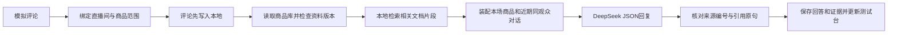

# 声播：评论测试台与本地持久化 v1.5

交付日期：2026-10-11。应用仍是现有本机网页应用，桌面“声播”快捷方式继续使用。

## 使用方法

1. 双击桌面的“声播”，点击左侧“评论测试台”；直播间卡片也有“评论测试”入口。
2. 在顶部选择配对直播间。它读取直播间已选择的商品编号，再读取共享商品库的最新资料。商品不另行复制到直播间。
3. 可以选定当前讲解商品，也可自动识别：单商品直接配对；多商品缺少明确对象时先询问，不随机选商品。同一模拟观众的后续问题可以延续本次测试中已确认的商品。
4. 输入模拟观众名和评论，发送后 DeepSeek 回复。Enter 发送，Shift+Enter 换行。页面刷新或关闭不会取消后端正在进行的请求。
5. 回答下面打开“查看检索依据”：查看文档名称、片段编号、原文行号、资料版本、更新时间、原文以及模型引用的原句。命中分数是检索排序分数，不是正确率。
6. 右侧“本场知识”显示可用文档，“回复规则”显示实际系统提示词。知识库资料修改后，点击“刷新商品资料”；每次新回答也会自动检查资料版本。
7. “新测试”创建新会话，不覆盖旧记录；下拉框可切回这个直播间的历史测试。“导出测试记录”导出本次会话和证据。
8. 点赞、进房的模拟按钮也移到这里。正式直播监控只显示事件和播放信息，不包含模拟输入控件。模拟评论会作为带有明确“模拟事件”标签的输入显示在监控中；AI 回答只在测试台展示，不发送到平台，也不自动插播。

## 商品知识文档

商品库编辑窗保留原来的“知识库 / 注意事项”，另外增加“独立知识文档”。可以手动新增带标题的文档，或导入 UTF-8 `.txt` 文本文件；例如物流政策、尺码说明、售后规则。每商品最多20份独立文档，每份1至15000字；文本文件不超过60KB。标题和内容随商品保存在共享商品库。

第一版支持文本资料，尚未实现 PDF/Word 附件解析、向量检索、图像识别或实时订单查询。原有知识库无需迁移即可检索。知识文档不会进入常规销售话术生成的提示词。

## 保存与恢复范围

| 内容 | 保存位置 | 重新进入时的行为 |
| --- | --- | --- |
| 商品、独立知识文档、话术与房间配置 | `runtime/library.sqlite3` | 按原编号恢复；房间引用共享商品库 |
| 已生成语音 | `runtime/room_audio/<room_id>/` 与数据库清单 | 保留并复用，不因为关闭页面重新合成 |
| 房间配置中选品、排序、音色等修改 | 自动写入数据库；浏览器本地草稿兜底 | 修改后约700ms自动保存；若关闭早于服务器确认，下次进入同一浏览器时恢复草稿并再次保存 |
| 评论事件与执行日志 | 数据库 `viewer_event`、`room_log` | 重建房间时加载最近120条，完整历史仍保留，可用“导出记录”获取 |
| 测试会话、评论、回答、引用与失败 | 数据库 `reply_session`、`reply_turn` | 每条评论先保存，再生成回答；重新进入加载同一会话 |
| 检索文档、片段、索引版本 | 同一数据库的 `rag_documents`、`rag_chunks`、`rag_manifest` 表 | 商品修改后事务性更新索引；旧回答保留当时检索的证据快照 |
| 未发送的测试输入、最后选择的会话 | 浏览器本地存储 | 同一浏览器重新打开恢复；已发送记录不依赖浏览器缓存 |

停止服务后不会自动恢复声音播放，重新开播由用户操作。未完成的模型请求在服务重启后标记为“已中断”，保留已有评论和检索记录，点击“重试回复”复用原记录。网络超时或模型格式错误同样可以重试，不伪造成功回答。

这里的持续保存指没有自动过期和自动清空；删除项目文件、数据库、语音目录或清理浏览器缓存，会影响对应内容。浏览器草稿与数据库各自承担不同的恢复范围。

## 回复核心的实现

采用固定“检索 → 生成”流程，没有引入额外多 Agent 或 LangGraph 依赖。业务范围与持久化由程序控制，模型只负责基于提供的原文组织主播回答。未来可将该模块作为运营 Agent 的回复工具。

本地检索实现为中文二字词 BM25，加上价格、尺码、物流、防滑、保养、售后等主题的关键词扩展。文档标题也参与匹配；按行切片，长行每350字取最多400字并保留50字重叠。默认最多取6个相关片段，再附上当前商品名称作为标明用途的基础上下文。这是关键词式 RAG，未调用 embedding 服务，也不宣称是向量检索。

范围控制先于召回：只读取当前房间引用的可用商品；选定商品后只用该商品检索。历史对话最多取同一测试会话、同一模拟观众已完成的前6轮。历史回答不作为新商品事实依据。多商品无法判断时，使用程序澄清，不调用模型猜测。

来源展示区分“已检索”和“模型引用”。服务器会验证引用编号来自本轮检索、引用原句能在片段中找到。引用通过不等于回答全部语义正确，因此页面明确保留人工复核说明。未确认的价格条件、退换、实时库存、物流承诺不会因模型工具能力而自动变成真实事实。

## 提示词调研及应用

研究采用官方资料，按场景编写实际提示词，没有照搬网上缺少事实约束的通用“金牌主播”角色模板。

- [DeepSeek JSON Output](https://api-docs.deepseek.com/zh-cn/guides/json_mode/)：设置 JSON 输出参数并在提示词提供格式示例；服务器仍需校验字段与引用，不把合法 JSON 等同于正确答案。
- [Anthropic 提示词实践](https://platform.claude.com/docs/en/build-with-claude/prompt-engineering/claude-prompting-best-practices)：参考明确任务、区分规则与资料、提供场景示例的做法；迁移到 DeepSeek 后用实际案例测试。
- [Anthropic 电商 Agent 指南](https://platform.claude.com/docs/en/about-claude/use-case-guides/commerce-agents)：借鉴商品价格、规格、店铺条款来自可靠数据入口的原则；本版不提供购物车、支付或平台写入工具。
- [Anthropic 减少幻觉指南](https://platform.claude.com/docs/en/test-and-evaluate/strengthen-guardrails/reduce-hallucinations)：参考对缺少依据的内容承认不确定、保留可核对原文的做法。

实际提示词保存在 `prompts/评论回复_当前.txt`，页面可直接查看。每条生成记录保存该提示词的摘要版本，便于后续比较。提示词以自然简短的普通话回答问题为先，适当建议，不强制每条促单；不得编造库存、包邮、售后条件、个人使用经历、截止时间或绝对安全保证。

## 验收记录

| 验证环节 | 标准 | 结果 |
| --- | --- | --- |
| Python 自动回归 | 新增检索、资料更新、范围隔离、重复发送、异步中断、重试、跨观众隔离等，同时保证原播报逻辑 | 115项通过，其中新增23项回复测试 |
| 前端保存逻辑 | 关闭前草稿、写入确认、旧响应不覆盖新修改、串行写入、草稿恢复、关闭时捕获 | 6项通过 |
| 原播放器回归 | 播出、打断与连接逻辑 | 5项通过 |
| 真实 DeepSeek 接口 | 价格、尺码、物流、防滑、未知退换、诱导编造、欢迎7类问题 | 最后一轮7/7完成；来源召回、编号与原句检查通过 |
| 网页实际操作 | 评论发送、查看来源、刷新恢复、配置自动保存、知识文档新增窗、监控无模拟输入、提示词查看 | 已实际操作验证 |
| 服务进程重启 | 旧会话及评论恢复，并可继续向模型提问 | 已重启并验证 |

真实接口做了两轮小样本测试。第一轮发现欢迎语主动提到商品特点却没有引用，补充提示词及检查；改进检索文档标题的匹配，并修复后台登记时机后，第二轮再次通过7个案例。人工阅读第二轮回答：107新台币没有变成人民币；宽脚建议保留“斟酌”；湿地安全问题保留提醒；未知退换和库存未直接承诺。样本仍小，指标只说明本次测试，不表示线上全部问题的正确率或真实成交效果。

测试输出：`docs/评论回复测试_v1.5/真实DeepSeek测试.json` 和同目录 `.md`，包含真实回答、检索来源与检查结果。原商品1件、话术14版、直播间2个均保留，未重置用户资料。验收留下一个可查看的测试会话及少量明确标记为模拟的事件。

本次还修复了评测脚本在 Windows 上未关闭 SQLite 副本连接导致临时目录清理失败的问题。最终运行正常结束。

## 后续接入时可复用的接口

| 接口 | 用途 |
| --- | --- |
| `GET /api/rooms/{room_id}/reply-knowledge` | 查看最新本场商品、文档、片段数量及提示词 |
| `GET /api/rooms/{room_id}/reply-sessions` | 列出本房间测试会话 |
| `POST /api/rooms/{room_id}/reply-sessions` | 新建绑定本房间的会话 |
| `GET /api/reply-sessions/{session_id}` | 读取已持久化的会话和各轮状态 |
| `POST /api/reply-sessions/{session_id}/comments` | 传入 `text`、`username`、可选 `product_id`、唯一 `request_id`，后台检索与回复 |
| `POST /api/reply-turns/{turn_id}/retry` | 重试失败或中断的原记录 |

同一会话同一时间只允许一个未完成回答。重复请求编号复用已存在的轮次，不重复调用或写入模拟事件。失败保留原评论和检索证据；重试按最新商品资料重新检索。

未来平台评论采集器应另做输入适配，回复核心与采集解耦。正式上线自动回复前，需要补上评论去重、按真实观众标识维护对话、超时丢弃策略、人工接管、回复频率控制，再决定哪些回答可以转成插播。不能直接把本测试接口当成真实平台发送接口。

知识量扩大时，建议用真实评论建立“问题—期望证据—正确回答”测试集，再根据召回失败决定是否加入向量与重排；当前版本不作语义检索覆盖率保证。
