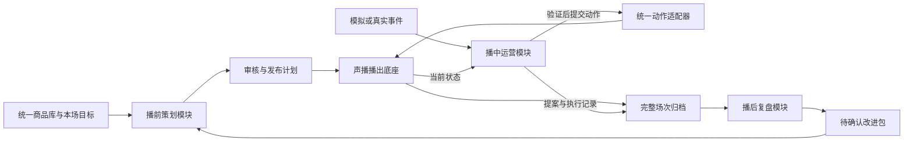

# 声播运营 Agent：播前、播中、播后拆分方案 v1.1

> 架构初稿：用户最新要求先研究协作方法，再回看本应用。现已补充[多Agent协作设计方法论调研](多Agent协作设计方法论调研_v1.0.md)；以下拆分、框架与任务包需按该方法评审后再作为实施依据。

日期：2026-10-07（上海时间）。性质：研发设计与并行交接，不代表已经实现。依据：现有声播代码、原《运营Agent构建报告_v1.0》及 LangChain / LangGraph 官方文档。本轮只写方案，不新增 Agent 代码，不改运行中的声播。

## 1. 决定与开发顺序

建议按三个业务模块开发：播前策划 Agent、播中运营 Agent、播后复盘 Agent。外面使用一个确定的流程统筹层，管理阶段、版本、任务和数据交接；首版不用另做一个会自主指挥的总 Agent。

三个模块独立输入、独立输出、独立存储，通过统一契约对接。是否三个进程部署可以后定，不应为了数量强制拆成三套基础设施。

| 模块 | 现在能否独立开发 | 独立运行方法 | 什么时候接声播 |
|---|---|---|---|
| 播前 | 可以 | 商品资料 JSON + 场次目标 → 计划、FAQ、问题清单和话术草稿 | 能稳定输出计划后，经适配器导入草稿、确认稿和房间配置 |
| 播后 | 可以 | 已结束场次的脱敏数据包；先用当前测试记录和明确标记的模拟用例 | 声播有完整场次归档后，换成真实归档输入 |
| 播中 | 决策部分现在可以；真实执行联调依赖播出底座 | 模拟事件 + 假状态/假工具 → 动作提案 | 动作语义、版本校验和回执归档完成后，接实际声音测试 |
| 统筹与播出适配 | 与前三者约定接口，由主项目维护 | 校验数据包、阶段、版本、权限，保存场次关系 | 所有写入声播的动作统一经过这里 |

“并行开发”不等于同一场的播前、播后同时产生正式结论。同一场仍是准备→开播→结束→复盘。运行时可以一边复盘上一场，一边准备下一场；当前场的阶段统计只能标为临时观察。当前声播同一时间只允许一个直播间播出，保留该限制。

并行开发的前置步骤是冻结接口契约和两份小样本，后续各模块用样本独立工作，不等待另一模块完成。

## 2. 回看原方案，需要改什么

| 原设计或现状 | 本次修订 | 原因 |
|---|---|---|
| 一个“运营副驾”，重心在播中答疑 | 拆成三个模块，播前与播后各自可验收 | 方便其他窗口独立开发；体现经营流程而不只演示插话 |
| 播前已有商品库与多版话术 | Agent 补资料诊断、结构策划、FAQ、计划、校验，不重写现有商品库 | 现有应用负责存储、生成和播放，Agent 负责选择、查证与调整 |
| 用当前状态/导出进行复盘 | 建立带完整性说明的场次归档 | `/api/export` 是各房间当前快照，不是完整历史场次数据库 |
| 旧工具表使用默认房间接口 | 新接入一律使用 `/api/rooms/{room_id}/state` 和 `/control` | 已有多个直播间配置，防止误操作默认房间 |
| 用 session_id、epoch 防止过期操作 | 队列另加 queue_revision，计划另加 plan_revision | 当前重排/替换待播列表不一定改变 epoch；epoch 不能覆盖全部计划冲突 |
| 长期记忆泛称“复盘经验” | 复盘输出改进提案，经确认后才更新下一场策略 | 单场、模拟数据或模型判断不能自动成为真实商品事实 |
| 等直播端全部完成才做 Agent | 播前、播后现在做；播中先假工具、后真实执行 | 减少串行等待，仍保留执行验证 |

代码复核补充：当前 `state.logs` 只保留最近 120 条，`played` 最多保留 1000 条，新场会重置已播列表。已有 `runtime/events.jsonl` 追加日志，但条目缺少完整 room_id/session_id、提案与动作参数关联，不能单独还原可靠的跨房间历史。需要增强现有记录，而非宣称完全没有落盘。

当前批准接口是人工确认加有限规则检查；fact_ids 存在也不能证明文字含义被事实支持。播前需另外做语义核查和可检查的证据引用，不能把现有确认按钮当成完整自动事实评测器。

## 3. 播前 Agent：资料核查与讲解策划

它的任务是将“商品资料 + 本场目标”转成可以审核和执行的开播准备包。不是让模型自行决定商品价格或猜测观众画像。

| 工作 | Agent 要做的判断 | 程序负责的部分 | 输出 |
|---|---|---|---|
| 资料诊断 | 哪些说法矛盾、过期、缺来源，哪些问题影响开播 | 字段/日期/币种/版本检查 | 必须补充与可留空的问题清单 |
| 讲解定位 | 从已有资料选择场景、核心价值、讲解角度 | 已知目标与约束传递 | 讲解简报，每个判断附来源或标注假设 |
| 话术编排 | 选择卖点、顺序、详略，多版应在哪些维度不同 | 分句、版本保存、不可变修订 | 开场→介绍→卖点→场景→规格/FAQ→优惠→引导的草稿 |
| FAQ 与回应边界 | 预计问题，区分能回答与需转人工的问题 | 事实引用有效性、答复模板约束 | 商品 FAQ、短回复、未知问题处理方式 |
| 本场播出计划 | 在用户给定商品及重点内安排顺序、版本和必讲点 | 检查引用、已确认状态、计划版本 | 计划草案及选择理由 |
| 内容检查与修订 | 检查无依据体验、夸大保证、重复、资料遗漏 | 价格/尺码等精确值比对，限制修订次数 | 逐条问题、修订记录、待确认稿 |
| 开播预检 | 解释为什么某项阻断或可继续 | 音色可用、声音来源、缓存、确认稿、资料版本检查 | ready/blocked/needs_review 与明确原因 |

例如当前拖鞋资料中的配送日期“9月21日—9月30日”不能直接用于10月7日的新场；原价178、活动价107必须保留 TWD，不能因为用普通话就变成人民币；没有库存就不能写“快没货”；没有促销结束时间就不能写“下播涨价”。原话术的6–10分钟只作体验参考，实测时长由 TTS 合成/播放结果产生。

首版不做：全网选品、自动核价、广告投放、无来源的人群画像、凭未知利润排序、自动批准整份新稿。跨商品的模板可以复用，具体事实必须各自查证。

建议内部是“查资料→诊断→策划→生成/选稿→检查→最多两轮修订→交给人确认”的图。资料检查、FAQ 和版本分析中互不依赖的任务可并行；不需要为每个节点创建一个自主 Agent。详细任务：[播前交接](运营Agent并行任务包/01_播前Agent任务.md)。

## 4. 播中 Agent：事件驱动的运营控制

它接收准备包、当前状态、问题事件，只处理当前场次，并通过声播动作执行。保留原方案的答疑、讲解调整和风险纠正三个 Skill。

流程：收集有限窗口事件→同类合并→查商品事实/本场已回答→选择不行动、建议或动作→验证→按模式确认→提交→检查真实回执→更新本场记忆。

第一闭环是句尾答疑；第二步加入“重复尺码问题→提前安排尺码讲解”；再考虑切换商品和替换已确认版本。立即打断用于明确需要的纠正，不能把每条普通弹幕都当成打断理由。

现有可用动作包括句尾/立即插播、跳句、重播、下一商品、切到后续已有商品、重排未播句子、同商品替换已确认版本、取消商品讲解、暂停/继续/结束。切商品仅控制讲解，不切平台购物车；立即插播后原句会从头重播；切到未来商品会跳过中间内容。这些效果必须在工具描述中写清。

同一房间只有一个动作提交入口。人工操作优先；人工切商品、暂停或结束后，旧提案重新验证，不继续执行。模型超时则保持原队列，播放器不等待模型。普通问题使用时间窗口，音频每次进度回报不触发一次 LLM。

当前为声音人应用，不需要补数字人视频才能开发播中 Agent。未来若接公司数字人，用能力清单约束：用户确认公司产品播中可插播，商品/脚本修改需播前完成。没有接口证据时不向它开放声播独有的实时重排等工具。

## 5. 播后 Agent：证据复盘与下一场改进

它读取已结束场次的数据包；程序先计算能计算的数，再让 Agent 查证、解释并提出改进。报告至少区分观察事实、原因假设、建议和验证方法。

| 工作 | 具体结果 | 数据不足时 |
|---|---|---|
| 重建实际时间线 | 商品/版本、实际播出、插播、取消、故障、人工接管 | 标记缺口，不用计划内容冒充实际播出 |
| 对照播前计划 | 必讲内容覆盖、漏讲、重复、顺序变化 | 不知道是否实际播完的条目标 unknown |
| 问题与答疑复盘 | 有记录问题的覆盖、等待、重复回应、无依据回答 | 只针对输入事件集，不外推所有观众 |
| Agent 执行复盘 | 提案、批准、接受、发声、完成、失败及耗时 | 只有HTTP成功时不能算播出成功 |
| 内容诊断 | 过长句、重复卖点、遗漏说明及可检查证据 | 只给内容/流程建议，不推断流失或转化原因 |
| 经营分析（有数据才启用） | 有效口径下的点击、订单等分段对比 | 无真实业务数据则该部分不启用；相关性不当作因果 |
| 下一场改进包 | FAQ补充、话术修订提案、排序建议、评测反例、实验计划 | 保留“待确认”，不自动覆盖商品事实或批准稿 |

例如实际已播记录证明尺码说明只在后半段，输入事件中较早出现三条尺码问题，可以建议下一场提前尺码说明，并用回放测“问题到回答耗时”；不能据此声称尺码说明导致观众离开或销量下降。

详细任务：[播后交接](运营Agent并行任务包/02_播后Agent任务.md)。

## 6. 统筹、LangChain 和 LangGraph 的位置

下面是本项目设计建议。官方文档区分固定路径的 workflow 与动态选择工具的 agent；LangGraph 适合在同一流程组合两者。本项目阶段顺序已知，适合固定的外层图，在策划、诊断、答疑和复盘节点中保留模型判断。[官方说明](https://docs.langchain.com/oss/python/langgraph/workflows-agents)

LangChain 负责模型、工具封装、结构化输出；LangGraph 负责阶段状态、子流程、恢复与可暂停的确认点。当前代码未安装或实现这些 Agent。DeepSeek 现有话术接口可复用其配置，但工具调用和结构化返回必须另做最小验证，不能因为话术生成成功就认为全部兼容。

三个阶段需要的上下文不同，分别维护，不共享一段无限增长的聊天记录。官方有子 Agent、路由、Skills、自定义工作流等模式；本项目选自定义流程与阶段子图，不要求三个 Agent 自由对话，也不额外套一个 supervisor 模型。[官方模式比较](https://docs.langchain.com/oss/python/langchain/multi-agent)

建议用 plan_id 标识播前任务，用 session_id 标识实际开播，用 review_id 标识复盘任务；thread_id 分别绑定这些任务，并保存映射。Checkpointer 保存任务运行状态；商品事实仍以统一商品库为准，跨场偏好/已确认SOP放单独存储；完整播出档案与动作账本不能只依赖图的检查点。[官方持久化说明](https://docs.langchain.com/oss/python/langgraph/persistence)

确认点可采用 LangGraph interrupt。恢复时节点前部可能重跑，所以确认前不执行插播等副作用，实际提交始终带稳定 action_id，并查询执行账本防重复。等待确认时直播继续；提案需有有效期，超期后作废或重新读取状态。[官方中断说明](https://docs.langchain.com/oss/python/langgraph/interrupts)

## 7. 统筹规则与接口

统筹层负责准备、审核、开播映射、结束封存、复盘和下一场改进发布。准备包发布后冻结引用；播出时只认绑定到本场的版本；结束后复盘包冻结，后到的业务数据形成新的复盘修订。

共享四种产物：PreparationBundle、NormalizedEvent/ActionRecord、SessionArchive、ReviewBundle。完整字段、读写边界、当前API映射与待补入口见[统一接口约定](运营Agent并行任务包/00_统一接口约定.md)。首版使用本地 JSON 文件交接即可，后续用HTTP替换运输层，业务结构保持兼容。不需要先上消息队列、向量库或分布式平台。

Agent 不直接改 `runtime/library.sqlite3`，不修改另一个模块的运行库。播前产出草案，由主项目适配器导入；播后只产出改进提案；播中实际操作由唯一动作网关提交。统一商品库的商品是唯一业务来源，事实快照只是可追溯的历史证据。

声播主项目接下来需要补的底座能力：

1. 场次归档：room/session/plan、版本快照、事件、动作和实际播出逐条落盘，标记缺口与完整性。
2. 动作账本：event/proposal/action/execution/attempt的对应、接受/开始/完成/取消/失败/未知状态；接收成功不等于发声成功。
3. queue_revision 与准备包导入检查：防止基于旧队列或旧资料提交；避免部分写入就成为可开播计划。
4. 能力清单：当前声播支持哪些动作；接公司数字人时哪些不支持。不得悄悄把不支持的动作改成另一动作。

当前 `action_id` 去重是内存中的近期记录；`expected_session_id`、`expected_epoch` 已有，但为可选参数。Agent适配器应强制传递适用条件；持久账本才能覆盖重启后的结果核对。

## 8. 并行分工和交付边界

| 开发窗口 | 独占内容 | 可读取 | 不应修改 | 第一批交付 |
|---|---|---|---|---|
| 播前窗口 | 独立项目 `D:\Codex project\shengbo-prelive-agent`（建议，尚未创建） | 契约、商品样本、旧方案 | 声播 server/UI/数据库、播后代码 | CLI或简单页面、准备包、问题清单、固定评测与README |
| 播后窗口 | 独立项目 `D:\Codex project\shengbo-postlive-agent`（建议，尚未创建） | 契约、历史测试JSON、模拟场次 | 声播 server/UI/数据库、播前代码 | 导入→时间线→报告→改进包、固定评测与README |
| 声播主窗口 | 现有 `ecommerce-voice-agent` | 两模块输出与测试集 | 不代替外部模块维护其逻辑 | 归档/账本/版本、适配器和播中联调 |

先由各窗口确认契约可用；发现缺字段只提交提案，由主窗口统一更新契约版本，不能两边各自默默改同名字段。独立启动端口不得占用声播8765；首版CLI或文件接口优先。

播前CPU/文本分析和播后离线分析可并行；现有声播在直播时禁止音频预生成，避免抢插播资源，仍保留这一约束。其他窗口不绕过它调用大批量TTS。

## 9. 分阶段验收

以下是计划门槛，不是本轮实测结果。

| 阶段 | 验收方法 | 门槛 |
|---|---|---|
| 契约冻结 | 同样本在两个模块解析；未知字段、缺必填项、错场次反例 | 必填与引用检查全部通过；模拟/真实/未知明确区分 |
| 播前独立验收 | 三款演示商品、至少20个正常/缺失/冲突/过期/未知库存案例 | 关键价格/币种/尺码零错误；引用存在率100%；固定高风险反例全部检出 |
| 播后独立验收 | 完整/不完整/重复/乱序/无事件/无订单/重复循环等至少15例 | 可计算统计与程序基准一致；缺失不记0；发现引用存在率100%；无数据不输出转化结论 |
| 播中旁路验收 | 模拟事件和假工具，至少20例 | 错商品/过期动作/重复动作等关键反例零误提交；记录不行动原因 |
| 实际声音联调 | 30个动作案例，观察真实playing/ended和异常恢复 | 不误场次、不播未确认稿、不重复执行；每次结果可追踪，超时标unknown |
| 三阶段闭环 | 准备包→开播→事件/动作→归档→复盘→新准备包 | 全链路ID与版本对应；改进只在确认后进入新场 |

人工内容评价单独看自然度、版本差异、问题价值和建议可执行性，每项1–5分，先校准再确定门槛；不能用一个总分掩盖关键事实错误。评价人可以先由项目作者担任，之后再找真实商家试用，报告中区分评价来源。

## 10. 可复用的既有研究

原报告中的开源参考继续保留，但按职责归位：Sparklive 的有限窗口/事件ID校验用于播中；ai-livestream-review 的工具证据与提交校验用于复盘；LiveStream-Agent-Studio 的时间线分段只作复盘结构参考，不继承未经验证的经营评分；RealtimeTTS 继续作为声播底座。播前目前没有已验证的现成开源模块可直接接入，优先用现有生成能力和图节点补齐策划与核查。

这些参考尚未完成与新三阶段架构的集成，本轮不重新宣称其当前功能、许可或可直接运行。后续实际复用时再核对原报告中的源码快照、具体LICENSE与依赖。

## 11. 本轮设计自检

- 播前、播后可以无直播端独立运行；播中有模拟适配器路径。
- 统一商品库保持唯一来源；房间和计划只引用，历史快照用于证据。
- 旧API、当前已有能力和拟新增契约分别标明。
- 当前快照截断、追加日志缺关联、队列版本缺失都进入主项目待办。
- 价格/事实/时间/业务数据缺失有处理方法；没有把模拟数据当作经营结果。
- 无Agent代码、框架安装或声播行为变更；其他窗口任务尚未自动创建或发送。
